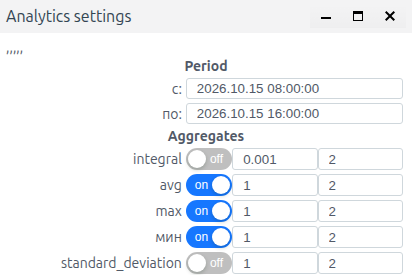
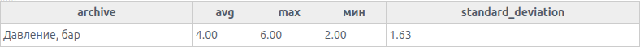
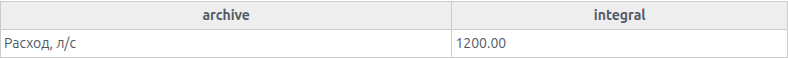

# Aggregates: calculating and exporting indicators

## About the module

Aggregates calculate indicators from stored history over a selected interval: average, minimum, maximum, integral, and standard deviation. Use them to prepare shift results, estimate volume from flow, and produce hourly summaries. «Аналитика» (Analytics) calculates indicators for one period; «Экспорт аналитики» (Export analytics) produces a file with results for consecutive intervals.

An aggregate is not a separate archive source type. History preparation is described in [Archives: configuring sources and recording data](./Archives.md); chart selection and ordinary chart data export are covered in [Trends: viewing and exporting history](./trends_en.md).

The screenshots show the Russian interface. Russian button and field labels are retained below with English explanations so that you can match the instructions to the screen.

## Before calculating

Open a trend with a direct archive series. Check that history exists for the required time and that you know the source units. Select the historical period and pause the chart so that the window stays fixed during the check.

The examples use pressure in bar and flow in L/s. The history is for training; local time is Asia/Almaty, UTC+5. The result depends on the boundaries, function, multiplier, and data completeness; check these parameters together.

«Аналитика» opens Analytics settings. Period contains the «с:» (From) and «по:» (To) fields; Aggregates lists the functions. To change a date and time, open the field's calendar. The multiplier and precision fields are to the right of each function toggle. Enable the required functions, check their parameters, and click «ОК». Results open in Analytics: rows correspond to series and columns to the selected functions. You must enable the functions again each time you reopen the settings.

## Functions and result meanings

| Function | Calculation | Result units | Gaps and other details |
| --- | --- | --- | --- |
| avg | Average weighted by value duration | Signal units | Accounts for the duration of numeric segments |
| min, shown as «мин» in the Russian form | Minimum numeric value | Signal units | A missing segment does not become zero |
| max | Maximum numeric value | Signal units | A missing segment does not become zero |
| integral | Area under the stepped signal | Before applying the multiplier: signal units × ms | Gaps make no measured contribution |
| standard_deviation | Time-weighted standard deviation | Signal units | Calculated over numeric segments |
| Positive integral, with a name ending in integral_pos | Area of positive segments only | Before applying the multiplier: signal units × ms | Zero is not guaranteed when there are no positive segments |

### Time-weighted average

In stepped history, each value remains in effect until the next change. The average is the sum of values multiplied by their durations, divided by the total duration of numeric segments. Infrequent recording of an unchanged signal does not reduce its contribution.

This differs from averaging the latest five polls in the vibration script in the archive guide. A time-weighted average depends on duration; a sample average depends on the contents of the window.

### Boundaries, gaps, and quality

The calculation interval includes its start and excludes its end: [start, end). The previous known value may remain in effect from the start of the selected period.

A gap is not zero. The average is calculated over the time for which numeric values exist; the result does not confirm that data is complete for the whole period. An integral over incomplete history does not establish the physical volume during the missing time.

Standard functions do not discard a numeric value solely because of its quality code. If invalid measurements must be excluded, agree on a validity rule when preparing the source history.

## Pressure over a shift

Task: calculate the average, maximum, and minimum pressure for October 15, 08:00–16:00. The source is PressureArchive, with the caption «Давление, бар» (Pressure, bar).

1. Open the direct pressure series, pause the chart, and set 08:00–16:00.
2. Click «Аналитика» (Analytics).
3. In Analytics settings, check «с:» (From) and «по:» (To).
4. Enable avg, max, and «мин». Leave the multiplier at 1 and precision at 2 for each function.
5. Click «ОК». In Analytics, check the «Давление, бар» row: avg 3.44, max 6.00, мин 2.00.

*Figure 1. Shift period with avg, max, and «мин» enabled; each function has multiplier and precision fields on its right.*

### Manual verification

| Shift segment | Pressure, bar | Duration, min |
| --- | --- | --- |
| 08:00–08:10 | 2 | 10 |
| 08:10–08:20 | 4 | 10 |
| 08:20–08:30 | 6 | 10 |
| 08:30–10:00 | 3 | 90 |
| 10:00–12:00 | 3.5 | 120 |
| 12:00–14:00 | 4 | 120 |
| 14:00–16:00 | 3 | 120 |

The weighted sum is 1650 bar·min and the duration is 480 minutes. The average is 1650 / 480 = 3.4375 bar; a precision of 2 displays 3.44. The minimum and maximum are 2 and 6 bar.

For a shorter check in the same scenario, select 08:00–08:30. Values of 2, 4, and 6 each remain in effect for ten minutes, so avg = 4, min = 2, and max = 6. Enabling standard_deviation additionally gives 1.63.

*Figure 2. Reference results for 08:00–08:30: average 4, maximum 6, minimum 2, and standard deviation 1.63.*

Precision controls the result format; it does not change source history. Analytics uses a decimal point in its results table.

## Water volume from flow

Task: determine the water volume over ten minutes using FlowArchive. The source unit is L/s; flow is 2 throughout the interval.

1. Open the direct «Расход, л/с» (Flow, L/s) series, pause the chart, and select October 15, 08:00–08:10.
2. Click «Аналитика» (Analytics) and check that Period has the same boundaries.
3. Enable integral. To the right of the toggle, check that the multiplier is 0.001 and precision is 2.
4. Click «ОК». The integral column should show 1200.00.

*Figure 3. Integral for 08:00–08:10: a constant flow of 2 L/s gives a volume of 1200 L.*

Manual check: 10 minutes = 600 seconds; 2 L/s × 600 s = 1200 L. The original integral uses time in milliseconds, so a multiplier of 0.001 converts the result to liters. A different source flow unit requires the corresponding conversion.

The result unit is liters. The row caption «Расход, л/с» continues to describe the source signal: Analytics has no separate column for the result unit.

The training configuration also provides a function whose name ends in integral_pos: the integral of positive segments. For the same positive flow, with a multiplier of 0.001 and precision of 2, it returned 1200.00, matching ordinary integral. Available additional functions depend on the project. A numeric zero is not guaranteed when no positive segments exist.

## Hourly summary

Task: export the average flow for each hour of the selected day. The example covers one day: October 15, 2026, 00:00 to October 16, 00:00, in Asia/Almaty, UTC+5. The training FlowArchive is 2 L/s throughout all 24 hours.

1. Open the direct «Расход, л/с» (Flow, L/s) series, pause the chart, and set the day boundaries.
2. Click «Экспорт аналитики» (Export analytics). Aggregates settings opens.
3. Set format to .xlsx. Set step to «Час» (Hour) and steps number to 1.
4. After changing the step, check Period again: «с:» (From) 2026.10.15 00:00:00, «по:» (To) 2026.10.16 00:00:00. Restore these dates using the calendar if necessary.
5. Leave direction at vertical and split datetime off.
6. For «Расход, л/с», select avg, a multiplier of 1, and precision of 2. Click «ОК» and save the downloaded file.
7. Repeat the export using .csv with the same settings. Open the files and check the 24 results and the first and last timestamps.

*Figure 4. Hourly summary settings: one day, Час (Hour) ×1, avg, multiplier 1, precision 2.*

When the unit and multiplier change, the interface normalizes the period end. In the check, an intermediate step of «Час ×10» (Hour ×10) extended the end to October 16, 06:00. Subsequently selecting ×1 does not remove the need to check the dates: verify the final boundaries before clicking «ОК».

### Reading summary rows

datetime is the end of the calculation interval. The first row, 01:00, refers to the hour [00:00, 01:00); the last row, 00:00 on the following day, refers to [23:00, 00:00).

| datetime | Расход, л/с (Flow, L/s), avg function | Interval |
| --- | --- | --- |
| 2026-10-15 01:00:00 | 2.00 | Oct 15, 00:00–01:00 |
| 2026-10-15 13:00:00 | 2.00 | Oct 15, 12:00–13:00 |
| 2026-10-16 00:00:00 | 2.00 | Oct 15, 23:00–Oct 16, 00:00 |

The CSV contains the headers datetime and «Расход, л/с», followed by 24 rows with the value 2.00. The XLSX contains Sheet1, range A1:B25: a header and 24 rows; time is stored as text and values as the number 2. In XLSX, the number of visible decimal places also depends on the cell format.

File timestamps have no time zone offset; in this example, they correspond to UTC+5.

The absence of a row labeled 00:00 at the start of the day does not mean the first hour is missing. Its result is in the 01:00 row. For days with a UTC offset change, check the actual period duration separately.

## Settings reference

### Analytics for one period

| Field | Purpose | Type / unit | Required | Default | If blank | Constraints |
| --- | --- | --- | --- | --- | --- | --- |
| Period: с / по (From / To) | Calculation interval | Date and time | Yes | Chart period | Select boundaries | Check the time zone |
| Function on/off | Select an indicator | on/off | At least one | off | No indicator selected | Enable again when reopening |
| Multiplier | Convert the result | Number | Yes | 0.001 for integrals; 1 for other functions | Keep the initial value | Align the units |
| Precision | Decimal places | Integer | No | 2 | Leave 2 | Result format |
| ОК | Run the calculation | Command | Yes | — | — | After selecting functions |
| Отмена (Cancel) | Close settings | Command | No | — | — | No new calculation |

Use a decimal point in multiplier fields: 0.001. After selecting a function, check the multiplier even if the interface fills it in automatically.

### Analytics export

| Field | Purpose | Type / unit | Required | Default | If blank | Constraints |
| --- | --- | --- | --- | --- | --- | --- |
| format | Output type | .xlsx / .csv / .xml / preview | Yes | .xlsx | Select a format | preview does not download a file |
| Period: с / по (From / To) | Overall period | Date and time | Yes | From the chart | Select boundaries | End is normalized to the step |
| step | Interval unit | Секунд / минута / Час (Seconds / Minute / Hour) | Yes | минута (Minute) | Keep the unit | Check dates after changing |
| steps number | Step multiplier | Integer | Yes | 10 | Enter a number | Must be > 0 for a summary |
| direction | Time layout | vertical / horizontal | Yes | vertical | Leave vertical | Rows / columns |
| split datetime | Separate date and time | Checkbox | No | Off | Combined datetime | Tested with vertical |
| Aggregates: series function | Indicator for each interval | Selection | For every series | avg | Select a function | Available functions depend on the project |
| Series multiplier | Unit conversion | Number | Yes | 1 for avg | Keep the initial value | For an integral, check 0.001 |
| Series precision | Result decimal places | Integer | No | 2 | Leave 2 | XLSX stores a number |
| ОК / Отмена (Cancel) | Run / close | Commands | As needed | — | — | Check settings before ОК |

vertical places time in rows; horizontal places it in columns. In this example, the horizontal preview shows one series row and 24 hourly columns.

With vertical, enabling split datetime creates separate «Дата» (Date) and «Время» (Time) columns alongside the series values. Check the checkbox again after changing direction: switching direction cleared it during the check.

Reopening Aggregates settings restores the initial format, step, layout, and function. For a repeated export, set Час (Hour) ×1, the required format, function, and layout again; check the period in «с:» and «по:».

| Format | Contents | How to obtain it | Details |
| --- | --- | --- | --- |
| XLSX | Table of indicators by interval | format .xlsx → ОК | Time as text, values as numbers |
| CSV | The same summary as text | format .csv → ОК | UTF-8 without BOM, TAB, CRLF; timestamps to the second |
| XML | Summary rows and columns | format .xml → ОК | rows / row / column structure; values as text |
| preview | Table in the interface | format preview → ОК | Check contents before downloading |

For this example, CSV and XML contain the same timestamps and the text 2.00; XLSX contains numerically equivalent values of 2. The vertical preview confirmed the same 24 intervals. Choose the format for your subsequent processing, retaining information about the function, period, and units.

### Custom functions

In Studio, open «Меню» (Menu) → Aggregates. This editor is for custom Erlang functions available in project analytics.

1. Make the required text changes.
2. Click Compile and read the result. A successful check shows OK and enables Save.
3. If errors or warnings are displayed, correct the indicated locations and run Compile again.
4. Save the prepared changes using Save.
5. Reopen the function list in analytics and check the result against known history.

Save is unavailable when compilation errors exist. Check the calculation formula separately using reference values and intervals. To discard edits, exit without Save; if the interface prompts you, confirm that you want to discard the changes.

| Action | Purpose | Available when | Result |
| --- | --- | --- | --- |
| Edit text | Configure custom functions | Editor is open and permissions allow it | Unsaved edit |
| Compile | Check the prepared text | Editor is open | OK or diagnostic messages |
| Save | Save project functions | After successful Compile | Saved settings |
| Exit without Save | Discard edits | Editor is open | Original saved text |

A script source is configured in the archive's own form. Functions in Aggregates calculate indicators from history that has already been stored.

## Diagnostics

| Observation | What to check | How to verify |
| --- | --- | --- |
| No results | History exists and a function is enabled | Use a short, known period |
| Average differs from the average of records | Value durations and gaps | Weighted sum / duration with numeric values |
| Volume differs by a factor of 1000 | Flow units and integral multiplier | For 2 L/s over 10 minutes: 1200 L |
| Result appears rounded | Precision field | Increase decimal places if needed |
| An indicator exists despite incomplete history | Gaps within the period | Inspect the source trend |
| Unexpected summary row count | Final boundaries, step, and time zone | Check the first and last intervals |
| File date differs from history date | Filename and timestamp rows | Check the contents |
| Custom function is unavailable | Save status and compilation result | Reopen the function list |
| Save is unavailable in the editor | Compile result, errors / warnings | Correct the text and obtain OK |

The ordinary «Сохранить в .csv» (Save to .csv) command exports chart data. For an hourly summary, use «Экспорт аналитики» (Export analytics) and explicitly set the function and step. The same file format does not imply the same contents.
