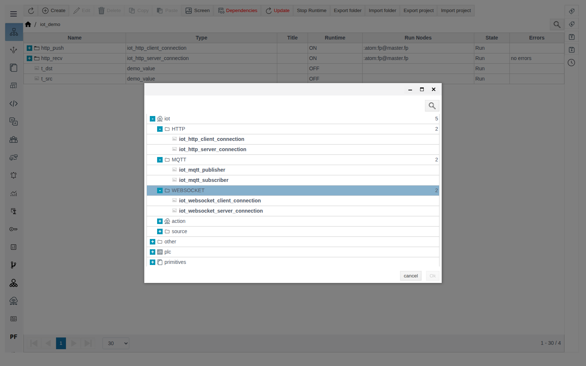
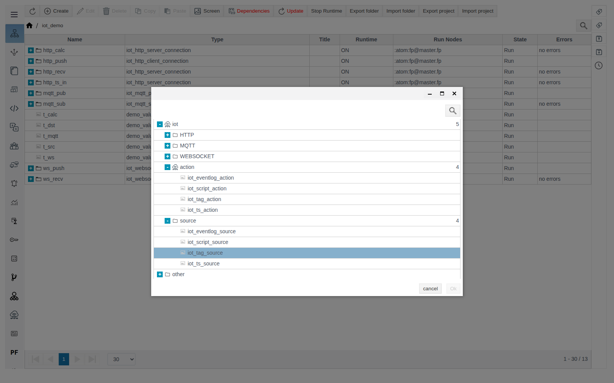
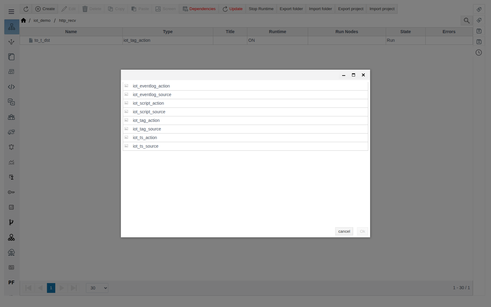
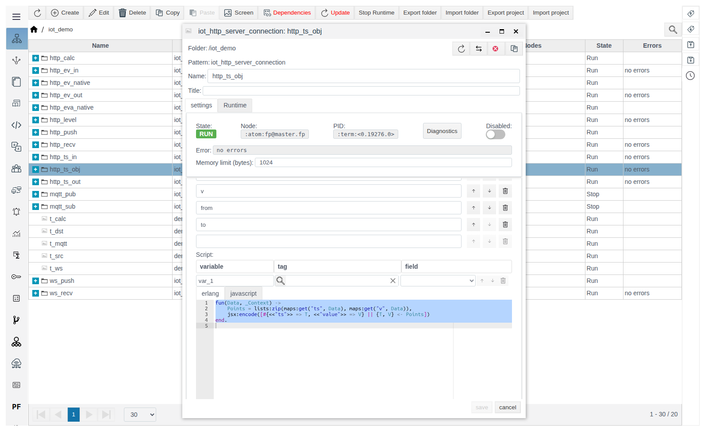
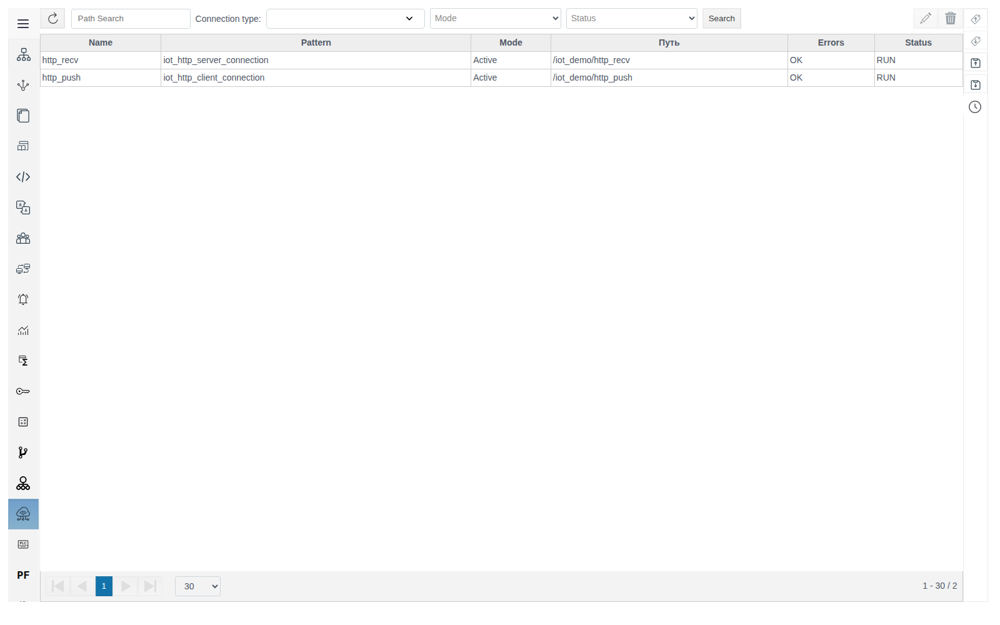
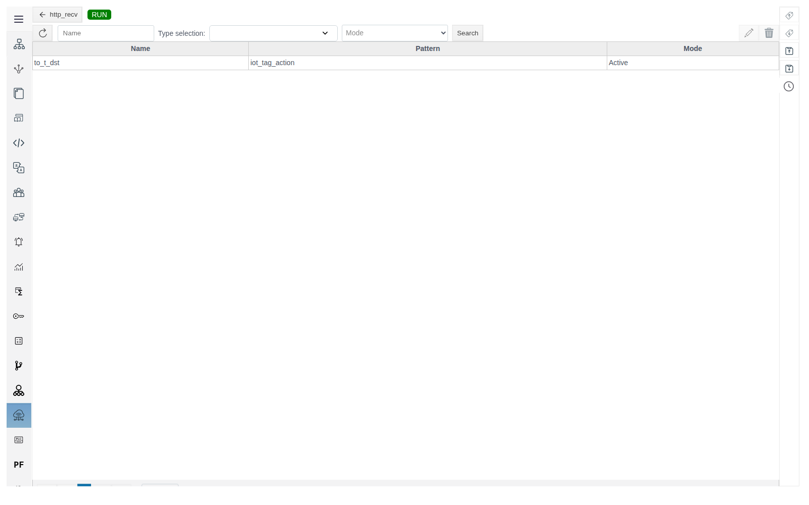

# IoT connections

A guide for the integration engineer who sets up data exchange between FACEPLATE and external systems over HTTP, MQTT and WebSocket.

# Contents

- [Glossary](#glossary)
- [Introduction](#introduction)
- [Main part](#main-part)
    - [Module contents](#module-contents)
    - [Roles and variables](#roles-and-variables)
    - [How sources and actions are linked to a connection](#how-sources-and-actions-are-linked-to-a-connection)
    - [Creating a connection](#creating-a-connection)
    - [Message format](#message-format)
    - [Triggers](#triggers)
    - [IoT connections tab](#iot-connections-tab)
    - [Diagnostics](#diagnostics)
- [Conclusion](#conclusion)

# Glossary

| Term | Meaning |
|---|---|
| IoT connection | A project object of one of the six types from the **HTTP**, **MQTT**, **WEBSOCKET** groups. It runs in Runtime as a separate process and is a folder: its sources and actions live inside it |
| Client role | The connection starts the exchange itself: on a timer, on a tag change or manually |
| Server role | The connection waits for an incoming message and processes it |
| Connection variable | A name from the **Data** list on the **Request & Response** tab. Variables link the message template to sources and actions |
| Source | An object from the **source** group inside a connection. Fills variables of the outgoing message |
| Action | An object from the **action** group inside a connection. Receives variables of the incoming message and writes them to tags or an archive |
| JSON template | JSON text with `$name` variables in place of values |

# Introduction

IoT connections exchange data with external systems over HTTP, MQTT or WebSocket — for example, with a cloud platform, a web service, a gateway or another application. For MQTT, the external system is a broker: FACEPLATE publishes messages to it or subscribes to its topics. Equipment with industrial PLC protocols is not connected through IoT connections. FACEPLATE can act as a client (it sends data or polls a service itself) and as a server (it accepts data that the external system sends).

Every connection works the same way:

1. The **Request & Response** tab sets the message format and the **Data** list of variables.
2. Sources inside the connection supply values to variables of the outgoing message.
3. Actions inside the connection write variables of the incoming message to tags or an archive.

All examples live in folder `iot_demo`. It contains `demo_value` tags with a numeric field `value`: `t_src` (value `21.5`), `t_dst`, `t_mqtt`, `t_ws`, `t_calc`. The HTTP and WebSocket examples run inside one FACEPLATE without external systems; the MQTT example needs a broker.

Each type is described in a separate guide of this section:

- [HTTP connections](http.md)
- [MQTT connections](mqtt.md)
- [WebSocket connections](websocket.md)
- [Sources](sources.md)
- [Actions](actions.md)

You need access to Studio (`http://<server>:9000/fp/studio`) with an account that is allowed to modify the project.

# Main part

## Module contents

When you create an object in **General View**, the **iot** group of the type selection dialog contains:

| Group | Type | Role | Purpose |
|---|---|---|---|
| **HTTP** | [`iot_http_client_connection`](http.md#iot_http_client_connection) | Client | Sends an HTTP request and parses the reply |
| | [`iot_http_server_connection`](http.md#iot_http_server_connection) | Server | Accepts HTTP requests on a path and replies |
| **MQTT** | [`iot_mqtt_publisher`](mqtt.md#iot_mqtt_publisher) | Client | Publishes messages to a broker topic |
| | [`iot_mqtt_subscriber`](mqtt.md#iot_mqtt_subscriber) | Server | Receives messages from a broker topic |
| **WEBSOCKET** | [`iot_websocket_client_connection`](websocket.md#iot_websocket_client_connection) | Client | Connects to a WebSocket server and exchanges messages |
| | [`iot_websocket_server_connection`](websocket.md#iot_websocket_server_connection) | Server | Accepts WebSocket connections |
| **source** | [`iot_tag_source`](sources.md#iot_tag_source) | Source | Tag field values |
| | [`iot_script_source`](sources.md#iot_script_source) | Source | Script result |
| | [`iot_ts_source`](sources.md#iot_ts_source) | Source | Archive values |
| | [`iot_eventlog_source`](sources.md#iot_eventlog_source) | Source | Event log records |
| **action** | [`iot_tag_action`](actions.md#iot_tag_action) | Action | Writes to tag fields |
| | [`iot_script_action`](actions.md#iot_script_action) | Action | Processes with a script and writes to tags |
| | [`iot_ts_action`](actions.md#iot_ts_action) | Action | Writes a series to an archive |
| | [`iot_eventlog_action`](actions.md#iot_eventlog_action) | Action | Creates event log records |



Connections can be created in any folder. Sources and actions can be created only inside a connection: in a regular folder the **source** and **action** groups are visible, but **Ok** is unavailable for their types.



Inside a connection, the type selection dialog shows only the eight source and action types.



## Roles and variables

What **Request** and **Response** mean depends on the connection role:

| | Client role | Server role |
|---|---|---|
| **Request** | The message FACEPLATE sends. Sources fill the variables from **Data** | The message FACEPLATE receives. Actions receive the variables from **Data** |
| **Response** | The external system's reply. Actions receive the variables from **Data** | FACEPLATE's reply to the incoming message. Sources fill the variables from **Data** |

- The **variable** drop-down of a source or action offers only the variables of the matching **Data** list.
- If that **Data** list is empty, the sources or actions of that side are not executed.
- MQTT has no reply: the **Request & Response** tab contains only **Request**.

## How sources and actions are linked to a connection

A source or action with only a **Name** does nothing. It starts working once a connection variable is selected in it together with where its value comes from or goes to. Order:

1. In the connection, on the **Request & Response** tab, set **Type** and list the variables in **Data**. For **JSON**, put the same variables into the template with `$`. Save the connection.
2. Double-click into the connection: the path above the table must end with the connection name. Create the source or action.
3. In the binding row, select **variable** — the list contains the variables from **Data** of step 1. Then select **tag** with the magnifier button and **field**.
4. Save and check the exchange.

Example — server `http_recv` writes the temperature from the request to tag `t_dst`:

| Where | What to set |
|---|---|
| `http_recv`, **Request** | **Type** `JSON`, **Data** `t`, template `{"temperature": $t}` |
| `http_recv` → `to_t_dst` (`iot_tag_action`) | `t` — `/iot_demo/t_dst` — `value` |

Request `{"temperature": 23.4}` → variable `t` = `23.4` → action `to_t_dst` writes `23.4` to `t_dst.value`. Full setup — in [`iot_http_server_connection`](http.md#iot_http_server_connection).

If the **variable** list is empty, the **Data** list of the matching side has no variables or the connection is not saved (see the table above: on a server, actions take variables from **Request** and sources from **Response**; on a client, the other way round).

## Creating a connection

1. Open **General View** and double-click into the folder for the connection.
2. Click **Create**, expand **iot**, then **HTTP**, **MQTT** or **WEBSOCKET**, select the type and click **Ok**.
3. Fill in **Name** and the tab parameters, then save.
4. Double-click into the connection and create its sources and actions.

The connection starts right after it is saved. To stop the exchange without losing the settings, turn on **Disabled**. A source or action is switched off with **Off**.

If a source or action cannot be prepared (for example, a binding refers to an object that does not exist), the whole connection stops: **State** `STOP`, the error text in **Error** and in the **Errors** column of General View.

The top panel of the form is the same for all connections:

| Field | Meaning |
|---|---|
| **State** | `RUN` — the connection process is running, `STOP` — it is not |
| **Node**, **PID** | FACEPLATE node and process identifier |
| **Disabled** | Stop the connection and keep its settings |
| **Error** | Text of the last exchange error; `no errors` if there is none |
| **Memory limit (bytes)** | Memory limit of the connection process |
| **Diagnostics** | The connection process log (see the [Diagnostics](#diagnostics) section below) |

## Message format

On the **Request & Response** tab, each message has a **Type**:

| Type | Outgoing message | Incoming message |
|---|---|---|
| **Const** | Fixed text from the **Text** field | Content is not parsed, no variables |
| **JSON** | JSON built from the template with variables replaced by values | JSON is parsed against the template, values go to variables |
| **Script** | An Erlang or JavaScript function returns the message text | A function parses the message and returns a map of variables |

### JSON template

```json
{
  "temperature": $t,
  "pressure": $p
}
```

- Add every template variable to **Data**.
- The editor marks `$t` as a JSON error. This does not affect saving or operation.
- An incoming JSON must contain every key of the template; extra keys are ignored. If a key is missing, the message is rejected with `{invalid_parse_request_result,false}`.
- An array in an incoming JSON is parsed with `$$`: the template `{"items": [$$ {"v": $v}]}` applied to `{"items": [{"v": 1}, {"v": 2.5}]}` gives `v` = `[1, 2.5]`.
- A variable holding a list in an outgoing template (`{"got": $v}`) becomes a JSON array (`{"got": [1, 2.5]}`).

> **Important.** `$$` in an outgoing template (for example, `[$$ {"x": $v}]`) causes a processing error. Build an array of objects in an outgoing message with a script — see the example in the next section.

### Message script

Write the script on the **erlang** or **javascript** tab; the editor opens with a function template. After editing, click **Compile**, wait for successful compilation, then save.

| Role and message | First argument | Returns |
|---|---|---|
| Client, **Request** | `Data` — variables from sources | Request text |
| Client, **Response** | `Response` — reply body | Map of variables for actions |
| Server, **Request** | `Request` — incoming message body | Map of variables for actions |
| Server, **Response** | `Data` — variables from sources | Reply text |

Example — the reply of server `http_ts_obj` as an array of objects. **Response**: **Type** `Script`, **Data** `ts`, `v`, `from`, `to` (`ts` and `v` are filled by an `iot_ts_source` source like `ts_read` in [iot_ts_source](sources.md#iot_ts_source)), script:

```erlang
fun(Data, _Context) ->
    Points = lists:zip(maps:get("ts", Data), maps:get("v", Data)),
    jsx:encode([#{<<"ts">> => T, <<"value">> => V} || {T, V} <- Points])
end.
```

Reply: `[{"ts":1792387500000,"value":"undefined"},{"ts":1792387513000,"value":10.5},{"ts":1792387543000,"value":11.25}]` for the request `{"from": 1792387500000, "to": 1792387550000}`. `jsx:encode/1` turns Erlang maps and lists into JSON.



## Triggers

Connections with the client role have this tab: `iot_http_client_connection`, `iot_mqtt_publisher`, `iot_websocket_client_connection`.

| Field | Meaning |
|---|---|
| **Trigger by tag** | A request is sent on every change of the selected tag field |
| **Cycle** | Send period, ms. Empty — no periodic sending |
| **Max. period per send request** | Maximum length of the `from`–`to` interval of one request, ms. Empty — no limit |
| **Required delivery** | What to do when more than **Max. period per send request** has passed since the last successful request. On — the data is sent in order, in parts no longer than the maximum, until it catches up with the current moment. Off — only the latest interval is sent |
| **Trigger** | Turn on and save to send one request immediately. The flag resets after sending |
| **Last successful request** | Time of the last successful request |

The `from`–`to` interval starts at the last successful request and ends at the current moment. The script source receives it in `Context`. If a request fails (its text appears in **Error**), **Last successful request** keeps its previous value. The next request starts from that same moment, so the data of the failed request is sent again and is not lost.


## IoT connections tab

The **IoT connections** item of the Studio main menu lists all project connections: **Name**, **Pattern** (type), **Mode** (`Active` / `Inactive`), **Путь** (path; this header is not translated in the English UI), **Errors**, **Status** (`RUN` / `STOP`).



- Filters above the table: **Path Search**, **Connection type** (several types allowed), **Mode**, **Status**, then **Search**.
- The pencil button opens the form of the selected connection, the trash button deletes the selected connections (confirm with **yes**). Ctrl+click selects several rows.
- Double-clicking a connection opens the list of its sources and actions with the same buttons. The button with the connection name returns to the full list.



Objects cannot be created on this tab — only in **General View**.

## Diagnostics

The **Error** field shows exchange errors; connection errors may not appear in it. Open the connection form, click **Diagnostics**, then **Start**: the window shows the connection process log. **Log level** sets the detail, **Stop** stops the output. The window is described in detail in [Diagnostics of Runtime objects](../administration/diagnostics/diagnostics.md).


| Symptom | Cause | What to do |
|---|---|---|
| `RUN`, `no errors`, but no exchange | Connection error: broker or server unreachable, wrong address, WebSocket handshake failed | Open **Diagnostics** |
| `STOP`, an error in **Error** | A source or action could not be prepared | Fix the bindings and scripts inside the connection |
| HTTP server replies `405` | **Method** is not in upper case or does not match the request method | Write the method in upper case |
| `{invalid_parse_request_result,false}` | The incoming JSON does not match the template | Compare the template with the real message |
| An action writes nothing | The **Data** list of the incoming side is empty, the variable is not selected in the binding, or the action is off | Add the variable to **Data** and to the binding |
| **Last successful request** does not change | No condition is set on the **Triggers** tab, or requests fail | Set **Cycle** or **Trigger by tag**, check **Error** |

# Conclusion

Setup order:

1. Decide the FACEPLATE role (client or server) and the protocol, choose the connection type.
2. Create the connection in **General View** and fill in the transport parameters. For an HTTP server, write **Method** in upper case; for a WebSocket client, check the handshake fields.
3. On the **Request & Response** tab, choose the message format and list the variables in **Data**.
4. Inside the connection, create sources for outgoing variables and actions for incoming ones.
5. For the client role, set a sending condition on the **Triggers** tab.
6. Check **State**, **Error** and **Last successful request**. If there is no exchange and no visible error, open **Diagnostics**.
