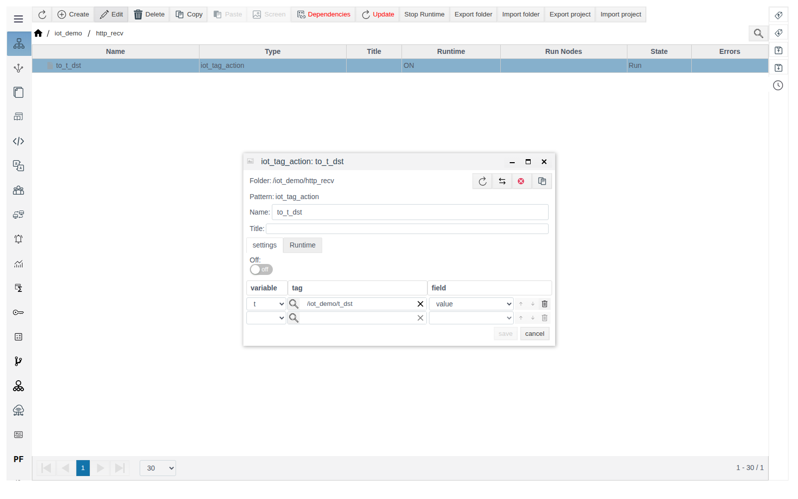
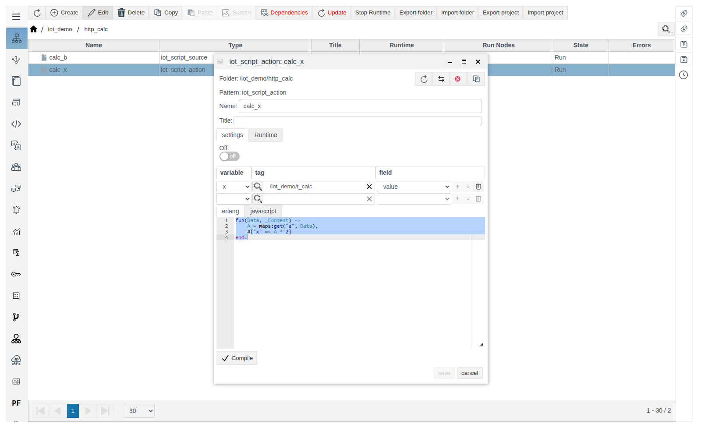
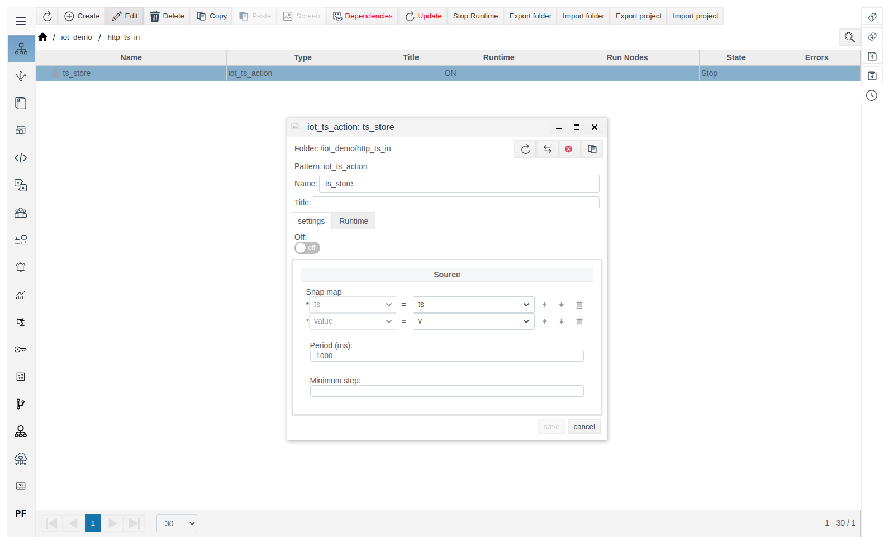
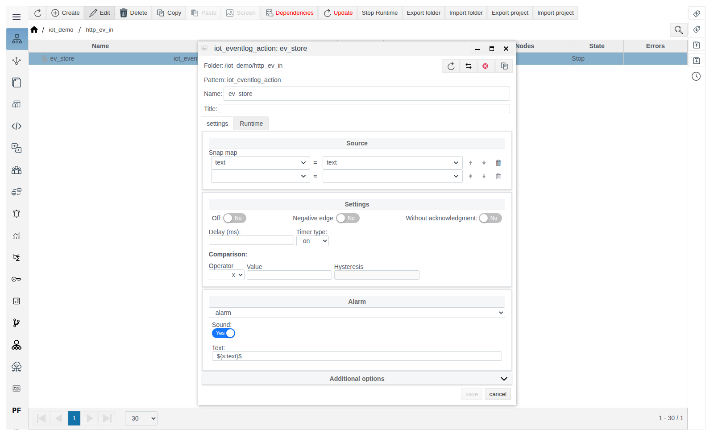
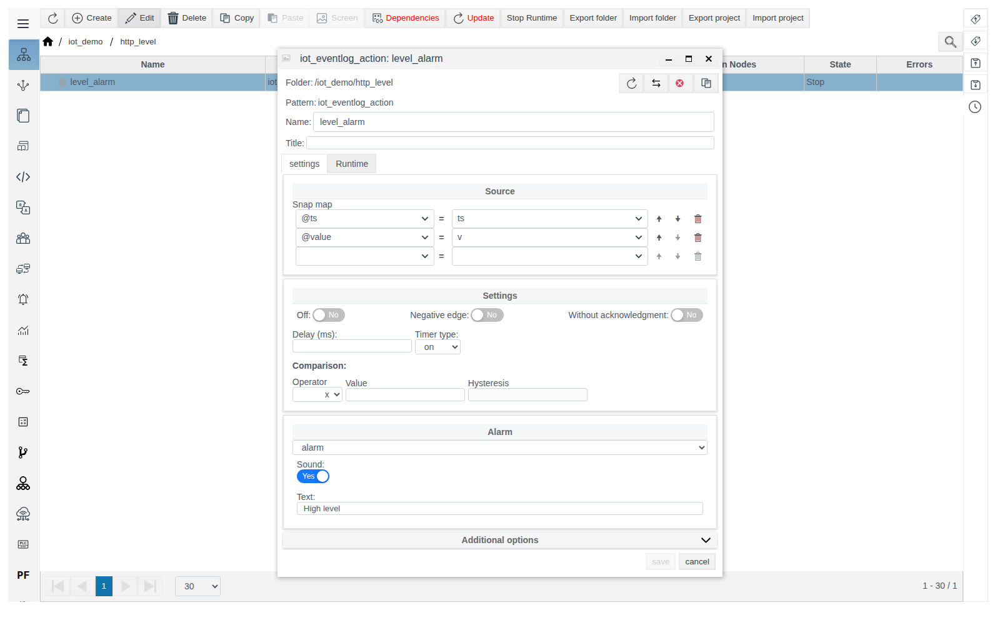

# IoT actions

A guide for the integration engineer. General concepts (roles, **Data** variables, message format, the **Triggers** tab, diagnostics) are described in [IoT connections](IoT_en.md). Verified on FACEPLATE Studio 4.0.7.

# Introduction

An action receives variables of the connection incoming message (the request of a server, the reply of a client) and writes them to tags or an archive. Actions can be created only inside a connection and run before sources. Setup order and an example — see the section “How sources and actions are linked to a connection” in [IoT connections](IoT_en.md).

You need access to Studio (`http://<server>:9000/fp/studio`) with an account that is allowed to modify the project.

# Main part

## iot_tag_action

Writes variables of the incoming message to tag fields. The binding rows are the same as in [iot_tag_source](sources_en.md#iot_tag_source). The value is converted to the field type.



Examples: `to_t_dst` in [`http_recv`](http_en.md#iot_http_server_connection), `to_t_mqtt` in [`mqtt_sub`](mqtt_en.md#iot_mqtt_subscriber), `to_t_ws` in [`ws_recv`](websocket_en.md#iot_websocket_server_connection).

## iot_script_action

Processes the incoming message with a script and writes the result to tags. The binding rows above the editor define the script variables: names from **Data** and the tags the values are written to. The function `fun(Data, Context)` receives all variables of the incoming message in `Data` and the current values of the script variables in `Context`, and returns a map `name => value`. Each value is written to the tag bound to that name. Click **Compile**, then save.

Example — server `http_calc` accepts a number `a`, writes `a * 2` to `t_calc` and replies with that value plus 1:

1. In `iot_demo`, create `iot_http_server_connection` `http_calc`: **Point** `/calc`, **Method** `POST`.
2. **Request**: **Type** `JSON`, **Data** `a`, `x`, template `{"a": $a}`. **Response**: **Type** `JSON`, **Data** `b`, `x`, template `{"b": $b}`. Variable `x` is needed in both lists because the action and source scripts use it. Save.
3. Inside `http_calc`, create `iot_script_action` `calc_x`: binding `x` — `/iot_demo/t_calc` — `value`, script:

   ```erlang
   fun(Data, _Context) ->
       A = maps:get("a", Data),
       #{"x" => A * 2}
   end.
   ```

   

4. Inside `http_calc`, create `iot_script_source` `calc_b`: binding `x` — `/iot_demo/t_calc` — `value`, script:

   ```erlang
   fun(Data, _Context) ->
       X = maps:get("x", Data),
       #{"b" => X + 1}
   end.
   ```

The request `curl -X POST -d '{"a": 5}' http://<server>:7080/calc` returns `{"b":11}`, and `t_calc` holds `10`. Actions run before sources, so the source reads the already updated tag.

## iot_ts_action

Writes a series of values to an archive. The action is an archive itself: **Period (ms)** and **Minimum step** are its archive settings. **Snap map** in the **Source** group sets the variables with arrays of timestamps (`ts`) and values (`value`). Timestamps are Unix milliseconds or a date string, the arrays must have equal length, non-numeric values are written as empty.

Example — server `http_ts_in` accepts a batch of points and writes it to archive `ts_store`:

1. In `iot_demo`, create `iot_http_server_connection` `http_ts_in`: **Point** `/ts_in`, **Method** `POST`.
2. **Request**: **Type** `JSON`, **Data** `ts`, `v`, template `{"points": [$$ {"ts": $ts, "value": $v}]}`. **Response**: **Type** `Const`, **Text** `OK`. Save.
3. Inside `http_ts_in`, create `iot_ts_action` `ts_store`. In **Snap map** `ts` is filled in automatically; select `v` for `value`. Save.

   

```
curl -X POST -d '{"points": [{"ts": 1792387513000, "value": 10.5}, {"ts": 1792387543000, "value": 11.25}]}' http://<server>:7080/ts_in
```

The reply is `OK`, and archive `ts_store` gets points `10.5` and `11.25` with the given timestamps.

## iot_eventlog_action

Creates event log records. The action is an event template itself: it has the same **Settings**, **Alarm** (type, sound, **Text**) and **Additional options** groups as a regular event template. **Snap map** in the **Source** group links event fields to variables of the incoming message. The **Comparison** fields have no effect on this action: the condition set there is not checked in either mode below.

The mode depends on the bindings:

| Bindings | What happens |
|---|---|
| Without `@value` (for example, only `text`) | Every incoming message creates a new record. Bound fields come from variables, the others from the action settings |
| `@value` and `@ts` | An event with a state. `@value` = `true` opens the event at time `@ts`, `false` closes it (closing time is `@ts`). Another `true` while the event is open does not create a new record |

Pass `@value` as `true`/`false` (or the strings `"true"`/`"false"`). A number in `@value` is not accepted: the server replies with error 500 and the event does not change. If a variable in the message is an array, a record is created for each element.

Example 1 — server `http_ev_in` writes the text from the request to the event log:

1. In `iot_demo`, create `iot_http_server_connection` `http_ev_in`: **Point** `/ev_in`, **Method** `POST`. **Request**: **Type** `JSON`, **Data** `text`, template `{"text": $text}`. **Response**: **Type** `Const`, **Text** `OK`. Save.
2. Inside `http_ev_in`, create `iot_eventlog_action` `ev_store`: **Snap map** `text` = `text`. Set the message type and sound as for a regular event template. Save.

   

```
curl -X POST -d '{"text": "Door open"}' http://<server>:7080/ev_in
```

The reply is `OK`, and the event log gets the record `Door open`. Source `ev_read` in [iot_eventlog_source](sources_en.md#iot_eventlog_source) exports such records.

Example 2 — server `http_level` opens and closes the event "High level" by a flag from the request:

1. In `iot_demo`, create `iot_http_server_connection` `http_level`: **Point** `/level`, **Method** `POST`. **Request**: **Type** `JSON`, **Data** `v`, `ts`, template `{"alarm": $v, "ts": $ts}`. **Response**: **Type** `Const`, **Text** `OK`. Save.
2. Inside `http_level`, create `iot_eventlog_action` `level_alarm`: **Snap map** `@value` = `v`, `@ts` = `ts`; **Text** `High level`. Save.

   

```
curl -X POST -d '{"alarm": true, "ts": 1792406684878}' http://<server>:7080/level
curl -X POST -d '{"alarm": false, "ts": 1792406686025}' http://<server>:7080/level
```

After the first request the event `High level` is open (`dt_on` = 1792406684878), after the second it is closed (`dt_off` = 1792406686025).

# Conclusion

- Use `iot_tag_action` to write to tags, `iot_script_action` for processing, `iot_ts_action` for batches of archive data.
- Create events with `iot_eventlog_action`: one per message by binding event fields, with opening and closing by binding `@value` and `@ts`.
