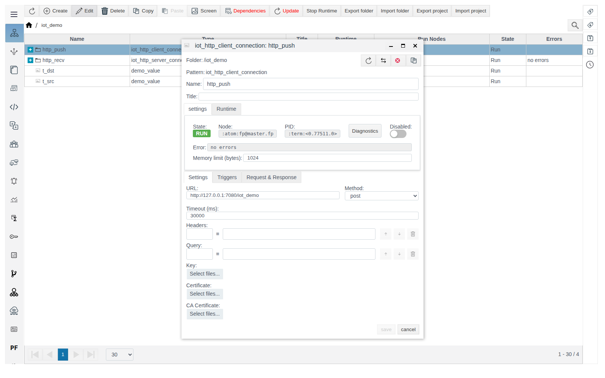
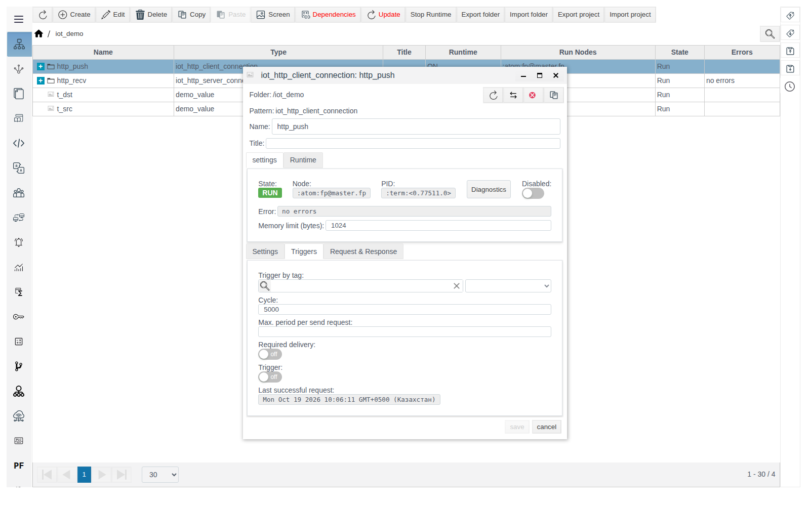
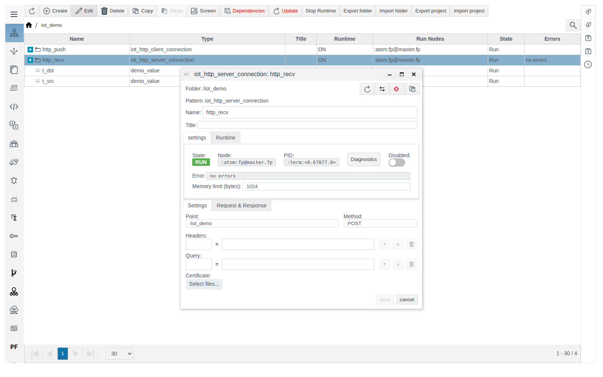
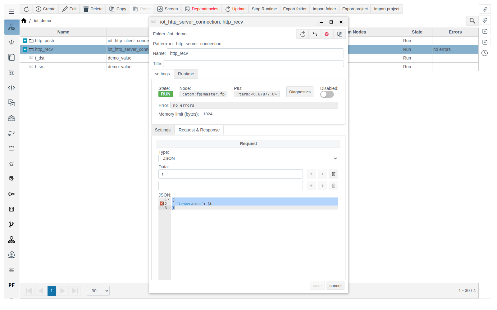

# HTTP connections

A guide for the integration engineer. General concepts (roles, **Data** variables, message format, the **Triggers** tab, diagnostics) are described in [IoT connections](IoT.md).

# Contents

- [Introduction](#introduction)
- [Main part](#main-part)
    - [iot_http_client_connection](#iot_http_client_connection)
    - [iot_http_server_connection](#iot_http_server_connection)
- [Conclusion](#conclusion)

# Introduction

HTTP connections link FACEPLATE to web services: `iot_http_client_connection` sends requests itself, `iot_http_server_connection` accepts requests from external systems. The example in this guide is a client → server pair inside one FACEPLATE: the value of tag `t_src` reaches tag `t_dst`.

You need access to Studio (`http://<server>:9000/fp/studio`) with an account that is allowed to modify the project.

# Main part

## iot_http_client_connection

HTTP client: on the condition from the **Triggers** tab, sends a request to **URL** and parses the reply.

| Field (**Settings** tab) | Purpose | Default |
|---|---|---|
| **URL** | Full service address: `http://...` or `https://...` | `http://127.0.0.1:7080/myserver` |
| **Method** | HTTP request method | `get` |
| **Timeout (ms)** | Reply timeout | `30000` |
| **Headers**, **Query** | Headers and query string parameters: name = value. A request variable can be substituted into the value: `${name}` | empty |
| **Key**, **Certificate**, **CA Certificate** | Client key and certificates for HTTPS | not uploaded |

- The request **Type** sets the `Content-Type` header: `text/plain` for **Const**, `application/json` for **JSON**, `application/octet-stream` for **Script**.
- A reply with a 4xx or 5xx status is treated as an error and shown in **Error**.

Example — client `http_push` sends the value of `t_src` every 5 seconds to server `http_recv` from the next section:

1. In `iot_demo`, create `iot_http_client_connection` `http_push`. **Settings**: **URL** `http://127.0.0.1:7080/iot_demo`, **Method** `post`. Leave **Timeout (ms)** at its default.

   

2. **Triggers** tab: **Cycle** `5000` — send period, ms. This is not **Timeout (ms)** from the **Settings** tab: the timeout limits the wait for the reply to each request.

   

3. **Request & Response**, **Request**: **Type** `JSON`, **Data** `t`, template `{"temperature": $t}`. **Response**: **Type** `Const`. Save.
4. Inside `http_push`, create `iot_tag_source` `from_t_src`: `t` — `/iot_demo/t_src` — `value`.

A few seconds later `t_dst` shows `21.5`, and **Last successful request** shows the request time.

## iot_http_server_connection

HTTP server: accepts requests on the **Point** path, passes the data to actions and replies with the **Response** message. FACEPLATE servers listen on ports 7080 (HTTP) and 7443 (HTTPS).

| Field (**Settings** tab) | Purpose | Default |
|---|---|---|
| **Point** | Path on which requests are accepted. Full address: `http://<server>:7080<Point>`. The path is unique among the project's HTTP servers | empty (hint `/myserver`) |
| **Method** | Accepted method. Required and case-sensitive: write it in upper case (`POST`, `GET`, `PUT`) | empty (hint `post`) |
| **Headers**, **Query** | Headers and query string parameters that the server extracts from the request: name = value used when the request has none | empty |
| **Certificate** | Certificates of clients that are allowed access. If a file is uploaded, requests without a matching client certificate get `401 Access denied` | not uploaded |

| Server reply | When |
|---|---|
| `200` and the **Response** body | The request was processed |
| `404` | The path matches no **Point** of an enabled server |
| `405 Method not allowed` | The method does not match **Method**, including case |
| `500 Internal error` | Processing error: the incoming JSON does not match the template, a source or script failed |

Example — server `http_recv` writes the received temperature to `t_dst`:

1. In `iot_demo`, create `iot_http_server_connection` `http_recv`. **Settings**: **Point** `/iot_demo`, **Method** `POST`.

   

2. **Request & Response**, **Request**: **Type** `JSON`, **Data** `t`, template `{"temperature": $t}`. **Response**: **Type** `Const`, **Text** `OK`. Save.

   

3. Inside `http_recv`, create `iot_tag_action` `to_t_dst`: `t` — `/iot_demo/t_dst` — `value`.

Test with any HTTP client:

```
curl -X POST -d '{"temperature": 23.4}' http://<server>:7080/iot_demo
```

The reply is `OK`, and `t_dst` holds `23.4`.

# Conclusion

- For an HTTP server, write **Method** in upper case; **Point** is unique in the project.
- For an HTTP client, set a sending condition on the **Triggers** tab.
- Test the server with `curl` and watch the client **Error** field.
