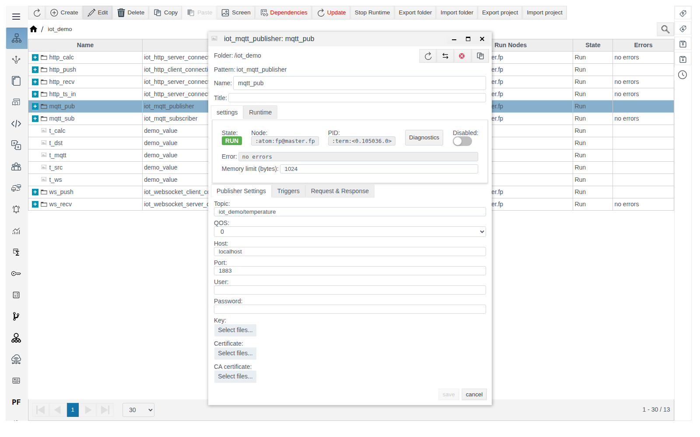
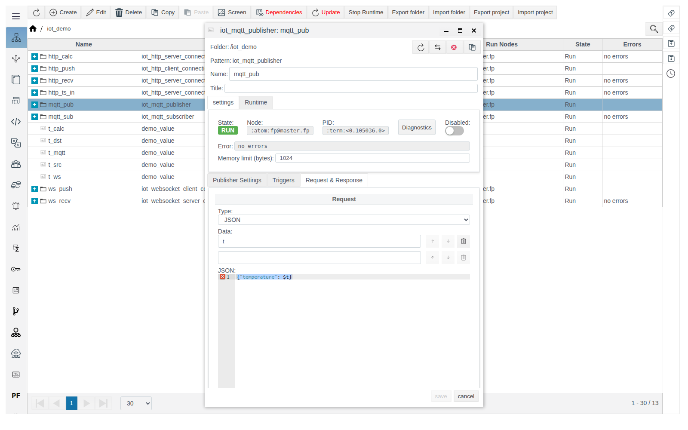
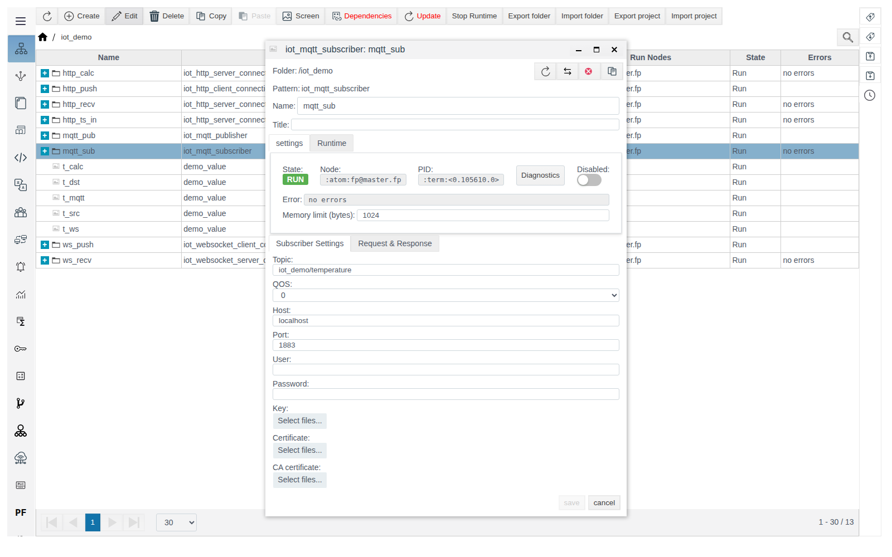

# MQTT connections

A guide for the integration engineer. General concepts (roles, **Data** variables, message format, the **Triggers** tab, diagnostics) are described in [IoT connections](IoT_en.md). Verified on FACEPLATE Studio 4.0.7.

# Introduction

MQTT connections work through an external broker: `iot_mqtt_publisher` publishes messages to a topic, `iot_mqtt_subscriber` receives them. The example in this guide is the chain `t_src` → broker → `t_mqtt`.

You need access to Studio (`http://<server>:9000/fp/studio`) with an account that is allowed to modify the project.

# Main part

## iot_mqtt_publisher

MQTT publisher: on the condition from the **Triggers** tab, publishes the **Request** message to a broker topic. An MQTT broker is not part of FACEPLATE.

| Field (**Publisher Settings** tab) | Purpose | Default |
|---|---|---|
| **Topic** | Topic to publish to. Required | empty |
| **QOS** | Delivery guarantee level: 0, 1 or 2 | `0` |
| **Host** | Broker address | `localhost` |
| **Port** | Broker port | `1883` |
| **User**, **Password** | Broker credentials. Used only if both fields are filled, otherwise the connection is anonymous | empty |
| **Key**, **Certificate**, **CA certificate** | Files for a TLS connection. The broker certificate is not verified | not uploaded |

Example — publisher `mqtt_pub` publishes `t_src` every 5 seconds:

1. In `iot_demo`, create `iot_mqtt_publisher` `mqtt_pub`. **Publisher Settings**: **Topic** `iot_demo/temperature`, **Host** — the broker address.

   

2. **Triggers** tab: **Cycle** `5000` — send period, ms.
3. **Request & Response**, **Request**: **Type** `JSON`, **Data** `t`, template `{"temperature": $t}`. Save.

   

4. Inside `mqtt_pub`, create `iot_tag_source` `from_t_src`: `t` — `/iot_demo/t_src` — `value`.

A broker subscriber to `iot_demo/#` receives `iot_demo/temperature {"temperature":21.5}`.

## iot_mqtt_subscriber

MQTT subscriber: subscribes to **Topic** and parses every received message with the **Request** template; the variables go to actions. The connection parameters are the same as the publisher's (**Subscriber Settings** tab); there is no **Triggers** tab.

Example — subscriber `mqtt_sub` writes the temperature from the topic to `t_mqtt`:

1. In `iot_demo`, create `iot_mqtt_subscriber` `mqtt_sub`. **Subscriber Settings**: **Topic** `iot_demo/temperature`, **Host** — the broker address.

   

2. **Request & Response**, **Request**: **Type** `JSON`, **Data** `t`, template `{"temperature": $t}`. Save.
3. Inside `mqtt_sub`, create `iot_tag_action` `to_t_mqtt`: `t` — `/iot_demo/t_mqtt` — `value`.

Together with `mqtt_pub` this forms the chain `t_src` → broker → `t_mqtt`: `t_mqtt` shows `21.5`.

> **Important.** If the broker is unreachable, the subscriber and the publisher stay in `RUN` with `no errors` and retry to connect every second. The connection error (`econnrefused`) is visible only in the **Diagnostics** window.

# Conclusion

- A broker is not part of FACEPLATE; set its address in **Host** and **Port**.
- For the publisher, set a sending condition on the **Triggers** tab.
- If there is no exchange and no visible error, open **Diagnostics**: broker connection errors are visible only there.
