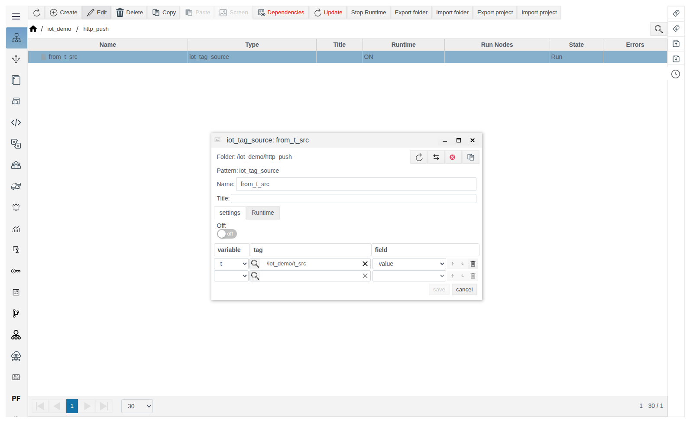
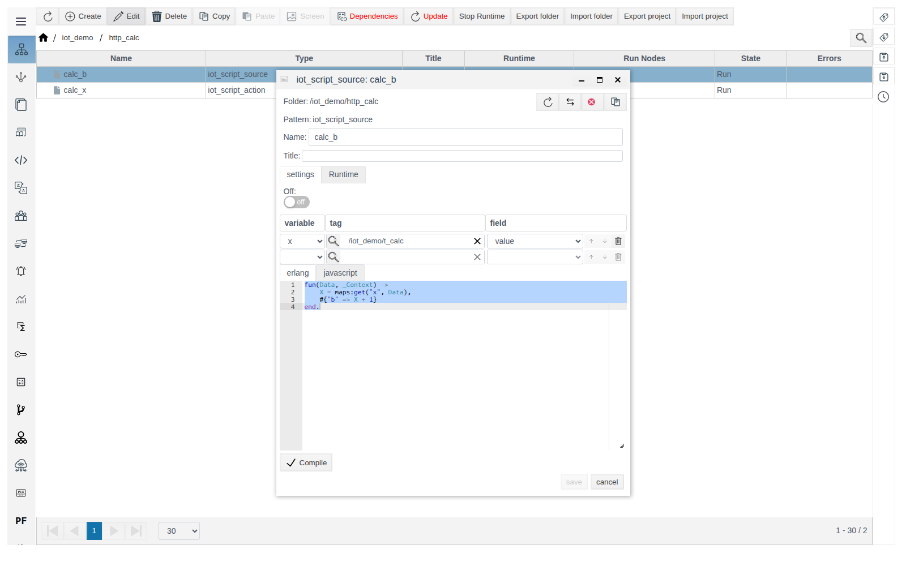
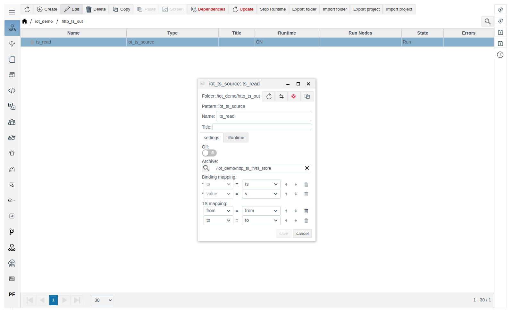
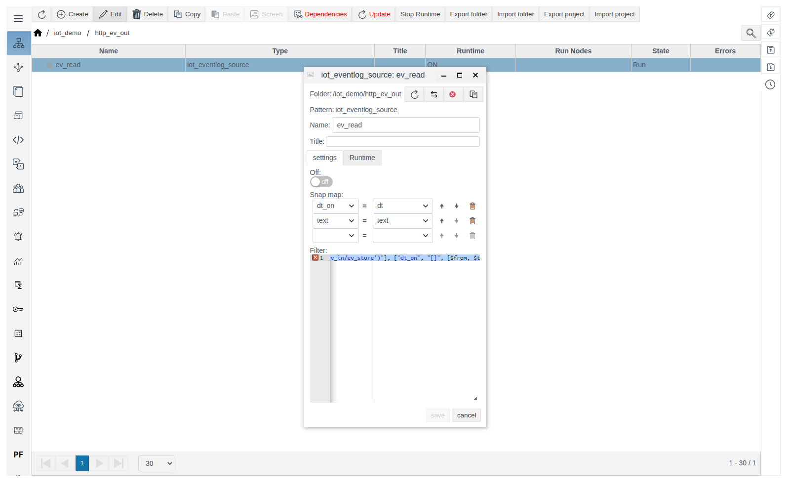

# IoT sources

A guide for the integration engineer. General concepts (roles, **Data** variables, message format, the **Triggers** tab, diagnostics) are described in [IoT connections](IoT.md). Verified on FACEPLATE Studio 4.0.7.

# Introduction

A source fills variables of the connection outgoing message: the request of a client, the reply of a server. Sources can be created only inside a connection; their variables come from the **Data** list of that side. Setup order and an example — see the section [How sources and actions are linked to a connection](IoT.md#how-sources-and-actions-are-linked-to-a-connection) in [IoT connections](IoT.md).

You need access to Studio (`http://<server>:9000/fp/studio`) with an account that is allowed to modify the project.

# Main part

## iot_tag_source

Passes tag field values to connection variables. Each binding row: **variable** (a variable from **Data**) — **tag** (picked with the magnifier button) — **field** (tag field). A new empty row appears after the previous one is filled.



Examples: `from_t_src` in [`http_push`](http.md#iot_http_client_connection), [`mqtt_pub`](mqtt.md#iot_mqtt_publisher), [`ws_push`](websocket.md#iot_websocket_client_connection).

## iot_script_source

Computes connection variables with a script. The binding rows above the editor define the script variables: names come from **Data**, values are read from the given tags. The function `fun(Data, Context)` receives the values of these variables in `Data`, service data in `Context` (for a client, the interval bounds `from` and `to`), and returns a map `connection variable => value`. Click **Compile**, then save.



Example — see [iot_script_action](actions.md#iot_script_action): source `calc_b` reads `t_calc` and returns a value one greater in the reply.

## iot_ts_source

Sends archive values for an interval. **Archive** is an archive object: `ARCHIVE` or [`iot_ts_action`](actions.md#iot_ts_action). **Binding mapping** sets the variables for the arrays of timestamps (`ts`) and values (`value`). **TS mapping** sets the variables with the interval bounds `from` and `to`.

- On a client, **TS mapping** can stay empty: the interval comes from the **Triggers** tab (from the last successful request to the current moment).
- On a server, the bounds come in the request. Add variables `from` and `to` to **Data** of the request and to **Data** of the reply — **TS mapping** offers the reply variables.
- The bounds are Unix milliseconds or a date string.
- The first point of the reply is the archive value at `from`. If there is no value at that moment, the reply contains `"undefined"`.

Example — server `http_ts_out` returns the points of archive `ts_store` (filled by [`iot_ts_action`](actions.md#iot_ts_action)) for the interval from the request:

1. In `iot_demo`, create `iot_http_server_connection` `http_ts_out`: **Point** `/ts_out`, **Method** `POST`.
2. **Request**: **Type** `JSON`, **Data** `from`, `to`, template `{"from": $from, "to": $to}`. **Response**: **Type** `JSON`, **Data** `ts`, `v`, `from`, `to`, template `{"ts": $ts, "value": $v}`. Save.
3. Inside `http_ts_out`, create `iot_ts_source` `ts_read`: **Archive** `/iot_demo/http_ts_in/ts_store`; **Binding mapping** `ts` = `ts`, `value` = `v`; **TS mapping** `from` = `from`, `to` = `to`. Save.

   

```
curl -X POST -d '{"from": 1792387500000, "to": 1792387550000}' http://<server>:7080/ts_out
```

The reply is `{"ts":[1792387500000,1792387513000,1792387543000],"value":["undefined",10.5,11.25]}`. If you need an array of objects (`[{"ts": ..., "value": ...}]`), build the reply with a script — see the section [Message script](IoT.md#message-script) in [IoT connections](IoT.md).

## iot_eventlog_source

Sends event log records. **Snap map** links event fields (`dt_on`, `dt_off`, `text`, `type`, `active` and others) to variables: each variable receives the array of field values over all found records. **Filter** is the selection condition as a JSON template; variables can be used in it:

| Filter element | Meaning |
|---|---|
| `["and", [condition, ...]]`, `["or", [...]]`, `["andnot", [condition, condition]]` | Logical operations |
| `["field", "=", value]` | Compares a field with a value, for example `=` |
| `["field", "[]", [$from, $to]]` | Time within the interval |
| `"$oid('/root/FP/PROJECT/...')"` | Reference to a project object, for example an event template in field `prototype` |

`$from` and `$to` are the interval bounds: on a client from the **Triggers** tab, on a server the request variables with these names.

Example — server `http_ev_out` returns the events of action `ev_store` (see [iot_eventlog_action](actions.md#iot_eventlog_action)) for the interval from the request:

1. In `iot_demo`, create `iot_http_server_connection` `http_ev_out`: **Point** `/ev_out`, **Method** `POST`.
2. **Request**: **Type** `JSON`, **Data** `from`, `to`, template `{"from": $from, "to": $to}`. **Response**: **Type** `JSON`, **Data** `dt`, `text`, template `{"dt": $dt, "text": $text}`. Save.
3. Inside `http_ev_out`, create `iot_eventlog_source` `ev_read`: **Snap map** `dt_on` = `dt`, `text` = `text`; **Filter**:

   ```json
   ["and", [
     ["prototype", "=", "$oid('/root/FP/PROJECT/iot_demo/http_ev_in/ev_store')"],
     ["dt_on", "[]", [$from, $to]]
   ]]
   ```

   Save.

   

```
curl -X POST -d '{"from": 1792406000000, "to": 1792407000000}' http://<server>:7080/ev_out
```

The reply is `{"dt":[1792406684717,1792406684854],"text":["Door open","Door closed"]}`.

# Conclusion

- Use `iot_tag_source` for tag values and `iot_script_source` for calculations.
- Use `iot_ts_source` for archive data and `iot_eventlog_source` with a filter by event template and interval for the event log.
