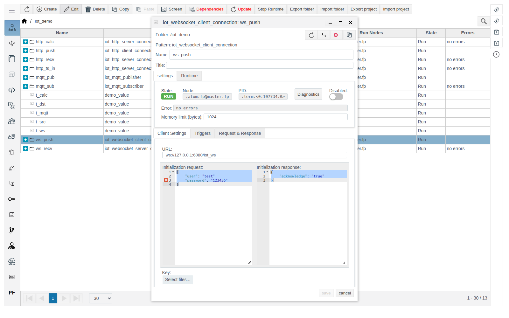
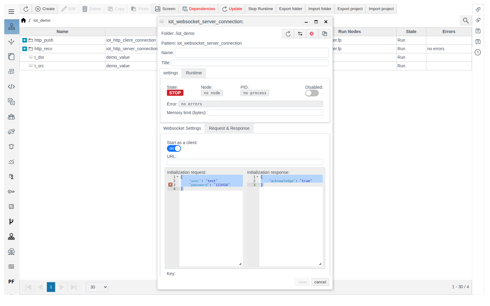
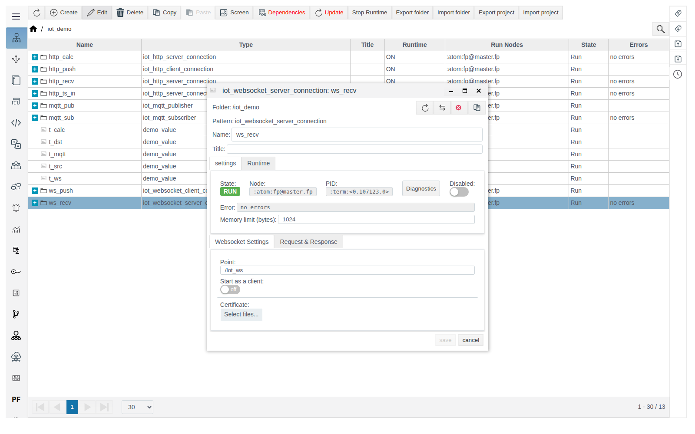

# WebSocket connections

A guide for the integration engineer. General concepts (roles, **Data** variables, message format, the **Triggers** tab, diagnostics) are described in [IoT connections](IoT.md).

# Contents

- [Introduction](#introduction)
- [Main part](#main-part)
    - [iot_websocket_client_connection](#iot_websocket_client_connection)
    - [iot_websocket_server_connection](#iot_websocket_server_connection)
- [Conclusion](#conclusion)

# Introduction

WebSocket connections keep a persistent channel: `iot_websocket_client_connection` connects to a server, `iot_websocket_server_connection` accepts connections. The example in this guide is a client → server pair inside one FACEPLATE: the value of `t_src` reaches `t_ws`.

You need access to Studio (`http://<server>:9000/fp/studio`) with an account that is allowed to modify the project.

# Main part

## iot_websocket_client_connection

WebSocket client: keeps a persistent connection to a server, sends **Request** on the condition from the **Triggers** tab and waits for the reply.

| Field (**Client Settings** tab) | Purpose | Default |
|---|---|---|
| **URL** | Server address: `ws://<host>:<port>/<path>` or `wss://...` | empty |
| **Initialization request**, **Initialization response** | Handshake after connecting: FACEPLATE sends the JSON from **Initialization request** and waits for a reply that matches the **Initialization response** JSON template. If the reply does not match, the connection is not established | an example with `user`/`password` and `acknowledge` (see below) |
| **Key**, **Certificate**, **CA certificate** | Files for WSS | not uploaded |

> **Important.** The handshake fields are pre-filled with an example that is not valid JSON (there is no comma between the lines). If you leave it, the client fails every second with `{initialization_error,badarg}`, while **Error** shows `no errors`. If the server does not require a handshake, clear both fields. The form keeps showing the example after clearing, but empty fields are saved.

Example — client `ws_push` sends `t_src` every 5 seconds to server `ws_recv` from the next section:

1. In `iot_demo`, create `iot_websocket_client_connection` `ws_push`. **Client Settings**: **URL** `ws://127.0.0.1:6080/iot_ws`, clear the handshake fields.

   

2. **Triggers** tab: **Cycle** `5000` — send period, ms.
3. **Request & Response**, **Request**: **Type** `JSON`, **Data** `t`, template `{"temperature": $t}`. **Response**: **Type** `Const`. Save.
4. Inside `ws_push`, create `iot_tag_source` `from_t_src`: `t` — `/iot_demo/t_src` — `value`.

## iot_websocket_server_connection

WebSocket server: accepts connections on the **Point** path, parses every message with the **Request** template and replies with **Response**. Servers listen on ports 6080 (WS) and 6443 (WSS).

| Field (**Websocket Settings** tab) | Purpose | Default |
|---|---|---|
| **Point** | Connection path. Full address: `ws://<server>:6080<Point>` | `/myserver` |
| **Start as a client** | The connection itself connects to an external server at **URL** (with a handshake, like a client) but processes incoming messages as a server. Use it when the external system sends the data but FACEPLATE has to open the connection | off |
| **Certificate** | Certificates of clients that are allowed to connect | not uploaded |

Example — server `ws_recv` writes the temperature from `ws_push` to `t_ws`:

1. In `iot_demo`, create `iot_websocket_server_connection` `ws_recv`. **Websocket Settings**: **Point** `/iot_ws`.

   

2. **Request & Response**, **Request**: **Type** `JSON`, **Data** `t`, template `{"temperature": $t}`. **Response**: **Type** `Const`, **Text** `OK`. Save.
3. Inside `ws_recv`, create `iot_tag_action` `to_t_ws`: `t` — `/iot_demo/t_ws` — `value`.

Together with `ws_push`, `t_ws` shows `21.5`.

# Conclusion

- For a client, check the handshake fields: the default example is invalid JSON.
- For a client, set a sending condition on the **Triggers** tab.
- Use **Start as a client** when the external system sends the data but FACEPLATE has to open the connection.
