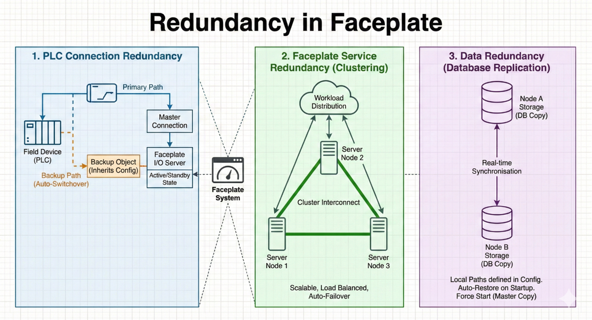
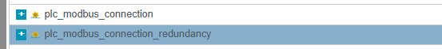
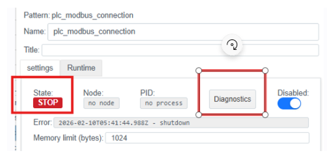
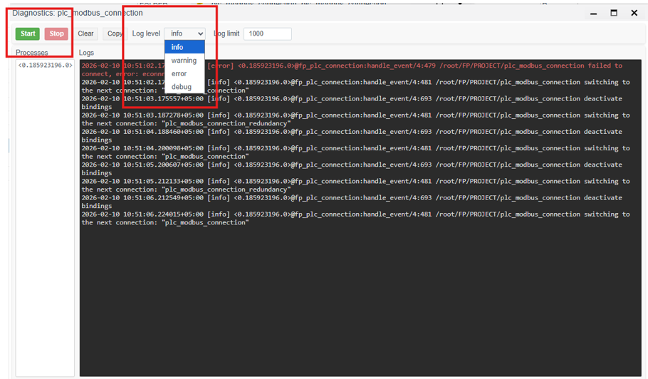

# Resource Redundancy in Faceplate

To ensure process continuity and high availability, Faceplate implements a multi-level redundancy system. The product architecture minimizes the risk of a single point of failure by duplicating key system components.

## 1. Equipment Connection Redundancy

Faceplate supports various protocols for communication with field devices (PLCs, sensors, RTUs).

- **Mechanism:** The system allows configuring multiple data exchange paths for a single logical node.

- **Result:** If the primary communication link is lost or a network interface failure occurs, Faceplate automatically switches to the backup channel, ensuring uninterrupted telemetry collection and control command transmission.

## 2. Faceplate Service Redundancy

Service redundancy is achieved through **clustering**. Multiple servers (Runtime) are combined into a single Erlang cluster.

- **Scaling:** Processes are distributed across nodes. If one node (server) goes down, the remaining nodes continue operating, ensuring system availability.

- **Identification:** Nodes discover each other through a shared Cookie (secret key) and DNS/Hosts configuration.

## 3. Basic Configuration (Tuning)

Fine-tuning of parameters is performed in configuration files located in the release directory (e.g., `/DATASET/project/scada/faceplate/releases/4.0.6/`).

### 3.1. Virtual Machine Configuration (vm.args)

The `vm.args` file defines unique Erlang environment parameters for each node:

- **-name:** Unique node name (e.g., `fp@rt-server1.fp`).

- **-setcookie:** A shared identifier (cookie) for all cluster servers, providing authorization for inter-node communication.

- **+MIscs:** Literal memory limit (specified in megabytes) for optimizing resource consumption.

### 3.2. Logging Configuration (fp.logger.config)

Configure the log output paths in the `console_handler` and `error_handler` sections. The paths must correspond to the directory structure specified in section 2.1:

- **Console path:** `/DATASET/project/scada/local/logs/console.log`

- **Error path:** `/DATASET/project/scada/local/logs/error.log`

## 4. Cluster Startup and Assembly

The initial startup is recommended to be performed in a tmux session named `scada` to ensure process continuity.

### 4.1. Starting the Primary Node

On the first cluster server, initiate startup in console mode:

```bash
./faceplate console
```

### 4.2. Joining Additional Nodes

To connect subsequent servers (Runtime 2, Runtime 3, or Historian), use the `ATTACH_TO` environment variable pointing to the address of an already active node.

**Command for the first connection:**

```bash
env ATTACH_TO=fp@rt-server1.fp ./faceplate console
```

*(where `fp@rt-server1.fp` is the name of the primary node).*

**Note:** After a node has been successfully added to the cluster, all subsequent restarts are performed using the standard command `./faceplate console`.



*Figure 1. Cluster node configuration*

## 5. PLC Connection Redundancy

The Faceplate communication module ensures guaranteed delivery of telemetry data and control commands by supporting redundant physical and logical data exchange channels. The connection redundancy mechanism operates at the protocol driver level (OPC UA, Modbus TCP, IEC 60870-5-104, etc.) and includes the following capabilities:



*Figure 2. Redundant communication channel diagram*

**Result:** Using these mechanisms minimizes the probability of data gaps and ensures instant response of the control system in emergency situations.

### 5.1. Detailed Example and Configuration

#### Configuration in Faceplate Studio (Master Connection)

**1. Creating the Master Connection:**

Create a standard connection (e.g., `plc_modbus_connection`). Leave the Master Connection field empty. This connection will serve as the primary one.


*Figure 3. Creating the master connection*

**2. Creating the Backup Object:**

Create a second connection (e.g., `plc_modbus_connection_redundancy`). In the Master Connection field, specify a reference to the Master Connection (select it from the list).


*Figure 4. Creating the backup connection*

#### Logs and Monitoring

The connection status is displayed in the State (RUN/STOP) and Status (OK/ERROR) fields in the driver editor.



*Figure 5. Connection status in the editor*

The Diagnostics window allows viewing logs for the current connection. The Start and Stop buttons allow starting and stopping the logging process. Log level categorizes messages by severity and detail. Selecting a specific level typically acts as a threshold filter: the console displays messages of the selected level and all messages of higher criticality.



*Figure 6. Connection diagnostics window*

### written by Marlen Meimanov
