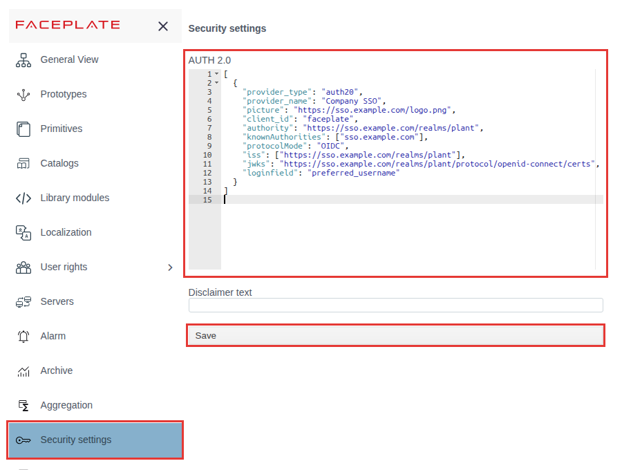
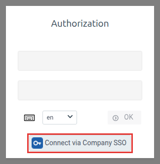

# External authorization

A document for the integration engineer who connects sign-in to Studio and Runtime through a corporate identity provider (OpenID Connect, single sign-on).

# Contents

- [Glossary](#glossary)
- [Introduction](#introduction)
- [Main part](#main-part)
    - [How sign-in works](#how-sign-in-works)
    - [Registering the application with the provider](#registering-the-application-with-the-provider)
    - [AUTH 2.0 field](#auth-20-field)
    - [Accounts and rights](#accounts-and-rights)
    - [Repeated sign-in and token lifetime](#repeated-sign-in-and-token-lifetime)
    - [Logout](#logout)
    - [Checking the setup](#checking-the-setup)
- [Conclusion](#conclusion)

# Glossary

| Term | Meaning |
|---|---|
| AUTH 2.0 | A field in **Security settings**. A list of providers in JSON format. The sign-in form shows a separate button for each provider |
| Provider description | One JSON object in the **AUTH 2.0** list: the provider address, the application ID, the token check rules |
| Provider button | The "Connect via <name>" button under the **OK** button of the sign-in form |

# Introduction

External authorization adds a provider button to the Studio and Runtime sign-in form. The user signs in at the provider with a corporate account, and Faceplate takes the login from the received token and opens a session of the Faceplate user with the same login. No Faceplate password is needed. Sign-in with login and password on the same form remains available.

The provider only confirms the identity. Roles and rights are still set in Faceplate, see [Users](users.md) and [Roles and access rights](roles.md). The sign-in form itself is described in [Sign-in and sessions](login.md).

In the example the provider is the OpenID Connect server `https://sso.example.com/realms/plant`, the application is registered with it under the ID `faceplate`, the button is called **Company SSO**, and the operator `petrov` signs in through it.

You will need:

- access to Studio (`http://<server>:9000/fp/studio`) under an account allowed to change the project;
- administrator rights at the provider to register the application.

# Main part

## How sign-in works

1. The user clicks the provider button on the sign-in form.
2. The browser goes to the provider's sign-in page. If the user already has a session at the provider, the page is not shown.
3. The provider returns the browser to the Faceplate address where the sign-in started and issues a token.
4. The Faceplate server checks the token: the issuer (`iss`), the signature against the provider's public keys, the expiry. The login is taken from the token.
5. A session of the Faceplate user with this login opens: Runtime or Studio, depending on the address where the sign-in started.

## Registering the application with the provider

Register Faceplate with the provider as a browser application without a secret (public client, Authorization Code flow with PKCE).

| Provider parameter | Value |
|---|---|
| Redirect URIs | `http://<server>:9000/fp/runtime` and `http://<server>:9000/fp/studio` — the addresses where users open Runtime and Studio |
| Allowed request origins (CORS) | `http://<server>:9000` |
| Scopes | `openid`, `profile`, `User.Read`. Faceplate requests all three, the provider must accept each of them |
| Token signature | RSA: RS256, RS384 or RS512. Public keys — at the provider's JWKS address |
| Login claim | The token claim whose value matches the user's login in Faceplate |

If the provider has no `User.Read` scope, create it and allow it for the application: without it the provider rejects the sign-in.

The provider issues an application ID (client ID) — it is needed in the **AUTH 2.0** field.

## AUTH 2.0 field

In the Studio main menu open **Security settings**, enter the list of providers in the **AUTH 2.0** field and click **Save**. The message "Settings successfully saved" appears. The button appears on the sign-in form the next time it opens.



An example for one provider:

```json
[
  {
    "provider_type": "auth20",
    "provider_name": "Company SSO",
    "picture": "https://sso.example.com/logo.png",
    "client_id": "faceplate",
    "authority": "https://sso.example.com/realms/plant",
    "knownAuthorities": ["sso.example.com"],
    "protocolMode": "OIDC",
    "iss": ["https://sso.example.com/realms/plant"],
    "jwks": "https://sso.example.com/realms/plant/protocol/openid-connect/certs",
    "loginfield": "preferred_username"
  }
]
```

| Key | Value |
|---|---|
| `provider_type` | Always `auth20`. For a description with another value no button appears |
| `provider_name` | The name on the button: "Connect via <provider_name>" |
| `picture` | Optional. The address of an image shown on the button to the left of the name. The image is loaded by the user's browser, so the address must open from the user's computer. The image height is fitted to the button, the proportions are kept |
| `client_id` | The application ID at the provider |
| `authority` | The provider address the browser goes to for sign-in |
| `knownAuthorities` | A list with the provider host name: `["<provider host>"]` |
| `protocolMode` | `"OIDC"` |
| `iss` | The list of allowed token issuers. The `iss` value in the token must match one of them character for character |
| `jwks` | The address of the provider's public key set (JWKS). The Faceplate server opens it, so the address must be reachable from the server, not only from the browser |
| `loginfield` | The token claim the login is taken from. If the key is omitted, the `nickname` claim is used |

Without `knownAuthorities` and `protocolMode` the provider page does not open: after clicking the button the sign-in form is shown again.

For several providers list the descriptions separated by commas — the form shows a button for each, in the order of the list.



To remove the buttons, leave an empty list `[]` in the **AUTH 2.0** field and save. If the JSON in the field contains an error, it is saved, but no buttons appear on the form; sign-in with login and password still works.

The **Disclaimer text** field in the same window is described in [Sign-in and sessions, section Disclaimer text](login.md#disclaimer-text).

## Accounts and rights

Sign-in through the provider opens a session of the Faceplate user whose login matches the value of the `loginfield` claim in the token. Create such users in **User rights** → **Users** and give them roles, see [Users](users.md). The Faceplate password is not used for sign-in through the provider.

The access rules are the same as for password sign-in: Studio opens only to users with the role `.administrators`.

If there is no user with this login in Faceplate or the user has no access to Studio, after sign-in at the provider a question appears saying that the user has no access to this system and can sign in as another user, which also signs them out of other systems.

| Answer | What happens |
|---|---|
| **yes** | Sign-out at the provider (see [Logout](#logout)), then the sign-in form. The next click on the provider button asks for the login and password at the provider again — you can sign in under another account |
| **no** | The sign-in form. The session at the provider remains, so the provider button signs in under the same account again and is refused again |

In the example both the provider and Faceplate have the user `petrov` with the role `operators`: through the **Company SSO** button `petrov` signs in to Runtime, and on signing in to Studio sees the question about having no access to this system, with the buttons **yes** and **no**, because `petrov` does not have the role `.administrators`.

## Repeated sign-in and token lifetime

After sign-in through the provider the browser keeps the token until it expires; the lifetime is set by the provider. While the token is valid, Studio and Runtime in a new tab or after a page refresh sign in by themselves, without the form.

When the token has expired, open sessions keep working, and the next time the page opens the sign-in form is shown. If the session at the provider is still open, the provider button signs in without a password.

## Logout

**Logout** → **yes** in Studio or Runtime for a user who signed in through the provider also ends the session at the provider: a separate provider sign-out window opens. After signing out there, the window closes, Faceplate shows the sign-in form, and the next click on the provider button requires the login and password at the provider.

For a user who signed in with login and password, **Logout** works as usual, see [Sign-in and sessions, section Logout and end of session](login.md#logout-and-end-of-session).

## Checking the setup

If after the setup the provider button is missing from the sign-in form or sign-in through it fails, find in the table what you see on the screen and check what is listed next to it.

Check in a separate private (incognito) browser window: a saved token and session at the provider do not interfere there.

| What you see | What to check |
|---|---|
| No provider button on the form | The JSON in the **AUTH 2.0** field, the `provider_type` value |
| After clicking the button the sign-in form appears again | `authority`, `knownAuthorities`, `protocolMode` in **AUTH 2.0**; the `User.Read` scope is allowed for the application at the provider |
| A question about an authentication error, offering to sign in as another user | The `jwks` address is reachable from the Faceplate server; the `iss` value in the token is in the `iss` list; the token contains the claim named in `loginfield` |
| A question saying the user has no access to this system | A user with the login from the token exists in Faceplate and has the required role |

# Conclusion

1. Register Faceplate with the provider: a public client, redirect URIs `/fp/runtime` and `/fp/studio`, scopes `openid`, `profile`, `User.Read`.
2. Fill in **Security settings** → **AUTH 2.0** → **Save**: `provider_type` `auth20`, `client_id`, `authority`, `knownAuthorities`, `protocolMode`, `iss`, `jwks`, `loginfield`.
3. Create users in Faceplate with logins as in the token and give them roles. Studio — only with the role `.administrators`.
4. Check sign-in with the provider button in Runtime and Studio in a private window.
5. **Logout** for a provider user also ends the session at the provider.
