# Sign-in and sessions

A document for the integration engineer who prepares sign-in to Studio and Runtime for operators and other users of the project.

# Contents

- [Glossary](#glossary)
- [Introduction](#introduction)
- [Main part](#main-part)
    - [Sign-in form](#sign-in-form)
    - [On-screen keyboard](#on-screen-keyboard)
    - [Interface language](#interface-language)
    - [Disclaimer text](#disclaimer-text)
    - [Sign-in errors](#sign-in-errors)
    - [Authorization history](#authorization-history)
    - [Logout and end of session](#logout-and-end-of-session)
- [Conclusion](#conclusion)

# Glossary

| Term | Meaning |
|---|---|
| Session | Work in one browser tab from sign-in until logout, page reload or closing the page |
| Account language | The interface language stored with the user. The language chosen on the sign-in form is compared with it |
| Disclaimer text | A field in **Security settings**. If it is filled, the sign-in form shows this text under the **OK** button |
| Authorization history | A window with the date and time of the last successful and the last unsuccessful sign-in under the account |

# Introduction

Studio and Runtime open with the same sign-in form. On it the user chooses the interface language, and on a touch panel without a keyboard types the login and password on the on-screen keyboard. Under the **OK** button the form can show a disclaimer text.

Accounts, passwords and roles are created in **User rights** → **Users**, see [Users](users.md). Password change by the operator and session recovery after a connection loss are described in [Status bar and connection](../operator/status.md#account-and-password-change), the screen that opens after sign-in to Runtime — in [Desktop and navigator](../operator/desktop.md#last-screen-after-sign-in).

The running example is the operator `petrov` with the role `operators`.

You need access to Studio (`http://<server>:9000/fp/studio`) under an account allowed to change the project.

# Main part

## Sign-in form

The form opens at the Studio address (`http://<server>:9000/fp/studio`) or the Runtime address (`http://<server>:9000/fp/runtime`). After sign-in, the requested one opens.

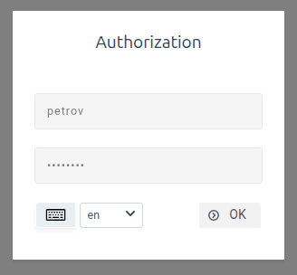

The upper field is the login, the lower one is the password; the fields have no captions. Below the fields are the on-screen keyboard button, the language list and **OK**. **OK** is available when both fields are filled. **Enter** in the password field works as **OK**.

## On-screen keyboard

The keyboard button opens the on-screen keyboard for the field with the cursor. It is meant for touch panels without a physical keyboard.

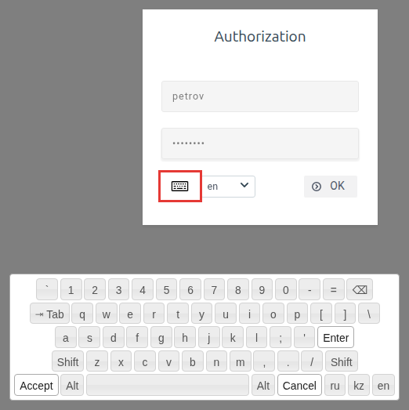

The layout matches the form language; the **ru**, **kz**, **en** buttons in the bottom row switch it.

## Interface language

The list below the fields (**ru**, **en**, **kz**) switches the language of the form and of the Studio and Runtime interface. The browser remembers the choice, and the next time the form opens in the same language.

Each account has its own language. At the first sign-in it becomes the form language. If at a later sign-in the form language differs from the account language, the question "Save localization settings?" appears after sign-in.

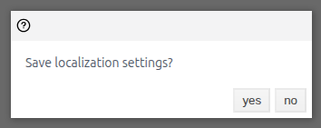

| Answer | Current session | Next time the form opens in this browser |
|---|---|---|
| **yes** | In the chosen language | In the chosen language. It becomes the account language, the question no longer appears |
| **no** | In the chosen language | In the account language |

In the example the account language of `petrov` is Russian, and **en** is chosen on the form: Runtime opens in English and asks the question. With **yes**, English becomes the language of `petrov`.

## Disclaimer text

The disclaimer text is shown under the **OK** button on the Studio and Runtime sign-in form. By default the field is empty, and nothing is shown under **OK**.

In the Studio main menu open **Security settings**, enter the text in the **Disclaimer text** field and click **Save**. The message "Settings successfully saved" appears. The text is shown on the form the next time it opens. To remove it, clear the field and save.

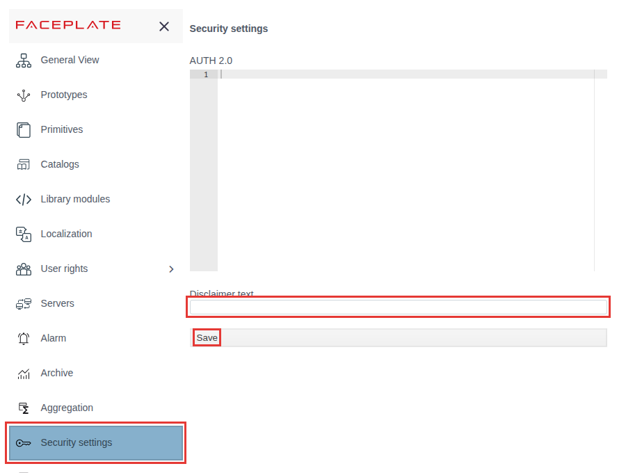

## Sign-in errors

| Situation | Message |
|---|---|
| Runtime: wrong login or password | **ERROR!** "The username or password is not correct. Please try again" |
| Studio: wrong password of a user with the role `.administrators` | The same |
| Studio: user without the role `.administrators` or a login that does not exist | **Error** window saying that you have no access to the system and should contact the administrator — with any password |

After the message is closed, the sign-in form opens again.

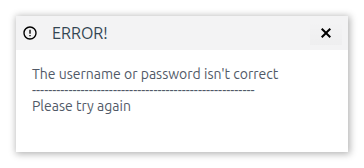

In the example `petrov` signs in to Runtime, but in Studio gets the no-access message. To open Studio to a user, give them the role `.administrators`, see [Users, section User roles](users.md#user-roles).

## Authorization history

The **Authorization history** window shows the date and time of the last successful (row **Successful entry**) and the last unsuccessful (row **Unsuccessful entry**) sign-in under the account of the current session. If there was no such sign-in, the row shows "Not found". The successful sign-in is usually the one that started the current session.

In Studio the window opens with the clock icon on the right panel.

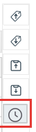

In Runtime — the **Authorization history** item of the menu (☰).

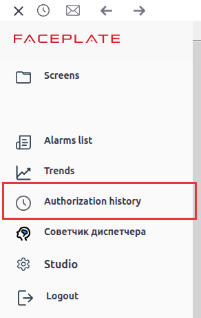

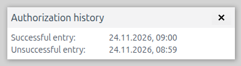

## Logout and end of session

**Logout** is in the Studio main menu (the last item) and in the Runtime menu. After the confirmation "Are you sure to exit?" → **yes** the sign-in form opens.

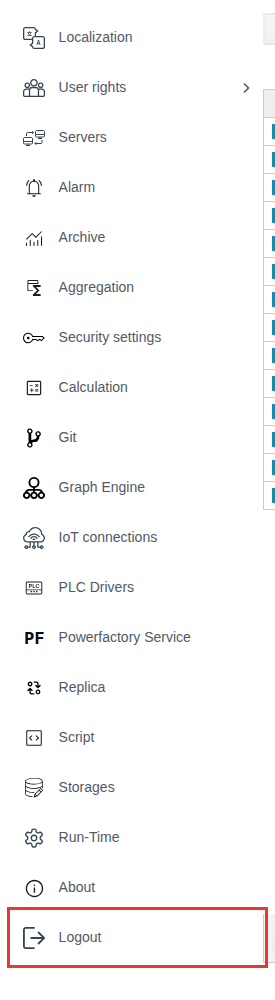

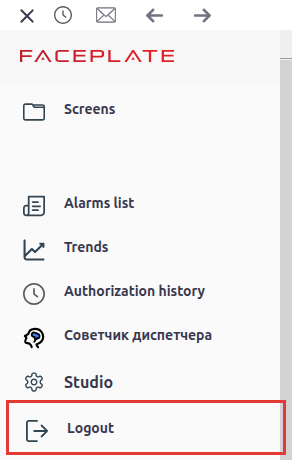

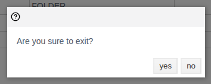

| Action | What happens |
|---|---|
| **Logout** → **yes** | The session ends, the sign-in form opens |
| Page reload (F5) | The browser may ask whether to leave the page. After the reload — the sign-in form |
| Closing the tab or browser | The session ends. Next time — the sign-in form |
| Idle without actions | The session does not end. Studio and Runtime stay open under the same account (checked with more than an hour idle) |
| Connection loss | Runtime signs in again by itself when the connection is back, Studio shows the sign-in form, see [Status bar and connection, section Connection loss](../operator/status.md#connection-loss) |

One account can work in several tabs and browsers at the same time: the sessions do not close each other.

# Conclusion

1. Create users and roles in **User rights** → **Users**. Studio opens only to users with the role `.administrators`.
2. The text under the **OK** button of the sign-in form is set in **Security settings** → **Disclaimer text** → **Save**.
3. On touch panels use the on-screen keyboard of the form.
4. The language is chosen on the form. The answer **yes** to "Save localization settings?" makes it the account language.
5. A session ends with **Logout**, a page reload or closing the page. It does not end because of idle time.
6. The last successful and the last unsuccessful sign-in are visible in the **Authorization history** window: the clock icon in Studio, a menu item in Runtime.
