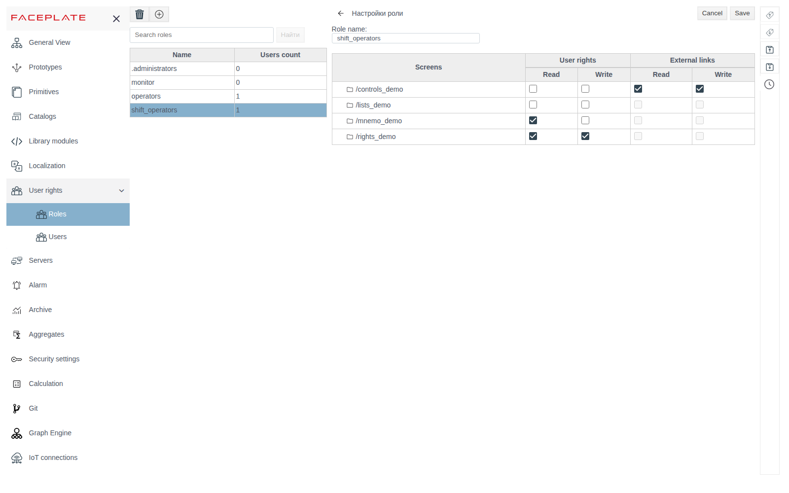
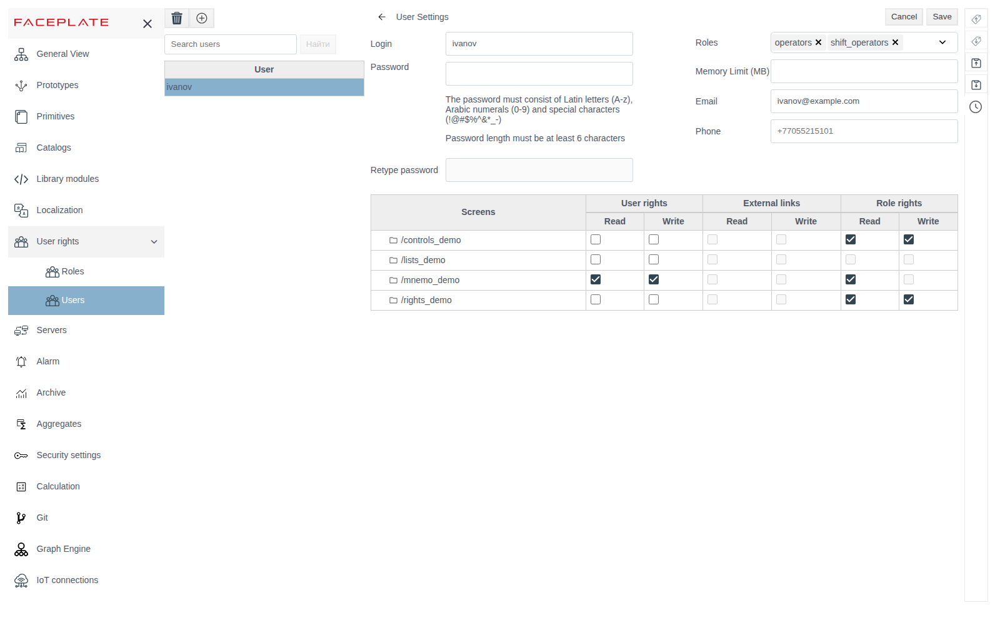
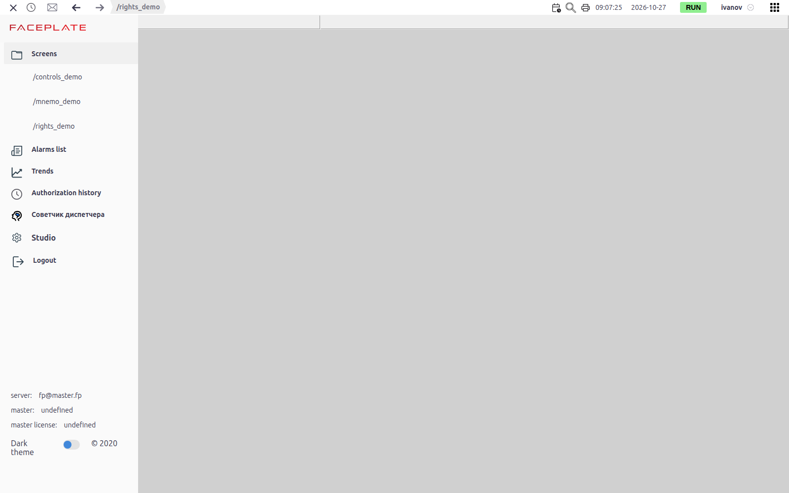

# Roles and access rights

A document for the integration engineer who controls operator access to the project screens.

# Contents

- [Glossary](#glossary)
- [Introduction](#introduction)
- [Main part](#main-part)
    - [Built-in roles](#built-in-roles)
    - [Creating a role](#creating-a-role)
    - [Rights on screens](#rights-on-screens)
    - [Rights on objects](#rights-on-objects)
    - [User rights](#user-rights)
    - [What the user sees in Runtime](#what-the-user-sees-in-runtime)
    - [Deleting a role](#deleting-a-role)
- [Conclusion](#conclusion)

# Glossary

| Term | Meaning |
|---|---|
| Role | A named set of rights on screens. Roles are assigned to users in the user card |
| Folder screen | The `screen` scheme of a project folder. Rights are given on it and apply to the whole folder content |

# Introduction

Access in FACEPLATE is controlled per screen. Each folder screen gets **Read** and **Write** rights, for a role or for a single user. A user gets the rights of all their roles plus their personal rights.

The section is in the Studio main menu: **User rights** → **Roles**. Personal user rights are set in **User rights** → **Users**, see [Users](users.md).

The running example is the role `shift_operators` (shift operators) and the user `ivanov` with this role. Project folders:

| Folder | What is on the screen |
|---|---|
| `/mnemo_demo` | Overview screen |
| `/controls_demo` | Control of pump `ctrl_1`: **Пуск**/**Стоп** (start/stop) buttons, setpoint |
| `/rights_demo` | Setpoint field of pump `ctrl_1` and the embedded screen `/controls_demo` (**Folder Screen** element) |

You will need access to Studio (`http://<server>:9000/fp/studio`) with an account that is allowed to change the project.

# Main part

## Built-in roles

| Role | Purpose |
|---|---|
| `.administrators` | Login to Studio. Without this role Studio does not open |
| `operators` | Every user has it; it cannot be removed. Rights on screens given to this role go to all users, so create your own roles to control access |
| `monitor` | **Read** on all project screens, including new ones: the right is selected as soon as a folder screen is saved. A user with this role sees all screens in Runtime. The role gives no **Write** |

The **Users count** column of the role list shows how many users from the **Users** section have the role. The built-in accounts `system` and `admin` are not counted.

## Creating a role

Click **+**, enter the role name in the "Define name" window and click **OK**. Click a role in the list to open its settings on the right: **Role name** and the rights table. Select the rights and click **Save**.

The search box above the list finds roles whose name starts with the entered text (three or more characters).

## Rights on screens

The table lists project folders that have a saved `screen` scheme. A folder without a screen does not appear in the table: draw and save its screen first (see [Screen editor](../mnemo/editor.md)).

| Column | Meaning |
|---|---|
| **User rights** → **Read** | The screen is visible in Runtime and shows values |
| **User rights** → **Write** | Values can be changed from the screen. With **Write**, **Read** is also selected after saving |
| **External links** → **Read**, **Write** | Rights received through another screen, see below. The checkboxes only show the state |

**External links.** If a screen shows the screen of another folder (the **Folder Screen** element, see [Screen editor, section "A screen inside a screen: Folder Screen"](../mnemo/editor.md#a-screen-inside-a-screen-folder-screen)), a role with rights on the first screen gets the same rights on the second one. In the example `shift_operators` has **Read** and **Write** on `/rights_demo`, and `/rights_demo` shows the `/controls_demo` screen, so the **External links** checkboxes of `/controls_demo` are selected.

## Rights on objects

The rights of a screen apply to the objects of its folder: with **Read** the operator sees their values, with **Write** the operator changes them.

An object of another folder that a screen element is bound to gets the rights of that screen. In the example the setpoint field on `/rights_demo` is bound to `/controls_demo/ctrl_1`: with **Read** on `/rights_demo` the operator sees the setpoint, with **Write** the operator changes it, even without rights on `/controls_demo`.

## User rights

The user card (**User rights** → **Users**) has the same rights table plus the **Role rights** → **Read**, **Write** columns. They are selected when the user's roles give the right.

**Role rights** and **External links** answer different questions. **Role rights** show that the right comes from a role and is not given to the user personally. **External links** show that the right on the screen comes through another screen that shows it (see [Rights on screens](#rights-on-screens)). In the user card **External links** are selected only from the user's personal rights. A right that a role got through an external link appears in the user's **Role rights** column. For example, `shift_operators` has **External links** selected on `/controls_demo`, and `ivanov` has the same right selected as **Role rights**.

The resulting rights are the union of personal, role and external rights.

`ivanov` has personal **Read** and **Write** on `/mnemo_demo` and gets the rest through the `shift_operators` role.

Give rights to roles and keep personal rights for exceptions: when the shift staff changes, only user roles change.

## What the user sees in Runtime

The **Screens** menu lists only the screens the user has **Read** on: personal, through a role or through external links. Without rights the list is empty.

If the user has only **Read**, the screen shows values, but an attempt to change them with a button or an input field ends with an access error message naming the object path. The value does not change.

## Deleting a role

Select the role, click the bin and confirm with **yes**.

# Conclusion

Access setup:

1. Draw and save the folder screens: only they appear in the rights table.
2. **User rights** → **Roles** → **+** → role name → **OK**. Select **Read** and **Write** per screen and click **Save**.
3. In **User rights** → **Users** assign roles to users. Use personal rights only for exceptions.
4. Keep links in mind: the rights of a screen extend to the screens it shows and to the objects its elements are bound to.
5. Check the result by logging in to Runtime as the user.
