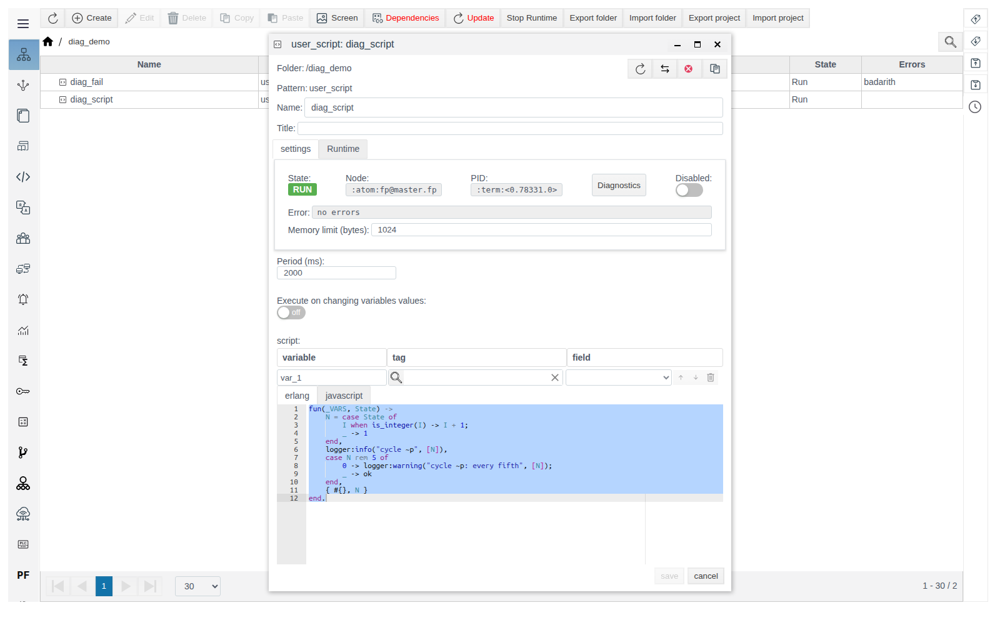
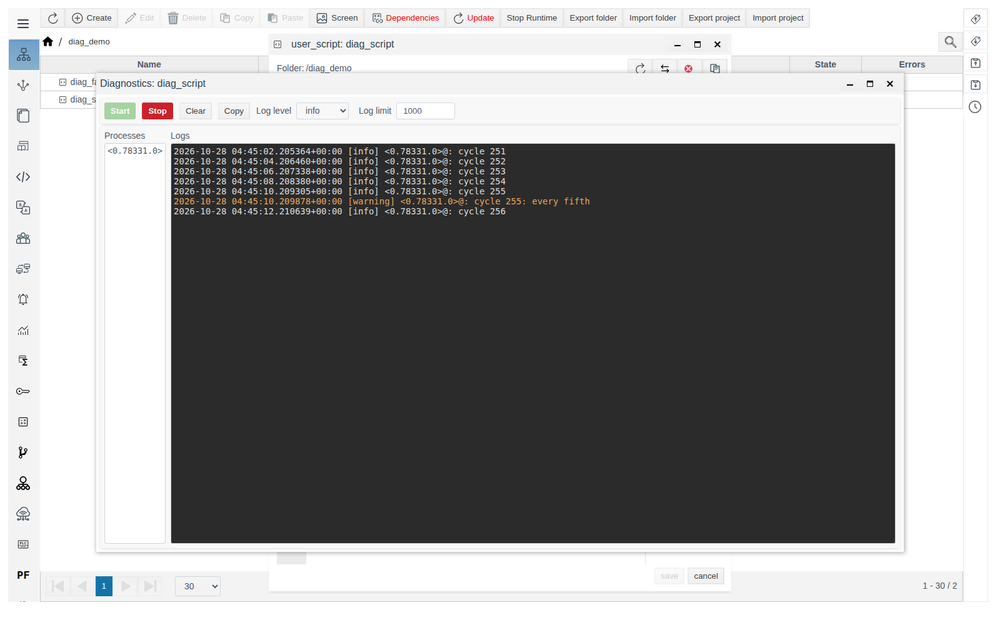
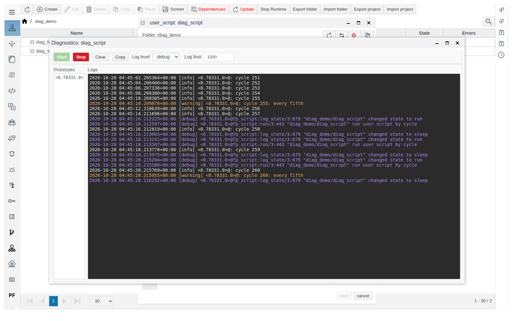
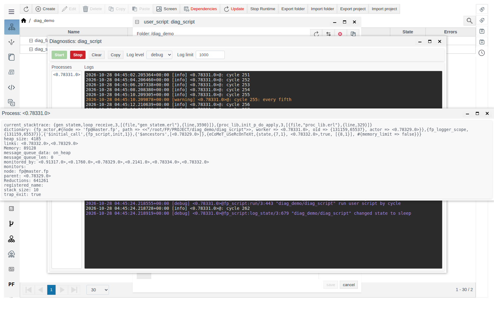
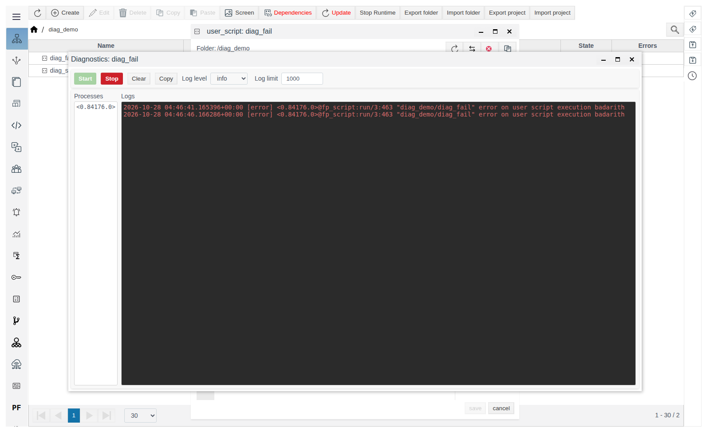

# Diagnostics of Runtime objects

A guide for the integration engineer who investigates why a calculation, a script or a connection does not behave as expected.

# Contents

- [Glossary](#glossary)
- [Introduction](#introduction)
- [Main part](#main-part)
    - [Where to open diagnostics](#where-to-open-diagnostics)
    - [The Diagnostics window](#the-diagnostics-window)
    - [Log level](#log-level)
    - [Log line](#log-line)
    - [Line limit](#line-limit)
    - [Object processes](#object-processes)
    - [Your own messages from a script](#your-own-messages-from-a-script)
    - [What to look for in the log](#what-to-look-for-in-the-log)
- [Conclusion](#conclusion)

# Glossary

| Term | Meaning |
|---|---|
| Runtime object | A project object that runs on the server: a calculation, a user script, an IoT or PLC connection and others. The top panel of its form has **State**, **Node**, **PID** and **Disabled** |
| Process | The server-side worker that performs the object's work. It is identified as `<0.78331.0>`; the same identifier is shown in the **PID** field of the form |
| Log | The stream of messages the object's processes emit while running: progress, warnings, errors |

# Introduction

The **Error** field of an object form and the **Errors** column of the **General View** show only the last error. The **Diagnostics** window shows the object's log in real time: every message with its time, level and process. It shows how often an error repeats, what preceded it and what the object does between errors.

The window opens from the form of any Runtime object and shows messages of that object only.

The running example is the folder `diag_demo` with two Erlang user scripts:

| Object | Period (ms) | What it does |
|---|---|---|
| `diag_script` | 2000 | Counts cycles, writes `cycle N` to the log on every cycle and the warning `cycle N: every fifth` on every fifth one |
| `diag_fail` | 5000 | Divides by zero on every run and fails with `badarith` |

How to create a user script is described in [User scripts](../../user_script/user_script.md).

You need access to Studio (`http://<server>:9000/fp/studio`) with an account that is allowed to change the project.

# Main part

## Where to open diagnostics

Open the object form in the **General View**. The **Diagnostics** button is in the top panel next to **PID**.



The button appears after the object is saved for the first time. The form of a new, not yet saved object does not have it.

Only forms with the **State**, **Node**, **PID** panel have the button. In the **Create** window of the **General View** these are the types:

| Group | Types |
|---|---|
| **system** | `calculation`, `user_script`, `ARCHIVE`, `REPLICA`, `alarm_template`, `graph_engine`, `modeling`, `dsf_service` |
| **iot** | `iot_http_client_connection`, `iot_http_server_connection`, `iot_mqtt_publisher`, `iot_mqtt_subscriber`, `iot_websocket_client_connection`, `iot_websocket_server_connection` |
| **plc** | All `plc_…_connection` connections |

Folders (`FOLDER`), JS libraries (`js_library`), primitive and prototype instances, sources and actions inside an IoT connection (`iot_…_source`, `iot_…_action`) and bindings inside a PLC connection (`plc_…_binding`) have neither the panel nor the button.

The window opens over the form with the title **Diagnostics: <object name>**. You do not have to close the form: the window and the form work independently.

## The Diagnostics window



| Element | Purpose |
|---|---|
| **Start** | Start recording the log. The window shows messages emitted after the click; earlier messages are not shown |
| **Stop** | Stop recording. The lines stay in the window. Messages emitted while stopped are not collected. The next **Start** appends new lines to the existing ones |
| **Clear** | Remove the lines from the window. Recording, if running, continues |
| **Copy** | Copy all lines of the window to the clipboard |
| **Log level** | Severity threshold: `info` (default), `warning`, `error`, `debug`. See [Log level](#log-level) |
| **Log limit** | How many last lines the window keeps: 1 to 100,000, default 1000. See [Line limit](#line-limit) |
| **Processes** | The object's processes that sent messages. See [Object processes](#object-processes) |
| **Logs** | The log lines. Clicking a line copies it to the clipboard |

The window refreshes once per second. Unless you have scrolled the log up, the window keeps the last line in view.

## Log level

**Log level** works as a threshold: the window shows messages of the selected level and of all more severe levels.

| Log level | What reaches the window | Line colour |
|---|---|---|
| `error` | Errors only | Red |
| `warning` | Warnings and errors | Orange |
| `info` | Informational messages, warnings and errors | Light grey |
| `debug` | All messages, including detailed progress of the object | Purple |

The level is applied when you click **Start**. To change the level while recording, click **Stop**, select the level and click **Start** again.

At level `warning`, the window for `diag_script` gets only the lines `cycle 5: every fifth`, `cycle 10: every fifth` and so on. At level `debug`, the script's service messages appear between them: state changes (`changed state to run`, `changed state to sleep`) and the reason for the run (`run user script by cycle`).



## Log line

```
2026-10-28 04:37:19.967153+00:00 [warning] <0.78331.0>@: cycle 20: every fifth
```

| Part | Meaning |
|---|---|
| `2026-10-28 04:37:19.967153+00:00` | Message time in UTC with microsecond precision |
| `[warning]` | Level |
| `<0.78331.0>` | The process that emitted the message |
| `@…` | Message source. For FACEPLATE service messages it names the place where the message was produced; for messages from a user script it is empty |
| `cycle 20: every fifth` | Message text |

## Line limit

**Log limit** bounds the window: when it overflows, the oldest lines are removed and the last ones stay.

If the object emits more lines within one second than **Log limit** allows, recording stops and an **ERROR!** message with `log_limit_exceeded` appears. Increase **Log limit** or select a less detailed **Log level**, then click **Start**.

## Object processes

The **Processes** list shows the object's processes that sent messages. Clicking an identifier opens the **Process: <identifier>** window with process details; the window refreshes once per second.



Fields useful for troubleshooting:

| Field | What it shows |
|---|---|
| **node** | The cluster node the process runs on |
| **Memory** | Process memory, bytes |
| **message_queue_len** | How many messages are waiting to be processed. Constant growth means the process cannot keep up with incoming data |
| **Reductions** | Counter of work done. It grows while the process works |
| **current_stacktrace** | Where the process is at the moment of refresh. If it does not change while **message_queue_len** grows, the process is stuck |

The remaining fields are service details for FACEPLATE developers; attach them to a support request.

## Your own messages from a script

An Erlang user script writes to its object's log with `logger:info/2`, `logger:warning/2`, `logger:error/2`, `logger:debug/2`. The first argument is a text template, the second one is a list of values. The messages appear in the **Diagnostics** window of that script at the matching level.

The code of `diag_script`:

```erlang
fun(_VARS, State) ->
    N = case State of
        I when is_integer(I) -> I + 1;
        _ -> 1
    end,
    logger:info("cycle ~p", [N]),
    case N rem 5 of
        0 -> logger:warning("cycle ~p: every fifth", [N]);
        _ -> ok
    end,
    { #{}, N }
end.
```

Such messages help check variable values and code branches during commissioning. Write temporary debug messages at level `debug`: in normal operation with **Log level** `info` they stay out of the way.

## What to look for in the log

The form of `diag_fail` shows **Error** `badarith`. The log gives the full picture: the error repeats on every run, every 5 seconds, from the same process — the script is not restarted, it fails on every cycle.



| What you see | What it means | What to do |
|---|---|---|
| Red `[error]` lines with the same text at equal intervals | An error on every run | Fix the code or the data it fails on |
| An error once, then normal lines | A one-off failure, the object keeps working | Match the error time with events on the object |
| The log is empty after **Start** at level `info` | The object emits no messages of this level | Select `debug` and click **Start** again |
| `State` `RUN`, **Error** `no errors`, but the object does not work | The cause is visible only in the log: for example, a connection cannot reach its server | Open **Diagnostics** at level `debug` |
| **message_queue_len** grows in the process window | The object cannot keep up with the data | Increase the period, reduce the amount of data |

Module-specific messages and their meaning are described in the module documents:

- IoT connections — [IoT connections, section "Diagnostics"](../../data_collection/IoT/IoT.md#diagnostics);
- PLC connections — [PLC Connections in Faceplate, section "Troubleshooting"](../../data_collection/plc_connections/general_en.md#troubleshooting);
- replication — [Replication in Faceplate, section "Troubleshooting"](../replica/replica_en.md#troubleshooting);
- archives — [Archives, section "Diagnostics and recording behavior"](../../data_storage/archives/archives_en.md#diagnostics-and-recording-behavior);
- dispatcher support (DSF) — [Dispatcher Support, section "If no recommendation appears"](../../dsf/dsf_en.md#if-no-recommendation-appears).

# Conclusion

Workflow:

1. Open the object form → **Diagnostics**.
2. Select **Log level** (`info` to start with, `debug` for details) → **Start**.
3. Reproduce the problem and find the `[error]` and `[warning]` lines.
4. If you suspect a hang, click the process in the **Processes** list and check **message_queue_len** and **current_stacktrace**.
5. **Copy** — for a report or a support request. **Stop** when you no longer need the recording.
