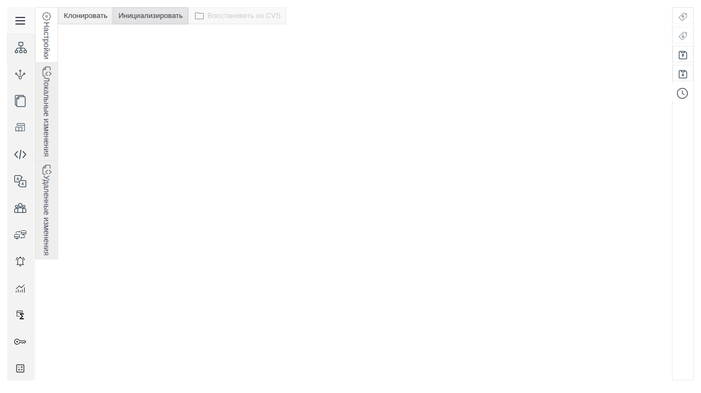
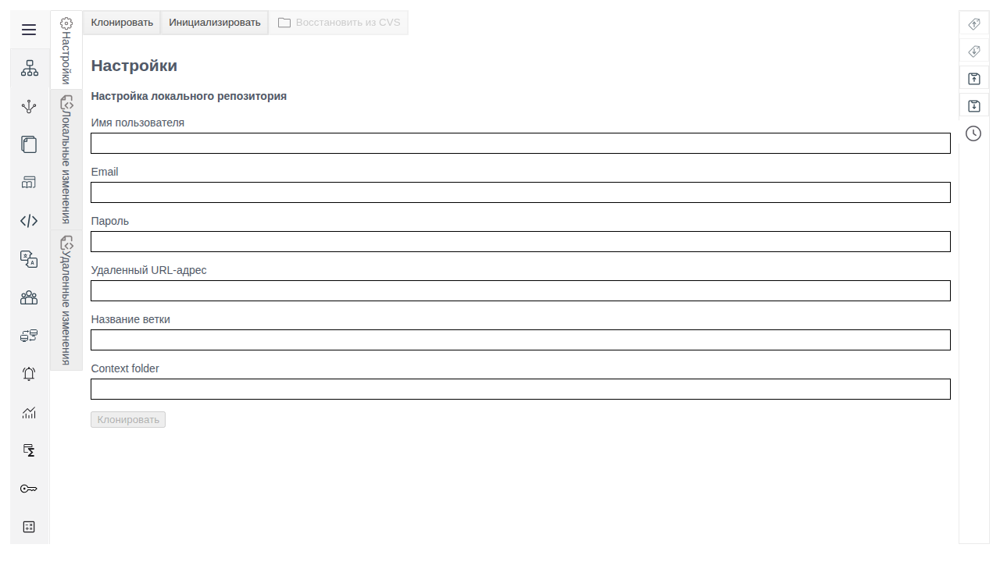

# Git in Faceplate: Configure a Connection and Exchange Configuration

A guide for Faceplate v4.0.7 integrators who connect projects to Git, transfer configuration between environments, and manage configuration versions.

The screenshots show the Russian interface. Original UI labels are retained in bold, with English explanations where needed. Example object names, field values, and commit messages are preserved so they remain consistent with the Russian guide.

## What Git does

Git stores versions of Faceplate configuration and exchanges them through a remote repository. Use it for collaborative development, preparing trials, and transferring approved changes to another environment.

Three states participate in this exchange:

| State | Contents | How it changes |
|---|---|---|
| Current project | The configuration an engineer views and edits in Studio | When objects are saved or received versions are applied |
| Local repository | Commits: recorded versions on the Faceplate server | When changes are committed or history operations are performed |
| Remote repository | Shared history on the Git server | When this environment or another contributor pushes commits |

The usual publishing cycle is: save an object in Studio → commit the change → push the commit. Receiving changes follows the reverse direction: pull commits from the server → apply them to the configuration → check the objects in Studio.

Saving an object does not create a commit. Creating a commit does not push it to the server. Receiving changes can modify or delete objects in the current project.

Version control covers configuration, not measurement history. The Git server administrator prepares the repository and its permissions.

### Where to perform operations

1. Open **Меню** (Menu) in Faceplate.
2. Select **Студия** (Studio).
3. Sign in to Studio with your account if a login window appears.
4. Open **Меню** in Studio.
5. Select **Git**.

| Tab | Main actions | Purpose |
|---|---|---|
| **Настройки** (Settings) | **Клонировать** (Clone), **Инициализировать** (Init), save personal credentials, reset the connection, **Восстановить из CVS** (Restore from CVS) | Connect to a repository and manage the local copy |
| **Локальные изменения** (Local changes) | **Зафиксировать** (Commit), **Загрузить** (Push), **Merge request**, **Сброс** (Reset) | Commit and push changes, request a merge, and discard uncommitted edits |
| **Удаленные изменения** (Remote changes) | **Выгрузить** (Pull), **Откатить** (Rollback), **Слияние веток** (Rebase) | Receive changes, use history, and bring changes across branches |

In this interface, **Загрузить** sends local commits to the Git server. **Выгрузить** receives changes from the server and applies them in Faceplate.

> [!NOTE]
> Empty change tabs do not confirm that the project matches the server. Do not rely on content comparison or file highlighting in the interface shown here. Check the objects themselves and the relevant branch history on the Git server.

## Prerequisites

Before connecting for the first time, agree on the configuration to transfer and how to restore access. A folder containing training objects alone does not restrict every Git operation to that folder.

| Requirement | What to check before starting |
|---|---|
| Studio access | The Faceplate account can open Git and modify the required objects |
| Git on the Faceplate server | Git is installed and available to the Faceplate process; the administrator verifies this |
| Network access | The Faceplate server itself can reach the Git server; signing in to GitLab in a browser does not establish this |
| Remote repository | The HTTPS URL, source branch, and person responsible for its contents are known |
| Git credentials | A personal username and password, or a server-approved access method using the password field, are available |
| Git permissions | Read permission is sufficient to receive changes; pushing and requesting a merge require the corresponding server permissions |
| Compatible configuration | The repository contains a Faceplate export with the required structure and objects, rather than arbitrary source files |
| Backup | The current configuration is saved; the recovery procedure and an account that can sign in after import are known |
| Publishing scope | The exported configuration contains no unapproved addresses, credentials, or unrelated objects |

A Faceplate login, personal Git credentials, and a GitLab browser session serve different purposes. Signing in to one service does not provide access to another.

Enter the password directly in the form field. Do not put it in a URL, commit message, screenshot, or support request. If the Git server accepts a token instead of a password, use only the method prepared by its administrator; the form has no separate token type setting.

### Choose a connection method

| Task | Action | What to consider |
|---|---|---|
| Receive configuration from an existing branch | **Клонировать** | Applies the repository configuration to the current environment; objects can be created, updated, and deleted |
| Start version history for the current configuration and link it to a prepared repository | **Инициализировать** | Uses main, accesses the existing main branch, and performs an initial push |
| Change a personal password or commit author while keeping the connection | Save personal details in **Настройки** | The URL, branch, and context remain shared connection parameters |
| Connect to another URL, branch, or context | Reset the connection and configure it again | Removes local history and saved Git access for all users |

**Инициализировать** does not create a repository on the Git server. Prepare a compatible main branch in advance. Do not assume an empty repository is a supported starting state for this procedure.

### Shared settings and personal details

The remote URL, branch, and **Context folder** belong to the shared connection on this Faceplate server. They become read-only after connecting. The user supplies the username, Email, and password. Saving these fields does not test communication with the Git server.

The username and Email also contribute to the commit author identity. Before committing after a user change, check whose name will appear in history.

**Context folder** specifies a project context within the exported configuration. It is not a directory on the user's computer. An empty value means no context. A context allows changes to be received for a selected part of the project; it does not isolate global data during initial cloning or restrict the export scope when committing.

### Training data

НС01 is the example identifier for training pumping station No. 1. The letters НС are Cyrillic. In Faceplate, the station is represented by a project folder named НС01, prepared by the administrator in the training configuration snapshot. Its **Заголовок** (Title) field indicates the work stage and has no physical units.

| Data | Example value |
|---|---|
| Repository URL | https://git.example.org/training/ns01.git — a fictional address; replace it with your approved HTTPS URL |
| Source branch | main |
| Trial branch | ns01-trial |
| Context for one station | НС01 |
| Initial НС01 title | база (baseline) |
| Title after the local edit | испытание (trial) |
| Title after approval | согласовано (approved) |
| Example Git username | integrator01; replace it with your login |

The scenario for receiving НС01 can be started independently. The administrator prepares a complete, compatible snapshot containing НС01 and known access after import. Later scenarios use its result and the additional prerequisites specified at the start of each stage.

For your own object, replace the НС01 name, context, messages, and reference values. Retain the checks for import scope, access, and the data to be sent.

## Receive the prepared НС01 configuration

A basic scenario for an integrator: connect to the existing main branch and check the station in Studio.

| Prerequisite | Required state |
|---|---|
| Git in Faceplate | The connection has not been configured |
| main branch | Contains a complete, compatible snapshot and the НС01 folder with the title “база” |
| Account after import | Known and has the required permissions in the imported configuration |
| Current project | Backed up; its replacement has been approved |

> [!WARNING]
> Cloning without a context can change the project, libraries, environment, object types, users, groups, and permissions. Objects absent from the snapshot may be deleted. The current administrator account is not guaranteed to be retained. Check the source and how to restore access before proceeding.

### Clone the branch

1. Open **Git → Настройки** in Studio.
2. Click **Клонировать**.
3. Select **yes** when asked to save the current project.
4. Save the project in the export dialog that opens.
5. Check that the backup file was saved before filling in the Clone form.

6. Enter your Git login in **Имя пользователя** (Username).
7. Leave **Email** empty to use an automatically generated author address.
8. Enter the access credential in **Пароль** (Password).
9. Enter the approved address in **Удаленный URL-адрес** (Remote URL).
10. Enter main in **Название ветки** (Branch name).
11. Leave **Context folder** empty for the complete training snapshot.
12. Click the final **Клонировать** button in the completed form.
13. Wait for the operation to finish.

The empty form does not populate main automatically. Enter the existing branch name exactly: an unknown name can create a new local branch instead of reporting a typo.

The form opens immediately after the backup export. It also opens if the export dialog is cancelled, so seeing the form does not confirm that a backup exists. Complete the backup first if no file was saved.

If a backup is already available, decline the first question with **no** and confirm continuation with **yes**. This opens the form; only the final **Клонировать** performs the transfer. Answering **no** to both questions cancels the transition to cloning.

### Verify the received station

1. Reopen **Git → Настройки**.
2. Check the remote URL and main branch.
3. Check that the context is still empty.
4. Find the НС01 folder in the Studio project tree.
5. Select its row.
6. Click **Редактировать** (Edit).
7. Check **Заголовок**: the expected value is “база”.
8. Close the form without saving.
9. Test the prepared account in a separate private browser session.
10. Open **Локальные изменения**.
11. Open **Удаленные изменения**.

The result is verified by the expected НС01 object, connection parameters, and access to the imported configuration. An empty change list does not replace these checks. Duration depends on snapshot size and communication with the Git server; no fixed completion time is specified.

## Publish a change to НС01

An intermediate scenario for an integrator: link the current configuration to a prepared main branch, change the station title, and make the version available to colleagues.

| Prerequisite | Required state |
|---|---|
| Previous scenario result | НС01 exists, its title is “база”, and access works |
| Remote main | The responsible person has confirmed compatibility with initial publishing of the current project |
| Backup | Up to date; all required local commits have been pushed |
| Publishing permission | The complete export scope, including shared configuration groups, has been approved |
| Exclusion exercise | Deleting exported files from the selected training catalog group has been approved separately |

### Configure the connection again

> [!WARNING]
> **Сброс** in **Настройки** deletes the local Git history, connection settings, and saved Git access for every user on this environment. The Faceplate configuration and remote repository remain. Do not use this action for an ordinary password correction.

1. Open **Git → Настройки**.
2. Click **Сброс** in the connection settings.
3. Confirm the reset.
4. Check that НС01 is present in Studio.
5. Check its **Заголовок**: the expected value is “база”.
6. Return to **Git → Настройки**.
7. Click **Инициализировать**.
8. Enter your Git login in **Имя пользователя**.
9. Enter the author's Email or leave **Email** empty.
10. Enter **Пароль**.
11. Enter the prepared **Удаленный URL-адрес**.
12. Click the final **Инициализировать** button in the form.
13. Wait for the operation to finish.

Init uses main and includes an initial push. This publishes configuration, so its approved scope must be checked before clicking the final button.

After successful initialization, reopen **Настройки**. The approved URL and main branch are expected. Check the initial commit and its author on the Git server. If initialization fails, do not proceed to committing НС01; investigate using “Connection and exchange troubleshooting”. Settings and the local copy may already have changed before the failure. Check their state before retrying.

### Edit and commit the title

1. Select the НС01 folder in Studio.
2. Click **Редактировать**.
3. Set **Заголовок** to “испытание”.
4. Save the form using its save button.
5. Reopen the НС01 properties.
6. Check the saved value “испытание”.
7. Open **Git → Локальные изменения**.
8. Click **Зафиксировать**.
9. Enter “НС01: испытание” in **message**.
10. Leave **ignore** empty for the approved complete training configuration.
11. Submit the form using its save button.
12. Wait for the commit to finish.

The expected result is a local commit with the message “НС01: испытание”. It appears on the remote server only after a push. Committing contacts the server to check branch state, so it must not be assumed to work without network access.

### Push the commit

> [!WARNING]
> A commit exports configuration beyond the НС01 folder. Before pushing, the person responsible for Git must approve the local commit's changed and deleted files. If the built-in view does not allow its contents to be checked, stop the push until that approval is available.

1. Obtain approval of the local commit's contents.
2. Click **Загрузить** on **Локальные изменения**.
3. Wait for the push to finish.
4. Open main in the Git server's web interface.
5. Find the commit “НС01: испытание”.
6. Check its author and changes.
7. Check the НС01 **Заголовок** in Studio: “испытание”.

The server history confirms publication. The saved value in Studio confirms the object's current state. These are separate checks.

### Check exclusions on training data

Exclusions apply to a particular commit. They do not protect files already present on the server. In particular, excluding a group can delete its previously exported files in the new commit.

Perform this stage only on a training configuration where deletion of the exported catalog group has been approved in advance. The source group must contain only approved training objects. The НС01 folder stays within the project scope.

1. Open **Локальные изменения** after pushing the previous commit.
2. Click **Зафиксировать**.
3. Enter “Учебная фиксация: исключены каталоги” in **message**; this means “Training commit: catalogs excluded”.
4. Select **catalogs** in **ignore**.
5. Submit the form using its save button.
6. Have the local commit checked against the approved deletions.
7. Click **Загрузить** only after its contents have been approved.
8. Check the new commit and group deletions in the Git server history.
9. Check that the НС01 title remains “испытание”.

Excluding the entire project is unsuitable for publishing a change to НС01. Excluding users, groups, or permissions also does not guarantee preservation of their previous export. For a working configuration, first agree on the scope policy and its consequences with the person responsible for Git.

## Prepare a trial branch for НС01

An advanced scenario for a lead integrator: create a station branch, save a second engineer's personal access, and receive an approved change.

| Prerequisite | Required state |
|---|---|
| НС01 | The published result, with the title “испытание” |
| Default branch on the Git server | main with the required source configuration |
| New branch name | ns01-trial is not already in use |
| Station location in the snapshot | НС01 is directly under the exported project root |
| Users | Two prepared Faceplate accounts with the required permissions; each engineer has personal Git access |
| Remote change to receive | The responsible person will set the title to “согласовано” in ns01-trial after the branch has been created and pushed |

### Connect a new branch with a context

A new local branch starts from the remote repository's default branch, which is not necessarily main. Before configuring it, confirm that the source branch contains the required НС01 state.

> [!WARNING]
> Reconnecting uses reset and Clone with the same effects on history, access, and configuration as the previous procedures. **Context folder** does not guarantee preservation of shared libraries, environment settings, or users during Clone.

1. Save an up-to-date project backup.
2. Check that all required commits have been pushed.
3. Reset the connection through **Git → Настройки → Сброс**.
4. Open **Клонировать**.
5. Save the backup and check the saved file as in the first scenario.
6. Enter your personal Git credentials.
7. Enter the approved repository URL.
8. Enter ns01-trial in **Название ветки**.
9. Enter НС01 in **Context folder**.
10. Click the final **Клонировать** button.
11. Wait for the operation to finish.
12. Check the ns01-trial branch and НС01 context in **Настройки**.
13. Check НС01 in Studio: the expected title is “испытание”.
14. Push the new branch with **Загрузить** after checking its approved contents.
15. Check that ns01-trial exists on the Git server.

For НС01 directly under the exported project root, enter only НС01. Do not add the export root directory name or a server path. If the station is nested more deeply, agree on the context and the resulting object layout before importing.

Creating a local branch does not establish that it exists on the server or that an upstream tracking branch is configured. If later operations report a missing upstream or the settings do not open, stop and report the state to the person responsible for Git. Cloning again with a different arbitrary name does not address the cause.

### Save the second engineer's personal access

1. Sign in to Faceplate with the second prepared account.
2. Open **Git → Настройки**.
3. Check the shared URL, ns01-trial branch, and НС01 context.
4. Enter your personal Git **Имя пользователя**.
5. Set the author's **Email** or leave it empty.
6. Enter your Git **Пароль**.
7. Click **Save** for personal details.

The expected result is saved personal credentials with the shared connection parameters unchanged. Successful saving does not confirm server authentication. Actual access is checked by the next approved pull operation.

### Receive the approved title

Before pulling, the responsible person must publish the НС01 title change to “согласовано” in ns01-trial. No required uncommitted edits should remain on the current environment.

1. Check the branch and published change in the Git server's web interface.
2. Open **Git → Удаленные изменения**.
3. Click **Выгрузить**.
4. Confirm that the changes should be received.
5. Wait for the operation to finish.
6. Open the НС01 properties in Studio.
7. Check **Заголовок**: the expected value is “согласовано”.
8. Compare the applied change with the ns01-trial history on the Git server.

With a context set, pulling applies changes to the corresponding part of the project. This context-based pull does not synchronize shared libraries, environment settings, or local settings. Their transfer requires a separately agreed procedure.

## Complete trials and restore the approved НС01 state

An advanced scenario for a lead integrator: prepare a merge request and practice the different ways to restore configuration. Perform recovery stages on a training environment with known reference states.

| Stage | Required preparation |
|---|---|
| Rebase and merge request | ns01-trial, a compatible remote ns01-reviewed branch, main as the target, and a Git server supporting merge requests through push options |
| Local reset | A known latest local НС01 commit with the title “согласовано” |
| Restore from the local copy | A separate complete training snapshot without a context, working remote branch tracking, and a local unpushed commit |
| Rollback through history | Two published reference states: A — “база”, B — “испытание”; the selected branch permits pushing a new commit |
| Every stage | An up-to-date backup, known access after import, and approved changes |

### Prepare a merge request

**Слияние веток** brings changes from a selected remote branch into the current branch using rebase. It does not switch the active branch. Agree on change compatibility before starting. For this example, prepare ns01-reviewed so that the expected НС01 title remains “согласовано” after the changes are applied.

1. Finish committing and pushing the current ns01-trial changes.
2. Open **Удаленные изменения**.
3. Click **Слияние веток**.
4. Select ns01-reviewed from the remote branch list.
5. Confirm with **Слияние веток**.
6. Wait for the changes to be applied.
7. Check НС01 in Studio: the expected value is “согласовано”.
8. Check the other objects affected by the approved change.
9. Open **Локальные изменения**.
10. Click **Merge request**.
11. Check the request in the Git server's web interface.
12. Check ns01-trial as the source, main as the target, and the request contents.

Opening the branch list already retrieves information from the server. **Merge request** starts a push with request creation options; it is not a preview. The request targets main. Creating a request does not mean main has been updated: further review takes place on the Git server.

If a conflict occurs, do not treat rebase as successful or proceed to the request. There is no built-in step-by-step conflict editor here; the person responsible for Git determines the recovery procedure.

### Discard an uncommitted edit

**Сброс** on **Локальные изменения** restores the configuration to the current local commit. It does not remove existing commits or select individual files.

1. Check that the latest local commit contains the title “согласовано”.
2. Open the НС01 properties in Studio.
3. Change **Заголовок** to “испытание”.
4. Save the form without committing to Git.
5. Open **Git → Локальные изменения**.
6. Click **Сброс**.
7. Confirm that uncommitted edits will be lost.
8. Wait for the operation to finish.
9. Reopen НС01.
10. Check **Заголовок**: the expected value is “согласовано”.

This verifies a return to the local version. It does not establish a match with the current remote branch. The operation also contacts the server and applies configuration from the local copy according to the context.

### Restore configuration from the local copy

**Восстановить из CVS** imports the current local configuration files into Faceplate again. The date beside the action does not select an arbitrary historical version.

For this stage, the responsible person prepares a complete training snapshot without a context: remote reference A with the title “база” and local commit B with the title “испытание”, not yet pushed. Remote branch tracking must work. Do not reuse the context-based environment without this preparation.

> [!WARNING]
> Restore runs without a context or selectable exclusions. It can create, update, and delete shared configuration objects and change access. A single positive confirmation starts the import immediately.

1. Check that local copy B contains the approved complete configuration.
2. Change only the НС01 **Заголовок** in Studio to “согласовано”.
3. Save the form without a new Commit or Push.
4. Reopen **Git → Настройки** to refresh the action state.
5. Click **Восстановить из CVS** if it is available.
6. Confirm the restore.
7. Wait for the import to finish.
8. Check НС01: the expected title is “испытание” from local copy B.
9. Check the complete approved object set and user access.

The action depends on local commits that are ahead of the tracked remote history. After a push, that range may be empty and the button unavailable. For an ordinary uncommitted edit, use local **Сброс** if its result meets your needs.

### Return to a state from history

**Откатить** creates a new commit containing the selected version's state. The selected commit and its changes are retained: the operation returns to its result rather than undoing that commit itself. Later commits remain in history.

For this example, prepare published A with the title “база” and B with the title “испытание”, where B is the current version. Selecting A should produce a new commit C with the title “база”.

> [!WARNING]
> Rollback automatically pushes the new commit to the Git server. Before the final confirmation, check the branch, selected reference state, and approved scope of the rollback. No separate Push command is required to complete this action.

1. Open **Git → Удаленные изменения**.
2. Click **Откатить**.
3. Find reference A in history by its identifier, message, and author.
4. Select its row.
5. Confirm the selection using the form's save button.
6. Confirm the warning about losing unpushed changes.
7. Wait for rollback and push to finish.
8. Open НС01 in Studio.
9. Check **Заголовок**: the expected value is “база”.
10. Find the new revert commit C in the selected branch's history on the Git server.
11. Check that B remains in history.
12. Check the other objects affected by the rollback.

Application is based on the differences between the selected versions. Unrelated edits to the current configuration outside those differences may remain. A completion notification does not replace checks of the objects and remote history.

If the push fails, the local configuration and new commit may already have changed. Check both states before retrying; clicking again is not a safe connectivity test.

## Field and state reference

### Connection parameters

Fields in a new form are empty. The user supplies required values; Clone does not automatically populate main.

| Field | Required status and initial value | Purpose and restrictions |
|---|---|---|
| **Имя пользователя** (Username) | Required; empty | Git access login; also used for commit authorship. Does not replace the Faceplate account |
| **Email** | Optional; empty | Author address. If empty, an address such as integrator01@faceplate.io is generated from the specified login |
| **Пароль** (Password) | Required; empty, masked input | Access credential for the Git server. Do not place it in other fields |
| **Удаленный URL-адрес** (Remote URL) | Required; empty | Existing repository address. Use an approved HTTPS URL without an embedded password. Read-only after connecting |
| **Название ветки** (Branch name) | Required for Clone; empty | Exact name of an existing branch or a new local branch. Init uses main without this field. Read-only after connecting |
| **Context folder** | Optional; empty | Context within the project. Empty means no context. Read-only after connecting |

For a nonempty Email, format validation accepts a domain ending of two to four Latin letters. If a valid corporate address fails this check, do not invent an address; agree on an option with the administrator, or leave the field empty and account for the automatically generated author identity.

The completed form checks that required values are present. It does not establish that the repository exists, the branch is correct, or pushing is permitted. These conditions are checked during an actual Git operation.

### Commit message and exclusions

| Field in **Зафиксировать** | Value |
|---|---|
| **message** | Required message describing a specific change; example: “НС01: испытание” |
| **ignore** | Groups to exclude from this commit; nothing is selected initially |

The **ignore** options use technical group names:

| Listed value | Configuration group |
|---|---|
| **global_libraries** | Shared libraries |
| **environment** | Environment |
| **primitives** | Primitives |
| **catalogs** | Catalogs |
| **prototypes** | Prototypes |
| **usergroups** | User groups |
| **users** | Users |
| **project** | Project, including НС01 |
| **user_rights** | Screen permissions |

An excluded group may disappear from the exported version. Check deletions as carefully as additions and modifications. A later full export may include previously excluded data again; this list is not a persistent exclusion policy.

### Select a branch or version

| Form | User selection | What to check |
|---|---|---|
| **Слияние веток** | A remote branch from the list retrieved from the server | This is the source of changes for the current branch; an empty selection is not allowed |
| **Откатить** | A history row containing a commit identifier | Message, author, date, and known object state; do not select by row number alone |

History uses the **Commit hash**, **Commit date**, **Message**, and **Author** columns. Commit dates are in UTC. To identify an agreed version unambiguously, keep its identifier together with the message.

### Distinguish recovery operations

| Action | Effect | What to verify afterward |
|---|---|---|
| **Настройки → Сброс** | Deletes local Git history, the connection, and saved Git access for all users | The project remains; the connection needs to be configured again |
| **Локальные изменения → Сброс** | Returns configuration to the current local commit according to the context; discards uncommitted edits | Reference values match the local commit; commit history is retained |
| **Восстановить из CVS** | Imports the current local copy without a context or exclusions | The complete contents, object values, and access match the prepared local reference state |
| **Откатить** | Creates a commit containing the selected version's state, applies differences, and automatically pushes the result | Required objects are restored; the new commit appears in the remote branch |

### Connection states

| Observation | What it confirms | Additional check required |
|---|---|---|
| **Клонировать** and **Инициализировать** are available; parameters have not been entered | Initial setup state | Prepare the source and personal access |
| URL, branch, and context are displayed | Shared connection parameters are saved | Test communication with an actual approved operation |
| Personal details were saved through **Save** | User details were recorded | Check authentication and permission for the required operation |
| A local commit was created | A version was recorded on the Faceplate server | Check the push and the remote history contents |
| **Восстановить из CVS** is unavailable | No available action state was found when settings opened | Check commits ahead of upstream and branch tracking; this does not indicate whether a backup exists |
| Change lists are empty | The view shows no items | Check objects and Git history; synchronization is not established |

## Connection and exchange troubleshooting

On failure, record the message, operation, current branch, and time. Do not attach a password, token, access field contents, or a full screenshot of a form containing personal details.

| Symptom | Checks and possible cause | Action | Recovery check |
|---|---|---|---|
| The final Clone or Init button is disabled | A required form field is empty | Check login, password, and URL; for Clone, also check the branch name | The button becomes available; server access is checked separately |
| Email is rejected | **Email** fails the built-in format check | Correct the address or leave it empty if agreed | Details save successfully; a later commit has the expected author |
| Git is missing from the server | The server Git program is unavailable | Send the message to the Faceplate administrator | The same approved operation starts without a missing-Git error |
| The repository is inaccessible | Check the URL and Git server accessibility from the Faceplate server itself | Have the responsible administrator correct the URL or network access | The approved branch can be received |
| Git access is denied | Check the current Faceplate user's personal credentials and Git server permissions | Correct personal details and click **Save**, then repeat the approved operation | The operation succeeds, not just the save |
| Commit fails with a message entered and exclusions empty | Check **message**, **ignore**, and the exact form or operation error | Report the error to support; do not select an arbitrary group as a workaround because it changes version contents | A commit is created with the required contents and no unintended exclusions |
| Commit reports differences from the remote branch | New server changes exist, or the previous local commit has not been pushed | Check history first: push the approved local commit or pull the required remote changes | Branch states are aligned and a new commit succeeds |
| Pull fails because of local changes | Unsaved or uncommitted edits prevent application | Save required data and agree on committing it or returning to the local version | Pull succeeds and НС01 has the expected title |
| A conflict occurs during pull or rebase | Changes from the two sides are incompatible | Stop further publishing and report the state to the person responsible for Git | Resolve the conflict and check objects and history before continuing |
| An object or access is missing after import | Check the source branch, context, and snapshot contents | Follow the agreed recovery procedure using a known account from the backup | Sign-in and reference objects are restored |
| An upstream error occurs after creating a branch | Expected remote branch tracking is not configured | Send the exact error to the person responsible for Git; do not recreate the connection with arbitrary parameters | Settings open and operations work on the intended branch |
| **Восстановить из CVS** is unavailable after a push | There may be no local commits ahead of upstream | Reopen settings and choose a recovery operation that fits the task | The action matches the prepared reference state; no unnecessary commit is made just to enable the button |
| An operation reports errors for individual objects | Import may have applied only part of the configuration | Save the object list and causes; compare the applied configuration with the backup | Verify the complete approved set, not just the completion notification |
| No merge request appears | Check permissions, push options support, the source branch, and main | Send the Git server message to the responsible person; a push does not establish that a request was created | The Git server shows a request with the expected branches and contents |
| Rollback changes the project but the push does not finish | A local commit may have been created before Push failed | Compare the local result and remote history before retrying | The required commit and object values are consistent on both sides |

If a message includes an object path and a cause, treat it as an indication of a possible partial import. After correcting the cause, check every affected object. Repeating the command without this check can hide an intermediate state.

## Limitations

- Shared connection settings and local history belong to the environment; each engineer does not have an independent repository.
- Context does not restrict exports during Init or Commit and does not fully isolate Clone. Restore runs without a context.
- Local reset cannot select individual files, and Restore cannot select an arbitrary date.
- Changing an existing connection's URL, branch, or context requires reconfiguration. The interface does not provide separate branch rename or delete operations.
- Commit exclusions do not replace confidentiality checks or approval of deletions.
- Use approved HTTPS access for the connection described here. There is no separate SSH key setup wizard.
- Commit and local reset contact the server; do not assume these actions work offline.
- Built-in views do not replace commit content checks. A completion notification does not guarantee successful application of every object.
- A publishing error does not mean all preceding local changes were automatically undone. Compare the project and history before retrying.
- Merge requests target main; server support and user permissions must be ready before clicking **Merge request**.
