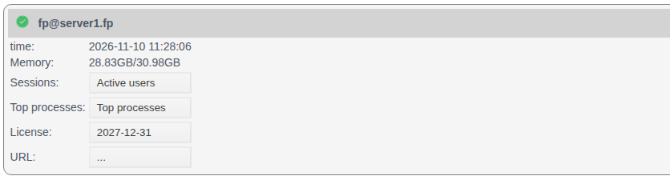
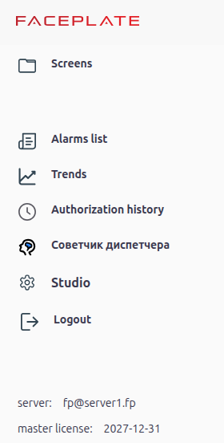
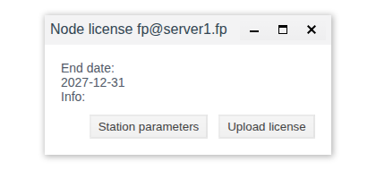
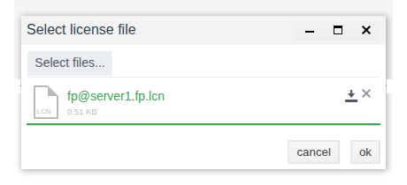
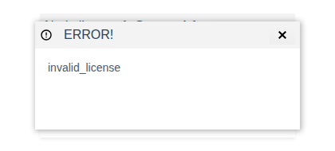
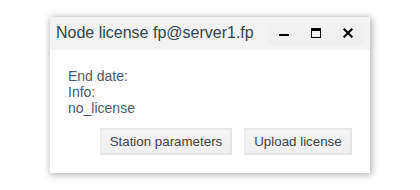
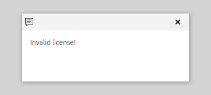

# Licensing

This document is for the integration engineer who puts FACEPLATE nodes into operation: where to check a node's license, how to obtain and upload it, and what the operator sees when there is no license or it is about to expire.

# Contents

- [Glossary](#glossary)
- [Introduction](#introduction)
- [Main part](#main-part)
    - [Where the license is shown](#where-the-license-is-shown)
    - [The Node license window](#the-node-license-window)
    - [Obtaining and uploading a license](#obtaining-and-uploading-a-license)
    - [A node without a license](#a-node-without-a-license)
    - [License expiry](#license-expiry)
- [Conclusion](#conclusion)

# Glossary

| Term | Meaning |
|---|---|
| Node | One FACEPLATE server named like `fp@<host>`. Cluster nodes are listed on the **Servers** panel, see [Cluster nodes](../nodes/nodes.md) |
| Node license | Permission for a specific node to run. Uploaded to each node separately |
| Station parameters file | The `<node name>.stn` file that Studio saves for a node. The supplier issues the license from it |
| License file | The `.lcn` file received from the supplier. It is uploaded to the node it was issued for |
| End date | The last day the license is valid, as `YYYY-MM-DD` |

# Introduction

A license is issued per node, not per project: a cluster of three servers needs three licenses, each issued from the parameters of its own node. That is why the license is checked whenever a new server is put into operation or a node is moved to other hardware.

The document answers three questions:

- where to see whether a node has a license and until when it is valid: in Studio for all nodes at once, in Runtime for the node the operator is connected to;
- how to obtain and upload a license;
- what happens at the operator workstation when there is no license or it is about to expire.

You will need access to Studio (`http://<server>:9000/fp/studio`) with an account that has permission to modify the project.

# Main part

## Where the license is shown

**Studio.** Select **Servers** in the left menu. In each node card the **License** line shows the license end date, or `...` if there is no license. This is the only place where the licenses of all cluster nodes are visible at once.

**Runtime.** Open the menu with the ☰ button in the top left corner. At the bottom of the menu:

- `server` is the node Runtime is connected to;
- `master license` is the license of that node: the end date or `no`.

| | Studio, **Servers** panel | Runtime, menu |
|---|---|---|
| Which nodes | All cluster nodes | Only the node Runtime is connected to |
| What you can do | View, save the station parameters file, upload a license | View only |
| Warnings | None | A notification every 10 minutes if there is no license or fewer than 5 days are left |

## The Node license window

Click the **License** value in the node card. The **Node license <node name>** window opens.

| Element | Purpose |
|---|---|
| **End date** | The last day the license is valid. Empty if there is no license |
| **Info** | License details. If there is no license, the reason is shown here, for example `no_license` |
| **Station parameters** | Saves the station parameters file `<node name>.stn` to the browser's downloads folder |
| **Upload license** | Opens the **Select license file** window to upload a `.lcn` file |

## Obtaining and uploading a license

1. On the **Servers** panel, open **License** of the node and click **Station parameters**. The browser saves a file such as `fp@server1.fp.stn`.
2. Send the file to the FACEPLATE supplier. You will receive a `.lcn` license file for this node in return.
3. In the same window click **Upload license** → **Select files...** → choose the `.lcn` file → **ok**.

After the upload a success message appears, **End date** and **Info** are filled in the window, and **License** in the node card. Runtime shows the new license in its menu without a restart.

In a cluster, repeat the steps for each node: the station parameters file describes one node and the server it runs on. If you upload a file issued for another node, an **ERROR!** window with `invalid_license` appears and the node license does not change.

For the same reason a new license is needed if the node is moved to another server or its name in `vm.args` is changed: save the station parameters file again at the new location.

## A node without a license

A node without a license works as usual: the project does not stop, and Studio and Runtime restrict nothing. Studio does not warn about the missing license by itself: the missing license is visible on the **Servers** panel and in Runtime:

- in Studio, **License** in the node card shows `...`, **End date** in the **Node license** window is empty and **Info** shows `no_license`;
- in Runtime, the `master license` line in the menu shows `no` in bold;
- in Runtime, 10 minutes after login and every 10 minutes after that, a window with the text «Invalid license!» appears. The window stays on the screen until it is closed with the cross.

Everyone working in Runtime on this node sees the notification, including the operator. To keep it off the workstations, upload the license before handing the system over.

## License expiry

If fewer than 5 days are left before the end date, Runtime shows the `master license` line in bold and every 10 minutes displays the notification «The license expires on <date>! Please, extend it». After the end date the node shows the same as [a node without a license](#a-node-without-a-license): **License** `...` in Studio, `no` and the «Invalid license!» notification in Runtime; the project keeps running. To extend the license, obtain a new `.lcn` file as described in [Obtaining and uploading a license](#obtaining-and-uploading-a-license) and upload it over the old one.

# Conclusion

A license is issued for a specific node from its station parameters file and uploaded in the **Node license** window on the **Servers** panel. In a cluster each node has its own license; the **Servers** panel also shows which nodes have one and until when it is valid. The operator sees the license of their node in the Runtime menu and gets a notification every 10 minutes if there is no license or fewer than 5 days are left. Upload a license to every new node before handing the system over, and request a new one when a node is moved to another server.
