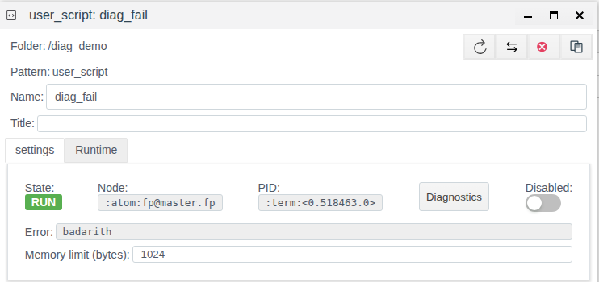

# Server logs

A document for the integration engineer who looks for the cause of a failure, or finds out who changed the project and when, using the log files on a FACEPLATE server.

# Contents

- [Glossary](#glossary)
- [Introduction](#introduction)
- [Main part](#main-part)
    - [Where the logs are](#where-the-logs-are)
    - [Size and rotation](#size-and-rotation)
    - [Log line](#log-line)
    - [Where to start the search](#where-to-start-the-search)
    - [Finding the lines of an object](#finding-the-lines-of-an-object)
    - [Who changed an object](#who-changed-an-object)
    - [Logs, Diagnostics and the Error field](#logs-diagnostics-and-the-error-field)
- [Conclusion](#conclusion)

# Glossary

| Term | Meaning |
|---|---|
| Installation directory | The folder FACEPLATE is installed to on the server. It contains the `bin`, `releases` and `logs` folders; `./faceplate console` is run from its `bin` |
| Node | One running FACEPLATE server. A node name looks like `fp@<server name>`, for example `fp@master.fp`; the same name is shown in the **Node** field of a Runtime object form and on the **Servers** panel |
| Server log | The text files `console.log` and `error.log` the node writes messages about its own work and the work of project objects to |
| Rotation | Renaming a full log file to an archive file (`console.log.0`, `console.log.1`, …) and starting a new file |
| Process | The server-side worker that performs the object's work. It is identified as `<0.518463.0>`; the same identifier is shown in the **PID** field of the object form |

# Introduction

Studio shows an object's state now: the **Error** field shows the last error, the **Diagnostics** window shows messages of one object from the moment **Start** is pressed. Server logs are written all the time, from node start, for all objects at once and for the system itself. They restore what Studio no longer shows:

- when an object started reporting an error and how often it repeated overnight;
- what happened before a connection or script stopped;
- who created, changed or deleted an object, from which address, and what exactly was changed;
- when users logged in and out;
- which FACEPLATE version the node started.

The running example is the `diag_demo` folder from [Diagnostics of Runtime objects](../diagnostics/diagnostics.md): the user script `diag_fail` fails with `badarith` on every run, once every 5 seconds; the script `diag_script` writes `cycle N` to the log every 2 seconds.

You need access to the file system of the FACEPLATE server (for example over SSH) and access to Studio (`http://<server>:9000/fp/studio`) with an account that is allowed to change the project.

# Main part

## Where the logs are

By default the node writes two files to the `logs` folder of the installation directory:

| File | What is written | What for |
|---|---|---|
| `<installation directory>/logs/console.log` | Messages of levels `info`, `notice`, `warning`, `error` and above | Full history of the node: start, user logins, project changes, work and errors of objects |
| `<installation directory>/logs/error.log` | Only messages of level `error` and above | Quick look at errors without the stream of working messages. The same lines are also in `console.log` |

`debug` messages are not written to the files. They are visible only in the **Diagnostics** window at level `debug`, see [Diagnostics of Runtime objects, section Log level](../diagnostics/diagnostics.md#log-level).

The console window where `./faceplate console` runs does not duplicate the log: read the files.

In a cluster each node writes its own files on its own server. Look for an object's messages on the node where it runs — the value of the **Node** field in the object form (see [Finding the lines of an object](#finding-the-lines-of-an-object)). The list of nodes is on the **Servers** panel, see [Cluster nodes](../nodes/nodes.md).

When installed in a Docker container, the `logs` folder is usually mapped to a folder on the server, see [Deploying in a Docker container](../../general/docker/deploy%20as%20docker.md).

The logs can be moved to another folder, for example to a separate disk, see [Resource redundancy, section Logging configuration (fp.logger.config)](../redundancy/redundancy.md#logging-configuration-fploggerconfig). The new folder is used after the node is restarted.

## Size and rotation

When a file reaches 1 GB, the node renames it to an archive numbered `.0`, shifts the previous archives by one number (`.0` → `.1` and so on) and starts a new file. The archive with the highest number beyond the limit is deleted.

| File | File size | Archives | Maximum disk usage |
|---|---|---|---|
| `console.log` | 1 GB | 10 (`console.log.0` … `console.log.9`) | about 11 GB |
| `error.log` | 1 GB | 3 (`error.log.0` … `error.log.2`) | about 4 GB |

The lower the archive number, the newer it is. To search the whole stored history, pass all files to the command at once: `grep '<text>' logs/console.log*`.

On a busy system 11 GB of `console.log` may hold only a few days. If you need a longer history, copy the archives elsewhere before they are deleted.

## Log line

Each message is one line:

```
2026-11-09 12:13:22.704800+00:00 [error] <0.518463.0>@fp_script:run/3:463 "diag_demo/diag_fail" error on user script execution badarith
```

| Part | Meaning |
|---|---|
| `2026-11-09 12:13:22.704800+00:00` | Server clock time with microsecond precision and the offset from UTC. On a server in the UTC+5 time zone the line ends with `+05:00` |
| `[error]` | Level: `info`, `notice`, `warning`, `error` and above |
| `<0.518463.0>` | The process that emitted the message. Matches **PID** in the object form until the object is restarted |
| `@` | Separator |
| `fp_script:run/3:463` | The place in the platform code that emitted the message. You can skip it when investigating. Messages from a user script have no place specified, only `:` remains in the line |
| `"diag_demo/diag_fail" error on …` | Text. Messages of project objects contain the object path |

The object path is written in different ways: scripts use the path from the project folder (`"diag_demo/diag_fail"`), connections the full path (`/root/FP/PROJECT/plat_bugs/bt_master`), change lines the path from the project root (`<<"/diag_demo/diag_fail">>`). All forms contain "folder/object", so search for that: `diag_demo/diag_fail` finds lines of any kind.

The **Diagnostics** window uses the same line format, so a line from the window can be found in the file and vice versa.

## Where to start the search

The platform and all project objects write to the logs. Every line has the same structure (see [Log line](#log-line)), so start from what you already know about the problem:

- **you know the object** — search by the `folder/object` path, see [Finding the lines of an object](#finding-the-lines-of-an-object);
- **the object has changed and it is unclear who changed it** — search for `USER ACTION`, see [Who changed an object](#who-changed-an-object);
- **the object form shows an error** — search `error.log` for the text from the **Error** field; the line gives the time and the node;
- **you need your script's own messages** — search for the text the script passes to `logger`, see [Diagnostics of Runtime objects, section Your own messages from a script](../diagnostics/diagnostics.md#your-own-messages-from-a-script);
- **you are checking database copying or closing** — see [Storages, section Checking in the log](../../data_storage/storage/storage.md#checking-in-the-log);
- **the log contains `crasher:`** — this is a process crash report. Attach it to your support request together with a few lines before and after.

## Finding the lines of an object

Start with the object form in Studio: it tells you what to look for and where.



| Form field | What it gives for the search |
|---|---|
| **Node** | Which server to open the logs on: `fp@master.fp` |
| **PID** | The object's process: `<0.518463.0>`. Narrows the search to the current run of the object |
| **Error** | Text of the last error: `badarith` |

The object path is shown in the folder header and the **Name** field: `diag_demo/diag_fail`.

All errors of the object, last lines:

```bash
grep 'diag_demo/diag_fail' logs/error.log | tail -n 3
```

```
2026-11-09 12:13:17.704793+00:00 [error] <0.518463.0>@fp_script:run/3:463 "diag_demo/diag_fail" error on user script execution badarith
2026-11-09 12:13:22.704800+00:00 [error] <0.518463.0>@fp_script:run/3:463 "diag_demo/diag_fail" error on user script execution badarith
2026-11-09 12:13:27.704813+00:00 [error] <0.518463.0>@fp_script:run/3:463 "diag_demo/diag_fail" error on user script execution badarith
```

The error repeats exactly once every 5 seconds — with the script period: the script is not restarted, it fails on every run.

The full history of the object, with starts, stops and changes, is in `console.log`:

```bash
grep 'diag_demo/diag_fail' logs/console.log
```

To follow the log in real time, showing only the object's lines:

```bash
tail -f logs/console.log | grep --line-buffered 'diag_demo/diag_fail'
```

Unlike the **Diagnostics** window, this shows both the object's own lines and the system lines about it, for example a change record from another user.

## Who changed an object

Every creation, change and deletion of an object through Studio is written to `console.log` as a `USER ACTION` line of level `info`:

| Action | What the line contains |
|---|---|
| `create object` | Path, user, IP address, field values of the new object (`fields: …`) |
| `edit object` | Path, user, IP address, changed fields: for each the new `value` and the old `previous_value` (`changes: …`) |
| `delete object` | Path, user, IP address |

In the example the script `diag_fail` was disabled with the **Disabled** switch and enabled again a minute later. In the log:

```bash
grep 'diag_demo/diag_fail' logs/console.log | grep -v 'error on user script'
```

```
2026-11-09 12:11:21.456723+00:00 [info] <0.517054.0>@fp_item:log_user_action/1:1240 USER ACTION: edit object <<"/diag_demo/diag_fail">>, user <<"system">>, ip: {172,17,0,1}, changes: #{<<"disabled">> => #{value => true,previous_value => false}}
2026-11-09 12:11:21.457658+00:00 [info] <0.499862.0>@fp_script:terminate/3:530 "diag_demo/diag_fail" stop script, reason shutdown
2026-11-09 12:11:21.458121+00:00 [info] <0.499862.0>@fp_script:log_state/3:676 "diag_demo/diag_fail" changed state to stop
2026-11-09 12:12:22.675101+00:00 [info] <0.518133.0>@fp_item:log_user_action/1:1240 USER ACTION: edit object <<"/diag_demo/diag_fail">>, user <<"system">>, ip: {172,17,0,1}, changes: #{<<"disabled">> => #{value => false,previous_value => true}}
```

The lines show:

- at 12:11:21 user `system` from address `172.17.0.1` turned **Disabled** on (`disabled`: `false` → `true`);
- in the same millisecond process `<0.499862.0>` stopped;
- at 12:12:22 the same user turned **Disabled** off.

There is no `badarith` error in `error.log` between 12:11:21 and 12:12:22; the next one is at 12:12:22 from the new process `<0.518463.0>`. That is why **PID** in the form after enabling differs from the one before disabling.

All project changes made by one user:

```bash
grep 'USER ACTION' logs/console.log* | grep 'user <<"admin">>'
```

## Logs, Diagnostics and the Error field

| | **Error** field, **Errors** column | **Diagnostics** window | Server logs |
|---|---|---|---|
| Where | Object form, **General View** | Window from a Runtime object form | Files on the server |
| What it shows | The object's last error | Messages of one object | Messages of all objects and the system |
| Time span | Only now | From **Start** until the window is closed | From node start until the file is removed by rotation |
| Levels | — | `debug`, `info`, `warning`, `error` | `info` and above (`console.log`), `error` and above (`error.log`) |
| Project changes, user logins | No | No | Yes |
| Access needed | Studio | Studio | Server file system |

Order of investigation: the **Error** field says the object is in error; the **Diagnostics** window shows what the object is doing now, including at level `debug`; server logs answer what happened earlier, on which node, and who changed the object.

Alarm messages the operator sees are a separate project message log, not server files, see [Alarms and trends on a screen](../../mnemo/alarms_trends.md).

# Conclusion

Each FACEPLATE node writes two files to `<installation directory>/logs`: `console.log` with messages from `info` up and `error.log` with errors only. The files grow to 1 GB and rotate: `console.log` keeps 10 archives, `error.log` keeps 3. The logs can be moved to another folder; the new folder is used after the node restarts. An object's lines are found by the "folder/object" path on the node from the **Node** field; the form's **PID** matches the process in the line until the object restarts. `USER ACTION` lines show who created, changed or deleted an object, when, from which address, and which fields were changed.
