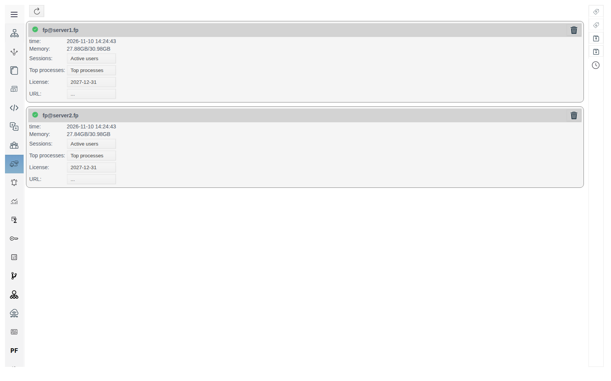
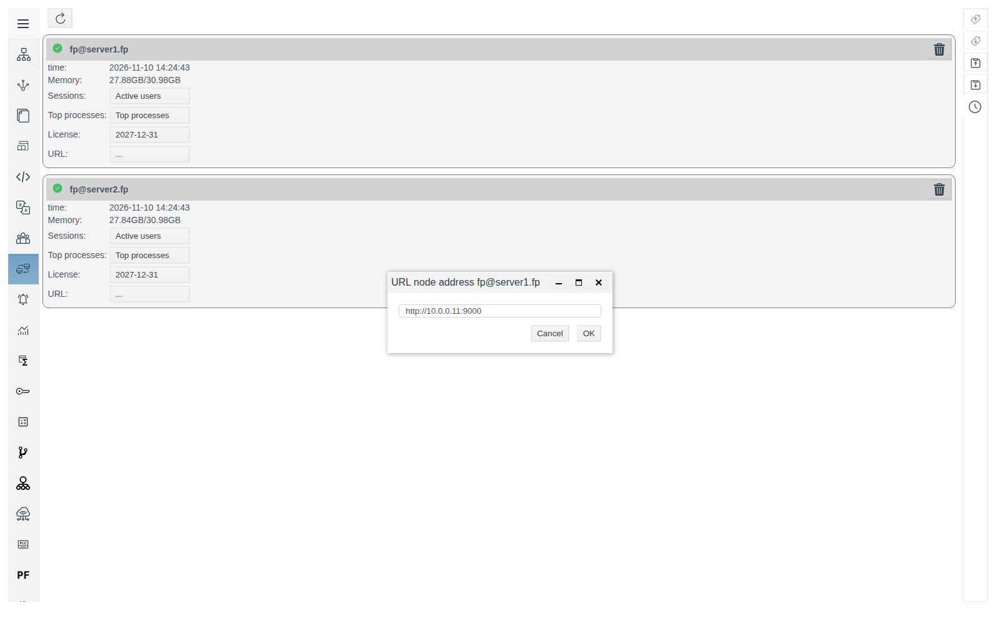
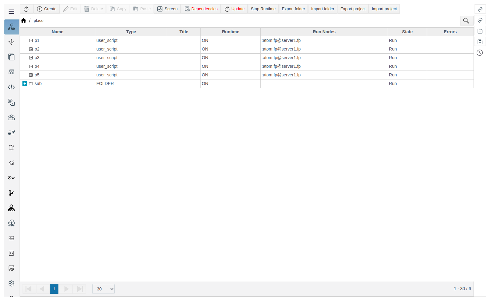
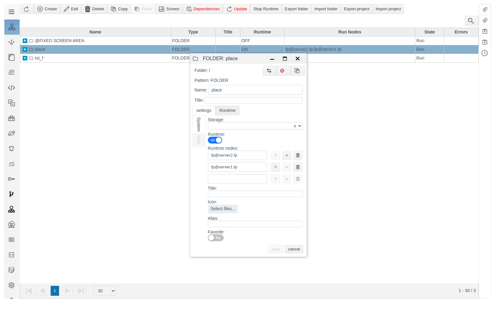
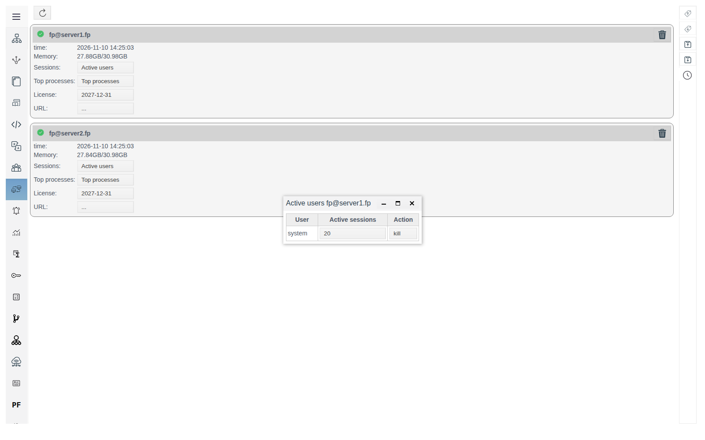
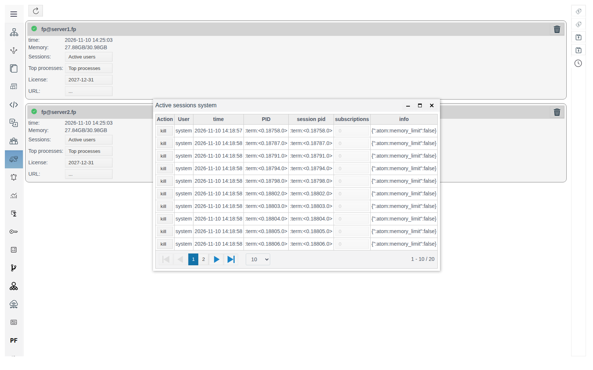
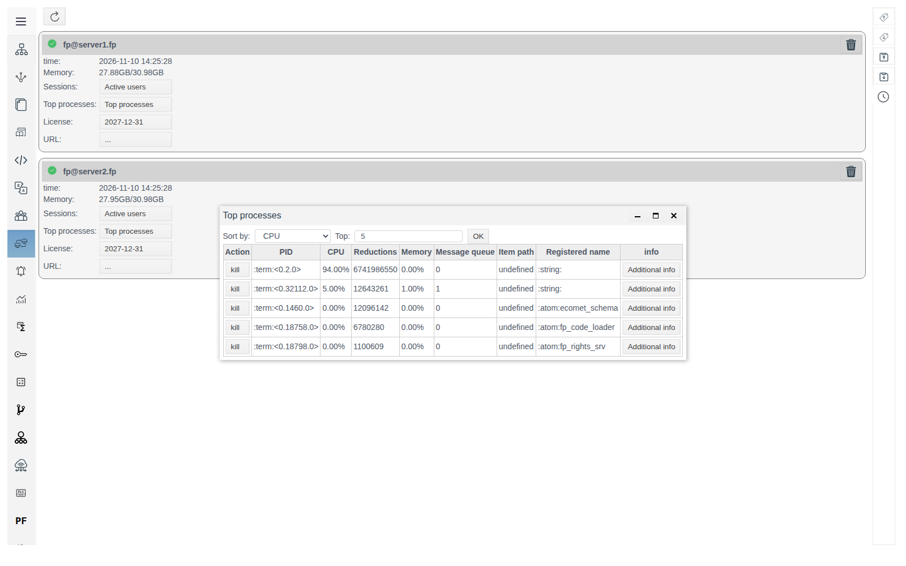
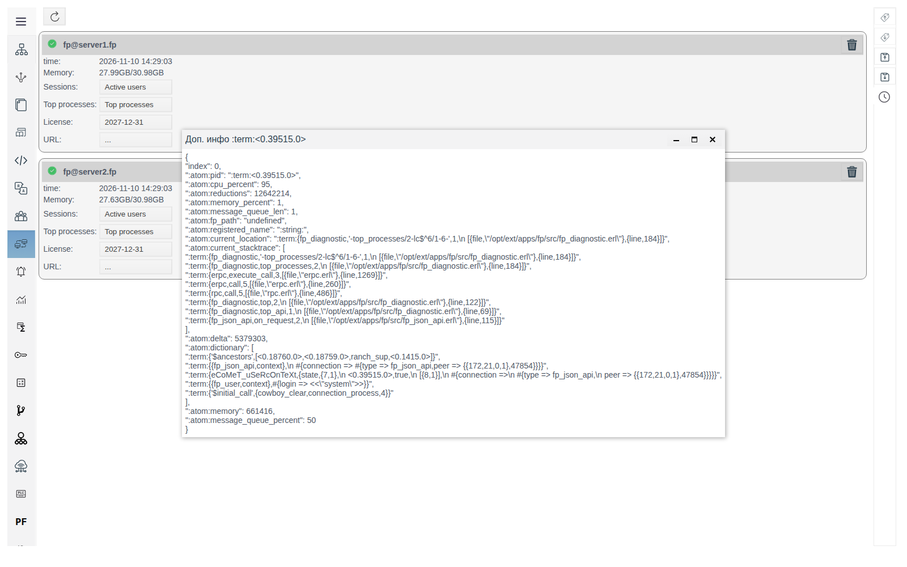
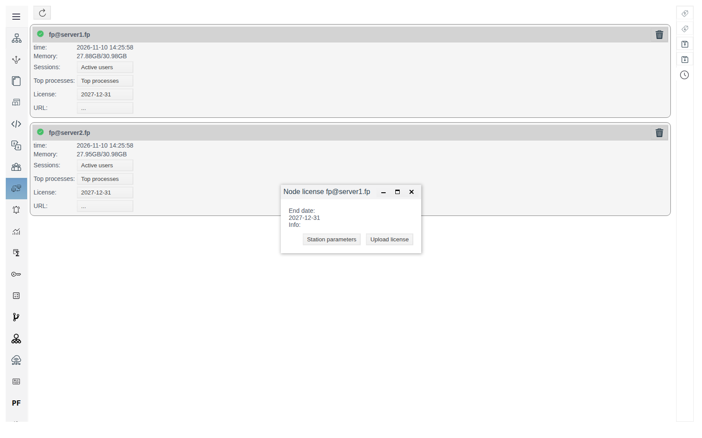

# Cluster nodes

This document is for the integration engineer who looks after FACEPLATE servers: which nodes are running, who is connected to them, what loads them, and where the operator's Runtime switches to if a server becomes unavailable.

# Contents

- [Glossary](#glossary)
- [Introduction](#introduction)
- [Main part](#main-part)
    - [Where to open the panel](#where-to-open-the-panel)
    - [Node card](#node-card)
    - [Node address for Runtime](#node-address-for-runtime)
    - [Where objects run](#where-objects-run)
    - [Active users and sessions](#active-users-and-sessions)
    - [Top processes](#top-processes)
    - [Node license](#node-license)
- [Conclusion](#conclusion)

# Glossary

| Term | Meaning |
|---|---|
| Node | One FACEPLATE server. A name like `fp@<host>` is set by the `-name` parameter in `vm.args`, see [Resource Redundancy in Faceplate](../redundancy/redundancy.md#virtual-machine-settings-vmargs) |
| Cluster | Several nodes combined into one system. Assembly is described in [Resource Redundancy in Faceplate](../redundancy/redundancy.md#starting-and-assembling-the-cluster) |
| Session | A connection to a node under a user account. Every Studio and Runtime window opens its own sessions; in addition, the node keeps service sessions created at its startup |
| Process | A worker on the node. Identified like `<0.1353.0>` |

# Introduction

The **Servers** panel is the list of cluster nodes in Studio, one card per node. It answers questions about a node as a whole: is it running, how much server memory is in use, who is connected, which processes load the node most, and what license it has.

The **Diagnostics** window ([Diagnostics of Runtime objects](../diagnostics/diagnostics.md)) works at the level of a single object: the log of a particular calculation, script, or connection. The **Servers** panel comes first, while it is still unknown which object is to blame: if the node is overloaded, **Top processes** shows the heaviest processes and the path of the project object each one belongs to. The cause is then found in that object's **Diagnostics**.

The panel's second purpose is Runtime redundancy. The node card holds the address by which the operator's Runtime connects to this node when it loses the connection to its server. The third is object placement: which node each script, calculation, or connection runs on and where it goes when a node fails.

In a single-node cluster, the panel shows one card.

You will need access to Studio (`http://<server>:9000/fp/studio`) with an account that has permission to modify the project.

# Main part

## Where to open the panel

In the Studio menu on the left, select **Servers**. The refresh button above the cards re-reads the node list and the card values.

## Node card

| Element | Purpose |
|---|---|
| Node name | `fp@<host>` |
| **time** | When the node last updated its data. For a running node, it matches the current time within a few seconds. If the node is stopped, the value stops changing |
| **Memory** | Used and total server memory, for example `22.13GB/30.98GB` |
| **Sessions** | The **Active users** button, see [Active users and sessions](#active-users-and-sessions) |
| **Top processes** | The **Top processes** button, see [Top processes](#top-processes) |
| **License** | Node license end date; `...` if no license is loaded. See [Node license](#node-license) |
| **URL** | Node address for Runtime; `...` if not set. See [Node address for Runtime](#node-address-for-runtime) |

## Node address for Runtime

The operator's Runtime is opened from one node and keeps a connection to it. On connecting, Runtime receives from the server the list of running cluster nodes and their addresses. If the connection is lost, Runtime tries the addresses in turn, connects to the first available node, loads the Runtime page from its address, and continues under the same account: the operator does not need to enter the password again.

Node address in the list:

| **URL** field | Address Runtime tries |
|---|---|
| Filled in | The **URL** value |
| Empty | Address from the node name: the host after `@` with the node's HTTP and HTTPS port, for example `http://<host>:9000` |

Set **URL** if the node's host name cannot be opened from the operator workstation: for example, it is known only inside the server network, or operators connect by IP address. Specify the address as it is opened from the operator workstation: protocol, host or IP address, and port, without a path, for example `http://10.0.0.11:9000`.

A node can accept an operator only if it holds a copy of the project database. How to add a copy on another node is described in [Storages](../../data_storage/storage/storage.md#redundancy-a-database-copy-on-a-second-server). Without a copy, Runtime does not load on such a node after the first one fails.

To set the address:

1. Click the **URL** value in the node card. The **URL node address <node name>** window opens.
2. Enter the address and click **OK**.

The address appears in the card; to its right is a cross that clears the field. The value is kept when the node restarts.

You can check switching without stopping a server: open Runtime, then in Studio terminate the session of this Runtime (see [Active users and sessions](#active-users-and-sessions)). Runtime loses the connection and connects to a node from the list. When FACEPLATE stops on a node, Runtime switches to another node within a few seconds.

## Where objects run

Runtime objects — user scripts, calculations, connections, archives — run on cluster nodes. The node an object runs on now is shown in two places:

* the **Run Nodes** column in **General View**, for example `:atom:fp@server1.fp`. A stopped object has no node;
* the **Node** field in the top panel of the object form, next to **PID**.

Which nodes objects may run on is set on the folder, not on the object itself. This is needed when an object is tied to a particular server: a PLC connection needs a server with a network route to the controller, heavy calculations need a separate server so as not to load the others. Fields in the folder form, **settings** tab:

| Field | Purpose |
|---|---|
| **Runtime** | Off — objects of the folder and its subfolders are stopped (**State** `Stop`, no node), and the folder's **Runtime** column shows `OFF`. On — objects run |
| **Runtime nodes** | Nodes on which the folder's objects may run. Enter the full node name, for example `fp@server2.fp`; an empty row for the next node appears after entry. The bin deletes a row |

| **Runtime nodes** of the folder | Where objects run |
|---|---|
| Empty | As in the parent folder. If no folder above has a list — on any cluster node: FACEPLATE distributes objects between nodes by itself |
| Set | Only on the listed nodes. Objects are distributed between them |

For a folder, the **Run Nodes** column shows its **Runtime nodes** list.

A change of the list applies when the folder is saved: objects restart on suitable nodes within a few seconds.

If a node stops, the objects that ran on it restart on another node from the list within a few seconds. For the folder's objects to survive a server failure, list at least two nodes, and each of these nodes must hold a copy of the project database, see [Storages](../../data_storage/storage/storage.md#redundancy-a-database-copy-on-a-second-server).

The **Stop Runtime** and **Start Runtime** buttons on the **General View** panel stop and start all project objects at once after confirmation.

In the example, the `place` folder lists `fp@server2.fp` and `fp@server1.fp`: the folder's five scripts ran on both nodes. After FACEPLATE stopped on `fp@server2.fp`, its script was running on `fp@server1.fp` a few seconds later.

## Active users and sessions

The **Active users** button opens the **Active users <node name>** window: the accounts connected to the node and the number of their sessions in the **Active sessions** column.

Clicking the number of sessions opens the **Active sessions <user>** window.

| Column | Meaning |
|---|---|
| **Action** | The **kill** button closes the session |
| **User** | Account |
| **time** | Time the session was opened |
| **PID**, **session pid** | Session process |
| **subscriptions** | Number of the session's data subscriptions |
| **info** | For Studio and Runtime windows, the client address (`peer`): the IP address and port the window was opened from |

The window shows 10 sessions per page; the number of rows is changed with the list under the table.

**kill** asks for confirmation and, after **yes**, closes the session. The Studio or Runtime window that owned the session loses the connection to the server: Runtime switches according to [Node address for Runtime](#node-address-for-runtime).

The session of a particular window is recognized by the **time** (login time) and **info** (workstation address) columns.

## Top processes

The **Top processes** button collects node process statistics over a few seconds and opens the **Top processes** window.

| Element | Purpose |
|---|---|
| **Sort by** | Which metric selects the processes: **CPU**, **Reductions**, **Memory**, **Message queue** |
| **Top** | How many processes to show, 5 by default |
| **OK** | Rebuild the list with the selected parameters |

| Column | Meaning |
|---|---|
| **Action** | The **kill** button stops the process |
| **PID** | Process identifier |
| **CPU** | Share of the node's CPU time during collection |
| **Reductions** | Counter of work done by the process. The larger it is, the more the process has computed |
| **Memory** | Share of node memory used by the process |
| **Message queue** | How many messages are waiting to be processed. A growing queue means the process cannot keep up with incoming data |
| **Item path** | Path of the project object the process belongs to, for example `"<folder>/<object>"`. `undefined` means a platform process, not a project object |
| **Registered name** | Name of a platform service process, if it has one |
| **info** | The **Additional info** button |

Which sort to choose:

| Symptom on the node | Sort by |
|---|---|
| CPU is busy, the interface responds slowly | **CPU** |
| Used memory in the card's **Memory** keeps growing | **Memory** |
| Data arrives with a delay | **Message queue** |

When sorted by **CPU**, the first row is usually the process that builds this very list for the current user.

If **Item path** names a project object, open its form in **General View** and start **Diagnostics**, see [Diagnostics of Runtime objects](../diagnostics/diagnostics.md#where-to-open-diagnostics).

**Additional info** opens a window with all process details: the current execution point (`current_location`) and call stack (`current_stacktrace`), memory in bytes (`memory`), message queue length (`message_queue_len`), and process service data (`dictionary`). In the `dictionary` of a session process, the account (`login`) and client address (`peer`) are given.

**kill** asks for confirmation and, after **yes**, stops the process.

## Node license

Clicking the **License** value opens the **Node license <node name>** window: the license end date, saving the station parameters file, and uploading the license file. A license is uploaded to each node separately. How to obtain and upload a license and what the operator sees without one is described in [Licensing](../license/license.md).

# Conclusion

The **Servers** panel shows each cluster node as a separate card. A node's **URL** sets the address by which the operator's Runtime switches to this node when the connection is lost: set it if the node's host name cannot be opened from operator workstations. A node accepts operators only if it holds a copy of the project database. Switching can be checked without stopping a server by terminating a Runtime session. The folder's **Runtime nodes** field sets which nodes objects run on; when a node fails, objects move to another node from the list. **Active users** shows who is connected and from where. **Top processes** finds the process that loads the node and the project object it belongs to. Look for the cause in that object's **Diagnostics**. A license is uploaded to each node from the **Node license** window.
