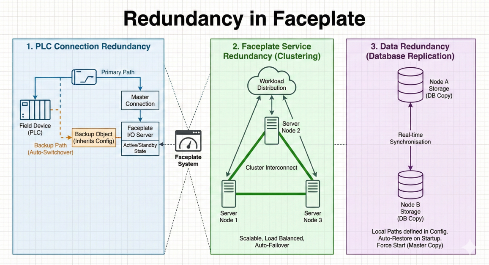
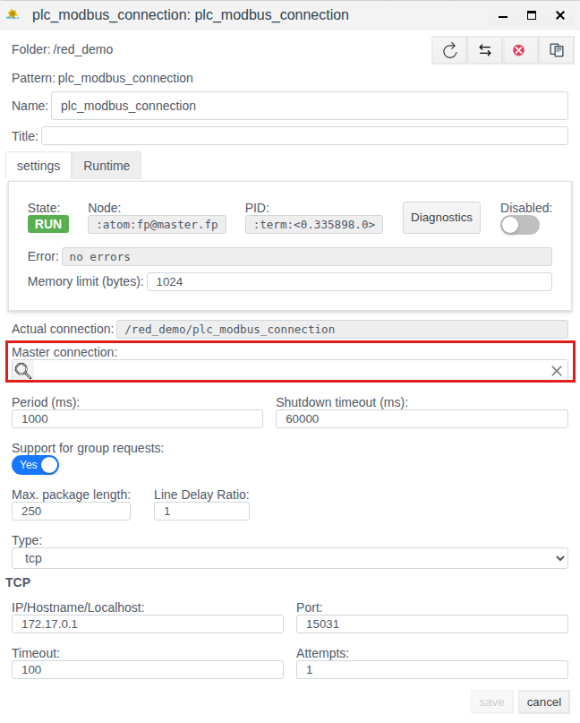
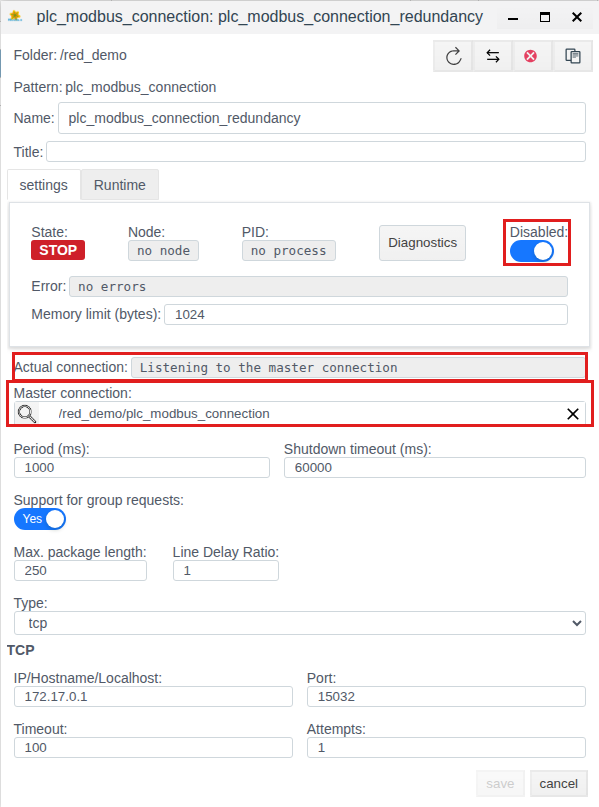
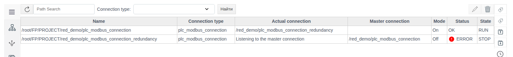
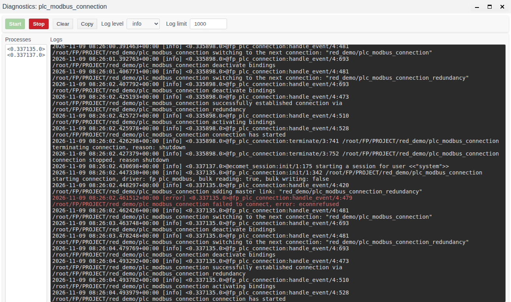

# Resource redundancy

To ensure process continuity and high availability, Faceplate implements a multi-level redundancy system. The product architecture minimizes the risk of a single point of failure by duplicating key system components.

# Contents

- [Glossary](#glossary)
- [Introduction](#introduction)
- [Main part](#main-part)
    - [Equipment connection redundancy](#equipment-connection-redundancy)
    - [Faceplate service redundancy](#faceplate-service-redundancy)
    - [Basic configuration](#basic-configuration)
    - [Starting and assembling the cluster](#starting-and-assembling-the-cluster)
    - [PLC connection redundancy](#plc-connection-redundancy)
- [Conclusion](#conclusion)

# Glossary

| Term | Meaning |
|---|---|
| Node | One Faceplate server with a name of the form `fp@<host>`. Cluster nodes are shown in Studio on the **Servers** panel, see [Cluster nodes](../nodes/nodes.md) |
| Cluster | Several servers (Runtime) combined into a single Erlang cluster |
| Database copy | An instance of a project database on a specific node, see [Storages](../../data_storage/storage/storage.md) |
| Master connection | The main PLC connection through which data is exchanged with the equipment. Its **Master connection** field is empty |
| Backup connection | A PLC connection of the same type with the backup channel parameters. Its **Master connection** field points to the main connection |

# Introduction

Faceplate makes three links redundant: equipment connections, Faceplate services, and project data.



*Figure 1. Redundancy levels in Faceplate*

| Level | Made redundant by | Described in |
|---|---|---|
| Equipment connections | A backup PLC connection | [PLC connection redundancy](#plc-connection-redundancy) |
| Faceplate services | A cluster of several servers | [Faceplate service redundancy](#faceplate-service-redundancy), [Cluster nodes](../nodes/nodes.md) |
| Project data | Database copies on several nodes | [Storages](../../data_storage/storage/storage.md#redundancy-a-database-copy-on-a-second-server) |

# Main part

## Equipment connection redundancy

Faceplate supports [various protocols](../../data_collection/plc_connections/index.md#choose-a-connection) for communication with field devices (PLCs, sensors, RTUs).

- **Mechanism:** the system allows configuring multiple data exchange paths for a single logical node.
- **Result:** if the primary communication link is lost or a network interface failure occurs, Faceplate automatically switches to the backup channel and continues telemetry collection and control command transmission.

Setting up the backup channel is described in [PLC connection redundancy](#plc-connection-redundancy).

## Faceplate service redundancy

Service redundancy is achieved through **clustering**. Multiple servers (Runtime) are combined into a single Erlang cluster. The assembly procedure is in [Starting and assembling the cluster](#starting-and-assembling-the-cluster).

- **Scaling:** processes are distributed across nodes. If one node (server) goes down, the remaining nodes continue operating, ensuring system availability. For this, the remaining nodes must hold copies of the project databases, see [Storages](../../data_storage/storage/storage.md#redundancy-a-database-copy-on-a-second-server).
- **Identification:** nodes discover each other through a shared cookie (secret key) and DNS/Hosts configuration.

What happens to the operator's Runtime when a node stops, and how project objects move to other nodes, is described in [Cluster nodes](../nodes/nodes.md).

## Basic configuration

Fine-tuning of parameters is performed in configuration files located in the release directory (for example, `/DATASET/project/scada/faceplate/releases/4.0.6/`).

### Virtual machine settings (vm.args)

The `vm.args` file defines unique Erlang environment parameters for each node:

| Parameter | Value |
|---|---|
| `-name` | Unique node name, for example `fp@rt-server1.fp` |
| `-setcookie` | A shared identifier (cookie) for all cluster servers, providing authorization for inter-node communication |
| `+MIscs` | Literal memory limit (specified in megabytes) for optimizing resource consumption |

### Logging configuration (fp.logger.config)

Configure the log output paths in the `console_handler` and `error_handler` sections, for example:

| Section | Path |
|---|---|
| `console_handler` (console log) | `/DATASET/project/scada/local/logs/console.log` |
| `error_handler` (error log) | `/DATASET/project/scada/local/logs/error.log` |

## Starting and assembling the cluster

For the nodes to join into a cluster, the servers must see each other over the network and by name and share the same `-setcookie` (see the table in [Virtual machine settings (vm.args)](#virtual-machine-settings-vmargs) above). For what to configure, see [Storages, Preparing the servers section](../../data_storage/storage/storage.md#preparing-the-servers). The initial startup is recommended to be performed in a tmux session named `scada` to ensure process continuity.

### Starting the lead node

On the first cluster server, initiate startup in console mode:

```bash
./faceplate console
```

### Joining additional nodes

To connect subsequent servers (Runtime 2, Runtime 3, or Historian), use the `ATTACH_TO` environment variable pointing to the address of an already active node.

Command for the first connection:

```bash
env ATTACH_TO=fp@rt-server1.fp ./faceplate console
```

Here `fp@rt-server1.fp` is the name of the lead node.

After a node has been successfully added to the cluster, all subsequent restarts are performed with the usual command `./faceplate console`. Connected nodes are shown in Studio on the **Servers** panel, see [Cluster nodes](../nodes/nodes.md).

## PLC connection redundancy

The Faceplate communication module supports redundant physical and logical channels through which telemetry data arrives from the equipment. The connection redundancy mechanism operates at the protocol driver level (OPC UA, Modbus TCP, IEC 60870-5-104, etc.).

**Result:** when the main channel link is lost, the connection automatically moves to the backup one, which minimizes data gaps.

### Setup in Faceplate Studio

**1. Creating the master connection.** Create a [standard connection](../../data_collection/plc_connections/general_en.md#create-the-connection-object-and-configure-the-channel) (for example, `plc_modbus_connection`). Leave the **Master connection** field empty. This connection will be the main one.

**2. Creating the backup connection.** Create a second connection of the same type (for example, `plc_modbus_connection_redundancy`) with the backup channel parameters. In the **Master connection** field, specify the main connection (select it from the list).

How to check the backup channel is described in [Bindings → Configure an alternative channel](../../data_collection/plc_connections/bindings_en.md#configure-an-alternative-channel).


*Figure 2. Main and backup connections in the folder*



*Figure 3. Creating the master connection*



*Figure 4. Creating the backup connection*

### Logs and monitoring

The connection status is displayed in the **State** (`RUN`/`STOP`) and **Status** (`OK`/`ERROR`) fields on the **PLC Drivers** page. State values are described in the [PLC connection reference](../../data_collection/plc_connections/general_en.md#states-and-diagnostic-controls).



*Figure 5. Connection status on the PLC Drivers page*

The [**Diagnostics** window](../diagnostics/diagnostics.md#the-diagnostics-window) shows the log of the current connection. The start and stop buttons start and stop logging. The [log level](../diagnostics/diagnostics.md#log-level) categorizes messages by severity and detail. Selecting a level acts as a threshold filter: messages of the selected level and all messages of higher criticality are shown.



*Figure 6. Connection diagnostics window*

# Conclusion

Faceplate makes equipment connections redundant with backup PLC connections, services with a server cluster, and data with database copies on several nodes. Node parameters are set in `vm.args` (`-name`, `-setcookie`, `+MIscs`), log paths in `fp.logger.config`. The cluster is assembled with the `ATTACH_TO` variable on the node's first start; after that, the node is restarted with the usual command. A backup PLC connection is a second connection of the same type with the main one in its **Master connection** field; its state is shown on the **PLC Drivers** page and in the **Diagnostics** window.
