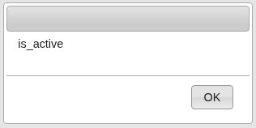
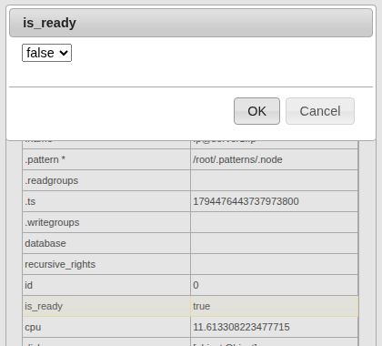
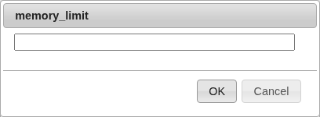

# Major update

For the integration engineer. Update types are described in [«FACEPLATE version and update»](update.md).

# Contents

- [Glossary](#glossary)
- [Introduction](#introduction)
- [Main part](#main-part)
    - [How the update goes](#how-the-update-goes)
    - [What is moved](#what-is-moved)
    - [Node console](#node-console)
    - [ECOMET management page](#ecomet-management-page)
    - [Update procedure](#update-procedure)
    - [Update with the cluster stopped](#update-with-the-cluster-stopped)
- [Conclusion](#conclusion)

# Glossary

| Term | Meaning |
|---|---|
| Node | One running FACEPLATE server. A node name looks like `fp@<server>`, see [«Cluster nodes»](../nodes/nodes.md) |
| Cluster | Nodes that work together with one project and one database |
| Installation directory | The folder on the server where FACEPLATE is installed. It contains the `bin`, `erts-<version>`, `etc`, `lib` and `releases` folders. After the first start the `logs` folder and the `DB` database appear in it, after a start in the background the `log` folder, and after the Git module is connected to a repository the `cvs` folder |
| Cookie | The cluster password in the `vm.args` file. Nodes connect only if their cookie is the same |
| `ATTACH_TO` | A variable set when a node starts: the name of the node whose cluster it joins |
| Node console | The command line of a running node where commands are run |

# Introduction

A major update changes the first number of the version. The previous major version's database does not fit the new one. So the new version starts with an empty database, and the project is moved into it: with commands in the node console or from Git.

The main procedure does not stop the cluster: nodes are moved to the new version one at a time. While the first nodes are being moved, the remaining nodes of the old version keep working, and Runtime is not interrupted until the switch to the new cluster. If Runtime can be stopped for the update, all nodes are stopped at once, see [«Update with the cluster stopped»](#update-with-the-cluster-stopped).

The project is moved — what was created in Studio. Archive history and the event log are kept in the node database and are not moved, see [«What is moved»](#what-is-moved).

You need access to the servers' files and console (for example, over SSH), Studio and the [ECOMET management page](#ecomet-management-page).

# Main part

## How the update goes

1. The first node is taken out of the old cluster and started in the new version with an empty database and a new cookie. The new cookie keeps nodes of different versions from connecting.
2. The project is moved into this node.
3. The other nodes are moved to the new version one at a time and attached to the first one with `ATTACH_TO`. A node gets the database from the first node.
4. When the last node of the old version is stopped, Runtime is started in the new cluster.

While nodes are being moved, Runtime works on the remaining nodes of the old cluster. If Runtime of the new cluster is started earlier, two Runtimes will work, each with its own database.

Data the old cluster writes after the export (step [3](#3-export)) does not reach the new cluster.

In the example the cluster has nodes `fp@server1.fp` and `fp@server2.fp`; `fp@server1.fp` is updated first. Commands are run from the folder that contains the `faceplate` installation directory.

## What is moved

| Moved | Not moved |
|---|---|
| Project objects: folders, tags, archives, process screens, scripts, prototypes, catalogs, users, roles and others | Accumulated archive values, and so trend history |
| Project system settings | Event log records |
| Values of fields with the **export** flag, see [«Prototypes»](../../project_objects/prototypes/prototypes.md) | Values of fields without the **export** flag |
| | User passwords: they are set again after the move |

After the update, the history stays in the previous version's database: it is viewed in the previous version running on the backup, or exported to files beforehand: [trends](../../data_storage/archives/trends.md#exporting-the-selected-period) and [alarm archive](../../alarms/alarm/alarm.md#5-archive-and-export).

## Node console

Commands of steps 3, 6, 12 and 15 are run in the node console. How to open it and how to leave it without stopping the node, see [«Starting and stopping a node», section «Node console»](../start_stop/start_stop.md#node-console).

## ECOMET management page

Steps 6, 12 and 13 need the database management page: `http://<server>:8000/static/admin.html`, log in with the built-in account. Addresses are in [«General information», section «ECOMET»](../../general/project_structure/FACEPLATE-start.md#ecomet).

The page shows database folders starting from `/root`:

- a folder is opened with a double click;
- an object is ticked with the checkbox on the left, then a button at the bottom is pressed: **edit** — properties, **delete** — delete;
- in the properties a value is changed with a double click: set the new value in the window, press **OK**, then **Save**.

## Update procedure

The project is moved in one of two ways: with a file or from Git. Steps 3, 8, 12 and 13 differ between the ways, the other steps are shared:

| Step | With a file | From Git |
|---|---|---|
| [3. Export](#3-export) | Save the project to a file | Push the latest project changes to the repository |
| [8. Copy](#8-copy) | Move the `cvs` folder if Git is still used after the update | Do not move the `cvs` folder |
| [12. Import](#12-import) | Do it | Skip it |
| [13. Clone](#13-clone) | Skip it | Do it |

### 1. Review

Read the release notes of the new version. If archive history or the event log are needed after the update, unload them to files, see [«What is moved»](#what-is-moved).

### 2. Connect

Check that all nodes are working: Studio, the **Servers** panel, see [«Cluster nodes»](../nodes/nodes.md).

Choose the node to update first — any of the working ones. While it is stopped, its objects run on the other nodes. If a folder's **Runtime nodes** field lists only this node, the folder's objects stop for the duration of the update, see [«Cluster nodes», section «Where objects run»](../nodes/nodes.md#where-objects-run). In the example, `fp@server1.fp` is updated first.

Connect to the server of this node.

### 3. Export

If the project is moved from Git, no file is needed: push the latest project changes to the repository with the Git module, see [«Git in Faceplate», section «Push the commit»](../git/git.md#push-the-commit), and go to step [4](#4-stop).

Save the project to a file. In the [node console](#node-console) run:

```erlang
ecomet:login(<<"<user>">>, <<"<password>">>).
fp_export:project_to_file("<folder>/prj_old.zip", #{}).
```

The first command logs in. `<user>` and `<password>` are an account with the `.administrators` role (see [«Roles and access rights», section «Built-in roles»](../../access/roles.md#built-in-roles)). The login answers `ok`, and `error` if the password is wrong. Under a user without this role the export saves only part of the project, and the import ends with `access_denied` errors.

`<folder>` is a folder outside the installation directory, for example the home folder: the installation directory is replaced in step 8. The export command answers `ok`, and the file `prj_old.zip` appears in the folder.

### 4. Stop

Stop the node, see [«Starting and stopping a node», section «Stopping»](../start_stop/start_stop.md#stopping).

### 5. Save

Make a backup of the installation directory together with the `DB` database and the `logs` logs, for example into the `faceplate_backup` folder. Project objects can also be saved to an export file, see [«Project import and export», section «Export»](../../project_objects/import_export/import_export.md#export).

### 6. Isolate

Take the node out of the cluster. Open the [ECOMET management page](#ecomet-management-page) of another running node, in the example `fp@server2.fp`:

1. Open the `.nodes` folder, tick `fp@server1.fp` and press **delete**.
2. If the `is_active` window appears, press **OK**:

    

    Tick the node, press **edit**, double-click `is_ready`, select `false`, press **OK** and **Save**. Delete the node again.

    

3. In the [console](#node-console) of the running node run:

    ```erlang
    zaya:all_nodes().
    ```

    `fp@server1.fp` must not be in the list.

### 7. Check

Check that the server's `/etc/hosts` lists all cluster nodes, see [«Storages», section «Preparing the servers»](../../data_storage/storage/storage.md#preparing-the-servers).

### 8. Copy

1. Unpack the new version's distribution in place of the installation directory.
2. If the project is moved with a file (step [12](#12-import)) and Git is still used after the update, move the `cvs` folder from `faceplate_backup` into the new installation directory. It holds the Git module's connection to the repository; without it the connection is set up again.

    If the project is moved from Git (step [13](#13-clone)), do not move the `cvs` folder: while it is there, the Git module has no **Clone** button.

### 9. Change

Unpacking replaces `faceplate/releases/<version>/vm.args` with the default file. Set in it:

| Parameter | Value |
|---|---|
| `-name` | The previous node name, for example `fp@server1.fp` |
| `-setcookie` | A new cookie, the same for all nodes of the new cluster |
| `+MIscs` | The previous value |

Parameters are described in [«Redundancy», section «Virtual machine settings (vm.args)»](../redundancy/redundancy.md#virtual-machine-settings-vmargs).

### 10. Start

Delete the `DB` folder in the installation directory (its copy is in `faceplate_backup`).

Set the open files limit and start the node, see [«Starting and stopping a node»](../start_stop/start_stop.md#open-files-limit). Look for start errors in the server logs, see [«Server logs»](../logs/logs.md) and step [11](#11-monitor).

The node creates an empty project: the server log has the line `init faceplate environment`, the Studio tree has only the `@FIXED SCREEN AREA` folder.

### 11. Monitor

Check that:

- the [server log](../logs/logs.md) has no `error` or `crash` lines before Runtime starts. Only these are allowed:
    - two `error` lines about `FP_TS_SCHEMA` on the first start with an empty database: the archive database is not created yet;
    - the lines `the attempt to obtain license failed`: the node has no license, see [«Licensing», section «A node without a license»](../license/license.md#a-node-without-a-license);
- Studio and Runtime open.

If the check fails, do not continue the update: stop the node and go back to the backup from step [5](#5-save). Make an archive of the logs and the database at the moment of start and hand it over to support.

How long to monitor depends on the project size.

### 12. Import

If the project is moved from Git, go to step [13](#13-clone).

1. Set a memory limit for the built-in account you will import as: on the [ECOMET management page](#ecomet-management-page), `.users` folder → user → **edit** → `memory_limit` → number of megabytes, for example `2048` → **OK** → **Save**. The limit also applies to commands in the console. If the field is empty, the session gets 100 MB, and the import of a large project is interrupted: the command answers `killed`, and the server log has the line `maximum heap size reached`. The limit is applied at login, so set it before the commands below.
2. In the [node console](#node-console) convert the file from step [3](#3-export) to the new version's format and import it:

    ```erlang
    ecomet:login(<<"<user>">>, <<"<password>">>).
    fp_export:upgrade("<folder>/prj_old.zip", "<folder>/prj_new.zip").
    fp_export:project_from_file("<folder>/prj_new.zip", #{create => true, update => true, delete => false}).
    ```

    The first command logs in, as in step [3](#3-export). The second one answers `ok`. The third one prints the list of import errors: `[]` means no errors. Importing a large project takes several minutes.

3. Set user passwords, see [«Users», section «Password»](../../access/users.md#password).
4. Do step [11](#11-monitor).

### 13. Clone

If the project was moved with a file (step [12](#12-import)), go to step [14](#14-deactivate).

The project is cloned from the repository the old cluster's Git module pushed it to.

1. Set a memory limit for the user you will clone as:
    - for built-in accounts — on the [ECOMET management page](#ecomet-management-page): `.users` folder → user → **edit** → `memory_limit` → number of megabytes, for example `2048` → **OK** → **Save**;

        

    - for other users — in Studio, the **Memory Limit (MB)** field, see [«Users», section «User card»](../../access/users.md#user-card).
2. Clone the project, see [«Git in Faceplate», section «Clone the branch»](../git/git.md#clone-the-branch). Answer **no** to the question about saving the project to a file.
3. Wait for the message `repository cloned successfully`.
4. Set user passwords, see [«Users», section «Password»](../../access/users.md#password).
5. Do step [11](#11-monitor).

### 14. Deactivate

In Studio open **General View**. If the panel has the **Stop Runtime** button, press it.

While at least one node of the old cluster is running, do not start Runtime of the new one.

### 15. Attach

Move the next node, in the example `fp@server2.fp`:

1. Stop the node (step [4](#4-stop)) and make a backup (step [5](#5-save)).
2. If the old cluster still has a running node, take this node out of the cluster (step [6](#6-isolate)).
3. Do steps [7](#7-check)–[9](#9-change). The cookie is the same as on the first updated node.
4. Delete the `DB` folder and start the node with `ATTACH_TO` set to the updated node's name, in the example `fp@server1.fp`, see [«Starting and stopping a node», section «Attaching a node to a cluster»](../start_stop/start_stop.md#attaching-a-node-to-a-cluster).

    With the old database the node does not join the new cluster.

5. In Studio, in **Storages**, add database copies for the node on the **Runtime**, **Messages** and **Archives** tabs, see [«Storages», section «Redundancy: a database copy on a second server»](../../data_storage/storage/storage.md#redundancy-a-database-copy-on-a-second-server).
6. Wait for the copying. In the [node console](#node-console) run:

    ```erlang
    zaya:all_dbs_available_copies().
    ```

    The node must be listed for the databases `ECOMET_SCHEMA`, `FP_TS_SCHEMA`, `project`, `project___<dates>`, `project_ts_database_buffer_<number>` and `root`. Copying runs in the background, see [«Storages», section «Checking in the log»](../../data_storage/storage/storage.md#checking-in-the-log).

7. Do step [11](#11-monitor).

The other nodes are moved the same way.

### 16. Start

When the last node of the old cluster is stopped, open **General View** in Studio of the new cluster and press **Start Runtime**.

Do not wait for the other nodes to join: step 15 can be done while Runtime is running.

## Update with the cluster stopped

If Runtime can be stopped for the update, all cluster nodes are stopped at once. The old and the new cluster then do not run at the same time: nodes are not taken out of the cluster, and Runtime of the new cluster need not be kept stopped. Runtime does not work from stopping the nodes until the project is moved.

Do the [update procedure](#update-procedure) with these differences:

| Step | Difference |
|---|---|
| [3. Export](#3-export) | Export before stopping, on the running cluster |
| [4. Stop](#4-stop) | Stop all cluster nodes |
| [5. Save](#5-save) | Make a backup on each node |
| [6. Isolate](#6-isolate) | Skip: the old cluster has no running nodes |
| [14. Deactivate](#14-deactivate) | Skip |
| [15. Attach](#15-attach) | The node is already stopped and backed up: start with item 3 |
| [16. Start](#16-start) | Do it right after the project is moved, without waiting for the other nodes. If Runtime was running at export, it is already started after the transfer: **General View** shows the **Stop Runtime** button |

The cookie in step [9](#9-change) is a new one, as in the main procedure.

# Conclusion

Nodes are taken out of the old cluster and moved to the new version one at a time; any node can go first. The node is stopped, its installation directory is saved together with the database and logs, the new version is installed and started with an empty database and a new cookie. Then the server log, Studio and Runtime are checked; if there are errors, the saved directory is returned to the node. The project is moved into the first updated node: with a file that console commands convert to the new version's format, or from Git; before the move the account gets a memory limit, after it the users get passwords. The other nodes are attached with `ATTACH_TO`. Runtime of the new cluster is started when the last node of the old one is stopped. If Runtime can be stopped, all nodes are stopped at once instead of being taken out of the cluster one at a time. Archive history and the event log are not moved: they are viewed in the previous version on the saved directory or unloaded to files beforehand.
