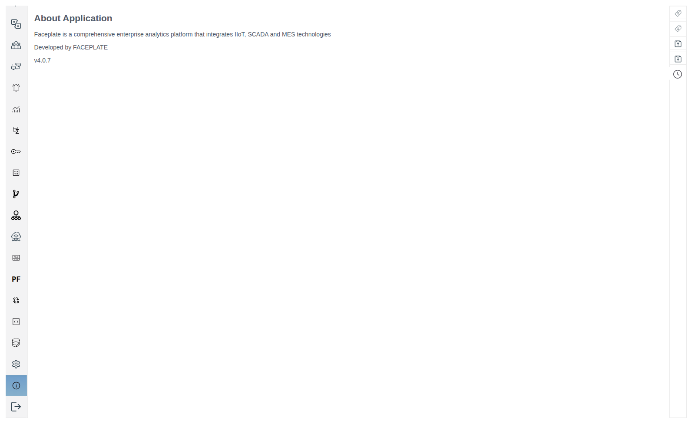
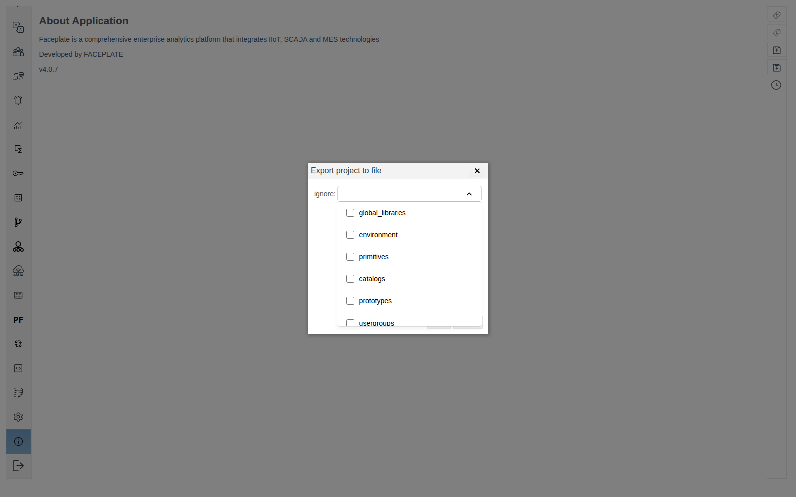
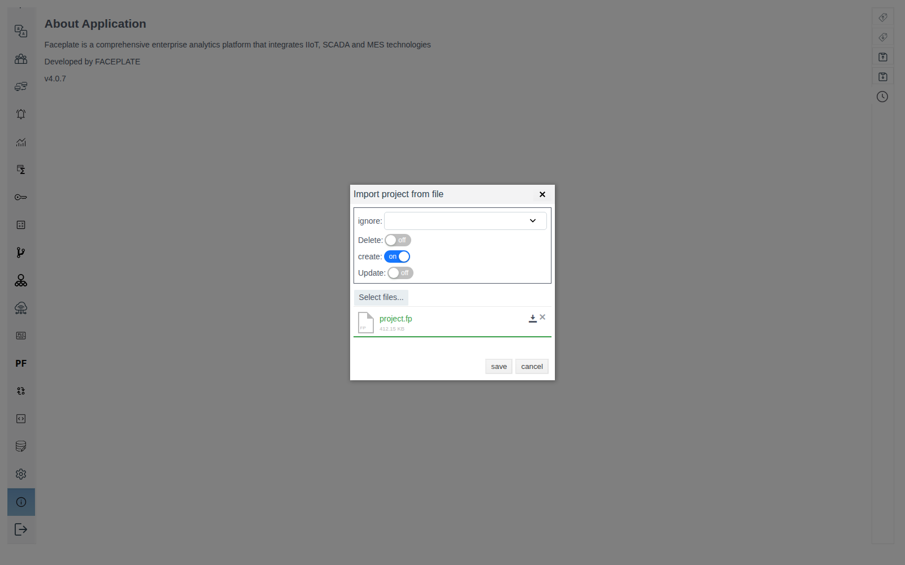

# FACEPLATE version and update

For the integration engineer: how to find out which FACEPLATE version is running and how to move a project to a new version.

# Contents

- [Glossary](#glossary)
- [Introduction](#introduction)
- [Main part](#main-part)
    - [Where the version is shown](#where-the-version-is-shown)
    - [What a node does with the database at startup](#what-a-node-does-with-the-database-at-startup)
    - [Choosing a path](#choosing-a-path)
    - [Starting the new version on the old database](#starting-the-new-version-on-the-old-database)
    - [Cluster update](#cluster-update)
    - [Transfer via export file](#transfer-via-export-file)
- [Conclusion](#conclusion)

# Glossary

| Term | Meaning |
|---|---|
| Node | One running FACEPLATE server. A node name looks like `fp@<server name>`. See [«Cluster nodes»](../nodes/nodes.md) |
| Installation directory | The folder on the server where FACEPLATE is installed. It contains the `bin`, `releases` and `logs` folders |
| Node database | The folder where the node keeps the project, archive values and the event log. By default this is `DB` in the installation directory. In a Docker install, a server folder is mounted into it, see [«Deploying in a Docker container»](../../quick_start/deploy%20as%20docker.md) |
| Project export file | The `project.fp` file that Studio saves with the **Export project to file** button. It holds the project objects without the accumulated data |

# Introduction

You need the version number for a support request, for a check after an update and for comparing cluster nodes. Studio shows the version of the node the browser is connected to.

A project is moved to a new version in one of two ways:

- [starting the new version on the old database](#starting-the-new-version-on-the-old-database): at startup the node migrates the database to its own version;
- [transfer via export file](#transfer-via-export-file): export in the old version, import in the new one.

The first way keeps the archive and event log history, but works only if the node recognizes the database format. The version number does not tell this: the format may differ even between builds of one version. So the new version is started on a copy of the database, and if the node does not recognize it, the project is transferred via an export file.

You need access to the server file system (for example, over SSH) and access to Studio (`http://<server>:9000/fp/studio`) with an account that may change the project.

# Main part

## Where the version is shown



| Where | What is shown | When it is handy |
|---|---|---|
| Studio, **About** item: the "i" icon at the bottom of the left panel, above **Exit** | Platform name, developer and version number, e.g. `v4.0.7` | Copying the number for a support request |
| Browser tab title | `Faceplate Studio 4.0.7` in Studio, `Faceplate RUN-TIME 4.0.7` in Runtime | Seeing the version without opening anything. Runtime has no **About** item, so there the title is the only place that shows the version |
| `console.log` server log | One of three lines the node writes at startup: the version, an upgrade to a new version, or creation of an empty project. What each means: section [«What a node does with the database at startup»](#what-a-node-does-with-the-database-at-startup) | Finding out which version the node started and what it did with the database, even when Studio does not open. Where the log is: [«Server logs», section «Where the logs are»](../logs/logs.md#where-the-logs-are) |

In a cluster, each node shows its own version. To compare nodes, open Studio at each node's address.

## What a node does with the database at startup

At startup the node looks for the project in the database and compares the version recorded there with its own. What it did is shown by one of three lines in `console.log`:

| Log line | What happened | What Studio shows |
|---|---|---|
| `faceplate version 4.0.7` | Versions match, the node works with the project as before | The project is in place, **About** shows the same version |
| `upgrade faceplate version from <old> to <new>` | The node found a project of an earlier version, migrated the database to its version and recorded the new number in the project | The project is in place, **About** shows the new version |
| `init faceplate environment` | The node found no project in the database and created a new empty one | The tree holds only the system folder `@FIXED SCREEN AREA`, no project objects at all |

At the first start on an empty database folder, the `init faceplate environment` line is expected. When the new version is started on a working database, it means the node did not recognize the database format.

## Choosing a path

| | Starting the new version on the old database | Transfer via export file |
|---|---|---|
| When it works | If the new version recognizes the database format: the log shows `upgrade faceplate version from … to …` | Always, as long as the old version can export |
| Archives and event log | Move to the new version | Stay in the old database, start from scratch in the new version |
| Old database | Unchanged: the new version runs on a copy | Unchanged |

If you need the archive history, start with running the new version on a copy of the database. If not, both paths are equal.

## Starting the new version on the old database

The main path: the project, archives and event log move to the new version together with the database. The old database stays untouched, the new version is started on its copy.

1. Save a project export file, as in step 1 of [«Transfer via export file»](#transfer-via-export-file). You need it if the new version does not recognize the database.
2. Stop the old node (`./faceplate stop` from `bin` of the installation directory) and copy its database folder.
3. Install the new version into a new installation directory and put the database copy into its `DB` folder. In `releases/<version>/vm.args` of the new directory, set the same node name (`-name`) as the old node had, see [«Redundancy», section «Virtual machine settings (vm.args)»](../redundancy/redundancy.md#virtual-machine-settings-vmargs). In Docker, mount the database copy to `/opt/faceplate/DB` of the new container.
4. Start the new node and find the version line in `console.log` (see [«What a node does with the database at startup»](#what-a-node-does-with-the-database-at-startup)):
    - `upgrade faceplate version from <old> to <new>`: the database is migrated. The project tree in Studio is in place, **About** shows the new version. On later starts the log shows `faceplate version <new>`.
    - `init faceplate environment`: the node did not recognize the database and wrote a new empty project into the copy. Stop the node, delete the copy and [transfer the project via an export file](#transfer-via-export-file).

The database remembers which node it ran on. If the node name in `vm.args` differs from the previous one, the new node never reaches the version line: it waits for the previous node. `console.log` repeats the lines `trying to connect to 'fp@<previous name>' node` and `'fp@<previous name>' node is not available`, and Studio does not open. Stop the node, correct `-name` and start it again.

## Cluster update

Nodes of different versions do not work together in one cluster. A node of the new version does not join nodes of the old one: its `console.log` repeats the line `database register lock error … retry`, and Studio does not open on it. So a cluster is updated as a whole: all nodes are stopped and started in the new version.

After a full stop, nodes wait for each other at startup: any of them may hold data the others lack. Meanwhile `console.log` repeats the lines `trying to connect to 'fp@<node>' node` and `There were active nodes ['fp@<node>'], when the node went down`. To get the cluster running, the node stopped last is started first, with the `FORCE_START` variable: it allows the node to open the database without waiting for the others. A cluster is started the same way after any full stop, not only during an update.

1. Save a project export file, as in step 1 of [«Transfer via export file»](#transfer-via-export-file).
2. Stop the nodes one by one (`./faceplate stop`) and note which one was stopped last. Copy the database folder of each node.
3. On each server, install the new version as in step 3 of [«Starting the new version on the old database»](#starting-the-new-version-on-the-old-database): a copy of this node's database in the `DB` folder, the previous node name in `vm.args`.
4. Start the node that was stopped last:

    ```bash
    env FORCE_START=true ./faceplate console
    ```

    Its `console.log` must show the line `upgrade faceplate version from <old> to <new>`.

5. Start the other nodes with the usual command `./faceplate console`. They receive the already migrated database, and their `console.log` shows `faceplate version <new>`.
6. Open Studio at each node's address: the project tree is in place, **About** shows the new version.

`FORCE_START` is set for one node and only for this start. A node with this variable treats its data as the most recent, and changes that reached only the other nodes are lost. The most recent data is on the node stopped last, so that node gets the variable.

If a node of the new version is already started next to running nodes of the old version and is waiting, stop all nodes, including it, and follow steps 4–6.

## Transfer via export file

Fits when the new version did not recognize the database or the archive history is not needed in the new version. The project is exported to a file in the old version and imported into the new version installed with an empty database. Only the project objects are transferred.

### Project export file

The **Export project to file** and **Import project from file** buttons are the third and fourth icons from the top on the right vertical toolbar of Studio.



The project is written to the file by sections. The **ignore** list in the export window shows the same sections: checked ones are left out of the file. To move to a new version, leave the list empty.

| Section | What it holds |
|---|---|
| `global_libraries` | Library modules and JS libraries |
| `environment` | Project system settings |
| `primitives` | Primitives |
| `catalogs` | Catalogs |
| `prototypes` | Prototypes |
| `usergroups` | User groups |
| `users` | Users |
| `project` | The project tree: folders, objects, screens |
| `user_rights` | Rights of users and groups |

Accumulated archive values and event log records are kept in the node database and are not part of the file. They reach the new version only when it is [started on the old database](#starting-the-new-version-on-the-old-database). After a transfer via file, the history stays in the old database: it is viewed in the old version running on that database or exported to files: [trends](../../data_storage/archives/trends_en.md#exporting-the-selected-period) and [alarm archive](../../alarms/alarm/alarm_en.md#5-archive-and-export).

### Import switches

The **Import project from file** window matches the objects of the file and of the project by path. The switches define what to do with the differences:

| Switch | What it does |
|---|---|
| **Delete** | Deletes the project objects that are not in the file |
| **Create** | Creates the file objects that are not in the project. Does not change objects that already exist |
| **Update** | Writes the field values from the file into the objects that exist both in the file and in the project. It is turned on together with **Create** |

Switch combinations:

| Turned on | Object only in the file | Object in the file and in the project | Object only in the project | When to use |
|---|---|---|---|---|
| **Create** | Created | Not changed | Stays | Moving to a new version into an empty database; adding what is missing without overwriting changes made in the project |
| **Create** and **Update** | Created | Gets the fields from the file | Stays | Bringing in changes from the file and keeping the objects created only in this project |
| **Delete** and **Create** | Created | Not changed | Deleted | Removing extras and adding what is missing without overwriting changes in shared objects |
| **Delete**, **Create** and **Update** | Created | Gets the fields from the file | Deleted | Making the project an exact copy of the file |
| **Delete** | Not created | Not changed | Deleted | Only removing from the project what is not in the file |

An import with **Delete** also deletes objects created in the project after the file was made. Before such an import, save an export file of the current project: what was deleted can be restored from it by an import with **Create**.

### Transfer steps

1. In Studio of the old version, click **Export project to file**, leave **ignore** empty and click **save**. The browser saves `project.fp`.
2. Stop the old node (`./faceplate stop` from `bin` of the installation directory) and copy its database folder to a separate place. You need the copy if you have to go back to the old version.
3. Install the new version with an empty database folder: into a new installation directory or, in Docker, into a new container with a new empty folder mounted to `/opt/faceplate/DB`.
4. Start the new node. `console.log` must show `init faceplate environment`, and **About** must show the new version.
5. Click **Import project from file** and pick `project.fp` with **Select files...**. Turn **Create** on, leave **Delete** and **Update** off and **ignore** empty. Click **save**.

   

6. Wait for `The project was imported successfully` and reload the page. The folders and objects of the old project appear in the tree.

# Conclusion

The node version is shown by the **About** item in Studio, the browser tab title and the `console.log` line at node startup.

An update starts with an export file and a copy of the database. The new version with the previous node name is started on the copy. The `upgrade faceplate version from … to …` line means the project, archives and event log have moved to the new version. The `init faceplate environment` line means the project is transferred via an export file with **Create** on, and the history stays in the old database.

A cluster is updated as a whole. The node stopped last is started first with `FORCE_START=true`, then the others.
