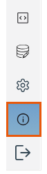
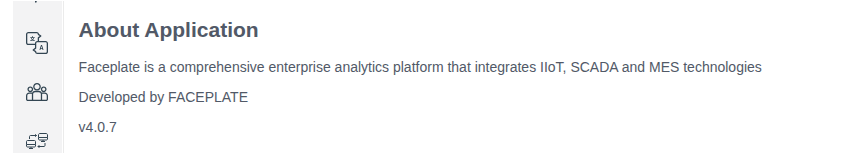

# FACEPLATE version and update

For the integration engineer: how to find out which FACEPLATE version is running and which update method to choose. The methods themselves are described in separate documents of this section.

# Contents

- [Glossary](#glossary)
- [Introduction](#introduction)
- [Main part](#main-part)
    - [Where the version is shown](#where-the-version-is-shown)
    - [Version number and update type](#version-number-and-update-type)
    - [What a node does with the database at startup](#what-a-node-does-with-the-database-at-startup)
- [Conclusion](#conclusion)

# Glossary

| Term | Meaning |
|---|---|
| Node | One running FACEPLATE server. A node name looks like `fp@<server name>`. See [«Cluster nodes»](../nodes/nodes.md) |
| Installation directory | The folder on the server where FACEPLATE is installed. It contains the `bin`, `erts-<version>`, `etc`, `lib` and `releases` folders. After the first start the `logs` folder and the `DB` database appear in it, after a start in the background the `log` folder, and after the Git module is connected to a repository the `cvs` folder |
| Node database | The folder where the node keeps the project, archive values and the event log. By default this is `DB` in the installation directory. |
| Project export file | The `project.fp` file that Studio saves with the **Export project to file** button. It holds the project objects without the accumulated data. See [«Project import and export»](../../project_objects/import_export/import_export.md) |
| Hotfix | An urgent bug fix without a new version number: files replaced in the installation directory or an application project change in Studio or Runtime. See [«Hotfix»](hotfix.md) |

# Introduction

You need the version number for a support request, for a check after an update and for comparing cluster nodes. Studio shows the version of the node the browser is connected to.

How a project is moved to a new version depends on the [update type](#version-number-and-update-type):

| Document | What it covers |
|---|---|
| [Major update](major.md) | The new version is started with an empty database, and the project is moved from an export file or from a Git repository. Nodes are moved one at a time, the old cluster keeps working until its last node is moved. If Runtime can be stopped, all nodes are stopped at once |
| [Minor update and patch](minor.md) | The new version is started on the previous version's database and migrates it to its own format. The project, archives and event log move together with the database. Nodes are updated one at a time, Runtime runs on the other nodes |
| [Hotfix](hotfix.md) | An urgent fix without a version change and without moving the project: replacing files in the installation directory or changing the application project in Studio or Runtime |
| [Project import and export](../../project_objects/import_export/import_export.md) | Saving the project to a file and importing the file: moving the project in a major update, a backup in a minor update and a patch |

You need access to the server file system (for example, over SSH) and access to Studio (`http://<server>:9000/fp/studio`) with an account that may change the project.

# Main part

## Where the version is shown

The version is shown on the **About** page. It opens with the "i" icon at the bottom of the Studio left panel, above **Exit**:

| Where | What is shown | When it is handy |
|---|---|---|
| Studio, **About** item: the "i" icon at the bottom of the left panel, above **Exit** | Platform name, developer and version number as `v<version>` | Copying the number for a support request |
| Browser tab title | `Faceplate Studio <version>` in Studio, `Faceplate RUN-TIME <version>` in Runtime | Seeing the version without opening anything. Runtime has no **About** item, so there the title is the only place that shows the version |
| `console.log` server log | One of three lines the node writes at startup: the version, an upgrade to a new version, or creation of an empty project. What each means: section [«What a node does with the database at startup»](#what-a-node-does-with-the-database-at-startup) | Finding out which version the node started and what it did with the database, even when Studio does not open. Where the log is: [«Server logs», section «Where the logs are»](../logs/logs.md#where-the-logs-are) |

All cluster nodes must run the same version. Studio shows the version of only the node the browser is connected to. To make sure after an update that the new version runs on every node, open **About** in Studio at each node's address.

## Version number and update type

The FACEPLATE version number follows [Semantic Versioning (SemVer)](https://semver.org/) and has the form `X.Y.Z`. Depending on which part of the number changes, an update is major, minor or a patch.

| Number part | Update type | What changes in the new version | How to update |
|---|---|---|---|
| `X`: major | Major | Incompatible changes: the previous version's database does not fit the new one | [Major update](major.md): empty database, project transfer, nodes one at a time |
| `Y`: minor | Minor | New features, compatibility kept | [Minor update and patch](minor.md): start on the previous database |
| `Z`: patch | Patch | Bug fixes | [Minor update and patch](minor.md): start on the previous database |

Which update procedure fits a move between specific versions depends on what changed in the release.

An urgent fix without a new version number, a hotfix, is installed differently: no project transfer, by replacing files in the installation directory or changing the application project in Studio or Runtime. See [«Hotfix»](hotfix.md).

## What a node does with the database at startup

At startup the node looks for the project in the database and compares the version recorded there with its own. What it did is shown by a line in `console.log`:

| Log line | When it appears | What the node did |
|---|---|---|
| `faceplate version <version>` | A normal restart of the node on its own database | Works with the project as before. **About** shows the same version |
| `upgrade faceplate version from <old> to <new>` | Minor update or patch: the new version is started on the previous version's database | Migrated the database to its version. The project is in place, **About** shows the new version |
| `init faceplate environment` | New installation or major update: the node is started with an empty database folder | Created an empty project: the tree holds only the system folder `@FIXED SCREEN AREA`. The project is created anew or moved from an export file or from Git |

A node starts only if its process may open enough files. That is why the open files limit is set to at least 200,000 before the start, see [«Starting and stopping a node», section «Open files limit»](../start_stop/start_stop.md#open-files-limit).

# Conclusion

The node version is shown by the **About** item in Studio, the browser tab title and the `console.log` line at node startup.

The version number follows SemVer: `X` is the major part, `Y` the minor, `Z` the patch. The minor update and patch procedure is described in [«Minor update and patch»](minor.md), the major one in [«Major update»](major.md); which of them fits depends on what changed in the release. A hotfix does not change the version number ([«Hotfix»](hotfix.md)).
