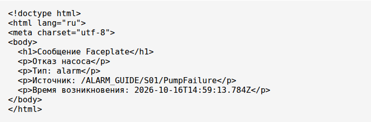
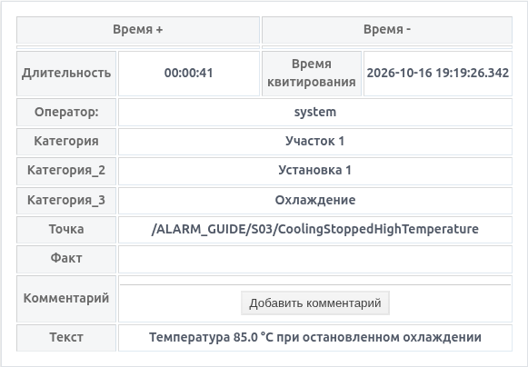

# Messages and alarms in Faceplate

A guide for integrators and operators. Configure conditions and notifications, work with messages, and use the archive, storage settings, and integration interfaces.

The training scenarios and screenshots were verified on 16 October 2026 in the Russian interface of Faceplate 4.0.6.subs. The examples use the ALARM_GUIDE training project. Replace equipment and category names with those used in your project. English descriptions of UI controls are followed by their verified Russian captions where needed. Russian example literals are retained to match the screenshots, scripts, and filters.

Basic Studio/Runtime navigation and the concepts of a tag and a field are sufficient to use this guide. Erlang or JavaScript is needed only for the scripting examples. Configuration requires the appropriate permissions; operators need permission to view and acknowledge messages and add comments.

## How to use this guide

For integrators: start with sections 1–2, then complete scenario 11.1. Conditions involving several tags and dynamic text are covered in section 6 and scenario 11.3. Exact fields and values are listed in section 12.

For operators: section 1 → section 3 → section 4 → section 5 → section 13. Acknowledgment confirms that a message has been handled; resolving its cause is a separate matter.

## Contents

- [1. Basic concepts](#1-basic-concepts)
- [2. Configuring a message](#2-configuring-a-message)
- [3. Operator actions](#3-operator-actions)
- [4. Lists and indicators](#4-lists-and-indicators)
- [5. Archive and export](#5-archive-and-export)
- [6. Scripts and dynamic context](#6-scripts-and-dynamic-context)
- [7. Email notifications](#7-email-notifications)
- [8. Linking messages](#8-linking-messages)
- [9. Storage and automatic processing](#9-storage-and-automatic-processing)
- [10. Scripts and external systems](#10-scripts-and-external-systems)
- [11. Three practical scenarios](#11-three-practical-scenarios)
- [12. Reference](#12-reference)
- [13. Troubleshooting and limitations](#13-troubleshooting-and-limitations)

## 1. Basic concepts

### A template and an individual message

A message template defines the source, condition, text, and processing rules. When the condition occurs, Faceplate creates a separate journal record: a message. Once cleared, the record remains in the archive within the configured retention period. A new occurrence after clearing creates a new record.

An alarm is a message indicating an abnormal condition. The same mechanism supports a discrete failure, a temperature limit, a compound condition involving several tags, and an informational event from an external system.

Message text can capture process values at the time of occurrence. Categories identify equipment, and email notifications can be enabled. Operators see messages in lists and indicators; history is available in the archive.

### Activity and acknowledgment

| State | Meaning | Action |
| --- | --- | --- |
| Active, unacknowledged | The condition has occurred and acknowledgment is still pending. | Assess the message, check the source, and acknowledge it according to project procedures. |
| Active, acknowledged | Acknowledgment is complete, but the condition persists. | Continue addressing the cause; check the state and clear time to confirm clearing. |
| Cleared, unacknowledged | The condition has ended, but acknowledgment is still required. | Review the event and acknowledge it. |
| Cleared, acknowledged | The condition has ended and acknowledgment is complete. | Find the record and comments in the archive if needed. |

Acknowledgment does not clear an active message. Clearing does not acknowledge it. Adding a comment is also a separate action. A list filter may hide the record after any of these transitions; check the record's own state.

### Types, categories, and groups

The usual type values are error, alarm, warning, info, and dsf. They classify messages and affect filtering and display. These strings do not define a universal numerical scale of process priorities. Each project defines what its types mean and how operators should respond.

Five categories can describe, for example, an area, unit, and equipment item. A group relates the record to the template's position in the project tree and allows messages for selected equipment to be displayed. Categories provide a chosen classification; groups define an area of the project tree.

The Point field (“Точка”) shows the message source path in the project. For a normal template, this is the template's own path; the input tag field may belong to another object.

## 2. Configuring a message

### Create an initial working configuration

Prepare a training tag named Pump with a numeric fault field: 0 means normal and 1 means failure. Start at 0. The field must be writable on the training instance. Create this example in ALARM_GUIDE/S01.

1. In Studio, open ALARM_GUIDE/S01. Click Create (“Создать”), then select system → alarm_template → Ok. This is the exact type name in the creation dialog; this guide calls the resulting object a message template.
2. Name it PumpFailure. Under Source (“Источник”), select tag (“тег”), use the object picker to select /ALARM_GUIDE/S01/Pump, and choose fault. The picker uses a path relative to the project.
3. Leave the comparison and delay empty. Turn off Negative edge (“Негативный фронт”) and No acknowledgment (“Без квитирования”).
4. Under Message (“Сообщение”), select alarm, enter “Отказ насоса” (Pump failure), and turn off Sound (“Звук”). Click save.
5. If Runtime is stopped, start it using “Запустить Runtime” and confirm yes. Refresh the editor and verify that the template is running without errors.
6. Change fault from 0 to 1 in the tag form, finish the input with Tab, and save. In Runtime, open Active messages (“Активные сообщения”) and find “Отказ насоса”.
7. Acknowledge the message, then return fault to 0. In the archive, check occurrence, clearing, and acknowledgment times and the operator. Scenario 11.1 verifies both orders of these actions.


*Figure 1. Discrete fault source, required acknowledgment, no comparison or delay, and sound explicitly disabled.*

The verified new-template form offers type alarm, the text Alarm text, and sound enabled. Delay is empty, while the timer type shows on; without a delay value, this selection does not introduce a time delay. Check the actual values before saving.

### Select a source

| Option | Configuration | Verification |
| --- | --- | --- |
| Tag field | Select the object and its field under Source (“Источник”) → tag (“тег”). | Change the training value and check the input, template state, and record. |
| Script | Select the language, bind variables to fields, and enter a function expression; see section 6. | Compile, save, change each bound variable, and check the result. |

A normal automatic alarm requires an existing source and an available field. A JavaScript source also requires JavaScript support in the installation. Some external integrations allow a source to be omitted, but this does not provide automatic tag monitoring.

Without a comparison, the input is converted to a discrete value: 0 is inactive, and a nonzero result after rounding is active. For example, 0.2 rounds to 0. Use an explicit comparison for an analog signal. Boolean true/false values become 1/0; numeric strings may be converted to numbers.

An unusable source result (none) is not the same as normal false: it may preserve an already active message and cancel a pending delayed transition. With scripts, behavior depends on what the function returns. Very short pulses may be missed while updates are processed; the journal does not replace hardware capture of every edge.

### Comparisons, individual bits, and masks

| Operator | Example | Result without hysteresis |
| --- | --- | --- |
| > / >= | Value 80 | Above 80 / at least 80. |
| \< / \<= | Value 20 | Below 20 / at most 20. |
| == / != | Value 1 | Equal to 1 / different from 1; numeric 1 and 1.0 are equal. |
| bit | Value 3 | Tests bit number 3, with a weight of 8. Numbering starts at 0. |
| mask | Mask 10 | Any shared bit is sufficient: weight 2 or 8. The standard form's operator list does not include mask. |

The number and bit comparison parameter are rounded before evaluation. With bit=3, input 8 triggers the message and input 4 does not. Mask 10 matches inputs 2, 8, and 10; it does not match input 4.

To apply a mask using the available form, select an Erlang script source. Bind status to the numeric status field, leave the form's comparison empty, and enter the following user script. Replace the status binding with your own field. Input 2 or 8 should produce an active condition.

```erlang
fun(VARS, State) ->
    Status = round(maps:get("status", VARS)),
    {(Status band 10) > 0, State}
end.
```

The exact compare value for a mask configuration is given in the reference. Its availability in the configuration interface does not mean that the normal form provides a mask option.

Negative edge (“Негативный фронт”) inverts the result after comparison. For example, if the source uses 1 for healthy and 0 for failure, enabling inversion triggers the message at 0. Check both stable input values.

### Hysteresis

Hysteresis creates two boundaries around a threshold. With the strict upper comparison >T and positive hysteresis H, the message occurs when the value is >T+H and clears when it is \<T−H. Between these boundaries it keeps its previous state. H is positive in the table below.

| Comparison | Occurrence | Clearing |
| --- | --- | --- |
| >T | x > T+H | x \< T−H |
| >=T | x >= T+H | x \<= T−H |
| \<T | x \< T−H | x > T+H |
| \<=T | x \<= T−H | x >= T+H |

For >80 and H=2, 82 °C does not yet trigger the message: the value must exceed 82 °C. After occurrence, 78 °C keeps the message active: the value must fall below 78 °C. With strict operators, equality at a boundary preserves the previous state. With >= and \<=, the boundaries are inclusive.

You can omit hysteresis to use an ordinary comparison without state memory. Do not replace omitted hysteresis with an explicit 0 in imported configuration: strict comparisons behave differently at the threshold. Equality, inequality, bit, and mask comparisons do not use hysteresis.

The verified form accepts integer hysteresis values starting at 1. Typing 0.5 produces 5; a threshold of 0 disables the hysteresis input. Reopen the form to check the saved value. Use a script condition for behavior that this form cannot configure correctly.

### Delays and transition cancellation

| Timer type | Delayed transition | If the condition reverses before the delay expires |
| --- | --- | --- |
| on | Occurrence. | Returning to normal cancels the pending occurrence; no record is created. |
| off | Clearing. | The abnormal condition returning cancels clearing; the existing record continues. |
| on_off | Both occurrence and clearing, using one delay value. | Each pending transition is canceled if the condition reverses. |

The Delay (ms) field (“Задержка (мс)”) uses milliseconds: 3000 means 3 seconds. An empty field means no delay. Enter a nonnegative value and select the timer type explicitly. The script and comparison produce the result first; inversion and the time delay follow.


*Figure 2. Upper limit >80, hysteresis 2, and an occurrence delay of 3000 ms. Boundary checks are covered in scenario 11.2.*

### Text, classification, and control

Text is required. For a normal configuration, enter a clear description of the event and equipment. Dynamic values use separate context variables and are captured at occurrence, after the delay. Section 6 gives the syntax and examples.

Categories 1–5 are optional. The generic example uses “Участок 1”, “Установка 1”, and “Охлаждение” (Area 1, Unit 1, and Cooling). Consistent categories make archive searches easier, but they do not change the group scope of a screen.

No acknowledgment (“Без квитирования”) creates a record that is already acknowledged: acknowledgment time equals occurrence time, and an operator is not added automatically. With this switch off, separate acknowledgment is required unless automatic processing performs it.

Sound (“Звук”) permits an audible response for the message. Playback also depends on the active interface and browser permissions. Verify it at the operator workstation; sound is disabled in the training scenarios.

Disabling a template stops automatic processing and clears its active messages. Editing settings or restarting execution can clear the old record and create a new occurrence while the condition remains abnormal. Prepare a safe training state before testing a change.

## 3. Operator actions

### Read a message and locate its source

1. Open Active messages (“Активные сообщения”) in the top Runtime toolbar, or open the list on the equipment's process screen.
2. Check text, type, categories, point, and occurrence time. Use the archive to verify occurrence, clearing, and acknowledgment times; use the card for acknowledgment, operator, and comments. Interpret row colors according to project settings.
3. Double-click a list row to open its card. In the archive, a single click is sufficient. Review text, point, operator, and comments.
4. Use the point to locate the template in the project tree. Integrators check its source tag/field or script variables in the form; operators use the associated equipment screen.

The name Active messages does not guarantee that all active records are displayed. The standard top window shows unacknowledged messages; acknowledging a message may hide it while it remains active. A list placed on a screen is configured separately.

### Acknowledge selected messages

1. Select the required row or rows in the list. Check which records are actually selected.
2. Click Acknowledge (“Квитировать”). The verified list did not display a separate confirmation.
3. Check that acknowledgment time and operator have been populated. If the source condition remains abnormal, the message stays active.

Use Acknowledge All (“Квитировать Все”) for the current page. Its scope is limited to that page, with the current filter and page size; the usual size is 30 rows. Use Ctrl to select several rows. Check the remaining rows after each operation.

Verified example: 35 cleared, unacknowledged records, page size 30, and no other matching messages. After a bulk operation, the counter in this build could display an incorrect value; closing and reopening the window restored it. The actual result was verified using rows and a fresh archive view.

| Action | Processed | Remaining unacknowledged |
| --- | --- | --- |
| Acknowledge All on the first page | 30 | 5 |
| Select two rows with Ctrl and acknowledge | 2 | 3 |
| Acknowledge All on the remaining page | 3 | 0 |
| Reopen the list and archive | All 35 retained with operator system and acknowledgment times | 0 |

### Add a comment

1. Open the card and click Add comment (“Добавить комментарий”).
2. Choose a predefined comment or Your text (“Свой текст”), enter, for example, “Принято в работу” (Work in progress), and click Send (“Отправить”).
3. Check the new text and the author's login. Verify acknowledgment and clearing separately.

Predefined choices are configured in the template. Comments on an individual record are retained in its history; new text appears before earlier text. Editing an old record depends on permissions and its storage mode.


*Figure 3. Message card with acknowledgment by user system and the comment “Принято в работу”. Adding a comment and acknowledging are separate actions.*

### When the system has acknowledged a message

Check the time and operator. Automatic acknowledgment may result from more than 200 unacknowledged messages of the selected types accumulating, an old segment becoming read-only, message linking, or No acknowledgment being enabled. Sections 8–9 explain these mechanisms; an acknowledgment record does not confirm that the physical cause has been resolved.

## 4. Lists and indicators

### Place an equipment message list on a process screen

1. In Studio, open the equipment folder, for example ALARM_GUIDE/S03, and its Process screen tab (“Мнемосхема”). Create or open the screen in the screen row.
2. Drag the Message list element (“Список сообщений”) onto the screen in the graphical editor.
3. Set group=/ALARM_GUIDE/S03 in its properties. To show all active and all unacknowledged messages, set active=true and acknowledge=true.
4. Save the screen. In Runtime, close the archive, open Menu (“Меню”), and select ALARM_GUIDE/S03 in the tree that appears.
5. Verify the list with a real event: acknowledge an active message and check that it remains until clearing. Then check a cleared, unacknowledged message.

In the verified interface, Menu already opens the process-screen tree. Clicking Process screens (“Мнемосхемы”) again toggles its visibility. The editor preview shows the layout; verify live values and actions in Runtime.

### State filter rules

| active | acknowledge | Selection |
| --- | --- | --- |
| false | true | Unacknowledged messages, both active and cleared. |
| true | false | Active messages, both acknowledged and unacknowledged. |
| true | true | Active OR unacknowledged messages. |
| false | false | No restriction on these two states; other filters still apply. |

The acknowledge property selects unacknowledged records. It does not grant acknowledgment permission or mean “show acknowledged messages”. Group, type, and additional filter restrictions apply together with the selected state rule.

The screen's list component has its own columns and filter. Saving a named archive view in section 5 does not automatically reconfigure that component. An array of conditions provides additional filtering, for example ["category_3", "=", "Охлаждение"]; check the actual category, group, and state being used.

The standard top Runtime window uses acknowledge=true, active=false, and types error/alarm/warning. Archive view settings do not change that selection. Find info or dsf messages using a suitable type selection or in the archive.

### Indicator and sound

Add a Message indicator (“Индикатор сообщений”) to the screen and set the same equipment group. The indicator includes active OR unacknowledged messages. Unacknowledged messages can flash; the component chooses what to display in the order error → alarm → warning. This is a component display order; process priority is defined by the project.

Clicking the indicator opens its group's list with both state selectors enabled. In the training check, an active, acknowledged message remained in both the group list and the indicator's window. Once all matching messages were cleared and acknowledged, the indicator disappeared.

Set the group explicitly for a screen dedicated to one unit. Make sure the message type is included. For sound, check the message's setting, interface state, and browser playback permission; verify the visible row and audible signal separately.

## 5. Archive and export

### Find an event in the archive

1. In Runtime, open Menu (“Меню”) → Message log (“Журнал сообщений”). The Message archive window (“Архив сообщений”) opens.
2. Select the time field and interval. Use Time + (“Время +”) for occurrence, Time − (“Время -”) for clearing, and acknowledgment time for acknowledgment.
3. Enter text and select the required types. Finish text input with Tab, then use Search (“Поиск”) or Refresh (“Обновить”). On a narrow toolbar, Search is in the ⋮ menu.
4. Check the result count, point, and timestamps of the required record. A single click on a row opens its card.

In the verified build, entering text or pressing Enter alone did not apply the filter. Text shorter than three characters uses an exact match; longer text uses a substring match. Check categories in the column and card: the archive toolbar has no separate simple category_1 field. To find a cleared, acknowledged message, use the archive without the current list's restriction.

### Times and duration

| Field | Meaning | Units and display |
| --- | --- | --- |
| Time + / dt_on (“Время +”) | Record occurrence time; after the configured delay, if any. | Unix milliseconds in the API. The verified workstation used UTC+05:00. |
| Time − / dt_off (“Время -”) | Clear time; empty for a normal active record. | Unix milliseconds in the API; displayed as a date and time. |
| Acknowledgment time / dt_ack (“Время квитирования”) | Time of acknowledgment. | Populated independently of clear time. |
| Duration / duration (“Длит.”) | dt_off − dt_on for a completed record. | Milliseconds in the API; a duration in the table. |
| Device time / dt_device (“Время с прибора”) | External device time, if supplied. | The normal example does not populate it automatically. |

Allow for time zones when comparing the screen, external API, and email. The training screen used Asia/Almaty (UTC+05:00). The API uses numeric time values; email template dates may appear as UTC with a trailing Z.

### Views and sorting

A view defines table columns, a filter, and sort order. Use separate views for daily operation and for reviewing history with times, duration, and operator. The verified example below shows the exact controls for saving a view.

The verified named view restricts the archive to category “Проверка пагинации” (Pagination check). Its Filter field uses a JSON condition array:

```json
["category_1", "=", "Проверка пагинации"]
```

1. In Studio, open Menu (“Меню”) → Message (“Сообщение”) → Runtime. Message list display settings (“Настройка отображения списка сообщений”) opens with Default view and Custom views.
2. In Custom views, enter a name, for example “Проверка архива P01”, and open the adjacent settings button. In Display settings (“Настройки отображения”), select columns Time + (“Время +”), Time − (“Время -”), Acknowledgment time (“Время квитирования”), Text (“Текст”), Operator (“Оператор”), and Category (“Категория”). Enter the JSON above in Filter, click Compile, and wait for OK.
3. Under order by, select Acknowledgment time (“Время квитирования”). Save the inner dialog, then the outer one. Reopen both to check the settings.
4. In Runtime, reopen Message log (“Журнал сообщений”), select your view with its checkbox, and click save. Select Time + and the training dataset's date, leave the text search empty, and run Search. The verified selection returned only the 35 records in that category.

Use the arrows to move columns and the trash icon to remove them. The general Category column and the listed time fields are available; the verified editor has no separate Type or category_1 column. A view changes the table presentation, so check the selected time field when searching.

To combine conditions, use, for example, ["and", [["category_1", "=", "Проверка пагинации"], ["type", "=", "alarm"]]]. Compile checks JSON; verify the actual selection in the archive. If no restriction is required, leave a new view's field untouched and empty. Literal [], null, or {} is not an empty view filter. The JSON export contract in section 10 uses a different filter structure.

The verified custom-view export contained all 35 records and the six selected columns. The screen was sorted by acknowledgment and began with record 01; XLSX and the print table began with record 35, in descending occurrence time. The actual print table contained the same 35 records.

### Export XLSX or print

1. Apply the filter first, then check the interval and result count.
2. Select XLSX export in the archive. Open the downloaded file and check the number of rows, required columns, and times.
3. Use the PDF/print button to print. In the browser dialog, choose a printer or save as PDF. A card prints one record; the list and archive produce a table.
4. For a large dataset, divide the selection into nonoverlapping time intervals and, if necessary, use additional criteria. Check each resulting file.

Archive export is limited to 10,000 records, ordered by occurrence from newest to oldest. The selected screen sort does not change that order. The request provides neither a next page nor a truncation indicator; a result of exactly 10,000 rows requires an additional completeness check.

The current list's PDF button may also select up to 10,000 matching records in a separate query; its print scope differs from the current acknowledgment page. The browser saves the PDF. XLSX is generated as alarm_logs.xlsx, sheet alarm; a cell value longer than 32,767 characters may be omitted with a notification.

## 6. Scripts and dynamic context

### Bind source variables

Under Source (“Источник”), select script and a language. Give each variable a name and an object/field binding. The example uses temperature → Temperature.value and cooling → Cooling.value. Cooling is numeric: 1 means running and 0 means stopped.

The script recalculates when a bound variable updates and reads the other values. This source does not define independent periodic polling. Compile the function first, save the template, and verify each condition branch by changing real tag values.

The following examples assume available numeric fields on the training instance. Define your own script's behavior for missing or nonnumeric values and lost data quality explicitly. A function result of false is treated as a normal condition result.

### An Erlang condition

Enter a function with two arguments in the script editor. VARS is a map whose variable names are string keys; State is the state from the previous execution. This example returns the condition result and passes State through unchanged.

```erlang
fun(VARS, State) ->
    {(maps:get("temperature", VARS) > 80) andalso
     (maps:get("cooling", VARS) == 0), State}
end.
```

The expected result is true only when temperature is above 80 and cooling=0. Leave the form's comparison empty and set the delay to 3000 ms/on. Start from the normal values temperature=70 and cooling=1.

### The same condition in JavaScript

Select javascript and enter a function expression, rather than a separate file or function call. This example uses the same numeric fields:

```javascript
async function(VARS, State) {
    return {
        value: VARS.temperature > 80 && VARS.cooling === 0,
        state: State
    };
}
```

JavaScript strict comparison distinguishes numeric 0 from Boolean false. If your tag is Boolean, adapt the condition to its actual type. In the training check, both languages produced the same condition and a message after the configured delay.

### Pass script state

| Language | Allowed result | State retention |
| --- | --- | --- |
| Erlang | Value or {Value, NewState}. | Return the second element of the pair to pass state explicitly. |
| JavaScript | boolean, number, {value: …}, or {value: …, state: …}. | Return state for the next execution; without it, the next State is undefined. |

Script state carries data between function executions and is separate from the message's active/cleared state. Do not rely on the previous script state surviving an execution restart. It is not a standalone process historian.

### Add dynamic text

1. Add temperature under context variables and bind it separately to Temperature.value. A source variable with the same name is not automatically added to context.
2. Enter the following message text: Температура ${f:1:temperature}$ °C при остановленном охлаждении (Temperature … °C while cooling is stopped).
3. Set categories “Участок 1”, “Установка 1”, and “Охлаждение”, save, and apply temperature=85 and cooling=0 for more than 3 seconds.
4. Verify text containing 85.0 °C. Change temperature to 90 with cooling=0: the existing record keeps 85.0 °C in its text. Display the current value in a separate field on the process screen.

| Substitution | Example | Purpose |
| --- | --- | --- |
| ${s:name}$ | ${s:equipment}$ | A string variable value. |
| ${i:name}$ | ${i:count}$ | A number rounded to an integer. |
| ${f:N:name}$ | ${f:1:temperature}$ | A number with precision N; N is a single digit. With f:0, the fractional part is discarded. |

The closing sequence is exactly }$. Unknown or missing variables are omitted; an incompatible type produces invalid_value. A syntax error may leave the original text unchanged. Check the resulting record, not just the input string.

These substitutions are supported in text, categories 1–5, fact, and commentAI. The same substitution pass is not applied to relevant or type. Context is captured at occurrence, after the delay; an ordinary later tag update does not rewrite the existing record.

### Transform context

A context transformation is a single-argument Erlang function, regardless of the source language. It receives a map with string keys and must return a map. To replace the system text, use the key .text, including the dot:

```erlang
fun(Context) ->
    Context#{".text" => "Контроль охлаждения"}
end.
```

Enter the function in the context transformation field, compile, and save. The next occurrence should show “Контроль охлаждения” (Cooling monitoring). The key text without the dot does not replace system text. The training check confirmed the replacement; transformation was then disabled and the original dynamic text restored.

System context keys include .text, .type, .point, and .acknowledged. Choose user names that do not accidentally override system values. commentAI is an additional context field; the field does not define an automatic AI comment-generation process.

## 7. Email notifications

### Prepare email sending

Notifications require shared SMTP settings, user email addresses, and recipients in the message template. Verify a successful UI action separately from actual receipt. Start with a test mail receiver.

In Studio, open Menu (“Меню”) → Message (“Сообщение”) → Settings (“Настройки”) → General settings (“Общие настройки”). This contains SMTP settings, Enable email notifications (“Включить email-уведомления”), and HTML template tabs for alarm/error/info/warning. Fill in your SMTP values or the training values below, save, and reopen to check them.

For a training recipient, open Menu (“Меню”) → Permissions (“Права”) → Users (“Пользователи”) → + → Enter a name (“Задайте имя”). Create AlarmGuideOperator, open its row, set Email to operator@alarmguide.test, and click Save (“Сохранить”). Reopening the user should show the saved address. Configure permissions and a password according to your project's rules.

In the verified build, the built-in system account was absent from the ordinary user editor and template recipients. Automatic notifications used the ordinary user AlarmGuideOperator. In the template's Additional settings (“Дополнительные настройки”), open Notifications (“Уведомления”), select that user with the checkbox, and save. Actual delivery confirmed that the saved setting took effect; this check did not require a separate Runtime restart.

| Setting | Training value | What to use in your project |
| --- | --- | --- |
| Sending / email_send | true during verification | Enable only after completing the settings; false disables sending. |
| Server / email_smtp | 127.0.0.1 | Address of a compatible SMTP server. |
| Port / email_smtp_port | 1465 | Your server's implicit SSL port; the training port belongs to the local receiver. |
| Login / email_login | alarmguide | A dedicated sending account. |
| Password / email_pass | alarm-guide, training receiver only | That account's password. |
| Sender / email_from | faceplate@alarm-guide.test | A sender address permitted by the server. |
| Recipient | operator@alarmguide.test | The email address of the user selected in the template's notifications. |

The transport uses implicit SSL and requires authentication. This interface does not provide a STARTTLS setting. Agree on the mode and port with the mail administrator; filling every field does not establish server compatibility.

### Configure recipients and verify an automatic email

1. Set the test recipient's email address in its user account. In the template's notifications, select that user or a group whose users have email addresses.
2. Save the template. After changing addresses or group membership, refresh the template's execution through the standard interface so the recipient list takes effect.
3. From a normal state, trigger a new message. Check the journal record and the actual email: recipient, text, source, and occurrence time.
4. Clear and acknowledge the training message. After the check, disable test sending and restore any addresses used temporarily.

Recipients are expanded from the selected users and groups; entries without email addresses are skipped. A new record can trigger a notification; updating an existing record does not itself create another notification. This rule does not provide notifications on clearing or acknowledgment.

### Forward an existing message

Open the card, expand Choose email (“Выберите почту...”), select a user, and click Send (“Отправить”). Verify receipt of a separate email. This operation uses the shared SMTP settings and the template for the message type. A successful UI response does not prove delivery: sending may be disabled, and SMTP acceptance and subsequent delivery are separate stages.

### Edit the email HTML template

Edit the required message type's template in the general email settings. Types without their own template use notification. The subject is generated separately as FACEPLATE: \<type>; changing the HTML heading does not change it.

The following user-authored HTML is a training example. Paste it into the alarm template, save, and send a new test email. The result should include the message text, type, point, and occurrence time.

```html
<!doctype html>
<html lang="ru">
<meta charset="utf-8">
<body>
  <h1>Сообщение Faceplate</h1>
  <p>${text}</p>
  <p>Тип: ${type}</p>
  <p>Источник: ${point}</p>
  <p>Время возникновения: ${dt_on}</p>
</body>
</html>
```

Email uses ${text}, ${point}, and ${dt_on}, without a trailing $ or the s/i/f format. This differs from message-text substitutions. Names are case-sensitive; a missing value becomes a hyphen. For manual sending, time fields are converted to UTC/RFC3339, while duration remains a number of milliseconds.

An automatic email at occurrence may not yet contain fields populated later during record creation. For a reliable initial template, use text, type, point, and occurrence time. Substituted text is not automatically HTML-escaped; prepare external values for HTML.

The attempts setting is present, but does not ensure confirmed delivery or guaranteed retries. Monitor actual receipt. Verify UI template changes by sending again; retention after full reinitialization requires a separate check on your build.

| Check | UI response | Actual receipt |
| --- | --- | --- |
| “Отказ насоса” occurs | A new active record | An automatic email was accepted, subject FACEPLATE: alarm. |
| Manual forwarding from the card | Message sent (“Сообщение отправлено”) | A separate second email was received. |
| Test SMTP rejection 451, Attempts=5 | ERROR! with a temporary SMTP rejection | One rejected attempt; no further accepted emails or repeated DATA attempts were observed over 52 seconds. |
| SMTP recovery followed by manual sending | Message sent (“Сообщение отправлено”) | A third email was received. |

Retry verification is limited to that test rejection and observation interval. Setting 5 did not confirm five send attempts. In production, monitor receipt and handle SMTP errors; UI success and actual delivery must be checked separately.



*Figure 4. Actual received training email HTML, with message text, type, point, and UTC time substituted into the template.*

This automatic email's timestamp was 9 ms later than the archive occurrence time. Manual forwarding used the saved record time. Also compare point and text when matching an email to the journal. After verification, the training condition was cleared, the record acknowledged, sending disabled, and the original HTML restored.

## 8. Linking messages

### Associate a fact with related events

Linking marks active messages related to the same fact. Set relevant in related-event templates and the matching fact value in the fact-message template. Processing starts when a message with fact is formed.

Open Cause-and-effect links (“Причинно-следственные связи”) in the form. Possible consequence (“Возможное следствие”) sets relevant, Is an anchor (“Является якорем”) sets fact, and Minimum (ms) / Maximum (ms) (“Минимум (мс)” / “Максимум (мс)”) set the candidate's time bounds. Enter the same link value in the appropriate fields of the different templates.

| Training template | Condition and text | Link settings |
| --- | --- | --- |
| CauseA | Inputs.cause_a=1; warning; “Охлаждение недоступно” (Cooling unavailable). | relevant=cooling_stop; relevant_min=0; relevant_max=600000. |
| CauseB | Inputs.cause_b=1; warning; “Охлаждение остановлено” (Cooling stopped). | The same relevant value and bounds. |
| Fact | Inputs.fact_signal=1; alarm; “Высокая температура — проверка связи” (High temperature — link check). | fact=cooling_stop. |

All three sources start at 0, require acknowledgment, have sound disabled, and have no comparison or delay. Replace tag names and the link value with your own. The candidate templates CauseA/CauseB define the time bounds in milliseconds.

1. Set cause_a to 1 and wait for occurrence; then set cause_b to 1 and wait for the second active, unacknowledged message.
2. Set fact_signal to 1. In the archive, enter cooling_stop under Only related to (“Только относящиеся к...”), select the occurrence interval, and run Search (“Поиск”). Check all three records and their acknowledgment states. The is_head/is_relevant flags are available in the JSON export described in section 10.
3. Clear all three training conditions and acknowledge the remaining records. Check the resulting history.

A candidate must remain active, have relevant matching fact, and be strictly older than relevant_min and strictly younger than relevant_max. An omitted bound imposes no age restriction. Bounds of 0 and 600000 select an event older than 0 and younger than 10 minutes.

One matching record is marked as the main related message (is_head=true); related records receive is_relevant=true, and the other candidates are automatically acknowledged. Selecting a main message does not establish the root cause or guarantee the earliest event is chosen. Check the actual flags and acknowledgment.

In the verified example, CauseA occurred at 20:16:34.648, CauseB at 20:16:46.282, and Fact at 20:17:13.596 (16 October 2026, UTC+05:00). Before Fact, both candidates were active and unacknowledged. After Fact, the following result was obtained without manual acknowledgment:

| Record | Activity and acknowledgment after Fact | Link flags |
| --- | --- | --- |
| CauseA | Active, unacknowledged. | is_head=true; is_relevant=true. |
| CauseB | Active, automatically acknowledged at 20:17:13.605 by system. | is_head is unset; is_relevant=true. |
| Fact | Active, unacknowledged. | fact=cooling_stop; is_head/is_relevant are unset. |

The top list changed from two candidates to two rows: CauseA and the new Fact. CauseB disappeared because it was acknowledged, not because it cleared. The cooling_stop archive retained all three records; CauseB's clear time remained empty.

In the verified UI, the general Fact column (“Факт”) also shows the matching link value for candidates. A candidate's card may nevertheless have an empty Fact field. The standard view editor has no separate is_head/is_relevant columns; use JSON export for an exact analysis. Observing CauseA being selected does not establish an earliest-cause selection rule.

After verification, all three inputs were returned to 0. The archive retained three cleared, acknowledged records; CauseB's earlier automatic acknowledgment time was unchanged.

## 9. Storage and automatic processing

### Select storage locations and retention periods

Message storage is configured for the project database using the complete log_params value. It defines storage nodes and directories, segment depth, and the age at which segments become read-only or are deleted. These settings apply to entire journal segments.

| Parameter | Server fallback value | Purpose |
| --- | --- | --- |
| read_only_age | 10 days | Segment age for switching to read-only mode. |
| max_age | 365 days | Segment age for deletion. |
| shard_depth | 30 days | Time span of a segment. |
| database | Placement across database nodes | Directory and disk storage for each node. |

Fallback values apply when the complete configuration is absent. If log_params is already a map, missing keys are not guaranteed to be filled safely. Supply the full structure. The Log editor's example depth of 10 days differs from the server fallback of 30 days.

Segment dates are calculated in UTC. Read-only transitions and deletion use the segment's time range, rather than an exact retention period for each record. Actual retention depends on the record's position within the segment and the background check.

### Complete configuration example

In Studio, open Menu (“Меню”) → Storage (“Хранилища”), select project, and open its editor. Select the Messages tab (“Сообщения”), the localized Log tab. Keep a copy of the original complete value. Enter the following example in that tab's JSON editor; replace faceplate@server1 with the actual database node name and the directory with the required storage location.

The relative directory ./FP_ALARM is resolved against the database schema directory. Prepare any relocation of an existing archive in advance; use separate storage for training checks. The :atom: and :string: prefixes are part of the serialization and must be retained.

```json
{
  ":atom:database": {
    ":atom:faceplate@server1": {
      ":atom:dir": ":string:./FP_ALARM",
      ":atom:disc": {
        ":atom:module": ":atom:zaya_rocksdb",
        ":atom:params": {}
      }
    }
  },
  ":atom:max_age": 365,
  ":atom:read_only_age": 10,
  ":atom:shard_depth": 30
}
```

1. Paste the full structure with the actual node and click Compile. Wait for OK.
2. For a real change, click the enabled save button, reopen the tab, and verify every key. If the value equals the original, save remains disabled; cancel and reopening are sufficient for checking it.
3. Verify access to recent and old messages in the training database. Use a known initial dataset to check age processing and deletion; a missing row alone does not establish why it was deleted.

In the check, the complete 10/365/30 value was reentered and Compile returned OK. Since nothing changed, save remained disabled. After cancel and reopening, the full structure matched the original; policy and placement were unchanged.

| Training record | Segment and processing | UI result |
| --- | --- | --- |
| ReadOnlySample: info, occurrence 6 September 2026 | Segment 6 September–5 October 2026. The record was automatically acknowledged by system when the segment became read-only. | The archive retained the cleared record: occurrence 19:50:31.136, clearing 19:50:31.236 (UTC+05:00). ACK 16 October 2026 19:50:44.978. |
| Comment on ReadOnlySample | One attempt to add “Проверка режима чтения” (Read-only mode check). | ERROR! with read_only. After refresh, the comment was empty and the record and times were retained. |
| PurgeSample: info, occurrence 11 September 2025 | The separate training segment 11 September–10 October 2025 was automatically deleted by retention processing. | A search on the known date without additional restrictions returned no record; the old read-only record and recent history remained available. |

The examples were created with occurrence times 40 and 400 days before verification. For the deleted example, the record and its separate segment were confirmed before their disappearance. Archive deletion does not guarantee removal of the directory itself: an empty physical directory remained in this check. The read-only check specifically confirmed rejection of a comment; verify other actions separately on your build.

### Automatic acknowledgment when messages accumulate

Approximately every 5 seconds, unacknowledged error/alarm/warning messages are checked across all available archive databases. This rule does not restrict activity, group, category, or record age.

If their count is strictly greater than 200, the system acknowledges N−100 and keeps the 100 most recently created records unacknowledged. This uses the record's technical creation time, rather than occurrence time dt_on. A late import of an old event may therefore enter the retained hundred. Acknowledgment time and the service operator, usually system, are populated.

| Training dataset | Unacknowledged | Acknowledged |
| --- | --- | --- |
| 205 completed alarm records, before the background pass | 205 | 0 |
| After the background pass | 100 | 105, operator system |
| After manually processing the remaining pages | 0 | 205; all retained in the archive |

Records were created in the order 001→205, while occurrence time deliberately decreased. The system acknowledged 001–105 and retained 106–205: these were the most recently created records, with older occurrence times. The UI confirmed both groups and the final archive of 205 records. During manual completion, reopening the list showed 70 → 40 → 10 → 0 remaining.

### Read-only mode, deletion, and system clearing

When an old segment becomes read-only, the system acknowledges all of its unacknowledged records, including info and dsf. This is a separate rule: the threshold of 200 and restriction to three types do not apply. Normal operator actions on an old record may be unavailable; check the result and storage mode.

The leading node checks old segments for read-only mode approximately every 60 seconds and for deletion approximately every 10 seconds. An entire eligible segment is deleted. An archive filter cannot return a record after actual deletion.

Clearing is checked approximately every 5 seconds. The system may clear an active record if its template is absent or deleted, disabled, or does not maintain an active state. This is particularly relevant to externally created direct events.

When execution starts, the template begins processing again and previous active records are cleared. Configuration changes or restarts can split a continuing physical abnormal condition into several records. Check history and the current source after these actions.

## 10. Scripts and external systems

### Select a recording method

The following integrator examples run in an authenticated native Faceplate Erlang session with the required permissions. Use a training database and check the actual archive record. Public interface names are shown as exact integration input.

| Interface | Purpose | Main verification requirement |
| --- | --- | --- |
| fp_alarm:write/1,2 | Create a direct event record. | Check that it exists; a return value of ok is insufficient. |
| fp_alarm_template:run_context/2 | Create or update a message using an existing template and context. | Pass an opened template object and preserve identity keys when updating. |
| export_logs_json | Retrieve a JSON selection through an authenticated connection. | filter is required; limit 10,000, order dt_on DESC. |

### Write a completed event

Replace project when selecting another database, and replace the text with your own. Times are integer Unix milliseconds. This example creates a completed informational event lasting 5 seconds.

```erlang
T1 = erlang:system_time(millisecond),
T0 = T1 - 5000,
fp_alarm:write(project, #{
    <<"type">> => <<"info">>,
    <<"text">> => <<"Completed API event E09">>,
    <<"point">> => <<"/ALARM_GUIDE/P05/API/Completed">>,
    <<"category_1">> => <<"Проверка API"/utf8>>,
    <<"dt_on">> => T0,
    <<"dt_off">> => T1,
    <<"active">> => false,
    <<"acknowledged">> => true
}).
```

The expected archive result is one info record with the specified text, T0/T1 times, and duration=5000. When a record is created with acknowledged=true and no separate acknowledgment time, acknowledgment time is set to dt_on. This differs from manually acknowledging an existing record.

write/1 selects the project database or, if absent, the first available storage database. write/2 accepts an atom database name or a full binary database path. Occurrence time determines the segment. Repeating a call with the same remote_id does not provide deduplication.

### Create and update a record through context

Open an existing template first. The example uses the training CauseA from section 8; replace its path with your own. EventContext uses binary keys, whereas the context transformation in section 6 uses string keys. Do not mix these formats.

```erlang
Template = fp_db:open(
    <<"/root/FP/PROJECT/ALARM_GUIDE/P05/CauseA">>),
EndTS = erlang:system_time(millisecond),
StartTS = EndTS - 1000,
EventContext = #{
    <<".dt_on">> => StartTS,
    <<".dt_off">> => EndTS,
    <<".active">> => false,
    <<".acknowledged">> => true,
    <<".type">> => <<"info">>,
    <<".text">> => <<"External event E09">>,
    <<".point">> => <<"/ALARM_GUIDE/P05/API/External">>,
    <<".category_1">> => <<"Проверка API"/utf8>>
},
fp_alarm_template:run_context(Template, EventContext),
fp_alarm_template:run_context(Template,
    EventContext#{
        <<".comment">> => <<"External event details updated">>
    }).
```

After the second call, expect one record with the updated comment. The normal matching branch uses template, occurrence time, type, text, and the specified point. Preserve these values when updating. Changing text or time may create another record; this is not an arbitrary update by external identifier.

### Explicitly clear an external record

When updating an existing active record, supply dt_off and active=false together, preserving its identity keys. Updating dt_off alone recalculates time and duration, but does not itself clear active.

```erlang
ClosingTS = erlang:system_time(millisecond),
OriginalContext = #{
    <<".dt_on">> => ClosingTS,
    <<".active">> => true,
    <<".acknowledged">> => true,
    <<".type">> => <<"info">>,
    <<".text">> => <<"Closing API event E09">>,
    <<".point">> => <<"/ALARM_GUIDE/P05/API/Closing">>,
    <<".category_1">> => <<"Проверка API"/utf8>>
},
fp_alarm_template:run_context(Template, OriginalContext),
FinishTS = erlang:system_time(millisecond),
fp_alarm_template:run_context(Template,
    OriginalContext#{
        <<".dt_off">> => FinishTS,
        <<".active">> => false
    }).
```

This example uses Template opened above. OriginalContext retains the context used to create this record; FinishTS is an integer finish time in milliseconds. Supply the final time together with the active=false transition, and verify the saved dt_off. Do not substitute another event's context.

The separate @value/@ts branch works with the latest active record for the template and type: true creates one if absent, and false completes the record found. This differs from matching by time/text; use one consistent contract for an integration.

A direct context call does not maintain the template's own active state. Background clearing can quickly complete a record without an active template maintaining it. Verify the lifecycle of external active alarms separately in your project; completed events with explicit times are easier to control. This limitation also matters at the interfaces with IoT/modeling and replication.

| Verified call | Record result | What to check |
| --- | --- | --- |
| Completed API event E09 | One completed info record, duration=5000, dt_ack=dt_on, operator unset. | Direct creation; acknowledgment time at creation does not imply a manual action. |
| External event E09 | Updating the comment retained one record with the same identity; comment External event details updated. | Type, text, point, and occurrence time remained unchanged. |
| Closing API event E09 | dt_off without active=false left active=true. An explicit active=false transition cleared the same record. | Check the final clear time and duration. |
| Active API event E09 | A directly created active record without a template cleared automatically; measured duration 508 ms. | This reflects the phase of the background pass, not a promised delay; the service runs on an approximately 5-second cycle. |

In a separate check, Closing first received dt_off 8 ms after occurrence while retaining active=true. The same dt_off was then sent again with active=false. The final clear time was 11 ms after occurrence: the unchanged time was replaced by the current time during the activity transition. Resending an already saved dt_off does not guarantee it will be preserved. For integration, check the actual active, dt_off, and duration after the update.

All four records have category “Проверка API” (API check) and points /ALARM_GUIDE/P05/API/Completed, /External, /Closing, and /DirectActive. They were created already acknowledged, so the operator field is empty. Initial acknowledgment and later clearing are independent.

An authenticated JSON query using type info, the four text prefixes, and a time interval returned exactly four records in the order Active → Closing → External → Completed. Verification confirmed 20 fixed fields, numeric times, null for missing values, and Boolean link flags. The 10,000 limit describes the method's contract; this training check did not create that volume.

In Runtime, archive defaultView for 16 October 2026, with text E09 and no type restriction, showed exactly 4/4 records. Clear and acknowledgment times, durations 5.000 s / 1.000 s / 0.011 s / 0.508 s, category, and an empty operator were confirmed. External event E09 appeared once with the updated comment.

### Retrieve JSON over WebSocket

Open ws://\<host>:\<port>/websocket, or wss for a secure connection. Send login and wait for a successful reply with the same id. Then send application on the same connection. Replace the address and credentials with your own; the following JSON objects are separate protocol messages.

```json
{"id":1,"action":"login","params":{
  "login":"<login>","pass":"<password>"
}}
```

```json
{"id":2,"action":"application","params":{
  "module":"fp_alarm",
  "function":"export_logs_json",
  "function_params":{"filter":{
    "logic":"and",
    "filters":[
      {"field":"type","operator":"eq","value":"info"},
      {"field":"text","operator":"startswith",
       "value":"Completed API event E09"}
    ]
  }}
}}
```

A successful reply has id=2, type=ok, and a result array. An error is returned as type=error. For no additional filtering, pass filter:[]; omitting filter or passing null is not equivalent to an empty filter.

For a time window, add a leaf condition with field=dt_on, operator=[], and value=[FromTS, ToTS], with both bounds in Unix milliseconds. and/or groups combine conditions; eq, contains, and startswith apply as appropriate to the field. gte/lte are converted to time intervals and are not general numerical comparisons for arbitrary fields.

The response is limited to 10,000 records, ordered by dt_on from newest to oldest; page, limit, offset, sort, orderBy, and fields do not change this contract. There is no total count, next page, or truncation indicator. The fixed fields are listed in the reference; active and acknowledged are not included in this export.

## 11. Three practical scenarios

Run all three scenarios in a separate training project with controllable tags. Before each variant, restore normal values and clear and acknowledge previous messages. Do not test transitions by controlling real equipment.

### 11.1. Create and verify a pump failure message

Task: configure one discrete source and distinguish four states. Preparation: Pump.fault is numeric, with 0 meaning normal and 1 meaning failure; its initial value is 0. The user has configuration and acknowledgment permissions.

| Setting | Complete example value |
| --- | --- |
| Folder / name | ALARM_GUIDE/S01 / PumpFailure |
| Source | Tag /ALARM_GUIDE/S01/Pump, field fault |
| Type and text | alarm / Отказ насоса |
| Comparison / hysteresis / delay | Unset |
| Inversion / No acknowledgment / sound / disabled | All off |
| Categories / email / links | Not configured for this scenario |

1. Create and save the template using section 2. Start Runtime. With fault=0, check that no message exists.
2. Set fault=1: open the tag, enter the value, finish with Tab, and save. In Runtime, open Active messages (“Активные сообщения”) and find the new unacknowledged record.
3. Open the card and add “Принято в работу”. Verify that the comment appears and acknowledgment is still pending.
4. Select the record and click Acknowledge (“Квитировать”). Check acknowledgment time and operator in the archive; clear time is still empty. Reopen Pump and verify fault=1.
5. Return fault to 0. Check clear time and duration on the same record; its acknowledgment is retained.
6. Set fault=1 again, then return it to 0 before acknowledging. A different record is created: it is cleared but unacknowledged and remains in the standard top list.
7. Acknowledge the second record. Find both in the archive and check times, operator, and comment. Finish with fault=0.

| Verified record, 16 October 2026 UTC+05:00 | Occurrence → clearing | Acknowledgment / operator |
| --- | --- | --- |
| Acknowledgment first | 18:30:30.527 → 18:32:01.109 | 18:31:00.743 / system |
| Clearing first | 18:32:34.506 → 18:32:56.991 | 18:33:18.705 / system |

Success criterion: both orders produce completed archive records, with acknowledgment and clearing populated independently. The top window hides an active record after acknowledgment because of its filter; check clear time in the archive.

### 11.2. A stable high-temperature message

Task: reject brief abnormal conditions and avoid chatter near a boundary. Preparation: numeric Process.temperature, initially 70 °C. Each variant starts at 70 with previous records completed and acknowledged.

| Setting | Complete example value |
| --- | --- |
| Folder / name | ALARM_GUIDE/S02 / HighTemperature |
| Source | Tag /ALARM_GUIDE/S02/Process, field temperature |
| Type and text | alarm / Высокая температура (High temperature) |
| Comparison | >, value 80, hysteresis 2 |
| Delay / timer type | 3000 ms / on; then separate off and on_off variants |
| Inversion / No acknowledgment / sound / disabled | All off |

1. Create the template with these settings and reopen the form to check the saved values.
2. With timer type on, set 82 and hold it for more than 3 seconds: no message occurs. Return to 70.
3. Apply 83 for less than 3 seconds, then return to 70. No new record should appear after the expected delay expires. Use the actual time values were saved, rather than just when typing began.
4. Hold 83. Find the active record after the delay. Set 82, then 78: the same record remains active. Set 77: the message clears.
5. Return to 70, acknowledge the previous record, and change the timer to off. At 83, occurrence has no configured delay. Apply 77 for less than 3 seconds, then return to 83: clearing is canceled and occurrence time is preserved. Holding 77 clears the record after the delay.
6. Start at 70 again and run the on_off variant: holding 83 triggers a message after the delay; a brief return to normal cancels clearing; holding 77 clears it after the delay.
7. Return to 70, acknowledge the records, and restore the base 3000/on settings. Compare times and duration in the archive.

| Check | Observed result | Evidence |
| --- | --- | --- |
| on: 82 for more than 3 s | No occurrence. | Strict upper comparison. |
| on: 83 → 70 within 1.141 s | No new record. | Occurrence delay canceled. |
| on: stable 83 | Occurrence approximately 3.203 s after saving. | Time + 18:56:19.878. |
| After occurrence: 82, then 78 | The same record remains active. | Both strict boundaries preserve state. |
| on: 77 | Clearing without an off delay. | Time − 18:57:22.927. |
| off: 77 → 83 within 1.143 s | Clearing canceled; original Time + retained. | Stable 77 then cleared the record after approximately 3.204 s. |
| on_off: 77 → 83 within 1.126 s | Clearing canceled; no new record. | Both stable transitions took approximately 3.2 s. |

Measured intervals include delivery of UI changes and do not specify timer accuracy. The configured value is 3000 ms. Success means correct boundaries, no record for the canceled brief abnormal condition, and retention of the existing record when clearing is canceled.

### 11.3. High temperature while cooling is stopped

Task: combine two tags, capture temperature in message text, and display equipment messages on a screen. Preparation: Temperature.value is numeric 70 °C; Cooling.value is integer 1, where 1 means running and 0 means stopped.

| Setting | Complete example value |
| --- | --- |
| Folder / name | ALARM_GUIDE/S03 / CoolingStoppedHighTemperature |
| Source | script: Erlang or JavaScript; full functions in section 6 |
| Source variables | temperature → /ALARM_GUIDE/S03/Temperature.value; cooling → /ALARM_GUIDE/S03/Cooling.value |
| Condition / form comparison | temperature>80 and cooling=0 / form comparison empty |
| Delay | 3000 ms, type on |
| Type / text | alarm / Температура ${f:1:temperature}$ °C при остановленном охлаждении |
| Context | Separate temperature → Temperature.value binding |
| Categories 1/2/3 | Участок 1 / Установка 1 / Охлаждение; categories 4/5 empty |
| Inversion / No acknowledgment / sound / disabled | All off |
| List / indicator | group=/ALARM_GUIDE/S03; list active=true and acknowledge=true; indicator uses the same group |

1. Create the template, select a language, and enter the appropriate function from section 6. Bind the two source variables, compile, and save.
2. Under Additional settings (“Дополнительные настройки”), enable Add user context variables (“Добавить пользовательские контекстные переменные”). Add a separate temperature variable, then the text and categories. Save again and check the form.
3. With cooling=1, set temperature=85 and wait more than 3 seconds: no message occurs. Set cooling=0 and wait more than 3 seconds: text containing 85.0 °C appears.
4. Change temperature to 90 with cooling=0. Verify that the existing record keeps 85.0 °C. Acknowledge it and check that it is still active.
5. Return cooling to 1: the message clears. Return temperature to 70. Repeat the main transitions in the other language, starting from 70/1.
6. Create a process screen as in section 4: a list and indicator for group S03, a Temperature.value display, and Cooling.value input. The training screen displays temperature and controls cooling by entering 0/1 followed by Enter; change temperature through the Studio tag form.
7. Open S03 through the Runtime tree. Check an active, acknowledged message in the list and indicator window. Then clear the next message before acknowledging it: the list retains it until acknowledgment.
8. Return to 70/1 and acknowledge the remaining records. Find the messages by text in the archive and check their categories.


*Figure 5. The context variable temperature is bound separately from script source variables.*



*Figure 6. Verified JavaScript record with captured 85.0 °C and equipment categories. Its text was retained after the tag changed to 90 °C.*


*Figure 7. A separate current-temperature display on the process screen shows 90 °C.*

| Variant, 16 October 2026 UTC+05:00 | Occurrence / acknowledgment | Clearing |
| --- | --- | --- |
| Erlang | 19:15:16.214 / 19:15:57.345 | 19:16:27.432 |
| JavaScript | 19:18:53.155 / 19:19:26.342 | 19:19:34.453 |
| Context transformation | 19:27:09.821 / 19:27:28.599 | 19:27:37.138 |

Additional variant within this scenario: enable Add context transformation script (“Добавить скрипт трансформации контекста”), enter the .text function from section 6, and trigger a new message. Expect “Контроль охлаждения”. After verification, disable transformation and restore dynamic text. Success means the same condition in both languages, independent clearing and acknowledgment, captured text, and correct group selection.

## 12. Reference

In these tables, “unset” means that omission is allowed with the stated result. A value offered by the form is distinguished from a server value. Do not fill in system-managed or calculated data during normal configuration. Exact names are needed when working with configuration and public interfaces.

### 12.1. Message template fields

| Field | Purpose and allowed value | Input, omission, and initial value |
| --- | --- | --- |
| source | Source: a JSON string with type=tag or script and settings. | Supplied by the integrator for an automatic alarm. Without a source, there is no automatic binding. |
| compare | JSON string with type, numeric value, and optional hysteresis. | May be omitted: discrete processing of the rounded input. |
| negative | Logical inversion of the result. | Only true enables it; omission means no inversion. |
| delay | Integer delay in milliseconds. | May be omitted: no delay. A new template's form is empty. |
| delay_type | on, off, on_off. | The form offers on. With a delay set, an omitted or other value delays occurrence. |
| type | error, alarm, warning, info, dsf; changes through system context require verification. | Required type; the server and form offer alarm. |
| text | Text with optional context substitutions. | Required. The form offers Alarm text; replace it. |
| no_ack | true creates an acknowledged record; false uses normal separate processing. | Server value false; No acknowledgment (“Без квитирования”) is off in the form. |
| alarm_sound | Permission for an audible response. | No initial server value is set; the form offers true. |
| category_1…category_5 | Five classification strings; substitutions are supported. | Optional, using project-defined values. |
| comment | List of predefined comment choices. | Optional. Different from comment on an individual record. |
| commentAI | Additional context field; substitutions are supported. | Optional; no standalone AI process is confirmed. |
| context_user | List of user variables with bindings. | Optional. Source variables do not replace this setting. |
| context_transform | Single-argument Erlang function: map → map. | May be omitted: context is retained without transformation. |
| fact / relevant | String link values; see section 8. | Optional. Without fact, occurrence does not start linking. |
| relevant_min / relevant_max | Strict candidate age bounds, in milliseconds. | An omitted bound does not restrict age. |
| notify | Selected email users and groups. | Optional; no recipients means no sending. |
| disabled | Disables execution. | Off for a working example; enabling it clears active records. |

Name and folder determine the template's location. Title and icon control presentation. A prototype template supports inheritance and does not run as an ordinary source. Permissions and dependencies follow the general rules for project objects.

| Template data | How it is obtained | Use |
| --- | --- | --- |
| source_type | From the configured source type. | Do not fill it in separately. |
| input / value | Converted input / maintained activity. | Inspect when checking the condition; do not use as a user setpoint. |
| state / pid / node / error | Execution state, process, node, and errors. | Inspect to verify startup; do not fill in during normal configuration. |
| memory_limit | General execution memory limit, MiB. | Inherited setting; initial value 1024. Usually does not need changing. |
| Template prototype | General configuration inheritance mechanism. | Different from a record's prototype, which points to its originating template. |

### 12.2. Types and classification

| Field or value | Purpose | Initial value and scope |
| --- | --- | --- |
| error / alarm / warning / info / dsf | Normal template types. | A new template uses alarm; these values are not a numerical priority scale. |
| oper | May appear on system action/session records. | Additional type for direct system records; not an ordinary template selection. |
| category_1…category_5 | User-defined classification. | Optional; copied into the record with context substitutions. |
| groups | Tree groups from the template upward, excluding the project root. | Calculated automatically for a normal message; supplied by the integration for a direct record if needed. |
| point | Message point. | Usually the template's project-relative path; the direct API can set it explicitly. |
| Record prototype | Reference to the originating template. | Automatic for a normal alarm; may be absent on a direct record. |

### 12.3. States, times, and operator

| Record field | Meaning | Population and conditions |
| --- | --- | --- |
| active | true means active; false means cleared. | Maintained by execution; direct writes follow the creation rules. |
| acknowledged | true means acknowledged. | Independent of active; a normal manual action populates time and operator. |
| dt_on | Occurrence time, integer Unix milliseconds. | Current time when omitted on creation. |
| dt_off | Clear time, integer Unix milliseconds. | An integer value on creation makes the record inactive. Editing this field alone is insufficient. |
| duration | Duration in milliseconds. | Calculated as dt_off−dt_on; duration>=0 on creation can also set clear time. |
| dt_ack | Acknowledgment time. | Current time for manual acknowledgment of an existing record; dt_on when creating an acknowledged record without a time. |
| operator | Login of the user/service that acknowledged the record. | Usually populated at acknowledgment; creation through no_ack does not add it automatically. |
| comment / dt_comment | Comment and time of its change. | A manual change updates the time; a string comment on creation without a time receives dt_on. |
| dt_device | External device time. | Optional; supplied by the integration. |
| is_head / is_relevant | Main / related message. | Result of fact/relevant linking. |
| remote_id | Remote event identity for the corresponding integration. | Not required for an ordinary local alarm; write does not provide upsert using this field. |

On creation, integer dt_off takes precedence when determining clearing; duration>=0 is considered next; then active=false without a separate time sets dt_off=dt_on. Otherwise the record is created active. Supplying dt_ack makes it acknowledged. On editing, an active=false transition without a dt_off change sets the current clear time; changing dt_off recalculates duration.

A normal record obtains text, type, categories, links, sound, and point from the template and context. Record placement, identifier, and permissions are created automatically. Permissions are copied from the template; a direct record without a template uses its folder's permissions.

### 12.4. Comparisons, bits, hysteresis, and delays

| Setting | Allowed value | Omission and conditions |
| --- | --- | --- |
| compare.type | >, >=, \<, \<=, ==, !=, bit; mask through exact configuration. | Without compare, round the input and check for a nonzero result. |
| compare.value | Numeric threshold, bit number, or mask. | Required when a comparison is configured. Bits start at 0; a mask tests any intersection. |
| compare.hysteresis | Number for >, >=, \<, \<=. | Omission gives an ordinary comparison. Form: integer from 1; threshold 0 disables the field. |
| negative | true enables inversion. | Applied after comparison and before delay. |
| delay / delay_type | Milliseconds / on, off, on_off. | No delay value means no time delay. A reversed condition cancels the pending transition. |

In exact configuration, source and compare are strings containing JSON. These examples show those strings' contents. The form's object picker uses a project-relative path; the example here uses a full path.

```json
{"type":"tag","settings":{
  "tag":"/root/FP/PROJECT/ALARM_GUIDE/S02/Process",
  "field":"temperature"
}}
```

```json
{"type":">","value":80,"hysteresis":2}
{"type":"bit","value":3}
{"type":"mask","value":10}
```

Each compare line is a separate variant, not three lines of a single value. The normal form has no mask option; section 2 shows an available script alternative. An unusable input is not false and does not guarantee clearing.

### 12.5. Scripts and context

| Setting / syntax | Contract | Conditions |
| --- | --- | --- |
| source: type=script | settings.script_type, settings.vars, settings.script. | Erlang is used if no language is specified. Variables are bound to fields. |
| Erlang VARS / State | String keys / passed state; Value or {Value, State}. | Two-argument function; runs when variables update. |
| JavaScript VARS / State | Object properties / state; boolean, number, {value}, {value, state}. | Function expression; async is supported; return state explicitly. |
| context_user | Separate list of named variables with bindings. | Not automatically populated from source variables. |
| context_transform | Erlang fun(Context) → map with string keys. | Dot-prefixed system keys: .text, .type, .point, .acknowledged. |
| ${s:name}$ / ${i:name}$ / ${f:N:name}$ | String / rounded integer / number with precision N. | N is one digit; closing sequence }$. Captured at occurrence. |
| Substitution fields | text, category_1…5, fact, commentAI. | relevant and type do not undergo the same substitution. |

### 12.6. Lists, filters, and action scope

| Setting / action | Rule | Verification |
| --- | --- | --- |
| group | Equipment group or a specific template. | Select the path in the project; groups and categories are not interchangeable. |
| types | Type restriction; the usual selection is error/alarm/warning. | For info/dsf, change the selection or use the archive. |
| active / acknowledge | Select active / unacknowledged records; both true means OR. | The standard top window uses false/true; the equipment list is configured separately. |
| filter | Additional condition-array restriction, combined with group, types, and states. | Example ["category_1", "=", "значение"] (“value”); the view form's syntax differs from the export API. |
| Acknowledge (“Квитировать”) | Selected rows. | Check that time and operator changed; verify activity separately. |
| Acknowledge All (“Квитировать Все”) | Current page; usual size 30. | Check remaining rows; close and reopen the window if the counter is incorrect. |
| Indicator | Active OR unacknowledged; unacknowledged messages flash. | The group and types must include the expected message. |
| View | Columns, filter, and sorting. | Table settings do not change the archive export contract. |

### 12.7. Export and public APIs

| Interface | Input | Output and limitations |
| --- | --- | --- |
| fp_alarm:write/1,2 | Map with binary keys; the second variant takes database + map. | Verify actual creation. remote_id does not turn a repeated call into an update. |
| fp_alarm_template:run_context/2 | Opened template object and context with binary keys. | Matches event keys; does not maintain the template's own activity. |
| Normal context identity | Template, dt_on, type, text, and the specified point. | Preserve all when updating; clear with active=false together with dt_off. |
| @value / @ts | Separate context branch requiring both keys. | Works with the latest active record for the template/type. |
| export_logs_json | Authenticated WebSocket application; filter is required. | result array, up to 10,000, dt_on DESC; no total count, next page, or truncation indicator. |
| filter | [] or an object; the object may be supplied as a JSON string. and/or, eq, contains, startswith, interval []. | Omission/null do not replace []. gte/lte represent time intervals. |
| Archive XLSX | Applied selection. | alarm_logs.xlsx, sheet alarm; up to 10,000; a cell longer than 32,767 characters may be omitted. |
| Print/PDF | Archive/list table or a card. | The interface generates print HTML; the browser saves the PDF. |

Fixed JSON export fields: dt_on, dt_off, dt_ack, duration, type, point, text, comment, category_1, category_2, category_3, category_4, category_5, fact, relevant, is_head, is_relevant, operator, dt_device, prototype. Times remain numbers, missing values are null, and logical values are Boolean. prototype is returned as the full template path or null.

Record identifier, active, acknowledged, dt_comment, groups, alarm_sound, commentAI, and remote_id are not included. Do not try to obtain them using this method's fields parameter. Check message state in the interface or through an appropriate record-reading interface.

### 12.8. Email

| Field | Purpose | Requirement and initial value |
| --- | --- | --- |
| email_send | Enable sending. | true to send; explicit false disables it. No initial schema value. |
| email_smtp / email_smtp_port | Server / implicit SSL port. | Required when sending is enabled; no initial schema values. Port form: integer 1–32768. |
| email_login / email_pass | Authentication. | Required for sending; no initial schema values. |
| email_from | Sender address. | Required for sending; no initial schema value. |
| email_attempts | Number-of-attempts setting. | No initial schema value; form range 1–10. Guaranteed retry is not confirmed. |
| email_templates | Type-specific HTML templates and notification. | No initial schema value; templates are populated at initialization and can be edited. |
| runtime_settings | List/archive views. | Standard views are used if unset; this field is unrelated to mail delivery. |
| autocomment | Declared additional setting. | No initial value; a user workflow is not confirmed. |
| notify + user email | Template recipients: users/groups. | Optional; without addresses there are no recipients. Changes may require refreshing execution. |

The shared schema fields initially have no values. In the verified form, port 465 and attempts 3 were placeholders while the actual fields were empty. Set the required values explicitly. Check form values separately from data populated by the running system. The normal info/warning/error/alarm templates and fallback notification are selected differently, while the FACEPLATE: \<type> subject is generated separately.

### 12.9. Linking messages

| Field | Meaning | Omission and result |
| --- | --- | --- |
| fact | Fact value in the triggering message. | Without it, related-message lookup does not start; substitutions are supported. |
| relevant | Matching value on active candidates. | Optional; does not undergo the same substitution pass as fact. |
| relevant_min | Lower candidate age bound, ms. | Age must be strictly greater; no restriction if omitted. |
| relevant_max | Upper candidate age bound, ms. | Age must be strictly less; no restriction if omitted. |
| is_head | Main matching related record. | Populated by the system; selection does not establish the root cause. |
| is_relevant | The record was identified as related. | Populated by the system; other candidates may be acknowledged automatically. |

### 12.10. Storage and automatic rules

| Parameter / rule | Values and period | Scope |
| --- | --- | --- |
| read_only_age / max_age / shard_depth | Positive integer days; server fallbacks 10/365/30. | Complete configuration map; the UI example depth of 10 is a separate value. |
| database → node → dir | Placement; fallback directory ./FP_ALARM. | Relative to the schema directory; supply the actual node. |
| database → node → disc | module=zaya_rocksdb, params=#{} in the complete example. | Exact input for disk storage configuration. |
| Acknowledgment when messages accumulate | About 5 s; when N>200, acknowledge N−100 and leave 100. | Archive, unacknowledged error/alarm/warning, ordered by creation, without an activity restriction. |
| Read-only transition | About 60 s, on the leading node. | Entire old segments; all their unacknowledged records are acknowledged. |
| Deletion | About 10 s, on the leading node. | Entire segments older than max_age by their range; no individual TTL is configured. |
| System clearing | About 5 s. | An active record without an existing, running, active template. |

## 13. Troubleshooting and limitations

Start with these brief checks. Detailed hysteresis, filtering, email, and storage rules are in their respective sections; reconfiguration without verification can change message history.

### A message does not appear

- Check the actual tag/field, value type, and saved comparison, inversion, and delay settings.
- Make sure the template is enabled, Runtime is running, and execution shows no errors or unavailable dependencies.
- Search the archive using a suitable interval and type: the current list may have filtered out the record.

If the condition is stably met but there is no record, send support the version, template path, settings screenshot, tag values, and verification time.

### A message does not clear

- Check that the source has actually returned to normal, allowing for inversion and the lower/upper hysteresis boundary.
- Wait for the off/on_off delay and verify that the abnormal condition does not return.
- Check data availability: a missing value or script error is not the same as normal false.

If a correct, stable return to normal does not clear the record, send support its point, occurrence time, and observed values.

### Acknowledgment gives an unexpected result

- Check selected rows, filter, and current page; Acknowledge All (“Квитировать Все”) applies to the page.
- Check acknowledgment time and operator in the archive. System acknowledgment is explained in sections 8–9; it does not resolve the physical condition.
- If the list counter is incorrect, close and reopen the window, then check the actual rows. For an old record, check permissions and read-only mode.

If the actual changes do not match the selected records, save before/after screenshots and report the action time to support.

### A message is missing from the list or archive

- In the list, check group, types, and the active/acknowledge rule; an active, acknowledged record is excluded from the standard top window.
- In the archive, check the selected time field, interval, time zone, and whether the search was applied.
- Check permissions and retention; for an incomplete export, divide the selection to allow for the 10,000 limit.

If a known record cannot be found in the correct interval, send support its point, text, expected time, and applied filters.

### An email is not received

- Check that sending is enabled, the SMTP address/port is correct and compatible with implicit SSL, and credentials and sender are configured.
- Check the user's address and template recipients; refresh template execution after changes.
- Compare occurrence/manual sending with actual receipt and check the junk folder. A successful UI reply does not confirm delivery.

If the test email is not accepted, send support the time, sending type, sanitized settings, and available SMTP result. Do not include the password.

Scope boundary: timed alarm shelving, escalation, duty schedules, and acknowledgment from email are not confirmed and are not included in this version's operating instructions. Template disabling, filtering, and automatic acknowledgment have their own rules, described above.
