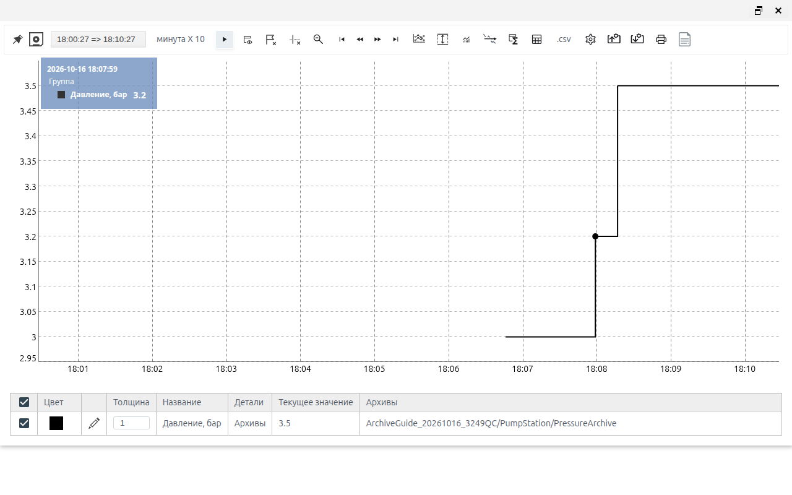
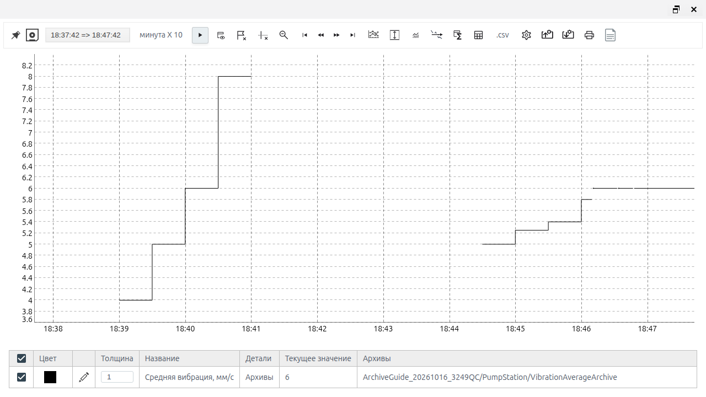

<a id="archives"></a>

# Archives: configuring sources and recording data

<a id="purpose"></a>

## About the module

An archive stores a history of timestamped values. Use it to track changes in process variables, investigate deviations, and provide data for trends and indicator calculations. The source is a tag field or the result of a JavaScript or Erlang script. Each archive has settings for the polling period, minimum change threshold, and disabling collection.

To view history, see [Trends: viewing and exporting history](./trends_en.md). For calculations based on history, see [Aggregates: calculating and exporting indicators](./aggregates_en.md).

The screenshots show the Russian interface. Russian button and field labels are retained below with English explanations so that you can match the instructions to the screen.

<a id="getting-started"></a>

## Before configuring an archive

You need permission to create and edit project objects, a running Runtime, and source objects with accessible fields. For a script source, your installation must support the selected language.

Determine the type and unit of each input in advance. In these examples, pressure is measured in bar, energy in kWh, volume in m³, and vibration in mm/s. Including the unit in the archive caption helps readers interpret the chart; the caption itself does not convert values.

All values below are for training. The examples assume that the source objects and fields already exist in the PumpStation folder of your project. Select objects through the project tree: the path in the selection field is relative to the project.

### How to confirm the configuration works

A saved form confirms the settings. RUN and the absence of an error confirm that the archive is active. To confirm that a value was recorded, open the history and check the value change and the point timestamp. The current value on the Runtime tab alone does not prove that a new point exists.

<a id="typical-example-of-working-with-an-archive"></a>

## Archiving pressure from a tag

Task: record changes in pump outlet pressure. The source is Pressure, using its numeric value field. The training sequence is 3 → 3.2 → 3.5 bar.

1. In Studio, open the PumpStation folder in the main tree. Click «Создать» (Create), open system, select ARCHIVE, and click «Ok».
2. Set «Название» (Name) to PressureArchive and «Заголовок» (Caption) to «Давление на выходе насоса, бар» (Pump outlet pressure, bar).
3. On the «Настройки» (Settings) tab, select the «тег» (tag) source. Use the tree to select Pressure, then its value field.
4. Leave «Период (мс)» (Period, ms) at 1000, leave «Минимальный шаг» (Minimum step) blank, and leave «Отключено» (Disabled) off. Click save.
5. Reopen the archive and check its source and settings. If Runtime is not running yet, use «Запустить Runtime» (Start Runtime) and confirm with yes.
6. Check that the archive shows RUN and no errors. Change the training source pressure from 3 to 3.2, then to 3.5. Wait longer than one polling period between changes.
7. Open Runtime → «Меню» (Menu) → «Тренды» (Trends) → «Архивы» (Archives). In the series editor, select PressureArchive and confirm with save, then «ОК».
8. Check the pressure steps and the tooltip showing the time and value. Use «Старт-Стоп» (Start–Stop) to pause the chart while checking it.



*Figure 1. Training pressure history: the tooltip confirms a value of 3.2. The pause applies to the chart.*

A period of 1000 ms means that the source is read once per second. An unchanged value does not necessarily produce another record every second. Pausing the trend does not stop archive collection.

A tag source stores the numeric representation of the field: numbers are used directly, booleans become 0 or 1, and numeric strings become numbers. A value that cannot be converted becomes missing. A simple tag binding does not automatically transfer the source field's timestamp and quality; use a script source to include them in the result when required.

## Script sources

Use a script to record a calculated variable, such as a ratio of counter increments, an average of several samples, or a result subject to validity conditions.

In the archive form, select the script source and the erlang or javascript language. In the variables table, specify the name, object, and field for each input. Each name in the table must exactly match its name in the function.

| Element | JavaScript | Erlang |
| --- | --- | --- |
| Input variables | VARS.energy_total | maps:get("vibration", VARS, none) |
| State | Second argument, State | Second argument, State |
| Returning a value and state | { value: number, state: newState } | {Value, NewState} |
| No calculated value | null | none |
| Boolean inputs | true / false | true / false |

State holds data between polls, such as the previous pair of counter readings or a sample window. The function returns this state; there is no separate field for entering it manually. Restarting the archive clears the state. After changing settings and enabling the archive again, allow time for the initial data to accumulate again.

A missing result differs from zero. Numeric 0 is a valid result; null or none means that no value can be calculated at this time. A transition to a missing value appears as a gap in the history.

A script result may also include ts, an integer Unix timestamp in milliseconds, and quality, a quality code. In JavaScript, these fields are part of the result object alongside value and state. In Erlang, value, ts, and quality can be returned as a map in the first element of the pair, with the new state as the second element. The functions below do not set time or quality explicitly; the calculation time is used. Agree on the meaning of quality codes for your system.

### Entering and checking a function

1. Configure the input bindings and select the language.
2. Replace the example text in the editor with the complete function.
3. Finish editing, wait for the change to be processed, and click Compile.
4. After successful compilation, wait for save to become available and save the archive.
5. Reopen the form and check the language, every binding, and the saved text.
6. Check the current result and history using known inputs.

Successful compilation checks the function, but does not establish that the selected objects, units, or input readings are correct. If reading a field fails before the function is called, null or none checks inside the function cannot handle that error.

## Specific energy consumption in JavaScript

Task: calculate the energy used per unit of pumped water. The indicator is the energy increment divided by the volume increment over one polling interval.

| Variable | Object and field in PumpStation | Type and unit |
| --- | --- | --- |
| energy_total | EnergyTotal → value | Nonnegative number; cumulative energy, kWh |
| volume_total | VolumeTotal → value | Nonnegative number; cumulative volume, m³ |

1. Create the SpecificEnergyArchive archive with the caption «Удельное энергопотребление, кВт·ч/м³» (Specific energy consumption, kWh/m³).
2. Select script → javascript and configure the two bindings from the table.
3. Set the period to 60000 ms, leave the minimum step blank, and keep collection enabled.
4. Insert the function below, run Compile, save, and reopen to check the text.

```javascript
async function(VARS, State) {
    const energy = VARS.energy_total;
    const volume = VARS.volume_total;
    const valid = x => Number.isFinite(x) && x >= 0;
    if (!valid(energy) || !valid(volume)) {
        return { value: null, state: null };
    }
    const next = { energy_total: energy, volume_total: volume };
    const hasPrevious =
        State !== null &&
        typeof State === "object" &&
        valid(State.energy_total) &&
        valid(State.volume_total);
    if (!hasPrevious) {
        return { value: null, state: next };
    }
    const deltaEnergy = energy - State.energy_total;
    const deltaVolume = volume - State.volume_total;
    if (deltaEnergy < 0 || deltaVolume <= 0) {
        return { value: null, state: next };
    }
    const result = deltaEnergy / deltaVolume;
    return {
        value: Number.isFinite(result) ? result : null,
        state: next
    };
}
```

The function remembers the previous readings. The first valid poll only establishes a baseline. A decrease in either counter, or the absence of a positive volume increment, produces a missing result and a new baseline. An invalid input clears the state.

### Checking a training sequence

The table shows the expected sequence of function calls. During a manual check, set both counters before the next poll and hold the pair until the result is recorded. An additional poll of an unchanged pair means a zero volume increment and may produce a missing result.

| Poll | Energy, kWh | Volume, m³ | Result, kWh/m³ | Explanation |
| --- | --- | --- | --- | --- |
| 1 | 1000 | 500 | No value | Initial baseline |
| 2 | 1002 | 510 | 0.2 | 2 / 10 |
| 3 | 1003 | 510 | No value | Volume did not increase; new baseline |
| 4 | 1004 | 515 | 0.2 | 1 / 5 |
| 5 | 2 | 2 | No value | Counter reset; new baseline |
| 6 | 3 | 7 | 0.2 | 1 / 5 after the reset |
| 7 | null | 8 | No value | Invalid input; state cleared |
| 8 | 4 | 12 | No value | New initial baseline |
| 9 | 5 | 17 | 0.2 | 1 / 5 |
| 10 | 5 | 22 | 0 | Zero energy with a positive volume increment |


*Figure 2. Checking recovery after a counter reset: the history shows 0.2 kWh/m³.*

The readings must refer to the same station and comparable times. The script cannot detect a hidden counter reset if the reading has already exceeded its previous value by the next poll. When volume does not increase, the energy for that interval is not carried into the next calculation. Numeric strings and booleans are deliberately rejected.

The practical context is monitoring energy efficiency in water supply and desalination, as discussed in [AVEVA's material on water supply](https://www.aveva.com/en/our-industrial-life/type/podcast/smart-water-for-a-changing-environment/) and [desalination energy costs](https://www.aveva.com/en/our-industrial-life/type/article/deep-sea-desalination-pods-cleaner-cheaper-water/). The function and counter reset rules here were developed for this Faceplate training example.

## Vibration moving average in Erlang

Task: smooth the vibration of a running pump without mixing samples from before a stop with samples from after a restart. The calculation uses the latest five valid polls and starts producing a result on the third.

| Variable | Object and field in PumpStation | Type and meaning |
| --- | --- | --- |
| vibration | Vibration → value | Number ≥ 0, mm/s |
| running | Running → value | Boolean: the pump is running |
| sensor_ok | SensorOK → value | Boolean: the source confirms validity |

1. Create the VibrationAverageArchive archive with the caption «Средняя вибрация, мм/с» (Average vibration, mm/s).
2. Select script → erlang and configure the three bindings.
3. Set the operating period to 1000 ms and leave the minimum step blank.
4. Insert the function, run Compile, save, and check it by reopening the form.

```erlang
fun(VARS, State) ->
    Vibration = maps:get("vibration", VARS, none),
    Running = maps:get("running", VARS, none),
    SensorOK = maps:get("sensor_ok", VARS, none),
    Valid = Running =:= true
        andalso SensorOK =:= true
        andalso is_number(Vibration)
        andalso Vibration >= 0,
    case Valid of
        false ->
            {none, []};
        true ->
            Previous = case State of
                L when is_list(L) -> L;
                _ -> []
            end,
            Window = lists:sublist([Vibration | Previous], 5),
            case length(Window) >= 3 of
                false -> {none, Window};
                true -> {lists:sum(Window) / length(Window), Window}
            end
    end
end.
```

State contains a list ordered from the newest sample to the oldest. If the pump stops, the validity flag is false, or vibration is invalid, the function returns a missing value and an empty window. The running and sensor_ok inputs must be true or false; numbers 0/1 and strings are not substitutes.

### Checking how the window fills and clears

For manual testing, you can temporarily set a period of 30000 ms to allow time to change inputs between polls. Restore the operating period of 1000 ms after the check. Changing the period may restart window accumulation.

| Poll | vibration | running | sensor_ok | Result | Window, newest to oldest |
| --- | --- | --- | --- | --- | --- |
| 1 | 2 | true | true | No value | [2] |
| 2 | 4 | true | true | No value | [4, 2] |
| 3 | 6 | true | true | 4 | [6, 4, 2] |
| 4 | 8 | true | true | 5 | [8, 6, 4, 2] |
| 5 | 10 | true | true | 6 | [10, 8, 6, 4, 2] |
| 6 | 12 | true | true | 8 | [12, 10, 8, 6, 4] |
| 7 | 12 | false | true | No value | [] |
| 8 | 3 | true | true | No value | [3] |
| 9 | 4 | true | false | No value | [] |
| 10 | none | true | true | No value | [] |
| 11 | 4 | true | true | No value | [4] |
| 12 | 5 | true | true | No value | [5, 4] |
| 13 | 6 | true | true | 5 | [6, 5, 4] |



*Figure 3. Manual check with a period of 30000 ms: averages of 4 → 5 → 6 → 8, a gap, and recovery. The operating period was restored to 1000 ms after the check.*

The table is a reference sequence of individual calls. Every valid poll enters the window, including polls with an unchanged input. This is a sample average, rather than a time average over a fixed duration or an average of the last five recorded changes. The example values are not equipment vibration limits.

The smoothing approach is illustrated in [Ignition: Easy Chart Calculated Pens](https://docs.inductiveautomation.com/docs/8.3/ignition-modules/vision/historian-in-vision/using-the-vision-easy-chart/easy-chart-calculated-pens); averaging the last N values is described in [Ignition SDK: MovingAverage](https://sdk.inductiveautomation.com/javadoc/ignition81/8.1.50/index-files/index-13.html). The pump conditions, five-poll window, and state clearing are an original adaptation for this example.

<a id="archive-in-faceplate"></a>

## Archive settings and controls

### General fields and recording

| Field | Purpose | Type / unit | Required | Default | If blank | Constraints |
| --- | --- | --- | --- | --- | --- | --- |
| Папка (Folder) | Archive location | Path | Yes | Current folder | Select a folder | Within the accessible project |
| Шаблон (Template) | Object type | ARCHIVE | Yes | Selected during creation | Select ARCHIVE | system category |
| Название (Name) | Object name | Text | Yes | User input | Enter a name | Unique within the folder |
| Заголовок (Caption) | Readable label | Text | No | Blank | No caption | Does not change units |
| Период (мс) (Period, ms) | Polling / calculation frequency | Integer, ms | Yes | 1000 | Leave at 1000 | Positive integer |
| Минимальный шаг (Minimum step) | Suppress small changes | Integer; signal units | No | Blank | No threshold | Positive integer; 0 is invalid |
| Отключено (Disabled) | Stop archive collection | Yes/no | No | Off | Collection allowed | Runtime must be running |

The tested interface did not save a fractional minimum step. Leave the field blank for the initial configuration; use a positive integer if a threshold is needed.

The minimum step compares a new value with the last saved value. The change must strictly exceed the threshold to be recorded; a change equal to the threshold is suppressed. For example, if the last saved value is 10 and the step is 1, values of 10.4 and 11 are within the threshold, while 11.2 exceeds it. Several small changes can accumulate to exceed the threshold. A quality change can also affect whether a point appears.

### Sources and bindings

| Field | Purpose | Type / unit | Required | Default | If blank | Constraints |
| --- | --- | --- | --- | --- | --- | --- |
| Источник (Source) | How the value is obtained | тег (tag) / script | Yes | тег | Select explicitly | Settings depend on the source |
| Object and field | Tag input | Path and field | For a tag | Not selected | Configuration incomplete | The field must exist |
| Язык (Language) | Function language | erlang / javascript | For script | erlang | Select explicitly | Must be supported by the installation |
| Переменные (Variables) | Input bindings | Name, object, field | As used by the function | Empty table | Required inputs absent | Names must match the code |
| Function text | Calculation | Function with two arguments | For script | Example | Enter the function | Compile and verify it was saved |

The blank row that appears automatically after completed bindings is for the next variable. Do not refer to it in code until its name, object, and field have been specified.

### Archive list and commands

In Studio, open «Меню» (Menu) → «Архив» (Archive). The table shows «Путь» (Path), «Статус» (Status), «Источник» (Source), «Отключено» (Disabled), Period,ms. and Min.step. To search, enter a name or part of a path in NameOrPart, select the Tag or «Скрипты» (Scripts) filter, and click «Найти» (Find). Use at least three characters when searching by part of a path.

| Action | Purpose | Available when | Result |
| --- | --- | --- | --- |
| Создать → system → ARCHIVE | New archive | In a project folder with appropriate permissions | Creation form opens |
| Double-click an archive | Edit | Archive exists | Form opens |
| save | Save | There are valid changes | Settings applied |
| cancel | Close without saving | Form is open | Unsaved changes discarded |
| Enable Отключено → save | Pause collection | In the archive form | New values are not collected |
| Clear Отключено → save | Resume | Archive was disabled | Collection resumes; State accumulates again |
| Compile | Check the function | Source is script | Compilation result |
| Диагностика (Diagnostics) | Archive log, see [Diagnostics of Runtime objects](../administration/diagnostics/diagnostics.md) | Saved archive | The **Diagnostics** window is open |
| Найти (Find) | Search by name and source | Archive list is open | Filtered rows |

After changing settings, reopen the form to check them. The RUN status, «Ошибка» (Error) field, and Runtime tab are populated automatically; you do not enter them manually.

## Diagnostics and recording behavior

| Observation | What to check | How to confirm the fix |
| --- | --- | --- |
| STOP; no current result | Project Runtime and Отключено (Disabled) | RUN after allowing collection |
| RUN, but no new point | Whether the value changed; period; minimum step | Change is visible in history |
| Points appear less often than the period | Unchanged values and threshold suppression | Check a known signal transition |
| Binding error | Object and field of every variable | Reopen the source and archive |
| Compile does not succeed | Language, complete text, two arguments, VARS names | Compile succeeds and the code is saved |
| Script returns a missing value after startup | Counter baseline or the first two vibration samples | Wait for enough valid polls |
| Missing value instead of the expected number | No volume increment, reset, input type, boolean flags | Check inputs against the scenario table |
| «Неправильное значение» (Invalid value) in the legend | null / none was returned | Compare the function conditions and error field |
| Current form shows an old value | Reopen the tab / form | Compare the fresh result with history |
| Error with minimum step | Zero or a fractional value | Leave blank or enter an integer > 0 |

View the archive log in the **Диагностика** (Diagnostics) window, see [Diagnostics of Runtime objects](../administration/diagnostics/diagnostics.md): click **Start**, reproduce the problem, then click **Stop**. The absence of messages during a brief check does not confirm recording: also check history and point tooltips.

A repeated missing result does not necessarily create another point. The length of a gap and the number of records therefore do not equal the number of unsuccessful function calls.
