# Calculations (Calculation)

This document is for integration engineers who set up calculations over tag values in a Faceplate project. Verified on FACEPLATE Studio 4.0.7.

# Glossary

| Term | Meaning |
|---|---|
| Calculation (object) | A project object of type `calculation`. It reads the current values of tag fields, evaluates an Erlang formula and writes the result to tag fields |
| Calculation runtime | The **Runtime** tab in the calculation form. The `in` field holds the input variable values, `out` holds all output variable values from the last successful run |
| Calculation (menu) | Studio main menu section: the list of all calculations in the project |
| General View | Studio main menu section with the project object tree (see [Project structure](../Project_strucure/FACEPLATE-start.md)). Calculations are created here |
| Tag | A project object whose field serves as a source or a destination of a value |
| Input variable | A row in the **Input data** table: a script variable name and the tag field the value is read from |
| Output variable | A row in the **Output data** table: a script variable name and, optionally, the tag field the result is written to |
| Auto-run | Running the calculation whenever any input field changes. In the form, this is the **Execute on changing variables values** toggle |
| Period | Timer interval for running the calculation, in milliseconds |

# Introduction

A calculation takes the current values of tag fields, computes new values with a formula and, if needed, writes them to fields of other tags.

| Suitable for Calculation | Implement in [User Script](../user_script/user_script.md) |
|---|---|
| Unit conversion, scaling | Historical and time-window calculations, rate of change |
| Formulas over several inputs: sum, difference, ratio, percentage, power, efficiency | Accumulation and totalizers, state between runs |
| Threshold flags and statuses | Alarms, SQL, UI interaction |
| Simple conditions: range clamping, fallback value, division-by-zero guard | Complex logic and control flow |
| Extracting a bit from a word, mapping integer state codes | Protocol decoding, formula libraries |

A calculation sees only the current input values: it does not remember previous runs.

A calculation consists of three parts:

| Part | What it defines |
|---|---|
| Input variables | Which fields of which tags to read and under which names they are available in the script |
| Script | Erlang expressions that compute the output variables |
| Output variables | Where to write the computed values |

A calculation runs on input changes, on a timer, or both.

Running example: folder `calc_demo` with tags `p_in_1`, `p_in_2`, `p_avg`. They are instances of a primitive with a numeric field `out_value`; how to create such a type is covered in the [Primitives](../primitives/Primitives.md) guide. Calculation `p_avg_calc` writes the average of two pressures to `p_avg` and also computes their difference `DIFF`.

You need access to Studio (`http://<server>:9000/fp/studio`) with an account allowed to modify the project.

# Main part

## Calculation list

Open **Calculation** in the Studio main menu. The table lists all calculations in the project, regardless of folder.

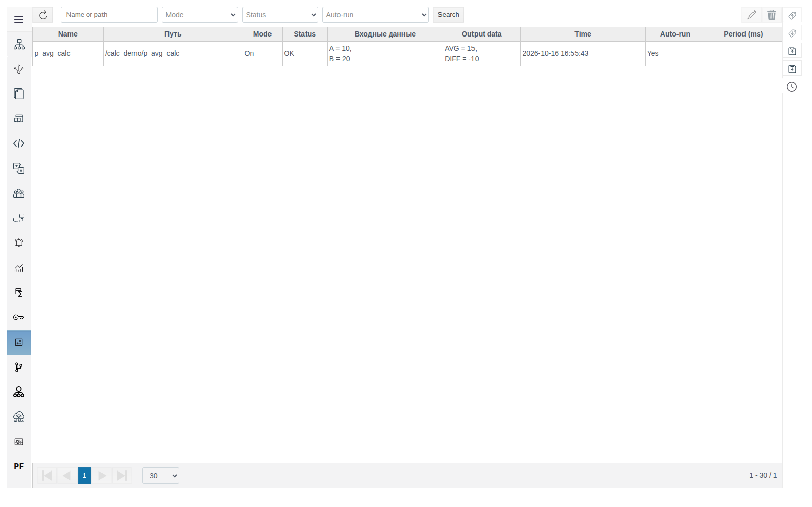

| Column | Content |
|---|---|
| **Name**, **Путь** | Calculation name and path from the project root |
| **Mode** | `On` or `Off` (the **Disabled** toggle in the form) |
| **Status** | `OK` or `ERROR`. A row with an error is highlighted red; the cause is shown in the calculation form |
| **Входные данные**, **Output data** | Variable values from the last successful run |
| **Time** | Time of the last successful run |
| **Auto-run** | `Yes`: the calculation runs on input changes |
| **Period (ms)** | Timer interval; empty means no timer |

Filters above the table: part of the path, **Mode**, **Status**, **Auto-run**. Apply them with **Search**.

On the right are the edit (pencil) and delete (trash) buttons. Double-clicking a row also opens the calculation. You cannot create a calculation from this section.

## Creating a calculation

1. In **General View**, double-click to enter the calculation's folder (`calc_demo` in the example) and click **Create**.
2. Expand **system**, select **calculation**, click **Ok**.

   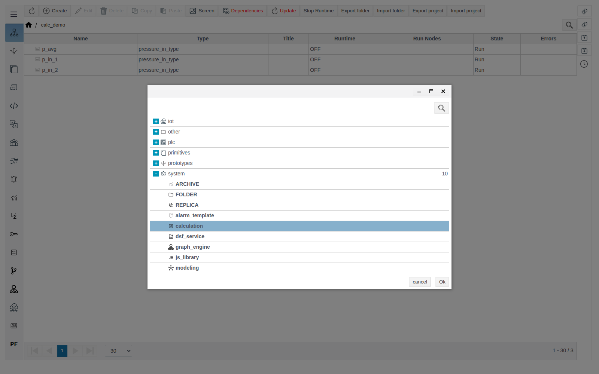

3. Fill in **Name**: `p_avg_calc`.
4. Set the run conditions (see [Run conditions](#run-conditions)). For the example, leave **Period (ms)** empty and **Execute on changing variables values** on, which is the default.
5. Fill in **Input data**, the script and **Output data** (see below).
6. Click **Compile**, wait for `OK` and save.

The calculation runs right after saving. The result is visible in the **Calculation** section and in the `out_value` field of the `p_avg` tag.

## Variables

Rows in **Input data** and **Output data** are filled in the same way:

| Column | What to enter |
|---|---|
| **value** | Read-only: the variable value from the last successful run |
| **variable** | The variable name in the script. The first letter is automatically capitalized (`diff` → `Diff`) |
| **tag** | The tag. Click the magnifier, double-click through folders, select the tag and click **OK** |
| **field** | A field of the selected tag. The list contains all tag fields, including system ones; for the value you usually need `out_value` |

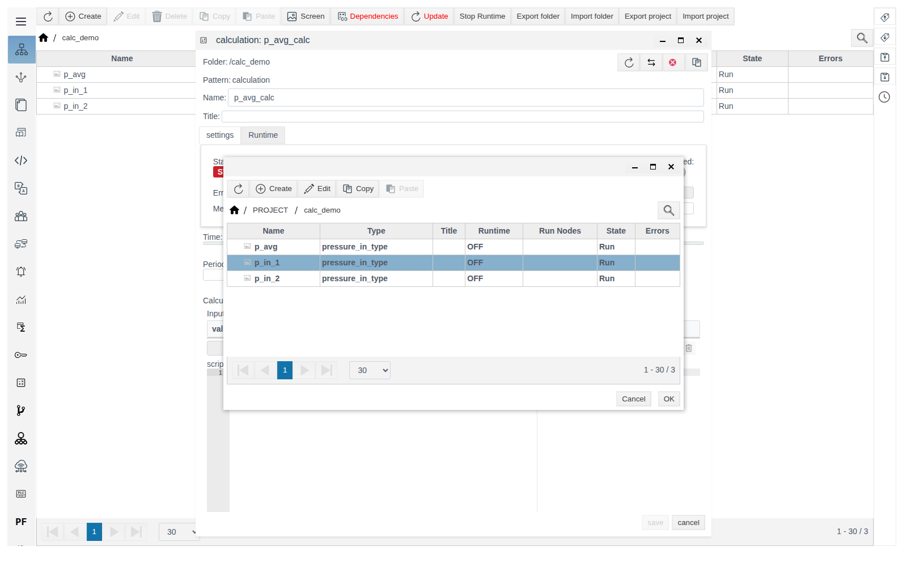

Once a row is filled, an empty row appears below it. The arrows reorder rows; the trash button deletes a row.

An input variable requires a tag and a field. An output variable does not:

| Output variable | Where the value goes |
|---|---|
| With tag and field | To the specified tag field and to the calculation runtime |
| Without tag | Only to the calculation runtime (the `out` field). Also visible in the form's **value** column and in the list's **Output data** |

Outputs without a tag are handy for intermediate values and debugging. Bind an output to a tag only when other project objects need the value: a screen, an [archive](../Archives/Archives.md), another calculation.

Do not write an output to a field that the same calculation reads as an input. This creates a feedback loop: the calculation keeps changing its own input.

Example:

| Table | variable | tag | field |
|---|---|---|---|
| Input data | `A` | `/calc_demo/p_in_1` | `out_value` |
| Input data | `B` | `/calc_demo/p_in_2` | `out_value` |
| Output data | `AVG` | `/calc_demo/p_avg` | `out_value` |
| Output data | `DIFF` | — | — |

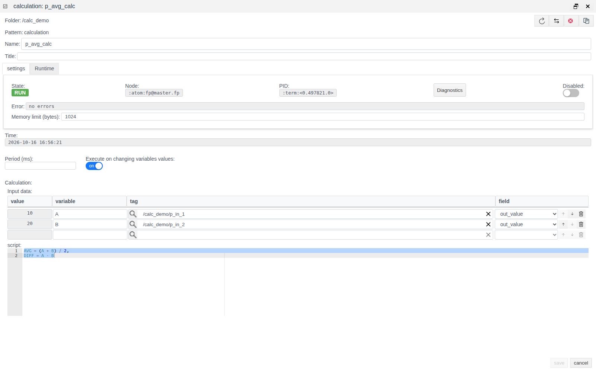

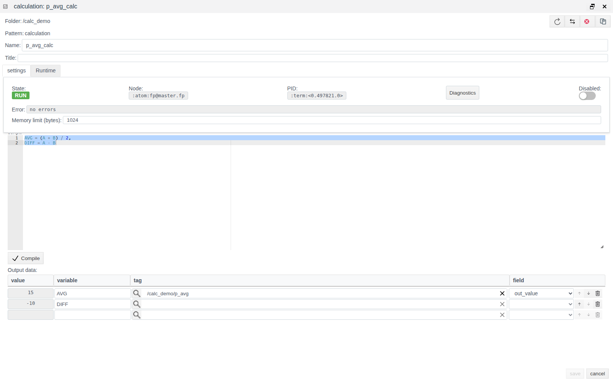

On the **Runtime** tab, `out` shows both output variables: `AVG` is also written to the `p_avg` tag, `DIFF` exists only here.

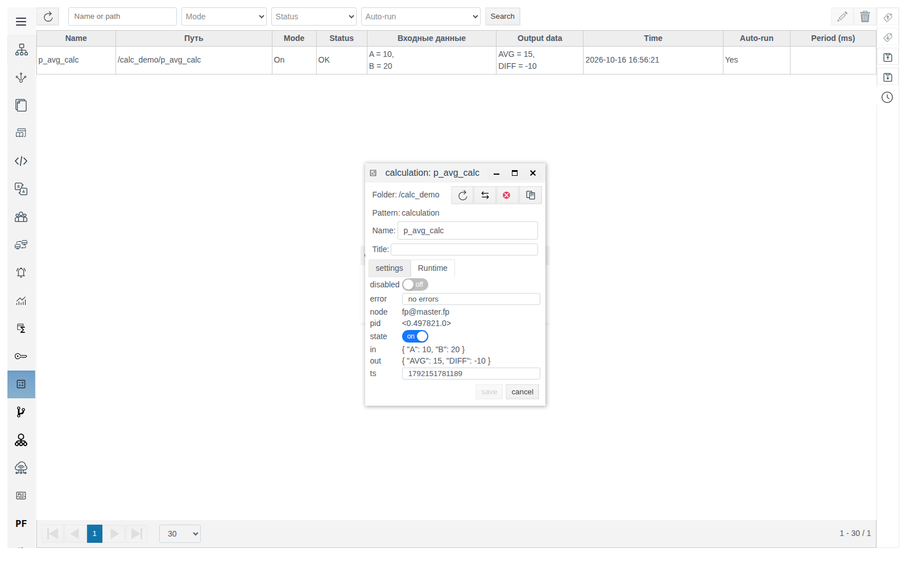

## Script

The script is Erlang formulas separated by commas. Input variables already hold the field values. Assign a value to every output variable.

```erlang
AVG = (A + B) / 2,
DIFF = A - B
```

Rules:

- Do not put a period at the end. Error: `{invalid_expression,{4,erl_parse,["syntax error before: ","'.'"]}}`.
- Variable names start with a capital letter, as in the **variable** column. If an output variable is not assigned or is written in lowercase, **Compile** returns `{unbound_var,'NAME'}`.
- Operations: `+`, `-`, `*`, `/` (floating-point result), `div` (integer division), `rem` (remainder), `band`, `bsr` (bitwise), parentheses, `min`, `max`, functions of the `math` module, for example `math:sqrt(A * B)`.

Typical formulas (`X`, `Y`, `Word` are inputs, `R` is an output):

| Task | Formula |
|---|---|
| Division-by-zero guard | `R = if Y == 0 -> 0; true -> X / Y end` |
| Clamp to 0…100 | `R = min(max(X, 0), 100)` |
| Status by thresholds | `R = if X > 80 -> 2; X > 50 -> 1; true -> 0 end` |
| Bit 3 of a word | `R = (Word bsr 3) band 1` |

Take thresholds, coefficients and status codes from the project: in the formula they are written as numbers.

**Compile** checks the script on the server together with the variable lists. `OK` or an error text appears next to the button. Until the check passes, **save** is unavailable. After any change to the script or the variables, click **Compile** again.

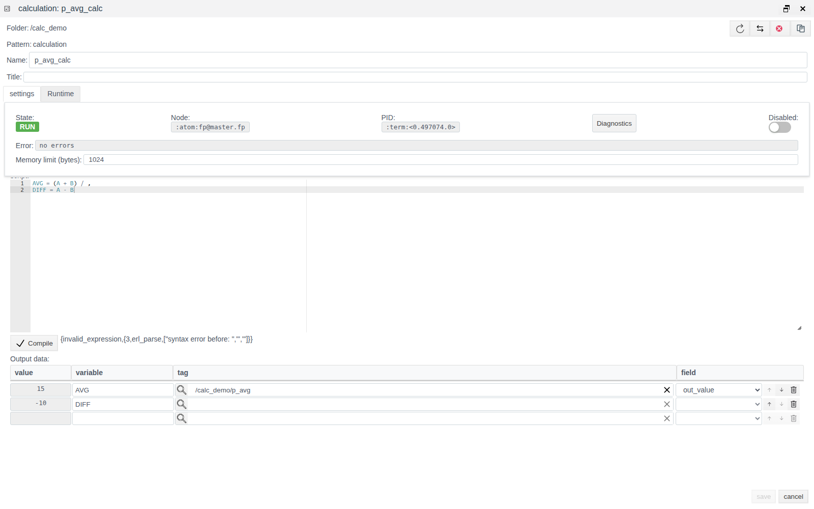

## Run conditions

| Period (ms) | Execute on changing variables values | When the calculation runs |
|---|---|---|
| empty | on | When any input field changes |
| `N` | off | Every `N` ms |
| `N` | on | Every `N` ms and when any input field changes |
| empty | off | Not saved: `no_trigger_defined` |

The period must be greater than 10 ms. A smaller value is rejected on save with the error `{invalid_cycle,N}`.

In addition, the calculation runs once on start: after saving and after clearing **Disabled**.

While **Disabled** is on, the calculation does not run (State is `STOP`) and the output tag values do not change.

## Errors

### On save

The server validates the calculation on save. On error, an **ERROR!** window appears, the calculation window closes and the changes are not saved. Open the calculation again and repeat the edits.

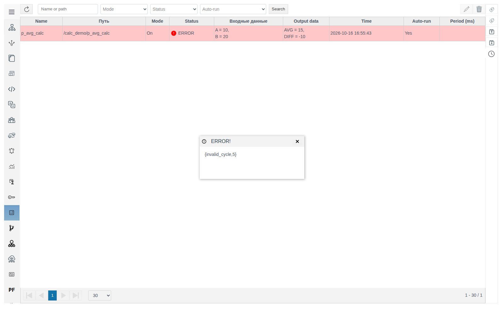

| Text | Cause |
|---|---|
| `{invalid_cycle,N}` | **Period (ms)** is not greater than 10 |
| `no_trigger_defined` | The period is empty and **Execute on changing variables values** is off |

### At run time

If the script fails at run time (for example, division by zero):

- the form's **Error** field shows the cause, for example `badarith`;
- in the **Calculation** section the row is highlighted red and **Status** is `ERROR`;
- in **General View** the cause is shown in the **Errors** column;
- the output tags do not change; **Входные данные**, **Output data** and **Time** keep the values from the last successful run.

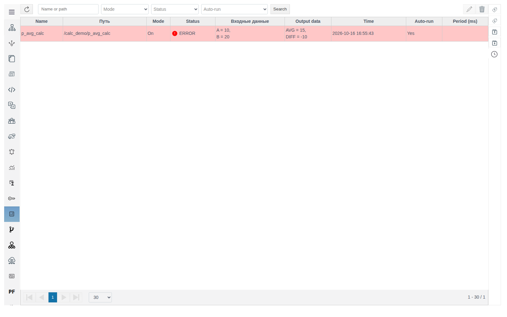

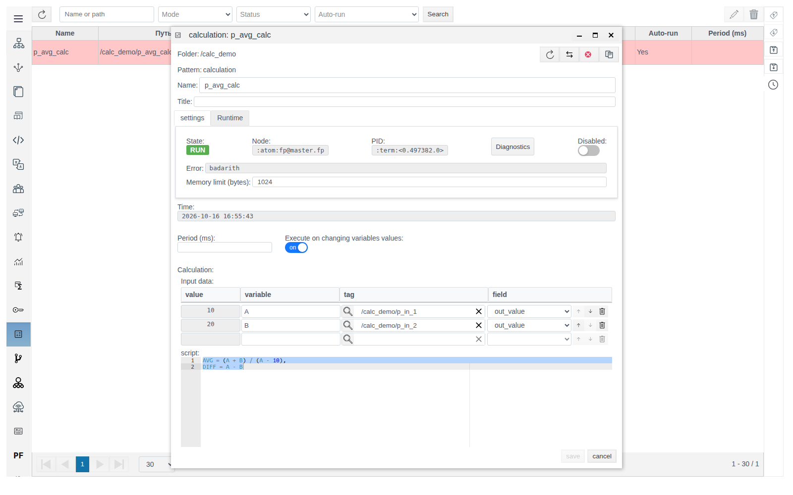

The error clears on the next successful run.

## Editing and deleting

Double-click the calculation in **Calculation** or in **General View**, make your changes, click **Compile** and save. The calculation restarts with the new settings.

To delete, select one or more rows in **Calculation** and click the trash button. The confirmation window shows only the number of rows (`delete items: 1`). Confirm with **yes**. In **General View**, a calculation is deleted like any other object, with **Delete**.

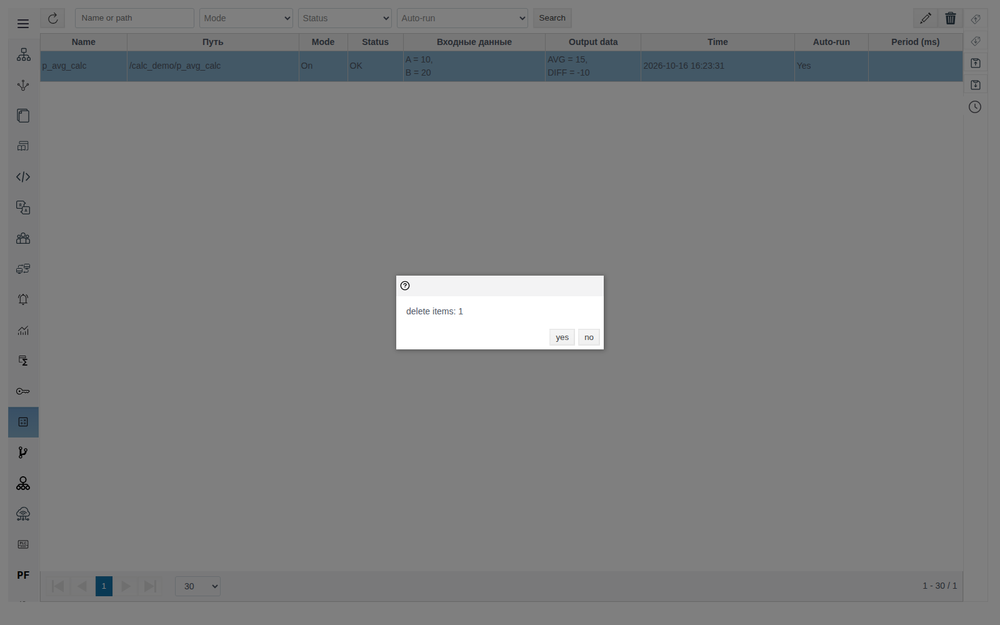

## Interface notes for 4.0.7

| On screen | Where |
|---|---|
| Column headers **Путь** and **Входные данные** are not translated | **Calculation** list |
| Buttons **save**, **cancel** and the **settings** tab are in lowercase | Calculation form |
| The confirm button is **OK** in the tag picker and **Ok** in the type selection window | Selection windows |
| Server errors look like `{invalid_cycle,5}` | **ERROR!** window |
| The **ERROR!** window does not close with Esc, only with the cross | Error window |

# Conclusion

Calculation setup sequence:

1. Identify the source tags, destination tags and their fields.
2. In **General View**, enter the target folder and create a **system → calculation** object.
3. Set the run conditions: a period greater than 10 ms, auto-run on input changes, or both.
4. Define input variables with a tag and a field. Define outputs with a tag if the result must be written to a tag, or without one if the calculation runtime is enough. Do not direct an output to a field that is an input of the same calculation.
5. Write the script: formulas separated by commas, no period at the end, every output variable assigned. Move historical calculations, accumulation and complex logic to [User Script](../user_script/user_script.md).
6. Click **Compile**, wait for `OK`, save.
7. Check the result in the **Calculation** section: status `OK`, input and output values, run time.
