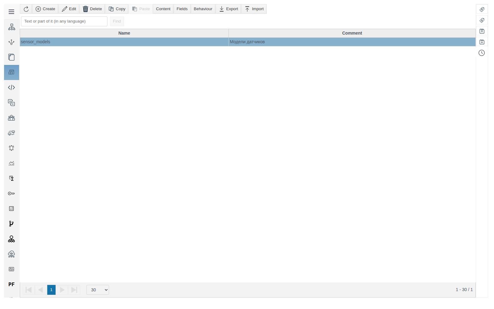
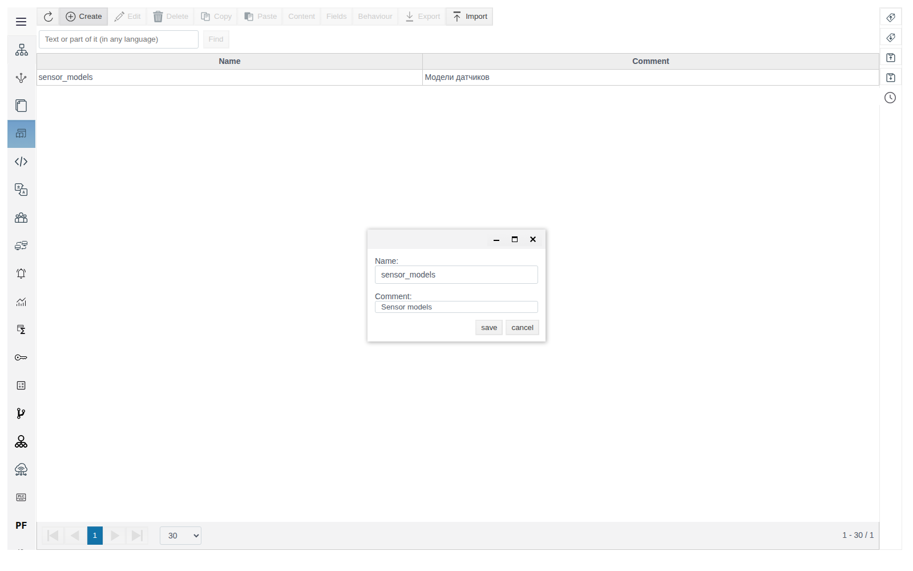
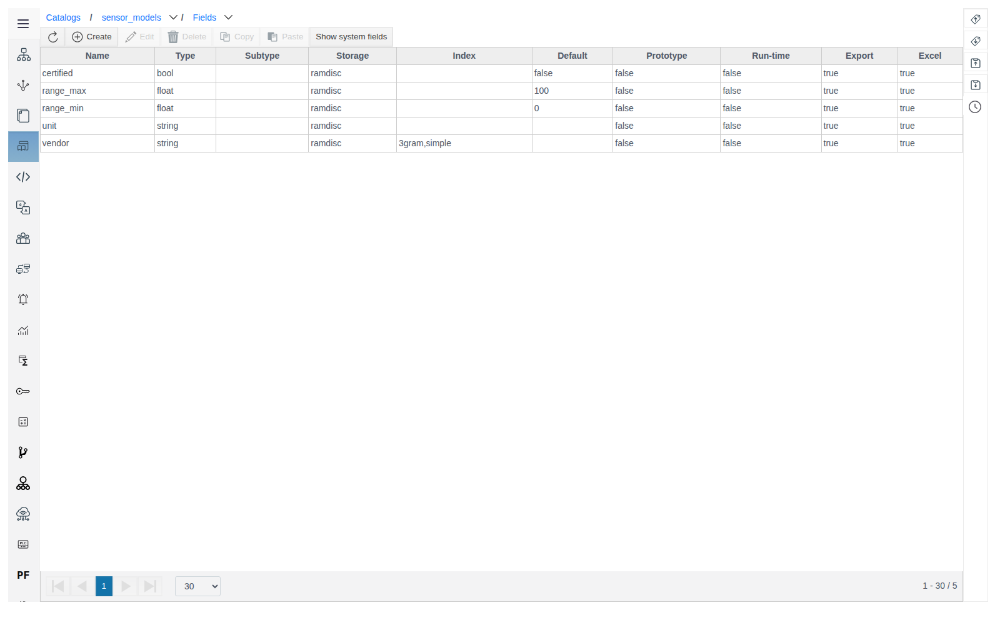
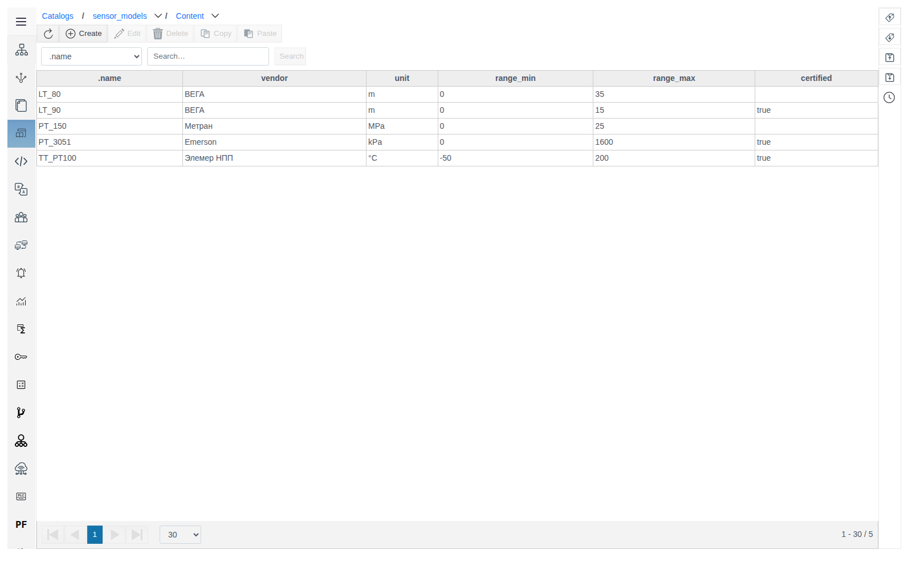
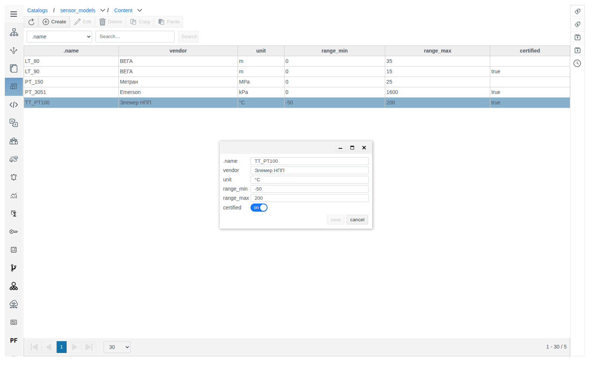
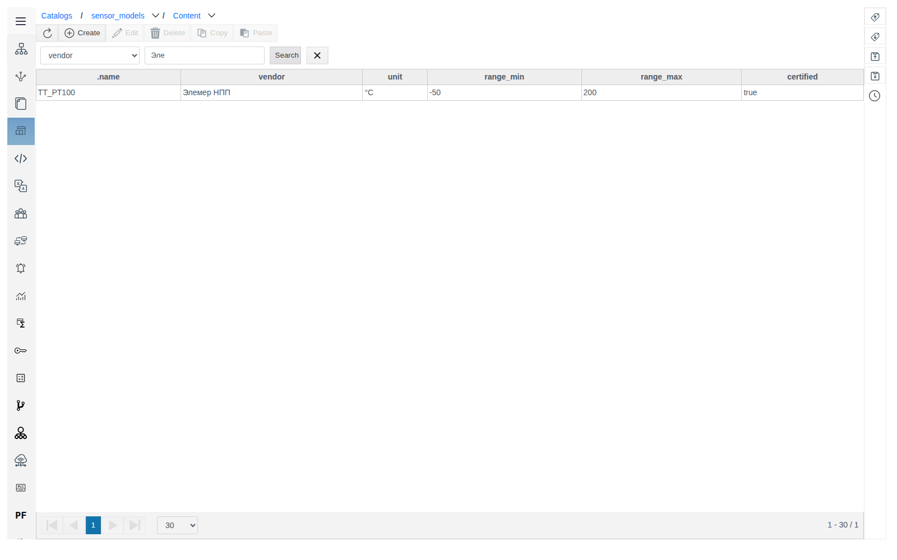
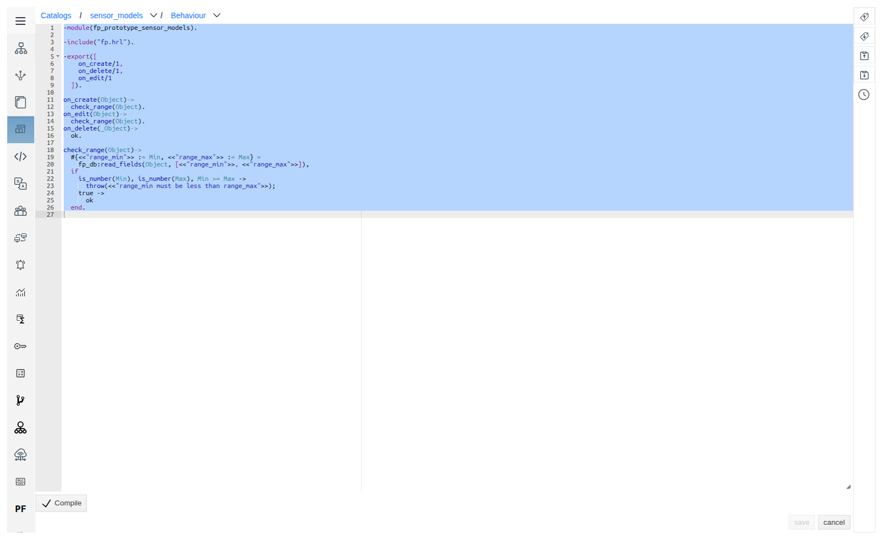
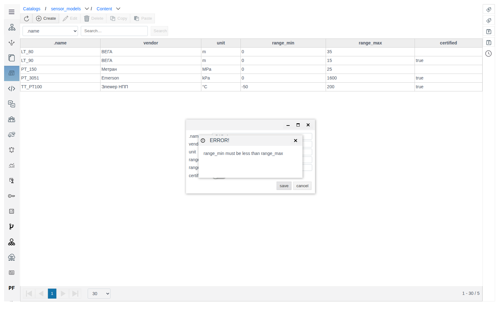
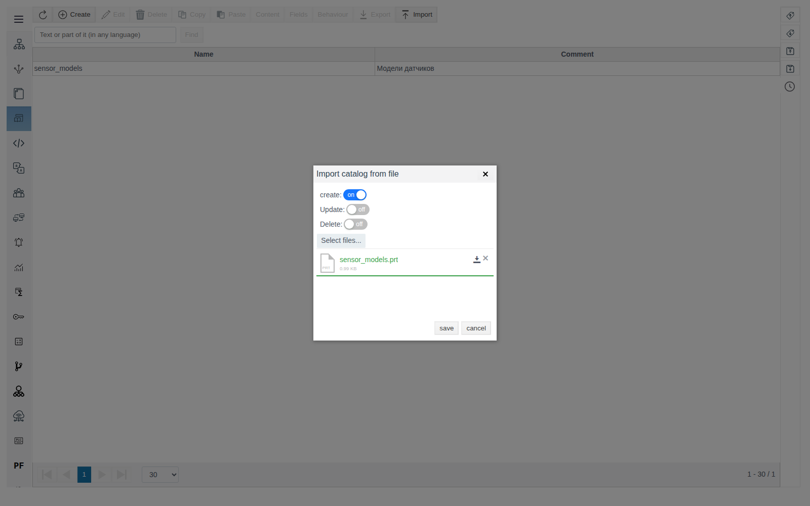
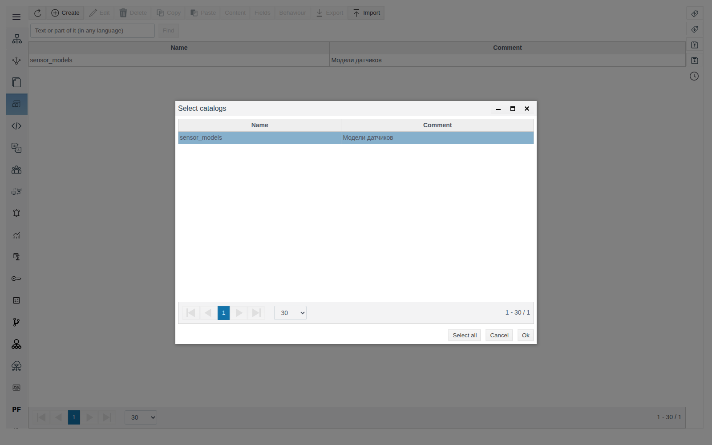

# Catalogs

A document for the integration engineer who keeps reference data in the project as tables.

# Glossary

| Term | Meaning |
|---|---|
| Catalog | A reference data table of the project from the **Catalogs** section: a set of fields (columns), records (rows) and an optional Behaviour |
| Record | A row of a catalog. The record name (`.name`) is unique within the catalog |
| Behaviour | An Erlang module with the functions `on_create/1`, `on_edit/1`, `on_delete/1`. The server calls them when a record is created, edited and deleted |
| `.prt` file | The catalog export file: fields, records and Behaviour |

# Introduction

A catalog is a reference data table inside the project: equipment models, sensor types, reason codes, material parameters and any other lists that are easier to keep as a table than as a tree of objects. The catalog fields define the table structure, the records hold the data. Behaviour lets you check or complete records when they are saved.

The section is in the Studio main menu: **Catalogs**. Each catalog has three parts, each opened with its own button:

| Part | Button | Contents |
|---|---|---|
| Records | **Content** | The table of catalog records |
| Fields | **Fields** | Table columns: name, type, storage, index, default value |
| Behaviour | **Behaviour** | Erlang code that the server runs on operations with records |

The example used throughout is the sensor model catalog `sensor_models` with the fields `vendor`, `unit` (unit of measure), `range_min`, `range_max` (measuring range) and `certified` (calibration flag).

You will need access to Studio (`http://<server>:9000/fp/studio`) with an account that is allowed to change the project.

# Main part

## Creating a catalog

Open **Catalogs** in the Studio main menu. The table shows the name and comment of each catalog, the search line above the table searches by name.



Click **Create**, fill in **Name** (required) and **Comment** and save. Empty Fields and Content are created together with the catalog.



The breadcrumbs above the table (**Catalogs / sensor_models / Content**) return to the list and switch between the catalog parts.

## Fields

Select the catalog and click **Fields**. The field form is the same as for a prototype: each parameter is described in [Prototypes](../prototypes/prototypes.md), section "Fields". For a catalog the following matter:

| Parameter | Effect in a catalog |
|---|---|
| **Type** | The input control in the record form: `string` — text, `integer` and `float` — number, `bool` — switch |
| **Default value** | Prefilled in the form of a new record |
| **Index** | `3gram` enables search by part of a value (section "Searching records" below) |
| **excel** | The field takes part in the Excel exchange (section "Excel exchange" below) |

Fields of the example: `vendor` and `unit` of type `string`, `range_min` and `range_max` of type `float` with default values `0` and `100`, `certified` of type `bool`. All fields have the **export** and **excel** flags set.



## Records

Select the catalog and click **Content**. The table columns are `.name` and the catalog fields.



Click **Create**, enter `.name` and the field values and save. An existing record opens on double-click.



> [!NOTE]
> The value `false` of a `bool` field is not shown in the table: the cell is empty. In the record form the switch is set to **off**.

## Searching records

Above the records table choose a column, enter a value and click **Search**. The cross button on the right resets the filter.

| Column | How it searches |
|---|---|
| `.name` | By part of the name: `PT` finds `PT_3051` and `TT_PT100` |
| A field with the `3gram` index | By part of the value |
| Other fields | By exact value only: `Emerson`, `kPa`, `200`, `true` |



> [!WARNING]
> An index applies only to records saved after it was added. In the example, after `3gram` was added to the `vendor` field, the query `Эле` found a record only after it was saved again, and `Emer` did not find `PT_3051`, which was not changed after that. Set the index before filling the catalog, or save the records again after adding it.

## Behaviour

Select the catalog and click **Behaviour**. An Erlang code editor opens with a template of the module `fp_prototype_<catalog name>`:

| Function | When it is called |
|---|---|
| `on_create/1` | A record is created |
| `on_edit/1` | A record is edited |
| `on_delete/1` | A record is deleted |

The function receives the record object and must return `ok`. An exception cancels the operation, and its text is shown to the user. Click **Compile**, wait for `OK`, then **save**.

Example: check that the lower range limit is less than the upper one.

```erlang
-module(fp_prototype_sensor_models).

-include("fp.hrl").

-export([
    on_create/1,
    on_delete/1,
    on_edit/1
  ]).

on_create(Object)->
  check_range(Object).
on_edit(Object)->
  check_range(Object).
on_delete(_Object)->
  ok.

check_range(Object)->
  #{<<"range_min">> := Min, <<"range_max">> := Max} =
    fp_db:read_fields(Object, [<<"range_min">>, <<"range_max">>]),
  if
    is_number(Min), is_number(Max), Min >= Max ->
      throw(<<"range_min must be less than range_max">>);
    true ->
      ok
  end.
```



A record with `range_min` = `10` and `range_max` = `5` is not saved: the **ERROR!** window shows the exception text, and the record form stays open with the entered values.



Behaviour also runs on Excel import. A row that fails the check is not changed, and the error names the record path:

`{<<"/root/FP/catalogs/sensor_models/content/LT_90">>, <<"range_min must be less than range_max">>}`

## Copying and deleting

Catalogs in the **Catalogs** list and records in **Content** are copied and deleted the same way.

**Copying.** Select a row, click **Copy**, then **Paste**. In the "Paste items?" window keep **Operation** = `copy`, set **Copies count** and click **OK**. The copy gets the suffix `_1`: `PT_150` → `PT_150_1`, `sensor_models` → `sensor_models_1`. A catalog copy gets all fields and records of the original.

**Deleting.** Select a row, click **Delete** and confirm with **yes**.

## Exporting and importing a catalog

**Export.** Select the catalog and click **Export**. The browser saves the file `catalog.prt` with the fields, records and Behaviour of the catalog.

**Import.** Click **Import**, turn on the modes, choose a `.prt` file with **Select files...** and save. On success the message "The catalog was imported successfully" appears.



| Switch | What it does |
|---|---|
| **create** | Creates records from the file that do not exist in the catalog. Existing records are not changed |
| **Update** | Overwrites existing records with the values from the file |
| **Delete** | Deletes catalog records that are not in the file |

## Excel exchange

Excel is convenient for filling in and editing records in bulk.

**Export.** In the **Catalogs** section click **Export .xlsx** on the right panel. In the selection window select the catalogs (or **Select all**) and click **Ok**. The browser saves the file `faceplate_project.xlsx`.



Each catalog is a separate sheet `catalog@<catalog name>`. The first column is the record name, the others are the fields with the **excel** flag. `bool` values are written as `:atom:true` and `:atom:false`.

| catalog@sensor_models | certified | range_max | range_min | unit | vendor |
|---|---|---|---|---|---|
| PT_3051 | :atom:true | 1600 | 0 | kPa | Emerson |
| LT_80 | :atom:false | 30 | 0 | m | ВЕГА |

**Import.** Click **Import .xlsx**, choose the file and click **ok**. In the `select_import_items` window select the sheets and click **OK**. A success message appears. Rows with new names create records, rows with existing names update them.

## Catalog on a mnemonic diagram

The **Controls** palette of the mnemonic diagram editor contains the **CatalogSelect** element. Its **value** property group has three properties: **catalog** — a catalog from the **Catalogs** section (drop-down list), **value** and **config**.

# Conclusion

Working order for a catalog:

1. Create the catalog in **Catalogs**.
2. Describe the columns in **Fields**. Set the **excel** flag on fields for the Excel exchange, and set the `3gram` index on fields that need search by part of a value before filling in records.
3. If needed, write Behaviour: checks in `on_create/1` and `on_edit/1`. Order: **Compile** → `OK` → **save**.
4. Fill in the records in **Content** or load them from Excel.
5. To move a catalog between projects use **Export** and **Import**.
