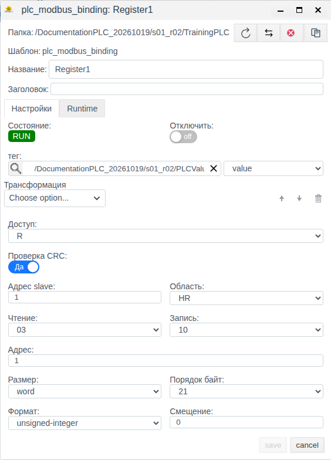

# PLC Connections in Faceplate: Choosing a Protocol and Configuring Communication

A guide for integrators: choose a driver, configure a connection, and verify data exchange in Faceplate Studio. The examples were tested on 19 October 2026 in a release 4.0.7 project.

The examples and screenshots use the Russian UI. Original on-screen labels are retained in bold, with English explanations where needed, so you can match the instructions to the interface.

## Purpose and operating principles

A PLC connection exchanges data with a controller, I/O module, meter, gateway, or industrial server. The connection selects the driver and defines communication settings; individual signal addresses are configured in bindings.

| Concept | What it defines |
|---|---|
| Protocol | Rules for exchanging data with the source |
| Driver | Faceplate support for the selected protocol |
| Connection | Settings for a particular channel: address, transport, and data exchange parameters |
| Binding | Device data address, exchange direction, and the linked tag field |
| Tag | A project object whose field receives a value for further use |

In this example, data follows this path: training register → Modbus TCP → **TrainingPLC** connection → **Register1** binding → **value** field of the **PLCValue** tag.

A client initiates communication with a device or server. A server provides data to external clients and handles their requests. The selected driver determines the role; there is no common client/server switch for all connections.

The overall workflow is to prepare the source and tag, create a connection in the project tree, configure a binding, check the PLC driver list, and then check the actual tag value. Creating a connection does not create signals automatically.

Connections and bindings serve different purposes. A connection stores channel settings and controls its execution. Bindings for individual signals are created inside it. All bindings in that connection use its channel and common communication settings; each signal's address and destination field are configured separately.

A tag belongs to the Faceplate project and provides a point where the data can be used. In this example, the source contains 1000, the connection communicates with the source, the binding selects the required register, and the tag receives the result in its **value** field. Configuration therefore requires both a data source and a destination for its data.

This separation helps with maintenance. If the device address or the common communication period changes, check the connection. If a single signal is read incorrectly, check its binding and destination tag field. Assess a displayed tag value together with channel state and evidence of a new read.

## Choosing a protocol

Choose the driver that matches the interface provided by the device or intermediary server. Before configuring it, confirm the protocol and variant, Faceplate's role, access parameters, and data map. An available driver does not establish compatibility with every device model.

The tested installation provides the following 15 types. The first column contains the exact values of the **Тип соединения:** (Connection type) filter.

| Type in the list | Purpose | Faceplate role |
|---|---|---|
| dcon | I/O modules using DCON | Device polling |
| [ethernet_ip](./plc_ethernet_ip_connection_en.md) | Communication with supported controllers over EtherNet/IP | Client |
| [opcda](./plc_opcda_connection_en.md) | Connection to an OPC DA data source | Client |
| [opcua_client](./old_plc_opcua_client_connection_en.md) | Receiving data from an OPC UA server | Client |
| [opcua_server](./old_plc_opcua_server_connection_en.md) | Providing Faceplate data to external OPC UA clients | Server |
| [s7](./old_plc_s7_connection_en.md) | Communication with supported Siemens S7 controllers | Client |
| [snmp](./plc_snmp_connection_en.md) | Reading parameters from an SNMP agent; the tested implementation uses v2c | Device polling |
| [iec101_client](./plc_iec101_client_connection_en.md) | IEC 60870-5-101 telecontrol | Client |
| [iec101_server](./plc_iec101_server_connection_en.md) | Providing data over IEC 60870-5-101 | Server |
| [iec104_client](./plc_iec104_client_connection_en.md) | IEC 60870-5-104 telecontrol over TCP | Client |
| [iec104_server](./plc_iec104_server_connection_en.md) | Providing data over IEC 60870-5-104 | Server |
| iec62056 | Communication with meters using IEC 62056 | Meter polling |
| [mbus](./plc_mbus_connection_en.md) | Communication with M-Bus meters | Meter polling |
| mercury230 | Communication with Mercury 230 meters | Meter polling |
| [modbus](./plc_modbus_connection_en.md) | Communication with Modbus PLCs, modules, and gateways | Client / device polling |

The links in the table open the individual protocol references. Value conversion is covered in [Transformation](./transformation_en.md), the **Диагностика** (Diagnostics) window in [Diagnostics of Runtime objects](../administration/diagnostics/diagnostics.md), and channel and service redundancy in [Resource redundancy](../administration/Redundancy/Redundancy_en.md).

The Modbus form offers **tcp**, **rtu-tcp**, and **rtu-serial**. This guide uses **tcp** only. IEC 101 is serial telecontrol; IEC 104 communicates over TCP. Detailed addressing, transport, and security for individual drivers are covered separately.

Modbus TCP was chosen for the training scenario because the prepared source has a known network address, port, and one register with a constant value. This lets you verify connection creation, data selection, tag binding, and the resulting value in sequence. A training Modbus TCP server acts as the device on the test setup; a physical pump station controller is not required.

The general workflow applies to PLC connections: select a supported driver, configure the channel, set up bindings, and verify the data. This scenario shows specific channel and addressing fields for Modbus TCP. With another driver, follow the same workflow and obtain connection parameters and signal addresses from its form and the device documentation. The choice of Modbus for the example does not determine the protocol for your project.

## Prerequisites and training objects

Before starting, provide:

- Access to Studio and permission to create, modify, and delete objects in the training folder.
- An enabled project folder and an available node to execute communication.
- A running Modbus TCP source with a known address, port, and register map.
- A prepared numeric tag with a value field that can be viewed in its object form.

The source must be accessible from the node executing Faceplate communication. In this example, 127.0.0.1 refers to that node. For a remote PLC, enter its actual address.

| Object or parameter | Initial state | Preparation |
|---|---|---|
| Training project folder | Writable; execution enabled | Prepare before the example |
| Training Modbus TCP server | 127.0.0.1, port 15020; running on the communication node | Prepare before the example |
| Source register | Unit 1, holding register at PDU address 0, value 1000 | Prepare before the example |
| PLCValue | Numeric tag; integer value field initially set to 0 | Prepare before the example |
| TrainingPLC | Connection does not yet exist | Create in the first scenario |
| Register1 | Binding does not yet exist | Create in the first scenario |

The number 1000 is a training value in raw register counts, without conversion to engineering units. The numeric tag type was prepared for the test setup; it is not assumed to exist in every new project. In your project, use a suitable numeric tag and its actual value field.

To check the tag, open **Меню → Общий вид** (Menu → General view), open the training folder, and then open **PLCValue**. Before creating a binding, **value** should display 0. Close the form with **cancel**.

One binding is used here to verify reading. Other binding and transformation capabilities are covered separately.

## Core settings

**Период (мс)** (Period, ms) sets the period of the cyclic part of data exchange. In this Modbus example, it is the polling period. If polling finishes before the period expires, the connection waits for the remaining time. If polling takes longer, the next cycle starts without an additional pause. The period does not guarantee that a new value will appear on screen after exactly that many milliseconds.

**Таймаут** (Timeout) in the Modbus TCP settings controls how long to wait for a device response. **Shutdown timeout (ms)** controls how long to wait for the connection's worker process to stop normally. These parameters serve different purposes.

**Поддержка групповых запросов** (Support grouped requests) allows reads to be combined if the driver supports it. When set to **Нет** (No), the packet length and coefficient fields cannot be edited. **Макс. длина пакета** (Maximum packet length) and **Коэффициент задержки линии** (Line delay coefficient) affect grouping; the coefficient does not define a separate pause between requests or replace the attempts setting. Group size units and valid sizes depend on the protocol.

Changing connection parameters used during execution restarts the connection's execution. After saving, check its state and the tag value. Initial values and field limits are listed in the reference section.

## Connect a pump station PLC

The first scenario creates **TrainingPLC** and reads 1000 counts into the prepared tag. It can be performed independently of the second scenario; its prerequisites are listed under “Prerequisites and training objects.”

### Create the connection object and configure the channel

At this stage, create the object that will communicate with the source. In **Общий вид** (General view), choose the connection's location in the project, then the driver type. Selecting **plc_modbus_connection** determines the protocol settings available in the form; the name **TrainingPLC** identifies this particular channel among other connections.

Channel parameters specify where to connect. For Modbus TCP, these are **Тип** (Type), **IP/Hostname/Localhost**, and **Порт** (Port). In the test setup, they point to the prepared server at 127.0.0.1:15020. Before repeating the example on another node, check that the source is accessible from the Faceplate execution node.

Common parameters specify how communication runs. **Период (мс)** sets the cycle, **Отключено** (Disabled) controls connection execution, and grouping settings determine whether reads can be combined. The register address and destination tag are not selected at this stage; they belong to the binding.

After entering a value in **Порт**, press **Tab**, then save the form. When you reopen it, check the saved port: it determines the actual connection endpoint.

1. In **Меню**, select **Общий вид**.
2. Open the prepared training folder.
3. Click **Создать** (Create).
4. Double-click the **plc** group.
5. Select **plc_modbus_connection**.
6. Click **Ok**.
7. Enter **TrainingPLC** in **Название** (Name).
8. Check that **Тип** is **tcp**.
9. Enter **127.0.0.1** in **IP/Hostname/Localhost**.
10. Enter **15020** in **Порт**.
11. Compare the remaining settings with the table.

| Field | First scenario value |
|---|---|
| Период (мс) — period | 1000 |
| Shutdown timeout (ms) | 60000 |
| Таймаут — timeout | 100 |
| Попыток — attempts | 1 |
| Поддержка групповых запросов — grouped requests | Да (Yes) |
| Макс. длина пакета — maximum packet length | 250 |
| Коэффициент задержки линии — line delay coefficient | 1 |
| Отключено — disabled | Off |
| Главное соединение — main connection | Empty |

12. Click **save**.
13. Select the new **TrainingPLC** object.
14. Click **Редактировать** (Edit).
15. Check the saved address, port, and settings.
16. Close the form with **cancel**.

After saving, the connection may display **RUN** before any binding is created. To confirm data reception, check the tag at the end of the scenario.

### Link device data to a project tag

Once the channel exists, specify which data should enter the project. Create the **Register1** binding inside **TrainingPLC**. It links specific device data to a specific field of **PLCValue**. Creating a connection alone does not specify which value should appear in the project.

A binding has two sides. On the Faceplate side, select the tag and its **value** field. On the device side, specify the data address and representation. In this example, **Адрес slave** (Slave address) selects device ID 1, while **Область** (Area), **Чтение** (Read), and **Адрес** (Address) select its holding register. The value 1 in **Адрес slave** and **Адрес** therefore refers to different parameters.

**Доступ: R** (Access: R) specifies reading from the source into the tag. **Размер** (Size), **Порядок байт** (Byte order), and **Формат** (Format) determine how received data is interpreted. Incorrect addressing or format can produce an incorrect result even when the channel is running. In this example, they match one unsigned 16-bit register; no conversion to engineering units is applied.

1. In **Общий вид**, double-click **TrainingPLC**.
2. Click **Создать**.
3. Enter **Register1** in **Название**.
4. Click the magnifying-glass selection button beside **тег** (Tag).
5. Open the training folder in the selection dialog.
6. Select **PLCValue**.
7. Click **ОК**.
8. Select **value** in the adjacent field list.
9. Check that **Доступ** is **R**.
10. Set **Адрес** to **1**.
11. Select **unsigned-integer** in **Формат**.
12. Compare the remaining settings with the table.

| Field | Value | Meaning in this example |
|---|---|---|
| Адрес slave — slave address | 1 | Training device identifier |
| Область — area | HR | Holding register |
| Чтение — read | 03 | Read the selected area |
| Адрес — address | 1 | Corresponds to PDU address 0 of the training source |
| Размер — size | word | Training 16-bit value |
| Порядок байт — byte order | 21 | Order verified with this source |
| Формат — format | unsigned-integer | Unsigned integer |
| Смещение — offset | 0 | No additional offset |

13. Check that **Трансформация** (Transformation) is empty.
14. Click **save**.
15. Reopen **Register1** and check the saved fields.
16. Close the form with **cancel**.

In a new form, **Адрес** is initially 0; change it to 1 for the training source. The size, format, and byte order in the table apply to this register. For your device, use its data map. **Запись** (Write) may remain visible when access is **R**; in this example, **Доступ** determines the exchange direction.

### Verify the connection and incoming data

Verification has two parts. First, find the connection in the PLC driver list and confirm that execution is enabled, its process is running, and the expected channel is selected. This is a general connection check, regardless of the signal you intend to use.

Then check the individual signal path: the child binding, its destination tag, and the **value** field. In this training example, the tag initially contains 0 and the source contains 1000. Seeing the expected 1000 after configuring the binding confirms the read result. **RUN** without a signal check establishes only that execution has started; an unchanged previous value does not establish a new exchange.

After verification, there should be three linked objects: the **TrainingPLC** connection, the **Register1** binding, and the **PLCValue** tag. The connection provides the channel, the binding describes one signal, and the tag makes its value available to the project. As you extend data exchange, describe additional signals with their own bindings inside an appropriate connection.

1. In **Меню**, open the PLC driver list.
2. In **Поиск по пути** (Search by path), enter a fragment of the training folder path containing at least three characters.
3. Expand **Тип соединения:**.
4. Select the **modbus** checkbox.
5. Close the type list.
6. Click **Найти** (Find).
7. Click the leftmost circular-arrow button to refresh.
8. Check the **TrainingPLC** row against the table.

| Where to look | Expected result |
|---|---|
| Режим — mode | Вкл. (Enabled) |
| Статус — status | OK |
| Состояние — state | RUN |
| Актуальное соединение — active connection | Path to TrainingPLC in the selected training folder |
| Binding list after double-clicking the connection | One Register1 binding, RUN/OK |

9. In **Меню**, select **Общий вид**.
10. Open **PLCValue** in the training folder.
11. Check **value: 1000**.
12. Close the form with **cancel**.

The field initially contained 0 and displays 1000 after the binding is configured. The source contains 1000 raw counts; no transformations are applied, so the expected stored and displayed value is also 1000. This confirms reading under the test conditions. Check the result after a successful cycle and a form refresh; the time of the check is not a measurement of communication latency.

Selecting the **modbus** filter may change the list columns to include protocol fields. Empty binding-field cells in the connection's own row do not indicate a configuration error.

## Restore reading after configuration changes

The second scenario modifies the existing **TrainingPLC**, checks diagnostics, and restores reading. Start after successfully completing the first scenario: the connection is enabled, the tag displays 1000, the binding is still **R**, and no transformations are configured.

| Object or parameter | Initial state | Change in this scenario |
|---|---|---|
| TrainingPLC | Enabled, RUN/OK; period 1000 ms | Period 500 ms; disable and re-enable |
| Grouped requests | Yes; packet length 250; coefficient 1 | No, then Yes; packet length 250; coefficient 2 |
| Register1 and PLCValue | R binding without transformations; value displays 1000 | Check the display during STOP and after re-enabling |
| Source | Unit 1, HR/PDU 0 = 1000 | Unchanged |

### Change the polling settings

This modifies an existing channel, so the register and tag do not need to be selected again. The example reduces the period from 1000 to 500 ms, then checks both grouping modes. These settings apply to the entire connection; the binding retains its address, read direction, and destination field.

After saving, first check that the form displays the new settings, then check that execution and reading have resumed. A saved setting, a running process, and a received value are separate verification results. The 500 ms period demonstrates a configuration change; whether that period is suitable for real equipment depends on the project requirements.

1. In **Общий вид**, select **TrainingPLC**.
2. Click **Редактировать**.
3. Set **Период (мс)** to **500**.
4. Set **Поддержка групповых запросов** to **Нет** (No).
5. Click **save**.
6. Reopen the connection.
7. Check that **500** and **Нет** were saved; the packet length and coefficient fields should be unavailable for editing.
8. Close the form with **cancel**.
9. Open the tag and check that it displays **1000**.
10. Close the tag form.
11. Open the **TrainingPLC** settings.
12. Set **Поддержка групповых запросов** to **Да** (Yes).
13. Check **250** in **Макс. длина пакета**.
14. Set **Коэффициент задержки линии** to **2**.
15. Click **save**.
16. Reopen the connection and check the saved values.
17. Close the connection form with **cancel**.
18. Open the tag and check **1000**.
19. Close the tag form with **cancel**.

One register is sufficient to check that both modes operate and the settings are saved. This example does not measure a performance gain from grouping. Seeing the same 1000 after a settings change is not sufficient on its own to prove a new read; the recovery check below addresses that separately.

### Check diagnostics

Open **Диагностика** (Diagnostics) for the saved **TrainingPLC**, click **Start** and inspect **Logs**; select **debug** for detailed output. Working with the window is described in [Diagnostics of Runtime objects](../administration/diagnostics/diagnostics.md).

**Start** and **Stop** in this window control only log recording. Communication is stopped by **Отключено** in the connection settings; after **Stop** the connection keeps running.

### Disable the connection and verify reading resumes

Disabling applies to the execution of the entire connection. In the training setup, it stops data exchange for the single **Register1** binding. Addressing settings remain saved, and the tag continues to exist as a project object.

First confirm shutdown through **STOP** and the absence of a process, then inspect the tag field display. After re-enabling, confirm that the process starts, the channel is healthy, and the expected data appears. This sequence explains why the tag value is checked together with the connection state: its display while stopped and the first value received after restart have different meanings.

1. In the **TrainingPLC** form, turn on **Отключено** (Disabled).
2. Click **save**.
3. Reopen the connection.
4. Wait for **State: STOP** and **PID: no process**.
5. Click **Диагностика** and check that the window opens for the saved STOP connection.
6. Close the diagnostics window.
7. Close the connection form.
8. Open **PLCValue**.
9. Record the displayed value after the connection has fully stopped.

The tested training form displayed **0**. Reopening it also displayed 0; entering the same number did not enable **save**, so no manual save was needed. This is the display after stopping, rather than a new source reading. Another tag type may display a different value when communication is absent.

10. Close the tag with **cancel**.
11. Open the **TrainingPLC** settings.
12. Turn off **Отключено**.
13. Click **save**.
14. Reopen the connection and check **RUN**, the presence of a **PID**, and **no errors**.
15. Close the connection form with **cancel**.
16. Open the tag and check that it now displays **1000**.
17. Close the tag form with **cancel**.
18. In the PLC driver list, check **Вкл. / OK / RUN** (Enabled / OK / RUN).

| Stage | Connection process | value displayed in the training form |
|---|---|---|
| Before disabling | RUN, PID present | 1000 |
| After a complete stop | STOP, no process | 0 for the tested type |
| After re-enabling and successful communication | RUN, new PID; OK | 1000 again |

The source contains 1000 throughout, and the binding remains **R**. The transition from the stopped display to 1000 after re-enabling confirms restored reading on the test setup. Assess state together with value changes; an unchanged old value does not establish new communication.

### Finish the training setup

Follow the deletion procedure in the next section for **TrainingPLC**. Before confirming, check its child **Register1** and the cross-reference for **PLCValue**. The scenario is complete when the connection is absent after searching and refreshing the list.

## Managing a connection

| Task | Where to perform it | How to verify the result |
|---|---|---|
| Find a connection | Меню → PLC driver list; Поиск по пути, Тип соединения:, Найти | The intended object appears; its path matches the project |
| Refresh the list | Leftmost circular-arrow button | Rows and states have been read again |
| Change settings | Общий вид; select the object → Редактировать | Reopening confirms saved fields; communication is checked separately |
| Disable or enable | Отключено switch in the form | STOP/no process, or restored RUN/OK and reading |
| Check incoming references | Перекрёстная ссылка in the object form | Objects that use it are listed |

An empty result from **Зависимости** (Dependencies) does not establish that all references to the object are absent. In the training test it was empty, while the tag's **Перекрёстная ссылка** (Cross-reference) listed **Register1**.

### Delete the training connection

> [!WARNING]
> Deletion ends communication and, in this example, also deletes the child binding. Perform this procedure only for the training connection you have finished using.

1. Open **PLCValue**.
2. Click **Перекрёстная ссылка**, the opposing-arrows icon at the top of the form.
3. Check the **Register1** row and confirm that it belongs to **TrainingPLC**.
4. Close the references window.
5. Close the tag form with **cancel**.
6. In the training folder, select only **TrainingPLC**.
7. Click **Удалить** (Delete).
8. Check the count **1** in the **delete items: 1** dialog.
9. Click **yes**.
10. Refresh the folder contents.
11. Check that the tag remains and the connection is absent.
12. Open the tag's **Перекрёстная ссылка** and check that the former **Register1** is absent.
13. Search for the deleted connection by its path in the PLC driver list.
14. Refresh the list and check that no rows are returned.

The tested example did not show a separate confirmation for deleting the child binding; **Register1** did not need to be deleted separately. The tag remained and continued to display 1000. After deletion of the connection, this is a retained display value, rather than continued reading.

Redundancy, copying, and moving are outside the practical scope of this guide.

## Settings and state reference

### Common connection fields

The values below apply to the tested form and build. Numeric limits come from the form settings; behavior specific to a protocol must be checked separately.

| Field | Input and initial value | Purpose and limits |
|---|---|---|
| Название — name | User-defined; a new form is empty | Object name; saving is unavailable when the name is empty |
| Заголовок — title | Optional; empty | Additional display description |
| Период (мс) — period | 1000 | Cycle period; 1–3600000 ms |
| Shutdown timeout (ms) | 60000 | Wait for process shutdown; 10–3600000 ms |
| Поддержка групповых запросов — support grouped requests | Да (Yes) in a new form | Allow grouping where supported by the driver |
| Макс. длина пакета — maximum packet length | 250 | Group limit; 1–10000 in driver-specific units; editable when grouping is enabled |
| Коэффициент задержки линии — line delay coefficient | 1 in a new form; set to 2 in scenario 2 | Grouping calculation; 1–10; editable when grouping is enabled |
| Отключено — disabled | Off in a new form | Controls connection execution |
| Главное соединение — main connection | Optional reference; empty | Main connection of the same type for redundancy; not set in these examples |
| Ограничение памяти (байт) — memory limit (bytes) | Empty before saving; 1024 after saving | Worker process heap limit. In this build, the number is interpreted in MiB: 1024 corresponds to 1 GiB, which does not match the “bytes” label. This field is not changed in the examples |
| Актуальное соединение — active connection | System-populated | Path of the channel selected after a successful connection; may be absent before connecting |
| Узел, PID — node and PID | System-populated | Execution node and worker process identifier |
| Ошибка — error | System-populated | Diagnostic message; no errors during successful verification |

### Common PLC binding fields

Addressing and additional fields depend on the selected driver and are described in the individual protocol references.

| Field | Purpose |
|---|---|
| Name / Название | Binding name in the project tree |
| Title / Заголовок | Binding description |
| State / Состояние | Binding execution state: STOP or RUN |
| Off / Отключено | Disable the binding without deleting it |
| Tag / Тег and field | Project object and its field for reading or writing |
| Transformation / Трансформация | Value conversion during data exchange |
| Access / Доступ | Exchange direction: R — read, W — write, RW — read and write |

### Data transformation

Value conversion is configured in the PLC binding's **Трансформация** (Transformation) field. Methods and settings are described in the separate [Transformation reference](./transformation_en.md). The training scenario does not use conversion.

### Modbus TCP fields

| Field | Form / example value | Meaning |
|---|---|---|
| Тип — type | tcp | TCP in this example; other form options: rtu-tcp, rtu-serial |
| IP/Hostname/Localhost | The form displays 127.0.0.1 | Source address as seen from the communication node; enter the actual address |
| Порт — port | Initially 502; 15020 on the test setup | Source TCP port |
| Таймаут — timeout | 100 | Response wait in ms; form minimum is 1 |
| Попыток — attempts | 1 | Number-of-attempts parameter; form range 1–50 |

### States and diagnostic controls

| Item | How to interpret it |
|---|---|
| Режим Вкл. / Откл. — enabled / disabled mode | Whether connection execution is permitted |
| State / Состояние RUN | Execution has started; verify the required data through the tag value |
| State / Состояние STOP | Execution has stopped; check settings, Runtime, and the error for the cause |
| Статус OK / ОШИБКА — OK / error status | Communication result in the list; inspect the message if an error occurs |
| no process / no node | The form has no current worker process / execution node |
| shutdown after disabling | Appeared with a timestamp after turning on Отключено during testing; relate it to the action performed |

## Troubleshooting

Check three levels: whether execution is permitted, whether the channel is working, and whether the required value is being received. **Диагностика** is also available for a saved connection in **STOP**.

| Symptom | Where to check | Possible cause | Action | Recovery check |
|---|---|---|---|---|
| STOP, no process | Отключено; whether the folder and execution node are enabled | The connection is disabled or execution is not permitted | Restore execution permission in the intended training configuration | RUN, PID present; a new read is confirmed |
| Communication error | Ошибка, Актуальное соединение, address, and port | Source unavailable or parameters do not match | Compare the connection settings with the source settings and correct them | OK and the expected tag value |
| RUN/OK, but the required value does not appear | Binding list, tag, and selected field | Missing binding, incorrect field, address, or direction | Check the R binding and its addressing against the data map | Expected value appears in the correct field |
| Value differs from the expected 1000 | Адрес slave, Область, Адрес, Размер, Порядок байт, Формат | Settings do not match the training register | Compare the fields with the binding table | Training tag displays 1000 |
| 0 is displayed after stopping | Connection state and tag form | Training field display behavior when communication stops | Relate the displayed value to STOP; perform the re-enabling check | After re-enabling, 1000 and RUN/OK are displayed |
| 1000 remains after deletion | Presence of the connection and incoming tag references | Retained tag display value | Check that the connection and binding are absent | Communication has ended; the old number is not treated as a new reading |
| Search does not return the expected row | Поиск по пути and Тип соединения: | Incorrect path fragment or a remaining filter | Use a path fragment of at least three characters, check the type, and click Найти / refresh | The required object is found, or its deletion is confirmed |

Working with the window is described in [Diagnostics of Runtime objects](../administration/diagnostics/diagnostics.md).

## Limitations

- Available types depend on the installed drivers. The catalog in this guide does not replace checking support for a particular device.
- Practical verification covered Modbus TCP with one R binding. Configuration of other protocols, RTU transports, transformations, and write commands is covered separately.
- Shared fields do not imply identical communication algorithms or grouping support in every driver.
- Communication latency, load, and grouping efficiency were not measured in these training scenarios.
- The memory limit field has an inconsistent unit label; the interpretation for the tested build is stated beside the field in the reference section.
