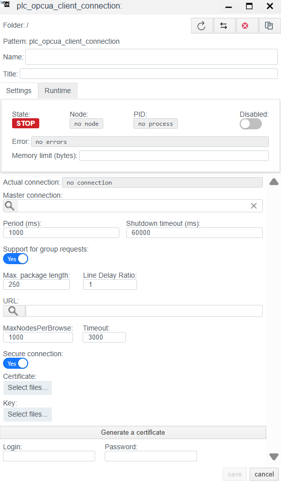
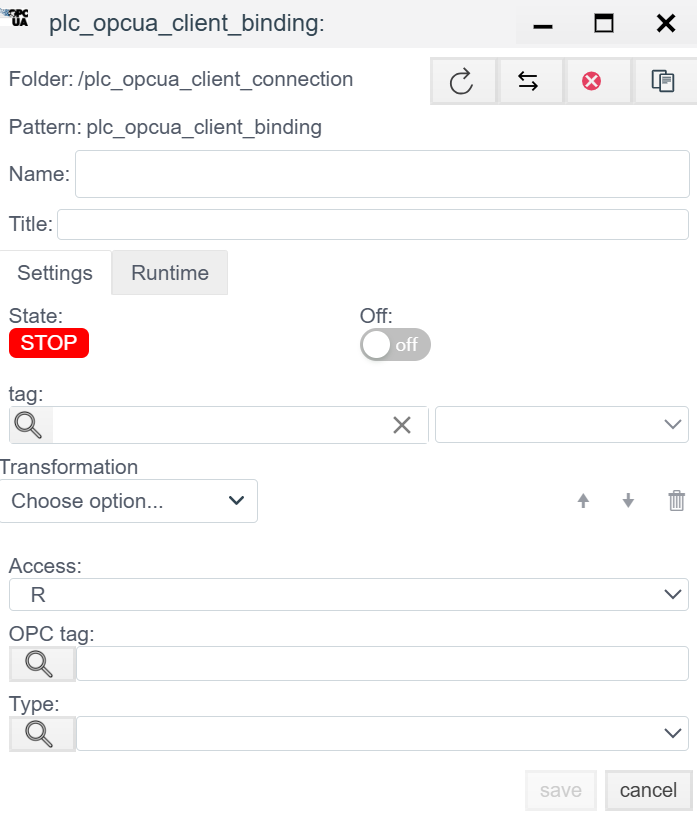

# OPC UA Client Configuration Guide

## Overview
**OPC UA (Unified Architecture)** is a modern cross-platform industrial communication standard (IEC 62541). Unlike classic OPC DA, it does not depend on Windows/DCOM, supports encryption, and handles complex data structures.

The **OPC UA Client** driver in **Faceplate** connects to servers (Siemens S7-1500 PLCs, Kepware, Prosys, B&R, and others) over the binary `opc.tcp` protocol.

Configuration is done in two stages:
1. **Connection (`plc_opcua_client_connection`):** Endpoint, security, and authentication.
2. **Binding (`plc_opcua_client_binding`):** Subscribe to specific nodes.

---

## 1. Connection setup (Connection)
> Create a PLC connection -> [Create a PLC connection](./general_en.md#create-a-plc-connection)

This step creates a secure channel to the server.

### 1.1 Diagnostics panel
> PLC connection diagnostics -> [Diagnostics](./general_en.md#diagnostics)

| Field | Description |
| :--- | :--- |
| **State** | **STOP** - driver stopped. **RUN** - driver running. |
| **Node** | Cluster node that runs the process. |
| **PID** | Process ID. |
| **Error** | Error text (if any). |
| **Disabled** | Toggles the driver on or off. |
| **Memory limit (bytes)** | Memory limit (RAM in bytes) for the connection process. This determines how many variables (tags) can be handled. |
| **Actual connection** | Current active channel. In redundant systems, shows which connection (primary or standby) is active. |
| **Master connection** | Link to the primary channel for redundancy. Defines the master connection in the pair. |

### 1.2 Main settings
| Parameter | Description |
| :--- | :--- |
| **Name** | Unique connection name. |
| **Title** | Human-readable description. |
| **Period (ms)** | Base driver cycle. |
| **Shutdown timeout (ms)** | Time to wait for clean shutdown. |
| **Support for group requests** *| **Yes** - enable General Interrogation support. |
| **Max. package length** *| Maximum packet size. Typically 250 bytes. |
| **Line Delay Ratio** *| Line delay ratio. |

### 1.3 Protocol parameters (OPC UA client)
This is the most important part of OPC UA setup.

| Field | Description |
| :--- | :--- |
| **URL** | **Endpoint URL.** Server address. *Format:* `opc.tcp://<IP-address>:<Port>` *Example:* `opc.tcp://192.168.0.10:4840` |
| **MaxNodesPerBrowse** | Limit for the number of nodes in a browse request. Default: `1000`. |
| **Timeout** | Server response timeout (ms). |
| **Secure connection** | **Encryption mode.** - **No (Off):** `None` (no security). Good for tests. - **Yes (On):** `Sign` or `SignAndEncrypt`. Requires certificates. |
| **Certificate / Key** | Paths to the client public certificate (`.der`) and private key (`.pem`). |
| **Generate a certificate** | Generates a self-signed client certificate. |
| **Login / Password** | **User authentication.** - Empty: **Anonymous**. - Filled: **User/Password** token. |

---

## 2. Binding setup (Binding)

In OPC UA, addressing uses **NodeId**.

> Create a PLC binding -> [Create a PLC binding](./general_en.md#create-a-plc-binding)
>
### 2.1 Binding parameters
| Field | Description |
| :--- | :--- |
| **Name** | Binding name. |
| **Title** | Human-readable description. |
| **State** | **STOP** - binding stopped. **RUN** - binding running. |
| **Tag** | Faceplate system tag. The incoming value is written to the selected field of the selected object. See [Tag binding](./general_en.md#tag-binding). |
| **Transformation** | Value transformation. See [Transformation](./transformation_en.md). |
| **Access** | **R** (Read), **W** (Write), **RW** (Read/Write). |

### 2.2 Node addressing (OPC UA Node)

| Field | Instruction |
| :--- | :--- |
| **OPC tag** | **NodeId (node address).** Unique address of a variable on the server. Includes namespace index (ns) and identifier (s, i, g, b). *Examples:* - `ns=2;s=Machine1.Sensor.Temp` (string ID) - `ns=3;i=1005` (numeric ID) - `i=2258` (standard node, ns=0) |
| **Type** | OPC UA data type (Int32, Float, Boolean, String, and so on). Usually detected automatically, but can be forced. |

> Binding error -> [Binding errors](./general_en.md#binding-errors)

---
