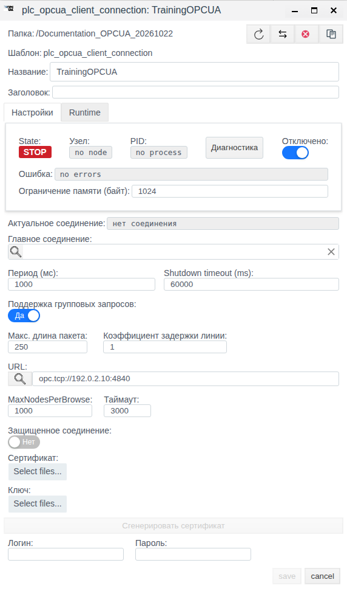
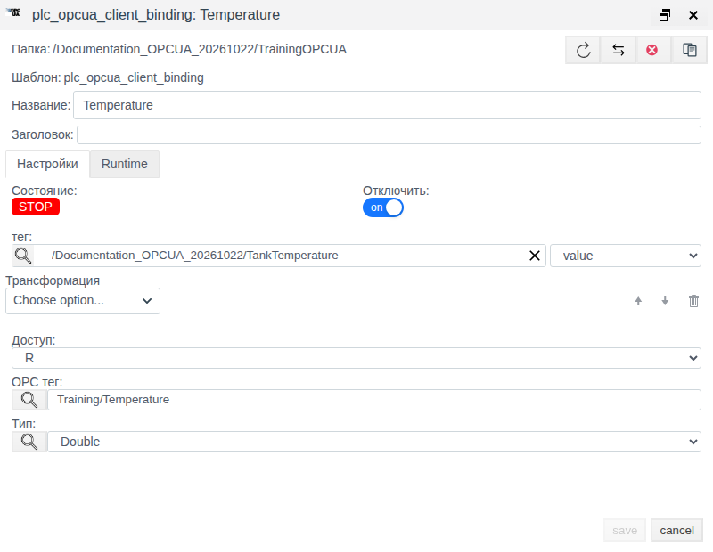

# OPC UA in Faceplate: configuring a client connection and bindings

Faceplate version: v4.0.7

This guide explains how to configure an OPC UA client, link a server variable to a tag field, and understand the exchange settings. Screenshots show the Russian Studio. Actual Russian UI labels are retained below, with English explanations; these explanations are not verified labels of an English localization. Operation names and data types retain the forms used by the interface.

The guide contains one configuration example without an OPC UA server. Creation, saving, and separate reopening of the connection and binding were verified. Both objects remain disabled. The illustrative addresses were not tested by connecting; this example does not verify reading, writing, or recovery of communication.

**Contents**

- [Configuration route](#configuration-route)
- [Verify the external server, type and write](#verify-the-external-server-type-and-write)
- [Purpose and data flow](#purpose-and-data-flow)
- [What to prepare](#what-to-prepare)
- [Client configuration example](#client-configuration-example)
- [Managing and recovering communication](#managing-and-recovering-communication)
- [Connection parameters](#connection-parameters)
- [Bindings and value processing](#bindings-and-value-processing)
- [Settings and states reference](#settings-and-states-reference)
- [Diagnostics](#diagnostics)

[Connection catalogue](./index.md) · [Prepare fields and bindings](./bindings_en.md) · [Transformations](./transformation_en.md) · [Diagnostics and recovery](./diagnostics_en.md)

## Configuration route

Prepare an external source or client and a compatible tag field using the shared guide. Configure the channel, save a complete binding and verify a new value. For supported writing/reception, separately confirm the external result; after correcting a failure repeat verification with a new control value.

[Alternative channels and signal maps](./bindings_en.md#configure-an-alternative-channel) share one procedure; check driver-specific switching conditions.

## Verify the external server, type and write

For operational reading, first create a scalar Double at BrowseName path Training/Temperature on the server. Open the saved connection, browse beside «OPC тег», select that node, then separately obtain/check its type beside «Тип». Browse requires a reachable server; a NodeId string does not replace the path.

For float field TankTemperature.value use R, an empty chain and confirm new server change 23.5→24.5 in the same field. For writes, prepare separate Double Training/Setpoint and float Setpoint.value; set W/RW and independently confirm command 25.0 through another server client.

For secure operation, upload both the client DER certificate and PEM key, enable security, arrange server trust of the client and user credentials, save and verify the actual secure endpoint with new data. An incomplete pair may select an unsecured branch; this client does not establish trust in the server certificate.

For R Boolean→bool test true and false; the shared transformation guide provides normalization. Script is unsuitable for W/RW. Do not treat text from a string field to String as an operational route without fixing/verifying adaptation. These operational checks require a server and are not claimed as executed here.

## Purpose and data flow

Faceplate contacts an external OPC UA server using the binary protocol over TCP and a URL such as `opc.tcp://host:port/path`. The server may expose equipment data or run as a separate server application. This driver acts as a client; a different server connection is used to expose Faceplate data to external clients.

| Concept | What it defines |
|---|---|
| Protocol | OPC UA exchange rules for communicating with the server |
| Driver | Support for that exchange in Faceplate |
| Connection | Server URL, access, and common execution settings |
| Binding | Variable path, direction, value processing, and the link to a project field |
| Tag and tag field | The project object and the specific destination for data or source of a write command |

For reading, data follows this chain: OPC UA variable → connection → binding → transformations → conversion to the selected field type → tag field. A connection does not create tags or signals automatically. The binding belongs inside the connection, while the tag is selected from the project.

Reading uses cyclic requests, individually or in groups. This client does not provide configuration for OPC UA subscriptions, events, methods, or historical reads. Use scalar variables for bindings; a group of nodes does not imply support for arrays or structured values.

For writing, a change in the selected field passes through type conversion and reverse transformations, then is sent to the node with the configured OPC UA type. R/W/RW directions and write triggers are described in the bindings section.

## What to prepare

For a real connection, obtain the following information from the server and project administrator:

| Information to obtain | Why it is needed |
|---|---|
| Full URL, server address/name, and port | The endpoint may include a path suffix; an IP address alone is insufficient |
| Reachability from the Faceplate execution node | The address is relative to the node performing the exchange, not the browser computer; localhost refers to that execution node |
| Required variable's BrowseName path and type | «OPC тег» (OPC tag) uses a path relative to Objects; a textual NodeId is not a substitute |
| Permitted operations and a known reference value | The binding mode does not grant read/write permissions on the server |
| User, endpoint, and certificate requirements | User authentication and the application certificate serve different purposes |
| Tag, field, field type, and units | The value must reach the correct field in a compatible representation |

Studio access must permit object creation and editing. Working communication additionally requires execution to be allowed for the project and parent folders, an available execution node, and valid dependencies. Runtime does not need to be started to save a disabled configuration.

The example uses the prepared folder `Documentation_OPCUA_20261022` and tag `TankTemperature`, with a `value` field of type `float`. Its initial value is 0.0; the form displays it as 0. This is a prepared value, not a server reading.

## Client configuration example

Configure connection `TrainingOPCUA` and its `Temperature` binding to `TankTemperature.value`. URL `opc.tcp://192.0.2.10:4840` and path `Training/Temperature` only illustrate how to fill the fields. No server is available, so the values are entered manually and both objects are saved disabled.

### Create and check the connection

| Field | Example value |
|---|---|
| Название (Name) | TrainingOPCUA |
| URL | opc.tcp://192.0.2.10:4840 |
| Период (мс) (Period, ms) | 1000 |
| Shutdown timeout (ms) | 60000 |
| Таймаут (Timeout) | 3000 |
| MaxNodesPerBrowse | 1000 |
| Поддержка групповых запросов (Group requests) | Да (Yes) |
| Макс. длина пакета (Maximum group size) | 250 |
| Коэффициент задержки линии (Line delay ratio) | 1 |
| Защищенное соединение (Secure connection) | Нет (No) |
| Сертификат, Ключ, Логин, Пароль (Certificate, Key, Login, Password) | Unset |
| Главное соединение (Main connection) | Unset |
| Отключено (Disabled) | Enabled |

1. Open Studio at `http://127.0.0.1:9000/fp/studio`, select «Меню» → «Общий вид» (Menu → General view), and open the prepared training folder.
2. Click «Создать» (Create), double-click the `plc` category, select `plc_opcua_client_connection`, and click «Ok».
3. Set «Название» to `TrainingOPCUA`. Enable «Отключено» before the first save.
4. Enter the illustrative URL and change «Защищенное соединение» to «Нет». A new form initially sets it to «Да».
5. Compare the other fields with the table. The numeric values already matched in the verified form; files and credentials remained unset. Certificate generation is unnecessary here.
6. Click `save`. After the form closes, select `TrainingOPCUA` and click «Редактировать» (Edit).
7. Check the separately reopened saved configuration: URL, numbers, secure mode «Нет», and enabled «Отключено». Close it with `cancel`, leaving the settings unchanged.

*Figure 1. Connection after saving and separate reopening. It is disabled; STOP and the absence of a process do not verify communication with the server.*

### Configure the binding within the same example

| Field | Example value |
|---|---|
| Название (Name) | Temperature |
| тег and selected field | TankTemperature, value |
| Доступ (Access) | R |
| OPC тег (OPC tag) | Training/Temperature |
| Тип (Type) | Double |
| Трансформация (Transformation) | Empty chain |
| Отключить (Disable) | Enabled, on |

1. Double-click `TrainingOPCUA` and click «Создать». Inside the connection, the binding form opens immediately, without selecting a connection type again.
2. Set «Название» to `Temperature` and enable «Отключить».
3. Click the magnifying glass next to «тег», open the training folder, select `TankTemperature`, and confirm with «ОК».
4. Explicitly select `value` in the adjacent field list. Selecting an object without selecting its field does not complete the project link.
5. Manually enter `Training/Temperature` in «OPC тег» and select `Double` in «Тип».
6. Check that «Доступ» is R and «Трансформация» is empty. Do not use the magnifying glasses next to «OPC тег» and «Тип» in this example: they contact the server.
7. Click `save`. After the form closes, select `Temperature` and click «Редактировать».
8. Compare the saved path, type, tag/field, R, empty processing chain, and enabled «Отключить». Close the form with `cancel`.

*Figure 2. The same training configuration: a manually entered path, Double and the value field selected, and the binding disabled.*

The example's result is two saved configurations that match the tables after separate reopening. The tree shows «ВЫКЛ» (Disabled) and Stop for both objects. The tag still displays its prepared zero. Saving a form does not confirm that the endpoint or node exists or that data transfer succeeds.

## Managing and recovering communication

The following information concerns maintenance of a real connection. Execution was not enabled and communication failure was not reproduced in the training example.

| Task | Where to perform it | What to check |
|---|---|---|
| Find a connection | «Общий вид», or «Меню» → «Драйверы ПЛК» (PLC drivers), path search and the `opcua_client` filter | The name and folder identify the intended channel |
| Change settings | Select the object → «Редактировать» → `save` | Reopen the object separately and compare the saved fields |
| Allow or stop the channel | Connection's «Отключено» flag and save | The flag controls execution permission; Runtime, parents, and the node also matter |
| Disable one signal | Binding's «Отключить» flag and save | Other bindings on the channel may continue operating |

Changing execution settings of a running connection recreates its execution. After a change, first check the settings, then the channel state, the specific binding's error, and a new expected value in the correct field.

Disabling an individual binding does not guarantee clearing the tag's previous value. Stopping the channel or a channel error can pass missing data through the transformation chain into R/RW fields. Depending on processing and state, the field may become empty, receive a substitute, or continue displaying a residual value. The binding's last value is not evidence of freshness either.

Recovery requires an available server and a known change in its variable after communication resumes. Correlate execution permission, channel state/error, binding state/error, and the arrival of the new value in the selected field. An error disappearing, RUN, or an unchanged old number is insufficient by itself. Writing additionally requires independent server readback; verify the physical result on the equipment when applicable.

## Connection parameters

### URL and server discovery

Enter the full endpoint, including the port and required path suffix. The magnifying glass next to «URL» searches for server URLs by address and port. Check the discovered URL against the server: discovering an address does not prove that the saved connection or the required signal works. This function was not run in the example.

### Cycle, Browse, and group requests

«Период (мс)» sets the read processing cycle. If requests take longer than the period, the next cycle has no additional pause; the setting does not guarantee the screen refresh rate.

«Поддержка групповых запросов» enables grouped reads and supported grouped writes. «Макс. длина пакета» limits a read group by **node count**, not bytes. This limit does not split write groups. Identical paths in a grouped write can collapse into one write. «Коэффициент задержки линии» is present in the common form but does not affect grouping of this client's string paths or introduce a pause between requests.

MaxNodesPerBrowse sets the number of starting nodes in one tree-browsing request, not the total tree size or the number of values to read. Server limits can make browsing incomplete: BrowseNext continuation is not handled. Reducing this setting does not replace checking that the required variables are found and readable.

«Таймаут» controls the wait for ordinary read/write operations. Connection establishment, server discovery, and tree browsing have separate waits; changing this field does not change all of them together. For infrequent polling and a W connection without changes, account for the 300000 ms request-inactivity timeout: the client may be recreated even when continuous reading is not part of the task.

### User and secure connection

Unset credentials use Anonymous. User access requires both login and password. Explicit empty strings can be sent as an empty Username/Password pair, so do not use them to select Anonymous. The account needs permission for the specific nodes and operations.

«Защищенное соединение» requires **both** uploaded files: the client's DER certificate and PEM private key. These are the contents of the selected files, not filesystem paths. The certificate must contain the application URI in subjectAltName; if required, the server administrator adds the client certificate to the trusted list.

The complete file pair uses SignAndEncrypt. There are no separate selectors for Sign-only or a specific SecurityPolicy: a compatible endpoint and policy are negotiated with the server. **The secure flag alone is insufficient:** without the complete file pair, settings can take the unsecured connection path. The client also accepts server certificates without checking their trust; encryption here does not authenticate the server. This form has no user setting for a trusted-server certificate list.

«Сгенерировать сертификат» (Generate certificate) creates a self-signed certificate and an unencrypted key, requiring a connection name and confirmation. The returned files are inserted into the form; save the configuration separately with `save`. Generation creates files on the node before the form is saved, so canceling the form does not undo that filesystem operation. The generated certificate uses common application-URI settings; check compatibility with the server's trust policy. Certificate generation and secure exchange were not performed in the training example.

### Alternative connections

«Главное соединение» links an alternative connection to a main connection of the same type. The alternative object is disabled, and the main channel's execution uses its parameters during switching. Chains of alternatives are not permitted. Different endpoints must expose data at matching logical paths; «Актуальное соединение» (Actual connection) shows the selected connection. Verify switching and return using new data; a path retained after an error does not prove source availability.

## Bindings and value processing

### Node path and type

«OPC тег» stores an exact BrowseName path relative to Objects. The illustrative `Training/Temperature` identifies variable Temperature inside Training. Do not add `Objects/` or a leading `/`. Strings such as `ns=2;s=...` and `i=2258` are not parsed as NodeIds here.

The magnifying glass next to «OPC тег» opens the variable browser using the connection's saved settings. Its «Обновить» (Refresh) clears the displayed tree's cache. Selecting a node fills the path but does not determine the type automatically. The magnifying glass next to «Тип» separately reads the current value and obtains its type. These functions require an available server; the example enters the path and type manually.

The path uses BrowseName rather than localized DisplayName. Namespace information is not retained in the textual path, and `/` inside a name is not escaped: colliding or ambiguous paths require verification on the server. A path missing from the cache may return `invalid node`; fallback path resolution is not universal across all namespaces.

The «Тип» list offers `Float`, `Double`, `UInt64`, `String`, `Boolean`, `SByte`, `Byte`, `Int16`, `UInt16`, `Int32`, `UInt32`, `Int64`. Reading uses the actual server value; selecting «Тип» does not recode a read or automatically change the saved setting. Writing sends the selected type and value, so a mismatch can be rejected by the server.

Int64/UInt64 do not preserve the full precision of all 64-bit integers. Before using extreme values, verify precision throughout the chain. Arrays and structures are not supported scalar values.

Boolean has a significant peculiarity: when passed to a Faceplate `bool` field without corrective processing, `false` may become `true` because of common type conversion. Do not commission that path without testing both Boolean values. Writing String from a `string`/`binary` field also does not pass ordinary text unchanged: the field is converted to a number or missing data. A type appearing in the list does not prove correct exchange with every project field type.

### Direction and writing

| Access | Reading into the field | Sending to the server |
|---|---|---|
| R | Cyclic | Field changes are not sent |
| W | Not performed | On field changes, plus the current command on connection/reconnection and when an active binding is added or changed |
| RW | Cyclic | On external field changes; its own read updates do not generate a write echo |

W does not keep the server value continuously synchronized. On connection, RW does not have the same mandatory initial command write as W: the server value may be read first. Changes during disconnection do not form a guaranteed queue; after recovery, check the server and issue a new deliberate command if needed.

Without a tag link, the binding's own runtime value can be the W/RW source. For an ordinary project, explicitly select both tag and field. Write success and the binding's runtime value reflect the command sent, not independent confirmation that the server changed.

### Transformations

An empty chain adds no processing. Forward operations run from top to bottom; reverse operations for writing run in reverse order. For W/RW, use only operations that support reverse processing.

| Operation | Reading | Writing / conditions |
|---|---|---|
| Scaling | Y = X × Factor + Shift | X = (Y − Shift) / Factor; Factor must be nonzero |
| Default Value | Preserves numeric input and replaces any nonnumeric input with numeric substitute Value | Reverse processing passes the value without substitution |
| Limit Control | Preserves a number within the inclusive interval; otherwise returns missing data | Reverse processing clamps to a boundary; Upper Limit must exceed Lower Limit |
| Integration | Accumulation in input units × ms; the first numeric sample returns no result | Not permitted for W/RW |
| Derivative | Change in input units/ms; the first numeric sample returns no result | Not permitted for W/RW |
| Damper | Smoothing; Tlag is in ms, initially 1 with a form minimum of 1 | Reverse processing does not smooth |
| Script | User-defined Erlang processing with input, context, and accumulated state | Not permitted for W/RW; JavaScript is not offered for this processing |

Scaling initially uses Factor = 1 and Shift = 0; Default Value uses Value = 0. Both initial Limit Control boundaries are 0: set a valid interval before saving. The zero-Factor check does not cover every representation of zero; ensure a nonzero factor for writing yourself.

Time-based operations use processing time in milliseconds, not OPC UA timestamps. Their state is recreated on changes or restart; Integration does not replace a persisted historical total. A transformation error can return missing data while the transport read succeeds. Default Value substitution can hide a missing real signal behind a number; account for this when diagnosing problems.

## Settings and states reference

The initial values and ranges below belong to the verified installation's form; ranges were read from its controls, without testing boundary values. Explicitly select fields with no initial value, or leave them unset only in the cases described.

### Common connection fields

| Field | Initial value / range | Purpose |
|---|---|---|
| Название / Заголовок (Name / Title) | Name is empty; title is optional | Object name and description |
| Период (мс) | 1000; 1–3600000 ms | Read cycle and wait before retrying a failed connection |
| Shutdown timeout (ms) | 60000; 10–3600000 ms | Wait for orderly execution shutdown |
| Поддержка групповых запросов | Да | Enable supported grouped operations |
| Макс. длина пакета | 250; 1–10000 nodes | Read group limit; if no integer value is stored, 5000 nodes are used |
| Коэффициент задержки линии | 1; 1–10 | Common setting; does not change this client's path grouping |
| Отключено | Off in a new form; on in the example | Prevent channel execution |
| Ограничение памяти (байт) (Memory limit, bytes) | Empty before saving, then 1024 | Despite the label, the actual unit is MiB: 1024 MiB = 1 GiB of worker heap; this is neither a tag count nor all external-client memory |
| Главное соединение | Unset | Optional link from an alternative connection to its main connection |

### OPC UA fields

| Field | Initial value / range | Purpose |
|---|---|---|
| URL | Empty | Full endpoint, required for configuration |
| MaxNodesPerBrowse | 1000; 5–6000, step 5 | Starting-node count for a Browse request |
| Таймаут | 3000; 5–6000 ms | Wait for ordinary reads/writes |
| Защищенное соединение | Да; Нет in the example | The secure path requires the complete file pair; the flag alone does not confirm it |
| Сертификат / Ключ | No files selected | DER application certificate and PEM key, required for the secure path |
| Логин / Пароль | Unset | Anonymous or user authentication using the complete credential pair |

### Binding fields

| Field | Initial state | Purpose |
|---|---|---|
| Название / Заголовок | Name is empty; description is optional | Identify the signal within the connection |
| тег / adjacent field list | Unselected | Destination object and specific field |
| Доступ | R | R, W, or RW: direction rather than server permissions |
| OPC тег | Empty | Exact BrowseName node path |
| Тип | Select explicitly | Scalar OPC UA type; especially important when writing |
| Трансформация | Empty chain | Additional processing; writing requires reverse processing |
| Отключить | off; on in the example | Exclude only this binding from exchange |
| Runtime | Populated during execution | Value and error; a saved number does not prove a new read |

### States and results

| What to inspect | Meaning | What verifies the result |
|---|---|---|
| «Отключено» / «Отключить» | Permission for channel/signal execution | For configuration, reopen the flag; exchange requires data verification |
| State / Состояние | RUN/STOP execution state | RUN may appear before successful connection or with a signal error |
| Узел / PID (Node / PID) | Execution location and process | A process does not confirm acquired data |
| Ошибка and «Актуальное соединение» | Channel result and selected path | The path may remain after an error; check the specific operation |
| Binding state/error | Result for an individual signal | Overall channel success does not rule out a node error |
| Tag field and Runtime value | Read, sent, substituted, or previous value | A new known result is required; writing requires independent readback |

This driver does not retain the original OPC UA quality/timestamp in this chain as a general field-freshness indicator. Even an empty read collection or an individual binding error can coexist with a successful channel state. The example displayed STOP, `no node`, `no process`, `no errors`, and «нет соединения» (no connection), consistent with a disabled configuration.

## Diagnostics

The «Диагностика» (Diagnostics) button is available on a saved connection even in STOP. Start/Stop controls log collection, not channel activation. Log level offers info, warning, error, or debug; Log limit initially is 1000, with a range of 1–100000. «Процессы» (Processes) and Logs show available diagnostic output; «Копировать» (Copy) and «Очистить» (Clear) apply to that output. An empty log does not prove healthy communication. Log operations were not included in the training example.

| Symptom | What to check and correct | Result verification |
|---|---|---|
| STOP, no process | Flags, Runtime, parents, dependencies, and execution node; disabling is intentional in this example | During commissioning: a process, successful channel, and new value |
| Connection or URL-discovery error | Full endpoint, host/port/path, and reachability from the execution node | A successful addressed operation, not merely a discovered URL |
| RUN/OK but one signal cannot be read | Binding disable flag, path, field, dependencies, and server permissions | A new value in the correct field |
| invalid node or incomplete tree | Exact BrowseName path, tree refresh, and Browse limits; do not enter a textual NodeId | The required node is found and read successfully |
| Type/value error when writing | Selected OPC type, scalar value, range, and Faceplate field type | Write response and independent readback |
| Incorrect Boolean or String transfer | Conversion peculiarities for bool and from string/binary, described beside the types | Separate verification of all significant values on a real source |
| Secure endpoint fails | Both files, DER/PEM, application URI, and server trust/user requirements | An actual secure channel and new data |
| Old number remains after correction | Residual value, no new operations, Default Value, or other processing | A known server change appears in the selected field |
| W/RW command during disconnection was not delivered | Delivery/replay is not guaranteed; check the server and issue a new valid command | Independent confirmation of the new command |

Verify new reads, secure exchange, readback, and recovery when a server is available. The saved forms and screenshots in this guide confirm client configuration only.
