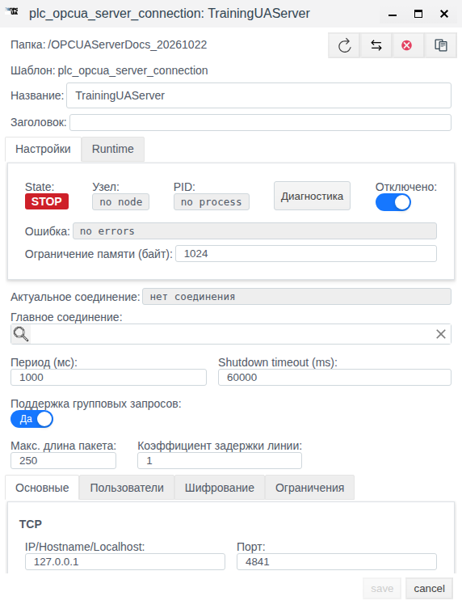
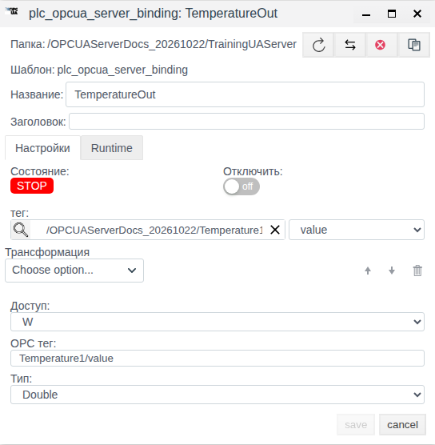

# OPC UA server in Faceplate: configuring connections and data exchange

Documentation version: Faceplate v4.0.7

This guide is for integrators who publish Faceplate tag fields through OPC UA or receive values from an external system. The single practical example shows how to save and reopen the settings of a disabled server. Client connections, reads and writes were not tested in this example. The other sections explain the settings and the verification procedure when a client is available; implementation details were established by source research.

The screenshots show the Russian interface. The instructions retain the actual Russian labels so that you can locate the controls.

**Contents**

- [Configuration route](#configuration-route)
- [Verify publication and receive a new value](#verify-publication-and-receive-a-new-value)
- [How the server works](#how-the-server-works)
- [Prepare the required information](#prepare-the-required-information)
- [Publish tag values](#publish-tag-values)
- [Receive writes and configure exchange in both directions](#receive-writes-and-configure-exchange-in-both-directions)
- [Configure users and security](#configure-users-and-security)
- [Manage the server](#manage-the-server)
- [Diagnose and restore exchange](#diagnose-and-restore-exchange)
- [Parameter and type reference](#parameter-and-type-reference)

[Connection catalogue](./index.md) · [Prepare fields and bindings](./bindings_en.md) · [Transformations](./transformation_en.md) · [Diagnostics and recovery](./diagnostics_en.md)

## Configuration route

Prepare an external source or client and a compatible tag field using the shared guide. Configure the channel, save a complete binding and verify a new value. For supported writing/reception, separately confirm the external result; after correcting a failure repeat verification with a new control value.

[Alternative channels and signal maps](./bindings_en.md#configure-an-alternative-channel) share one procedure; check driver-specific switching conditions.

## Verify publication and receive a new value

After configuring TemperatureOut, prepare an external OPC UA client. Connect to the actual node address and port 4841, browse Objects for Temperature1/value and confirm 23.5. Change the source field to 24.5 and read new 24.5 in the client; saving the form does not replace this check.

For reception, prepare float tag Setpoint.value. In the disabled server create SetpointIn: Доступ R, Тип Double, OPC тег Commands/Setpoint, tag Setpoint, field value, empty chain. Save, reopen independently and check the path after any form recalculation. After startup, write 25.0 from the client and verify new 25.0 in the Faceplate field.

For R Boolean, test true/false and use applicable normalization from the shared guide. Publishing original String text requires adaptation repair/verification. Security needs both certificate and key, verified trusted parties and an actual selected policy; the flag alone does not exclude an unsecured endpoint.

These procedures extend the previously saved configuration; no new client reads/writes or secure exchange are claimed here.

## How the server works

A **connection** defines one local OPC UA server: its address, port, users, security and execution settings. Select the `plc_opcua_server_connection` type for it. This is a Faceplate server accessed by external clients over `opc.tcp`; this form does not specify the address of another OPC UA server.

Create **bindings** of type `plc_opcua_server_binding` inside the connection. Each binding links a selected Faceplate tag field to a variable in the server address space. One connection can serve several bindings.

The **Доступ** (Access) field specifies the direction relative to Faceplate:

- **W** publishes the Faceplate field to the OPC UA variable. The current field is sent at startup, followed by its changes.
- **R** receives the OPC UA variable value into the Faceplate field. An external client writes the variable, and Faceplate reads it during its cycle.
- **RW** supports both directions. On a full server start, the current Faceplate field supplies the initial value.

These letters do not specify external client permissions. Variables are created readable and writable; there is no separate prohibition on client writes to W variables or separate user permissions for individual nodes. A client write to a W variable is not transferred back to the Faceplate field.

**OPC тег** (OPC tag) is the publication path, with segments separated by `/`. Intermediate segments form folders under Objects; the last segment becomes the variable. At least two nonempty segments are required. This path is not a string NodeId. Browse names are created in namespace 1, while the server assigns NodeIds automatically; identifiers are not guaranteed to remain unchanged after a restart. A client should locate the node by browsing the address space. This form does not support loading a NodeSet or importing a remote server tree.

Variables appear on the first local operation of a running server, rather than when the form is saved. A saved binding alone does not confirm that a node is available.

## Prepare the required information

Before configuration, determine the local network address and a free port, tag fields and their types, the direction of each signal, publication paths, engineering units and required transformations. Secure access also requires server accounts, a certificate and key, trusted chains and the security mode required by the client.

The address **127.0.0.1** is accessible only on the server machine. A remote client needs an address reachable over the network and an allowed TCP port. **IP/Hostname/Localhost** is used both for binding the listening socket and for the advertised address. The form accepts IPv4, a fully qualified domain name or `localhost`; IPv6 input is not provided. With `0.0.0.0`, the server listens on all IPv4 interfaces, but also advertises that address in its endpoint: the client needs the real machine address and the returned endpoint must be checked.

The training example uses a separately prepared folder, `OPCUAServerDocs_20261022`, and a `Temperature1` tag with an available float field named `value`, set to **23.5**. Temperature in °C is the illustrative meaning of this number. Creating the server connection does not create the tag automatically.

## Publish tag values

### Example: configure a server and one signal

The result is a saved `TrainingUAServer` and its `TemperatureOut` binding. Leave the server disabled: this example does not require a client.

1. In Studio, open **Общий вид** (General view) and the `OPCUAServerDocs_20261022` folder containing the prepared `Temperature1`. Click **Создать** (Create), expand **plc**, select **plc_opcua_server_connection** and confirm with **Ok**.
2. Enter `TrainingUAServer` in **Название** (Name). Turn on **Отключено** (Disabled). On **Основные** (Main), set **IP/Hostname/Localhost** to `127.0.0.1`, **Порт** (Port) to `4841`, and **Таймаут** (Timeout) to `3000` ms. This corresponds to `opc.tcp://127.0.0.1:4841` after a future start.
3. On **Пользователи** (Users), leave **Разрешить анонимный досуп** (Allow anonymous access, with the actual UI spelling) enabled and the user list empty. On **Шифрование** (Encryption), leave **Защищенное соединение** (Secure connection) off. These settings serve the local configuration example.
4. Click **save**. After the form closes, select the new row and click **Редактировать** (Edit). Confirm that the name, address and port were saved and **Отключено** is on. The example shows **STOP**, `no node`, `no process`, `no errors`, and **Актуальное соединение** (Actual connection) = `нет соединения` (no connection).

5. Close the editor with **cancel**, then double-click the `TrainingUAServer` row to open its contents. Click **Создать**: the child **plc_opcua_server_binding** form opens.
6. Enter **Название** = `TemperatureOut`. Use the search button beside **тег** (tag), select `Temperature1` in your training folder and confirm with **ОК**. Select **value** in the field list that becomes available.
7. Set **Доступ** = `W`, **Тип** (Type) = `Double`, and **OPC тег** = `Temperature1/value`. Selecting the float field in the inspected form automatically suggested Double and this path; check both explicitly. Leave **Трансформация** (Transformation) empty and **Отключить** (Disable) off. Finish entering the path by moving to another field.
8. Click **save**. After the form closes, select the `TemperatureOut` row and click **Редактировать**. Check the tag, field `value`, W, Double, `Temperature1/value` and the absence of transformations.

9. Close the form with **cancel**. The connection must remain disabled. The binding itself is enabled, but its **STOP** is expected under a disabled parent. **ВКЛ** (ON) on the binding row does not mean that the server is running.

Figure 1. Saved server after an independent reopen. The lower timeout field is outside the screenshot.

Figure 2. Saved publication binding. The form shows the tag path relative to the project root.

The confirmed result is that both objects retained their settings after closing and independently reopening their forms. The value 23.5 was prepared in the tag; its delivery to a client was not tested.

### Publication path and value type

In the current editor, selecting a tag/field builds the path from the final tag name and the field. Reopening can also recalculate the path in the form draft; saving may replace a previously configured custom path. After a change, check the **OPC тег** field itself. The column with the same name is also calculated from the tag/field and does not prove the actual node path. Canceling the form does not save its draft.

Bindings with the same path access the same variable; identical keys in a group may be combined. Plan unique paths. After renaming, deleting or disabling a binding, the old node and value may remain until the server restarts.

**Тип** determines the outgoing scalar Variant. The backend does not automatically inherit the field type: select it and check it after saving. The form suggests integer → Int64, float → Double, bool → Boolean, string → String; when the field changes, an existing type selection may remain. This form's type does not strictly validate all client writes: the variable retains a general DataType and allows arbitrary dimensionality.

Source research identified an adaptation defect in string field publication: the string is first converted to a number or a missing value, so selecting String does not ensure correct publication of the original text. Do not depend on this exchange without a separate check. Receiving a string into a string field follows a different processing path.

## Receive writes and configure exchange in both directions

To receive values, select the target field and **R**. The initial Faceplate field is not published in this mode. Before the first client write, the variable may be empty; reading an empty value can replace the field with a missing value. Consider this before enabling the binding.

For exchange in both directions, select **RW** and decide which side supplies the initial value. On a full start, the current Faceplate field is published to the server. For a new or changed binding on an already running server, forced initial publication is provided for W; RW may wait for a field change or a full restart. Prepare bindings while the connection is stopped for predictable initialization.

When a client is available, verify each direction separately: for W, change the field and read the new result with the client; for R, write a new value with the client and inspect the intended field; for RW, perform both checks. Saving the form and seeing no error do not replace this verification. These actions were not reproduced for this guide.

### Transformations

The direct chain runs **OPC UA → Faceplate**, from top to bottom. The reverse chain runs **Faceplate → OPC UA**, using inverse operations in reverse order. A transformation in W therefore acts in the reverse direction.

- **Scaling**: the direct formula is `x × factor + shift`; the reverse is `(x − shift) / factor`. For W/RW, factor must be nonzero.
- **Default Value** substitutes a numeric value for nonnumeric input when receiving; in reverse, it passes the value through. A substitute does not confirm data freshness.
- **Limit Control** returns a missing value for incoming values outside the range; for publication, it clamps the result to the nearest boundary.
- **Damper** smooths incoming values; in reverse, it passes them without smoothing. Time is specified in ms.
- **Скрипт** (Script), **Derivative** and **Integration** support direct processing. A reverse chain containing them fails validation for W/RW.

For receiving Boolean into a bool field without normalization, research identified a defect: incoming false can become true. This is not a result verified on the test environment, but it means a direct Boolean binding cannot be considered correct without testing both logical states. Outgoing bool processing uses a separate conversion.

A missing outgoing value is handled differently by mode: single mode may produce `invalid value` for numeric/Boolean types and the literal string `none` for String; grouped mode passes null with status `BadNotConnected`. Switching grouping may change the visible result for such a signal.

## Configure users and security

### Anonymous access and accounts

On **Пользователи**, **Разрешить анонимный досуп** permits login without credentials. For password login, populate the server list through **Логин** (Login) and **Пароль** (Password), save it, and disable anonymous access if it is unnecessary. These are separate OPC UA server accounts, rather than Faceplate project users. This configuration has no roles or permissions for individual variables.

The inspected form defaults to an empty list and enabled anonymous access. When configuring outside the form, distinguish an explicitly empty list from an absent list: an absent list may retain library access defaults, including anonymous login and demonstration accounts. Verify actual client login with allowed and rejected credentials; this was not tested here.

### Certificate, key and trust

On **Шифрование**, enable **Защищенное соединение**, supply **Сертификат** (Certificate) in DER and **Ключ** (Key) in PEM. Both files are required. If the switch is enabled but either file is missing, the implementation may start an unencrypted server; the switch alone does not confirm a secure endpoint.

**Сгенерировать сертификат** (Generate certificate) creates a self-signed certificate with RSA 2048 and a key without a password. The generator uses DNS `localhost` and URI `urn:faceplate.io:Faceplate:OPCUA:Server`; changing the certificate name does not change these values. Prepare a suitable certificate for the required network names and ApplicationUri compatibility, then verify it with the client. Generation and file uploads were not performed in the example.

**Доверенные сертификаты** (Trusted certificates) and **Доверенные корневые сертификаты** (Trusted root certificates) contain DER certificates for trusted parties and the chain. In this implementation, **Отозванные сертификаты** (Revoked certificates) means CRL files, rather than ordinary certificates to block. A memory handling defect was found for two or more files within any one of these lists. The reliability of that configuration is unconfirmed; do not treat lists containing multiple files as a verified trust setup.

Enabling encryption does not exclude an endpoint with policy None. The inspected active form has no separate control for disabling unencrypted connections. That setting exists separately in the implementation; even disabling it does not restrict secure modes to SignAndEncrypt alone — Sign remains. Verify the required policy and mode against the actual advertised endpoints and the connection selected by the client.

The implementation attempts to add Basic128Rsa15, Basic256, Basic256Sha256 and Aes128Sha256RsaOaep with Sign/SignAndEncrypt alongside None. Successful addition of each policy depends on the build and was not confirmed by inspecting the form. This list is not a recommendation to choose obsolete policies.

## Manage the server

Save changes with **save**, then reopen the form and check the fields. Double-clicking a container opens its contents; to configure a saved object, select its row and use **Редактировать**.

**Отключено** on the connection prohibits execution. **Отключить** on a binding stops its processing but does not delete a node already created. To enable server exchange, clear the connection's switch and save; then separately check the state, endpoint and fresh data. The training server does not need to be enabled to verify its configuration.

Changing connection settings may recreate the server process. To rebuild the entire address space, disable and save the connection, wait for it to stop, then enable and save it. Clients lose their current connections; old nodes disappear and NodeIds may change. Check the address space and new values after the restart.

**Период (мс)** (Period, ms) sets the Faceplate processing cycle. **Поддержка групповых запросов** (Grouped request support) combines Faceplate operations on the local server handler; **Макс. длина пакета** (Maximum packet length) specifies the number of items, rather than bytes. It does not limit external client Read/Write requests. **Коэффициент задержки линии** (Line delay factor) is present in the common form but has no effect on grouping this driver's string paths. Performance was not measured.

**Ограничения** (Limits) configures session and secure channel resources and individual request sizes. The fields labeled as “simultaneous operations” actually limit the number of nodes in one client Read/Write, rather than the number of parallel threads. Blank fields retain library values; they are not an entered zero.

For multiple servers, create separate connections with compatible local addresses and different free ports. The common **Главное соединение** (Master connection) mechanism links connections of the same type; chains of master connections are not allowed. The field alone does not guarantee client session transfer, network address failover or data preservation on failure. Multiple servers and redundancy were not tested here.

**Ограничение памяти (байт)** (Memory limit, bytes) has a mismatch between its label and calculation: the actual value is interpreted in MiB. A saved `1024` means 1 GiB, rather than 1024 bytes. Account for this when planning resources.

## Diagnose and restore exchange

Distinguish execution permission, process state and signal results. Clearing **Отключено** only permits startup. **RUN** and a PID show process execution, but do not prove endpoint availability or new incoming data. An individual binding error can coexist with a RUN connection.

The saved connection form provides **Состояние** (State), **Узел** (Node), **PID**, **Ошибка** (Error), **Актуальное соединение**, and **Диагностика** (Diagnostics). The outer **Runtime** tab shows current execution fields. Starting and stopping message collection in **Диагностика** controls the log, rather than the server. This module does not publish a client list, session counter or universal freshness timestamp into the object.

If a client cannot connect, check execution permission, the connection error, local address binding, port availability, address reachability from the client's network and the selected endpoint, in that order. For security, also check both files, trust, CRL, ApplicationUri, and the actual policy and mode. **Таймаут** on **Основные** is the wait for a response from the local handler in ms; it is not the client session idle time. A failure of this timeout does not establish the cause of a client's network failure.

If the connection runs but a signal is wrong, open the binding and check the tag/field, R/W/RW, path, type and transformation chain. For R, account for an empty value before the first write; for W, consider String handling; for bool reception, consider false handling. An old node name may remain until a restart. Do not treat the calculated **OPC тег** column as proof of the actual NodeId or client path.

A connection error does not clear the selected Faceplate field. Disconnecting the external client does not clear the value in the local server either: Faceplate continues to access its own address space. An old number, the absence of errors, and even a successful local read therefore do not prove that external exchange has recovered.

After correcting the cause, confirm recovery with a **new control value**: field → client for W, client → field for R, and both directions for RW. The result must be obtained after the recovery event. Recovery and client exchange were not tested in this example.

## Parameter and type reference

### Connection parameters

Initial values below refer to the inspected form; effective values of blank resource fields were established from the implementation. Form bounds do not replace checks of address availability, resources and client compatibility.

| Field | Purpose | Initial value, units and bounds |
|---|---|---|
| Название / Заголовок | Object name / display title | Integrator supplies the name; title may be blank |
| Отключено | Prohibit connection execution | Enabled in the example |
| Ограничение памяти (байт) | Process memory limit | 1024 after saving; actually MiB despite the label |
| Главное соединение | Reference for the common redundancy mechanism | Blank; same type, no chains |
| Актуальное соединение | Current selection of the connection mechanism | Status field; “нет соединения” in the example |
| Период (мс) | Processing cycle | 1000 ms; 1–3600000, form step 10 |
| Shutdown timeout (ms) | Wait for process termination | 60000 ms; 10–3600000, step 10 |
| Поддержка групповых запросов | Group local operations | Yes |
| Макс. длина пакета | Number of items in a local group | 250; 1–10000, step 1 |
| Коэффициент задержки линии | Common grouping field | 1; 1–10, step 1; no effect for string paths |

**Основные** tab:

| Field | Purpose | Initial value, units and bounds |
|---|---|---|
| IP/Hostname/Localhost | Local listening and advertised address | 127.0.0.1; IPv4, fully qualified domain name or localhost |
| Порт | OPC UA server TCP port | 4841; 1–65535, step 1 |
| Таймаут | Wait for a local handler response | 3000 ms; 5–6000, step 1 |

**Пользователи** tab:

| Field | Purpose | Initial value and conditions |
|---|---|---|
| Разрешить анонимный досуп | Login without credentials | Enabled |
| Логин / Пароль | Entries in the local server list | Empty list; separate from project accounts |

**Шифрование** tab:

| Field | Purpose | Initial value and conditions |
|---|---|---|
| Защищенное соединение | Enable encryption configuration | Off; both files required |
| Сертификат / Ключ | Server certificate and private key | Blank; DER / PEM |
| Сгенерировать сертификат | Create a self-signed pair | RSA 2048, key without a password; check names and URI |
| Доверенные сертификаты | Trusted party certificates | Blank; DER; multiple-file handling defect described above |
| Доверенные корневые сертификаты | Trusted issuers/chain | Blank; DER; same multiple-file caveat |
| Отозванные сертификаты | Revocation lists | Blank; CRL; same multiple-file caveat |

**Ограничения** tab:

| Field | Purpose | Blank form: implementation value; input bounds |
|---|---|---|
| Максимальное кол-во сессий | Number of sessions | 100; minimum 1, step 1 |
| Максимальное кол-во защищенных соединений | Number of secure channels | 40; minimum 1, step 1 |
| Максимальное кол-во одновременных операций на чтение | Nodes in one client Read | 0 — unlimited; form accepts 1 and above, step 1 |
| Максимальное кол-во одновременных операций на запись | Nodes in one client Write | 0 — unlimited; form accepts 1 and above, step 1 |
| Таймаут сессии (мс) | Maximum session timeout | 3600000 ms; minimum 100, step 100 |
| Максимальное время жизни секретного токена (мс) | Maximum channel token lifetime | 600000 ms; minimum 100, step 100 |

The inspected form has no upper bound for these resource fields. Effective limits under load and intervals negotiated with a client were not measured here.

### Binding parameters

| Field | Purpose | Initial value and conditions |
|---|---|---|
| Название / Заголовок | Binding name / display title | TemperatureOut in the example; title blank |
| Состояние | Execution result | STOP in the disabled example |
| Отключить | Prohibit binding processing | Off; parent must also be enabled for operation |
| тег / field | Faceplate object and specific field | Select explicitly; Temperature1 / value in the example |
| Трансформация | Transformation chain | Empty; account for direct and reverse directions |
| Доступ | Direction relative to Faceplate | R in a new form; W in the example; RW also available |
| OPC тег | Publication path | Initially blank; at least two nonempty segments separated by /; Temperature1/value in the example |
| Тип | Outgoing scalar Variant | Unset before field selection; Double in the example |

### Supported types

Available types are **String, Float, Double, Boolean, SByte, Byte, Int16, UInt16, Int32, UInt32, Int64, UInt64**. SByte/Byte are signed/unsigned 8-bit integers; the other integer pairs have the indicated bit width. Float and Double are floating-point numbers; Double is selected for the training float field. Account for the String and Boolean adaptation details in the publication and reception sections.

Numeric conversion does not validate the target type's range. Large Int64/UInt64 values pass through an intermediate representation with double precision, so large integer precision is not guaranteed. For exact counters, verify the entire required range beforehand.

This configuration is intended for scalars. Full array exchange and element addressing are not implemented; an external client's ability to write an array does not prove correct transfer to a Faceplate field. DateTime, ByteString, structures and GUID are not represented in this converter set.
