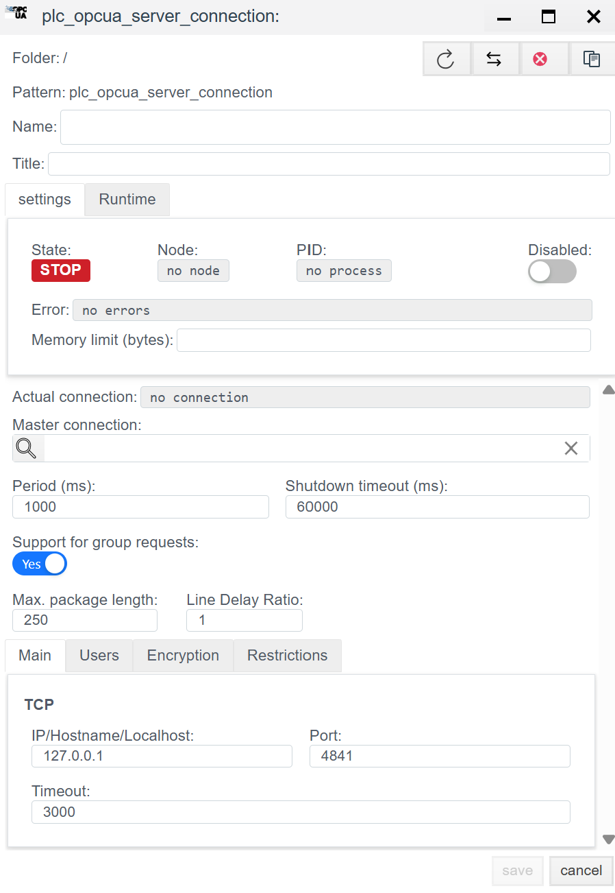
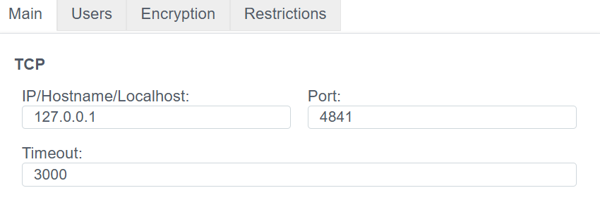
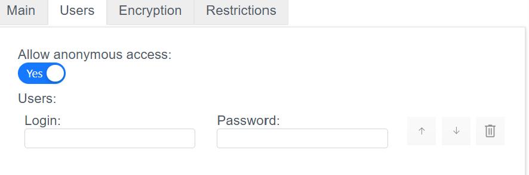
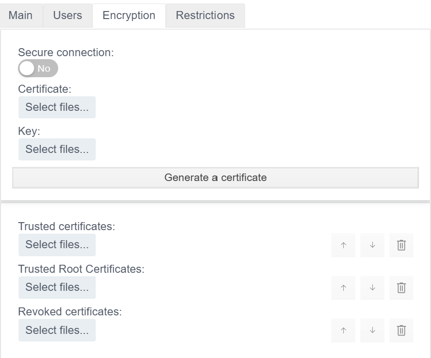
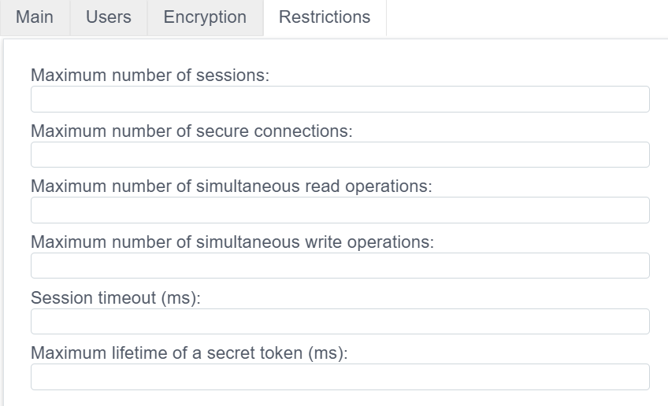
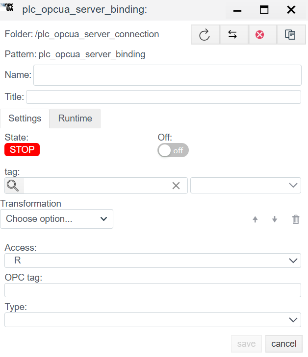

# OPC UA Server Configuration Guide

## Overview
The **OPC UA Server** driver allows **Faceplate** to act as an OPC UA server. The system publishes its internal tags to the external network so that third-party clients (SCADA, MES, ERP, UaExpert) can connect, read, and write data via `opc.tcp`.

Configuration is done in two stages:
1. **Connection (`plc_opcua_server_connection`):** Network interface (endpoint) and server parameters.
2. **Binding (`plc_opcua_server_binding`):** Publish specific tags to the server address space.

---

## 1. Connection setup (Connection)
> Create a PLC connection -> [Create a PLC connection](./general_en.md#create-a-plc-connection)

This step defines the port and interface where the server listens for incoming connections.

### 1.1 Diagnostics panel
> PLC connection diagnostics -> [Diagnostics](./general_en.md#diagnostics)

| Field | Description |
| :--- | :--- |
| **State** | **STOP** - driver stopped. **RUN** - driver running. |
| **Node** | Cluster node that runs the process. |
| **PID** | Process ID. |
| **Error** | Error text (if any). |
| **Disabled** | Toggles the driver on or off. |
| **Memory limit (bytes)** | Memory limit (RAM in bytes) for the connection process. This determines how many variables (tags) can be handled. |
| **Actual connection** | Current active channel. In redundant systems, shows which connection (primary or standby) is active. |
| **Master connection** | Link to the primary channel for redundancy. Defines the master connection in the pair. |

### 1.2 Main settings
| Parameter | Description |
| :--- | :--- |
| **Name** | Unique connection name. |
| **Title** | Human-readable description. |
| **Period (ms)** | Base driver cycle. |
| **Shutdown timeout (ms)** | Time to wait for clean shutdown. |
| **Support for group requests** *| **Yes** - enable General Interrogation support. |
| **Max. package length** *| Maximum packet size. Typically 250 bytes. |
| **Line Delay Ratio** *| Line delay ratio. |

#### 1.3 Protocol parameters (OPC UA server)

Server configuration uses four tabs: **Main**, **Users**, **Encryption**, and **Restrictions**. The sections below explain each parameter.

## 1.3.1 Main tab

Network parameters needed for client connections.

* **IP/Hostname/Localhost**
  * Interface that the server listens on.
  * *Example:* `127.0.0.1` (local only) or `0.0.0.0` (all interfaces).
* **Port**
  * TCP port for incoming connections.
  * *Typical value:* `4840` or `4841`.
  * *Important:* Make sure the port is open in the firewall.
* **Timeout**
  * Wait time (ms) before dropping a connection when no response is received.
  * *Recommended:* `3000` (3 seconds).

## 1.3.2 Users tab

Access control and user accounts.

* **Allow anonymous access**
  * Toggle (`Yes`/`No`).
  * When **Yes**, any client can connect without a password.
  * *Warning:* For production systems, disable this option.
* **Users**
  * Local users for authentication (if anonymous access is disabled).
  * **Login:** User name.
  * **Password:** Password.
  * Use the `up` and `down` buttons to reorder and the trash icon to delete.

## 1.3.3 Encryption tab

Connection security (Security Policy) and X.509 certificates.

* **Secure connection**
  * Enforces encrypted communication. When `No`, data is sent in plaintext.
* **Certificate**
  * Upload the server public certificate (`.der`, `.pem`).
* **Key**
  * Upload the server private key (`.key`, `.pem`). Keep this file secret.
* **Generate a certificate**
  * Creates a self-signed certificate if you do not have one.
* **Trusted certificates**
  * Whitelist of trusted client certificates.
* **Trusted Root Certificates**
  * Root CA certificates.
* **Revoked certificates**
  * Blacklist of revoked certificates that are not allowed to connect.

## 1.3.4 Restrictions tab

Protection against overload and resource limits.

* **Maximum number of sessions**
  * Maximum number of logical sessions that can be open at the same time.
* **Maximum number of secure connections**
  * Limit on concurrent secure TCP channels.
* **Maximum number of simultaneous read operations**
  * Limit on the number of tags that can be read in a single request.
* **Maximum number of simultaneous write operations**
  * Limit on the number of tags that can be written in a single request.
* **Session timeout (ms)**
  * Lifetime of an idle session. When the client is inactive for this period, the server closes the session.
* **Maximum lifetime of a secret token (ms)**
  * Lifetime of the security token. After it expires, the secure channel must be renewed.

---

## 2. Binding setup (Binding)

This stage defines the server Address Space. Each binding object creates a node visible to external clients.

> Create a PLC binding -> [Create a PLC binding](./general_en.md#create-a-plc-binding)
>

### 2.1 Binding parameters
| Field | Description |
| :--- | :--- |
| **Name** | Binding name. |
| **Title** | Human-readable description. |
| **State** | **STOP** - binding stopped. **RUN** - binding running. |
| **Tag** | Faceplate system tag. The incoming value is written to the selected field of the selected object. See [Tag binding](./general_en.md#tag-binding). |
| **Transformation** | Value transformation. See [Transformation](./transformation_en.md). |
| **Access** | Access for external clients: - **R** - Read only (client can read but cannot modify). - **RW** - Read and write (client can control this tag). |
| **OPC tag** | **Node name (NodeId).** Name under which the variable appears in the OPC UA server tree. Example: `Sensor1` or `Area1.Temp`. |
| **Type** | OPC UA node data type (Double, Int32, Boolean, etc). If not set, inherits from the source tag. |

> Binding error -> [Binding errors](./general_en.md#binding-errors)

---
