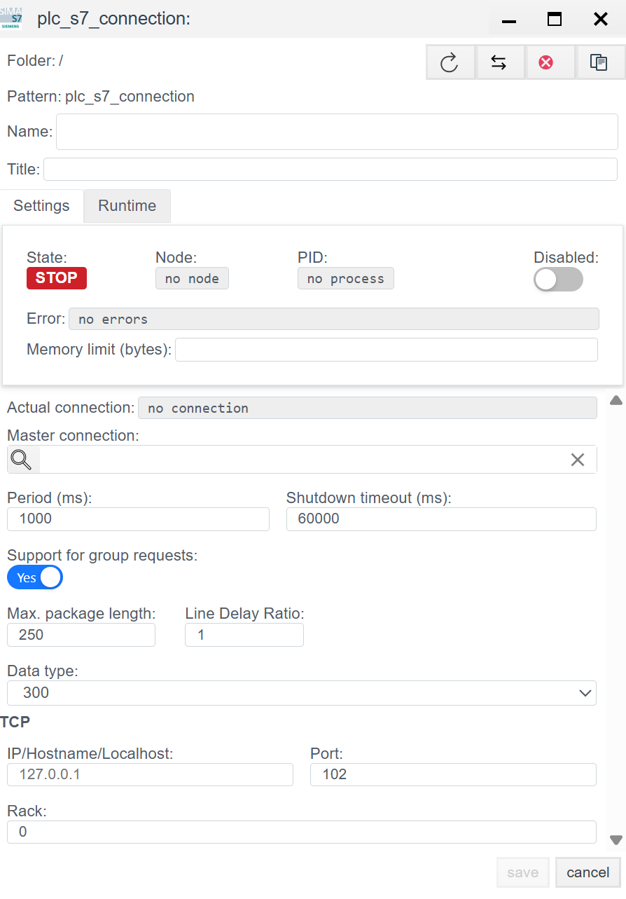
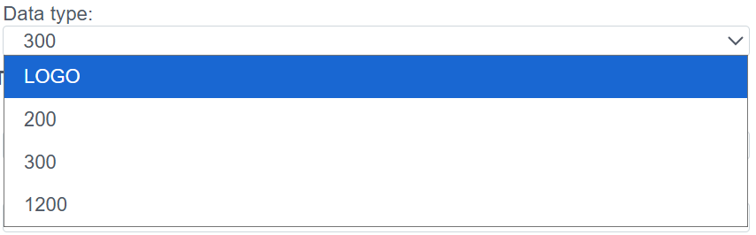
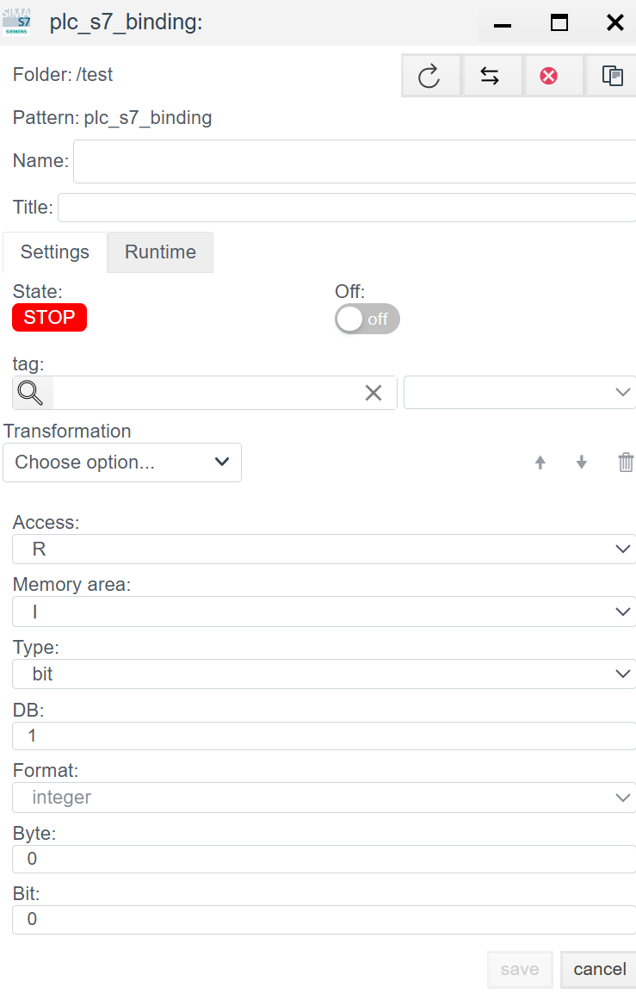

# S7 (ISO-on-TCP) Configuration Guide

## Overview
The **S7** driver provides native data exchange with Siemens **Simatic S7** PLCs.

Supported series:
* **S7-300 / S7-400** (classic architecture).
* **S7-1200 / S7-1500** (modern series, requires access setup, see Troubleshooting).
* **Siemens Logo!** (from versions 0BA7/0BA8).

Data exchange uses **ISO-on-TCP** (RFC 1006) over the standard port **102**.

Configuration is done in two stages:
1. **Connection (`plc_s7_connection`):** Network access to the CPU.
2. **Binding (`plc_s7_binding`):** Address a specific memory cell.

---

## 1. Connection setup (Connection)
> Create a PLC connection -> [Create a PLC connection](./general_en.md#create-a-plc-connection)

This step configures access to the communication processor or the Ethernet port on the CPU.

### 1.1 Diagnostics panel
> PLC connection diagnostics -> [Diagnostics](./general_en.md#diagnostics)

| Field | Description |
| :--- | :--- |
| **State** | **STOP** - driver stopped. **RUN** - driver running. |
| **Node** | Cluster node that runs the process. |
| **PID** | Process ID. |
| **Error** | Error text (if any). |
| **Disabled** | Toggles the driver on or off. |
| **Memory limit (bytes)** | Memory limit (RAM in bytes) for the connection process. This determines how many variables (tags) can be handled. |
| **Actual connection** | Current active channel. In redundant systems, shows which connection (primary or standby) is active. |
| **Master connection** | Link to the primary channel for redundancy. Defines the master connection in the pair. |

### 1.2 Main settings

| Parameter | Description |
| :--- | :--- |
| **Name** | Unique connection name. |
| **Title** | Human-readable description. |
| **Period (ms)** | Base driver cycle. |
| **Shutdown timeout (ms)** | Time to wait for clean shutdown. |
| **Support for group requests** *| **Yes** - enable General Interrogation support. |
| **Max. package length** *| Maximum packet size. Typically 250 bytes. |
| **Line Delay Ratio** *| Line delay ratio. |

### 1.3 Protocol parameters (S7)

| Field | Description |
| :--- | :--- |
| **Data type** | PLC family. Affects packet formatting. Choose `300` (S7-300/400), `1200` (S7-1200), `1500` (S7-1500), or LOGO. |
| **IP/Hostname** | PLC IP address. |
| **Port** | **102** (standard Siemens ISO-on-TCP port). |
| **Rack** | **Rack number (chassis).** - For S7-300/400/1500: usually `0`. |
| **Slot** | **CPU slot number.** (May appear below Rack.) **Critical parameter:** - **S7-300:** always `2`. - **S7-400:** depends on hardware config (often `2` or `3`). - **S7-1200 / S7-1500:** usually `1` (or `0` for older 1200 firmware). |

---

## 2. Binding setup (Binding)

S7 memory is strictly structured. To access a variable, you must know its area, type, and offset (address).

> Create a PLC binding -> [Create a PLC binding](./general_en.md#create-a-plc-binding)

### 2.1 Binding parameters

| Field | Description |
| :--- | :--- |
| **Name** | Binding name. |
| **Title** | Human-readable description. |
| **Tag** | Faceplate system tag. The incoming value is written to the selected field of the selected object. See [Tag binding](./general_en.md#tag-binding). |
| **State** | **STOP** - binding stopped. **RUN** - binding running. |
| **Transformation** | Value transformation. See [Transformation](./transformation_en.md). |
| **Access** | **R** (Read), **W** (Write), **RW** (Read/Write). |

### 2.2 Memory addressing (S7 Address)

For an address like `DB1.DBX10.2` (bit 2 in byte 10 of data block 1), the settings are:

| Field | Instruction |
| :--- | :--- |
| **Memory area** | Memory area: - **DB** - Data Block (main area). - **I** (Inputs) - Inputs. - **Q** (Outputs) - Outputs. - **M** (Flags/Merkers) - Marker memory. |
| **Type** | Variable data type: - `bit` (BOOL) - `byte`, `word`, `dword` - `int`, `real` (float) |
| **DB** | **Data block number.** Used only when `Memory area` = **DB** (for example, `1`). |
| **Byte** | **Byte offset.** Starting byte of the variable. |
| **Bit** | **Bit offset.** `0` to `7`. Set **only** when `Type` = `bit`. For other types, keep `0`. |
| **Format** | Data interpretation (for example, `integer` for signed values or `float` for floating point). |

> Binding error -> [Binding errors](./general_en.md#binding-errors)
---
