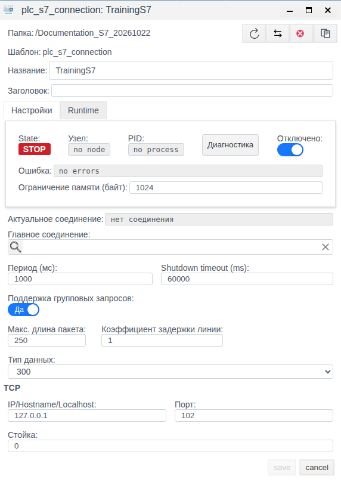
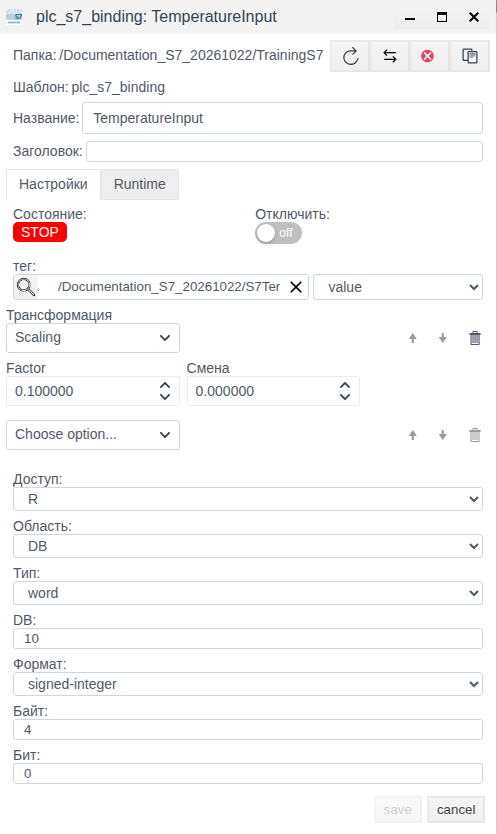
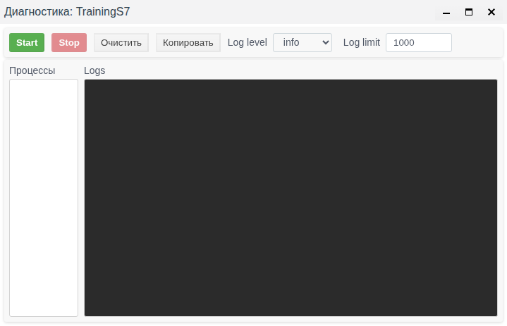

# Siemens S7 in Faceplate: configuring connections and bindings

Faceplate version: v4.0.7

This article is for integrators who need to receive a Siemens S7 signal in a Faceplate tag field, convert it to engineering units, and verify communication. Screenshots show the Russian Studio interface. Actual Russian UI labels are retained below with English explanations; these are not verified labels of an English localization.

The training example verifies configuration creation, saving and independent reopening, changing the period, disabling a binding, and controlling diagnostic collection. A suitable S7 source and its memory map have not been established, so the connection remains disabled. Reading, scaling live PLC data, and communication recovery have not been confirmed; the instructions below explain how to verify them with an available source.

**Contents**

- [Configuration route](#configuration-route)
- [Verify applicability and prepare a write](#verify-applicability-and-prepare-a-write)
- [How the Siemens S7 connection works](#how-the-siemens-s7-connection-works)
- [Preparing the connection](#preparing-the-connection)
- [Configuring reading and scaling](#configuring-reading-and-scaling)
- [Changing settings and controlling communication](#changing-settings-and-controlling-communication)
- [Troubleshooting and verifying recovery](#troubleshooting-and-verifying-recovery)
- [Writing data: W and RW modes](#writing-data-w-and-rw-modes)
- [Group reading and standby connections](#group-reading-and-standby-connections)
- [Settings and addressing reference](#settings-and-addressing-reference)

[Connection catalogue](./index.md) · [Prepare fields and bindings](./bindings_en.md) · [Transformations](./transformation_en.md) · [Diagnostics and recovery](./diagnostics_en.md)

## Configuration route

Prepare an external source or client and a compatible tag field using the shared guide. Configure the channel, save a complete binding and verify a new value. For supported writing/reception, separately confirm the external result; after correcting a failure repeat verification with a new control value.

[Alternative channels and signal maps](./bindings_en.md#configure-an-alternative-channel) share one procedure; check driver-specific switching conditions.

## Verify applicability and prepare a write

Before startup, compare IP, CPU, Rack/Slot and address-memory access with the PLC project. The map must permit the relevant operations at example DB10.DBW4 and command DB10.DBW6; TCP port 102 alone does not establish DB access.

Slot/timeout were absent in the illustrated editor. If the CPU needs another Slot, saving that object does not complete operational configuration. Use an available verified editor/fix for the target build and confirm the saved Slot in the S7 list. This guide does not claim a verified workaround for entering the missing field.

Prepare separate float tag S7Setpoint.value. Inside the disabled connection create SetpointRW: Область DB, DB 10, Байт 6, Бит 0, Тип word, Формат signed-integer, Доступ RW, Scaling 0.1/0, tag S7Setpoint, field value. Save and reopen every field.

On a permitted source, raw 200 should read as 20.0. After command 21.0, independently read DB10.DBW6: expect raw 210. Verify the command separately from measurement DB10.DBW4. Check the initial W command before activation; this recipe is not an executed PLC write.

## How the Siemens S7 connection works

Faceplate initiates an outgoing TCP connection to the PLC and exchanges data using S7. This is a client connection; this driver has no separate server mode. The usual port is 102. The CPU list offers LOGO, 200, 300, and 1200. An entry in the list does not replace verification of the specific model, firmware, and access settings. The form has no separate 400 or 1500 options.

| Term | Meaning in the configuration |
|---|---|
| Protocol | The S7 communication rules between Faceplate and the equipment |
| Driver | The Faceplate component that performs this communication |
| Connection | A specific PLC address, port, CPU option, and shared execution settings |
| Binding | One signal address, its size and format, direction, transformations, and reference to a tag field |
| Tag | A project object with fields; the selected field receives a read value or supplies a command value |

The read path is: PLC memory → connection → binding with address and format → transformations → selected tag field. Bindings reside inside the connection. The tag is selected separately: creating a connection does not automatically create process tags or address bindings.

For writing, the selected field value passes through reverse transformations and encoding for the PLC address. R, W, and RW determine the direction and transmission trigger; their behavior is described in the writing section.

## Preparing the connection

Obtain the following information before configuration:

- The IP address or a name that resolves to IPv4 from the node performing communication, and the PLC TCP port.
- The CPU option; for 300, the rack and slot from the equipment configuration. These two parameters participate in connection establishment specifically for the 300 option.
- The signal map: I/Q/M/DB area, DB number for the DB area, byte and bit offset, size, numeric format, and permitted access direction.
- Memory access requirements for the selected CPU and DB. Agree these with the PLC administrator; the driver does not configure the controller project.
- An existing tag, its destination field and data type, units, conversion formula, and known source values for verification.

The address is relative to the communication node. For example, 127.0.0.1 identifies that node even when Studio is opened in a browser on another computer.

The training task uses a prepared `Documentation_S7_20261022` folder and a `S7Temperature` tag with a `value` field of type `float`. Its initial value of 0.0 is not a PLC reading. A floating point field preserves the fractional part of the result; selecting an integer field rounds the result.

The training temperature address is `DB10.DBW4`: a signed word in DB 10 starting at byte 4. A factor of 0.1 and shift of 0 produce the expected pairs 2345 → 234.5 °C and 2360 → 236.0 °C. These are arithmetic checks; address availability and new values must be verified on the source.

## Configuring reading and scaling

### Create and verify the connection

1. Open Studio at http://127.0.0.1:9000/fp/studio and navigate to the training folder.
2. Click “Создать” (Create), open the `plc` category, select `plc_s7_connection`, and confirm with “Ok”.
3. Set “Название” (Name) to `TrainingS7`. Enable “Отключено” (Disabled) before the first save while the equipment settings and source remain unverified.
4. Select 300 in “Тип данных” (Data type). In this form, this field means the CPU option. Explicitly enter IP 127.0.0.1, port 102, and rack 0; retain a period of 1000 ms. Here, the address serves the saved training configuration and does not identify an established S7 source.
5. Click `save`. After the form closes, select the saved `TrainingS7` and click “Редактировать” (Edit). Check the address, CPU, period, and enabled disabled flag.

The reproduced form did not display the “Слот” (Slot) and `timeout` controls. The saved connection row under “Меню” (Menu) → “Драйверы ПЛК” (PLC Drivers) → connection type filter `s7` → “Найти” (Find) showed slot 0 and timeout 100 ms. The planned slot 2 was not entered through this form. The equipment configuration determines the slot: neither 0 nor 2 is universal. If the required slot cannot be set with the available editor, connection preparation cannot be considered complete for a real CPU.

*Figure 1. Independently reopened connection: disabled, STOP, without a node or process. The screenshot confirms settings, not PLC communication.*

### Add the temperature address and transformation

1. Close the inspected form with `cancel`, open `TrainingS7` by double-clicking, and click “Создать” (Create). Inside the connection, this opens the `plc_s7_binding` form.
2. Set “Название” (Name) to `TemperatureInput`. Leave “Отключить” (Disable) off; the parent connection remains disabled.
3. Use the search button beside “тег” (tag) to select `S7Temperature`, confirm with “ОК”, and separately select the `value` field.
4. Set “Доступ” (Access) to R, “Область” (Area) to DB, “Тип” (Type) to word, DB to 10, “Формат” (Format) to signed-integer, “Байт” (Byte) to 4, and “Бит” (Bit) to 0. Type sets the size; Format sets the numeric interpretation. The complete text `DB10.DBW4` is not entered into a separate field.
5. In “Трансформация” (Transformation), select Scaling. Enter Factor 0.1 and retain a shift of 0; the shift field is labeled “Cмена” in this form. Leave the numeric field with Tab and check the displayed number.
6. Click `save`, then independently reopen the saved `TemperatureInput`. Verify the tag and field reference, address, R, word/signed-integer, Factor 0.100000, and shift 0.000000.

*Figure 2. Reopened binding: DB 10, byte 4, bit 0, word/signed-integer, and Scaling 0.1. STOP is consistent with the disabled parent.*

### Verify reading with an available source

1. Check the endpoint, CPU, rack, slot, and signal address against the real source. Save any necessary corrections and reopen the settings.
2. Confirm that the parent folder permits execution and the communication node is available. Clear the connection’s “Отключено” (Disabled) flag and save. The individual binding’s “Отключить” (Disable) flag must also be clear.
3. Check the connection state, its error, and the selected “Актуальное соединение” (Current connection). Then check the binding’s state and error separately.
4. With a known source value of 2345, verify 234.5 °C specifically in `S7Temperature.value`. Then change the source value to 2360 and wait for 236.0 °C in the same field. Do not edit the Faceplate field manually to imitate reading.

This part was not performed on the training setup. RUN alone, no error, or an unchanged number is insufficient to accept reading.

## Changing settings and controlling communication

### Change the period

1. Select the saved connection and click “Редактировать” (Edit).
2. Change “Период (мс)” (Period, ms) from 1000 to 500, leave the field, and click `save`.
3. Independently reopen the connection and check the saved 500 ms.
4. To restore the training configuration, save 1000 ms and reopen the form again for verification.

*Figure 3. A period of 500 ms saved while the connection is disabled. This is a demonstration value, not a measured PLC recommendation; 1000 ms was restored after verification.*

The period sets the processing cycle, not a guaranteed delivery time for each signal. Account for response times, the address set, and grouping. Changing settings of an executing connection recreates its process; verify that new data resumes after the change. Saving settings of a disabled connection does not start communication.

### Disable or permit communication

For the entire channel, enable “Отключено” (Disabled) in the connection form and save. For one signal, enable “Отключить” (Disable) in the binding form and save. To permit execution again, clear the corresponding flag and save. Independent reopening confirms the flag; a new source value confirms communication after enabling.

In the example, the binding flag was verified by saving both positions and was restored to off. The parent remained disabled, and both forms showed STOP. A permitted binding does not start its disabled parent channel. In lists, Runtime “ВКЛ” (ON) indicates execution permission and can appear alongside a Stop state.

Disabling an individual binding does not clear the previous tag field value. Stopping an executing connection can instead pass absent input through the transformation chain to the field, producing an empty result or a substituted value. Reinitializing a binding restarts the accumulated state of time dependent transformations. Operational disabling and resuming of the parent with an available PLC were not tested in this example.

## Troubleshooting and verifying recovery

### Separate execution, operation results, and new data

| Check | What it indicates | How to confirm the result |
|---|---|---|
| “Отключено” and “Отключить” flags | Whether channel and signal execution are permitted | Reopen the saved settings; separately check folder and node execution prerequisites |
| Connection State, “Узел” (Node), PID | Execution exists; RUN can appear before successful communication | Check the error, selected connection, and specific binding |
| Connection “Ошибка” (Error) and “Актуальное соединение” (Current connection) | General channel result and selected endpoint | Check an addressed operation; a general OK does not exclude an individual signal error |
| Binding “Состояние” (State) and error | Operation result for the specific address | Check the address, size, format, transformation, and destination field |
| Tag field value | A retained, read, or substituted value | Obtain a new known source value; the previous number does not prove freshness |

The disabled training connection showed STOP, `no node`, `no process`, and `no errors`. In the specialized list, “Статус” (Status) nevertheless showed “ОШИБКА” (ERROR) with a `no errors` tooltip. Evaluate the flag, state, and error text together for such a row; one label does not prove an S7 communication failure.

### Open the log

1. In the saved connection form, click “Диагностика” (Diagnostics).
2. Select Log level: info, warning, error, or debug. Log limit defaults to 1000, with a range of 1–100000 entries.
3. Click Start to begin diagnostic collection. Inspect “Процессы” (Processes) and Logs. The debug level helps with recurring errors that may not be repeated in the normal log.
4. When messages exist, “Копировать” (Copy) transfers rows, and “Очистить” (Clear) clears the displayed list. When a process row exists, its details can be opened. Empty output does not verify these actions with meaningful data.
5. Click Stop after collection and close the window. Closing also stops diagnostic collection.

*Figure 4. Start/Stop and level selection were verified; processes and logs are empty in the disabled example. This is not a screenshot of successful communication or recovered connectivity.*

Start/Stop in this window control diagnostic collection. The connection flag controls the channel itself. Copying meaningful logs and viewing a process card were not verified in the example because the relevant data was absent.

### Find the cause from the symptom

| Symptom | Check and correction | Confirmation after correction |
|---|---|---|
| STOP, no node or process | Check the channel flag, parent folder activity, node availability, and broken dependencies. Permit execution where it is required | The process executes, an addressed operation succeeds, and a new known value is received |
| Connection error, timeout, or disconnection | Check IP/name reachability from the communication node, TCP port, CPU option, rack/slot for 300, and equipment access. Distinguish response timeout from TCP connection timeout | After restoring access, verify the channel, binding, and a new source value |
| Channel RUN/OK, binding error | Open the binding’s own error. Check area, DB existence, offset, size, format, and access permission; correct the address against the map | The corrected address is read successfully and its new value reaches the selected field |
| Incorrect number | Compare PLC source data, signed/unsigned interpretation, size, float, offsets, transformation order, and tag field type. Set bit 0 for byte/word/dword | A known raw value produces the calculated engineering value, followed by a second known value |
| Error cleared, number unchanged | Check the correct tag/field, binding permission, its error, Default Value substitution, and an actual source change | After recovery, set a new source value and observe it in the correct field; the old number does not count |

PLC responses may include `db_not_exists` (0x0A), `address_not_exists` (0x05), and `invalid_data_size` (0x07). Relate them to the DB, address bounds, and data size respectively. `unknown_error` requires analysis of the response code; `invalid_response` or `unexpected` requires checking the endpoint and response compatibility. These messages are reference information; they were not reproduced in the training example.

### Confirm recovery

1. Record the initial value on a controlled source and in the corresponding Faceplate field.
2. For an incorrect address, correct the configuration against the map, save it, and reopen it. For a lost connection, restore access to the previous endpoint; check “Актуальное соединение” (Current connection) when alternatives are used.
3. Check the channel result and the binding result separately. The driver reconnects after a general connection error; not every individual operation timeout implies the same channel restart.
4. After recovery, change the source to a new known value, for example from 2345 to 2360. Confirm that `S7Temperature.value` receives 236.0 °C. Writing additionally requires an independent read of PLC memory.

Without a controlled source, address errors, disconnection, and recovery were not tested. An identical read value may not be written to the field again, and Default Value can produce a number even when data is absent. Therefore, an error clearing and an unchanged temperature do not prove recovery.

## Writing data: W and RW modes

Writing is described as reference information; neither a write operation nor its physical effect on the equipment was verified in this example.

| Access | Direction | Transmission trigger |
|---|---|---|
| R | PLC → tag field | Cyclic reading according to the connection plan |
| W | Tag field → PLC | The current value at startup, reconnection, and binding reinitialization after changing its settings; then changes to the selected field |
| RW | Both directions | Cyclic reading and writing external field changes; without the forced initial transmission used by W |

W does not hold PLC memory by repeatedly writing a constant. If another participant changes PLC memory, an unchanged Faceplate command does not itself trigger a corrective write. In RW, updating the field through its own read does not write that same result back.

Before permitting W, check the value already stored in the field: it will be transmitted at startup or reconnection. Changing an active W binding’s settings also reinitializes it and sends the current value, even without a changed command. Agree write permission, size, format, and the permissible command range with the equipment configuration.

On reading, the transformation chain runs from top to bottom. On writing, the inverse operation of each element runs in reverse order. With Scaling Factor 0.1 and shift 0, a command of 20.0 becomes raw 200: `(20.0 − 0) / 0.1 = 200`. This is a calculation, not a confirmed write. Reverse scaling requires a factor other than 0.

Integration, Derivative, and “Скрипт” (Script) have no supported reverse chain for W/RW; configuring them causes preparation of that chain to fail. Damper and Default Value pass values through in reverse, while Limit Control clamps them to the bounds. Do not treat read filtering as complete command range validation.

Acceptance distinguishes a successful write operation, an independent subsequent read of PLC memory, and the actual equipment effect. A changed Faceplate field confirms only a changed command. W itself does not provide cyclic reading to verify the result.

## Group reading and standby connections

### Group reading

“Поддержка групповых запросов” (Group request support) combines addresses in the same memory area and, for the DB area, in the same DB. Ranges are read instead of individual operations, and signals are extracted from them. This optimizes reading; there is no group writing here.

“Макс. длина пакета” (Maximum packet length) limits the range generated for a group request; the form defaults to 250 bytes. Choose the value according to the specific source’s permitted request: a saved number does not prove the PDU size agreed with the PLC. “Коэффициент задержки линии” (Line delay coefficient) participates in group selection using distances between addresses; it is a coefficient, not a timeout in milliseconds. Its value in the inspected form is 1.

After changing grouping, verify the entire signal set and new values before measuring the communication benefit. An enabled flag in the saved disabled example does not constitute a test of group requests.

### Standby connections

An alternative S7 connection’s “Главное соединение” (Main connection) references the primary connection of the same type. The alternative object provides another connection’s parameters; its independent execution is forcibly disabled. Chains of main connections should not be built.

The primary connection uses its own binding set and selects available connection parameters on communication errors. Alternative endpoints therefore need a consistent data map for these bindings. “Актуальное соединение” (Current connection) shows the channel actually selected after connecting.

Do not assume guaranteed automatic return to a preferred endpoint. To accept standby operation, verify the selected channel and a new known value after switching. Switching, actual preference order, and primary source recovery were not tested in this example.

## Settings and addressing reference

### Connection parameters

The defaults below refer to the inspected new form and independently reopened object. For an existing connection, use its saved values.

| Field | Purpose | Default, range, and applicability |
|---|---|---|
| “Название” (Name), “Заголовок” (Title) | Name and optional description | TrainingS7 in the example; the title may remain empty |
| “Отключено” (Disabled) | Prevent channel execution | Off in the new form; enabled before saving the training configuration |
| “Тип данных” (Data type) | CPU option | 300; options LOGO/200/300/1200 |
| “IP/Hostname/Localhost” | PLC IPv4 address or resolvable name | Empty in the new form; the 127.0.0.1 placeholder is not an entered value; example 127.0.0.1 |
| “Порт” (Port) | Source TCP port | 102; form range 1–65535 |
| “Стойка” (Rack) | Rack for the 300 option | 0; form range 0–1. Does not determine connection establishment for the other CPU options |
| “Слот” (Slot) | Slot for the 300 option | The editor defines a range of 0–11; the new UI object saved 0. The inspected form lacked this input; its value was read in the S7 list |
| timeout | Response and S7 session establishment timeout | 100 ms; the editor defines 10–20000 ms in steps of 5. The input was absent; its saved value was read in the S7 list |
| “Период (мс)” (Period, ms) | Processing cycle | 1000 ms; form range 1–3600000 ms |
| “Shutdown timeout (ms)” | Wait for process termination | 60000 ms; form range 10–3600000 ms. Separate from PLC response timeout |
| “Поддержка групповых запросов” (Group request support) | Combine read ranges | “Да” (Yes); applicability and size must be verified with the source |
| “Макс. длина пакета” (Maximum packet length) | Group read range size | 250 bytes; form range 1–10000 |
| “Коэффициент задержки линии” (Line delay coefficient) | Group planning coefficient | 1; form range 1–10, without time units |
| “Главное соединение” (Main connection) | Alternative channel’s reference to the primary | Optional; empty in the example; the same S7 type only |
| “Актуальное соединение” (Current connection) | Selected connection | Filled by the system after connecting; “нет соединения” (no connection) in the example |
| “Ограничение памяти (байт)” (Memory limit, bytes) | Process memory limit | Empty in the new form, 1024 after saving. Despite the “bytes” label, the value is interpreted in MiB; 1024 does not mean 1024 bytes |
| State, “Узел” (Node), PID, “Ошибка” (Error) | Observe execution and operation result | Filled by the system; do not replace verification of individual signals and fresh data |

TCP connection timeout is 5000 ms and differs from the response timeout. There is no separate retry count field. Increasing the period or timeout does not correct an incorrect address or numeric format.

### Binding parameters

| Field | Purpose | Default, range, and applicability |
|---|---|---|
| “Название” (Name), “Заголовок” (Title) | Signal name and optional description | TemperatureInput in the example; parent is TrainingS7 |
| “Отключить” (Disable) | Exclude one signal from communication | Off; does not enable a disabled parent |
| “тег” (tag) and field list | Project object and exact destination/command field | Empty in a new form; S7Temperature and value in the example. Fields do not always have to be named value |
| “Доступ” (Access) | R/W/RW direction | R; W/RW require accounting for write behavior |
| “Трансформация” (Transformation) | Ordered transformation chain | Initially absent. Without it, the number passes without conversion; arrows change order and the bin removes an element |
| “Область” (Area) | Memory area | I; options I/Q/M/DB. The DB number is used only for the DB area |
| “Тип” (Type) | Data size | bit; options bit/byte/word/dword |
| DB | Data block number | 1; form range 1–65335. For the DB area, set it from the map for any selected CPU |
| “Формат” (Format) | Numeric interpretation | integer; the list depends on size, as shown below |
| “Байт” (Byte) | Byte offset, not word number | 0; form range 0–65335 |
| “Бит” (Bit) | Bit within the starting byte | 0; range 0–7. Explicitly set 0 for byte/word/dword |
| “Состояние” (State), error, Runtime value | Result of the individual binding | Filled during execution; check the binding’s own value and the selected tag field separately |

To deliver data to a process tag, select both the object and its field. Saving an address without that destination does not complete delivery to the project. The DB and byte ranges of 65335 are those of the inspected form; do not replace them with the word numeric format range.

### Memory areas

| Area | Purpose | Address configuration |
|---|---|---|
| I | Inputs | Area I, byte, and bit; DB is not used in the request |
| Q | Outputs | Area Q, byte, and bit; the area’s presence does not guarantee write permission for a particular address |
| M | Marker memory | Area M, byte, and bit |
| DB | Data blocks | Area DB, block number, byte, and bit |

Use Q for outputs; O is not an option in this form. For LOGO/200, the DB number is not automatically replaced with 1: the DB area uses the specified DB field.

### Size and format

| “Тип” (Type) | Size | “Формат” (Format) options and representation |
|---|---|---|
| bit | 1 bit; a byte is used to obtain it | integer, bit value 0 or 1 |
| byte | 8 bits, 1 byte | integer: 0–255; signed-integer: −128–127 |
| word | 16 bits, 2 bytes | integer: 0–65535; signed-integer: −32768–32767 |
| dword | 32 bits, 4 bytes | integer: 0–4294967295; signed-integer: −2147483648–2147483647; float: a 32-bit floating point number |

integer is unsigned, and signed-integer is signed. Select float for dword. Multibyte values use big endian order; there is no byte swap selector. To correct an incorrect number, first compare its size and format with the PLC map.

### Transformations

Element order affects the result. Reading uses the forward chain; the reverse chain for writing reverses the order. An empty transformation result is not a new valid measurement, even when the address was read successfully.

| Element and parameters | On reading | On writing with W/RW |
|---|---|---|
| Scaling: Factor 1, shift 0 | Multiplies the input by the factor and adds the shift | Subtracts the shift and divides by the factor; the factor must not be 0 |
| Default Value: Value 0 | Passes numeric input; replaces nonnumeric or absent input with the configured number | Passes the value through |
| Limit Control: Lower Limit 0, Upper Limit 0 | Passes a number within the inclusive range; returns an empty result outside it. Set the upper bound above the lower: the initial equal bounds are unsuitable | Clamps the number to the range bounds |
| Integration: no parameters | Accumulates the current value × actual time interval; the first numeric call returns an empty result | Reverse chain unsupported |
| Derivative: no parameters | Input change / actual time interval; the first numeric call returns an empty result | Reverse chain unsupported |
| Damper: Tlag 1 ms, form minimum 1 | Smooths using previous values and the interval; passes the first numeric input through | Passes the value through without reverse smoothing |
| “Скрипт” (Script): Erlang editor and variables referencing a tag/field | A function with three arguments: input, variable context, and state; returns output and new state | Reverse chain unsupported |

Time operations use milliseconds: Integration results have input units × ms, Derivative results have input units / ms, and Tlag is in ms. There is no automatic conversion to seconds. Reinitialization resets the state of these transformations.

Default Value after Limit Control can replace a rejected value with a number. On a read error, substitution can likewise produce a number instead of absent input. Distinguish a substituted value from a confirmed source value.

### Address examples

All addresses in this table are for training. They explain configuration and do not confirm that this memory is available on the selected CPU.

| Address | Binding fields | Tag field and transformation |
|---|---|---|
| DB10.DBW4 — temperature | DB, DB 10, Байт (Byte) 4, Бит (Bit) 0, word, signed-integer, R | float; Scaling 0.1, shift 0; 2345 → 234.5 °C |
| DB1.DBX0.2 — bit state | DB, DB 1, Байт (Byte) 0, Бит (Bit) 2, bit, integer, R | Numeric field for 0 or 1; no scaling |
| DB1.DBD8 — floating point number | DB, DB 1, Байт (Byte) 8, Бит (Bit) 0, dword, float, R | float; no scaling |

For bit with a nonzero offset, verify individual reading separately on the source. Group reading extracts the required bit from a read byte. The training illustration DB1.DBX0.2 is not a completed test of that case.
