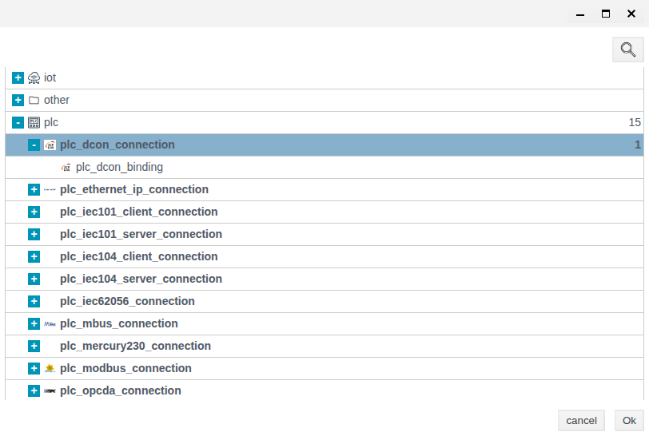
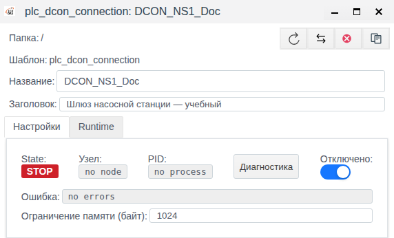
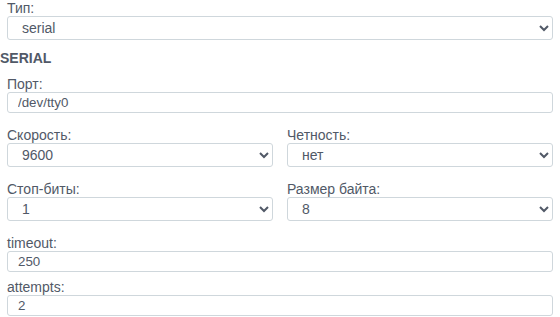
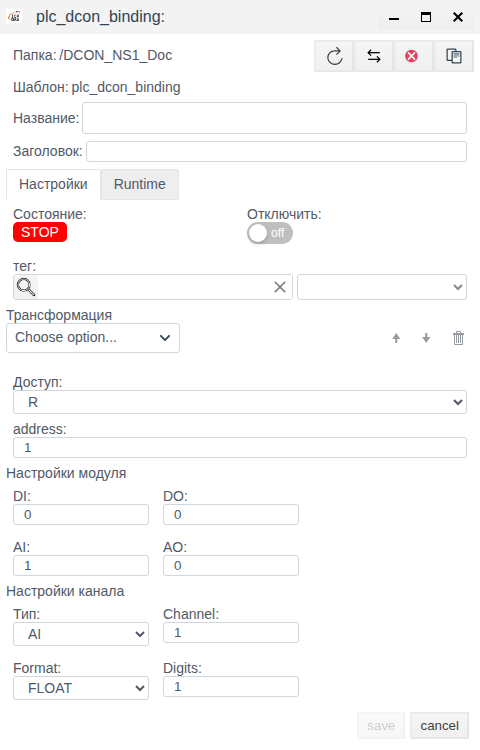

# DCON Connections in Faceplate: Creation and Configuration

Instructions for integrators using Faceplate v4.0.7. This guide covers DCON connection and channel binding configuration. Connection creation, saving, and reopening were checked using a disabled training object.

The screenshots show the Russian interface. Instructions retain the actual Russian UI labels, with English explanations where needed. These explanations are not presented as verified labels of the English localization. Untranslated labels such as **save**, **timeout**, and **Channel** match the interface.

**Contents**

- [Configuration route](#configuration-route)
- [Complete example: analog input and output](#complete-example-analog-input-and-output)
- [What a DCON connection does](#what-a-dcon-connection-does)
- [Prerequisites](#prerequisites)
- [Transport and communication settings](#transport-and-communication-settings)
- [Prepare a pump station gateway connection](#prepare-a-pump-station-gateway-connection)
- [Configure channel bindings](#configure-channel-bindings)
- [Check communication after connecting equipment](#check-communication-after-connecting-equipment)
- [Connection parameter reference](#connection-parameter-reference)
- [Troubleshooting a connection](#troubleshooting-a-connection)

[Connection catalogue](./index.md) · [Prepare fields and bindings](./bindings.md) · [Transformations](./transformation.md) · [Diagnostics and recovery](./diagnostics.md)

## Configuration route

Prepare an external source or client and a compatible tag field using the shared guide. Configure the channel, save a complete binding and verify a new value. For supported writing/reception, separately confirm the external result; after correcting a failure repeat verification with a new control value.

[Alternative channels and signal maps](./bindings.md#configure-an-alternative-channel) share one procedure; check driver-specific switching conditions.

## Complete example: analog input and output

Use a prepared float tag AnalogValue.value. The illustrative module map is address 1, DI 2, DO 2, AI 1, AO 1; obtain the complete actual composition from its specification.

| New binding AnalogInput field | Value |
|---|---|
| Тип / Channel | AI / 1 |
| address / DI / DO / AI / AO | 1 / 2 / 2 / 1 / 1 |
| Format / Digits | FLOAT / 1 |
| Доступ / Отключить | R / enabled until verified |
| тег / field | AnalogValue / value, float |
| Трансформация | Scaling: Factor 0.1, Cмена 0 |

Create AnalogInput inside the disabled connection, fill the table, select tag and field, save and reopen independently. Verify all channel counts: they describe the module, not just this input. Once the source is ready, remove both execution blockers. A confirmed numeric response 1000 should yield 100.0; 1001 should yield 100.1.

For DO, prepare a separate integer command field and a binding with the same composition, Тип DO, Channel 1, W and an empty chain. For AO use Тип AO, Channel 1, FLOAT and a suitable numeric field; Digits controls write formatting. Check the permitted initial command before activation. Send an allowed test value and independently verify the output. This is a configuration recipe, not an executed physical-module test.

## What a DCON connection does

A DCON connection defines how Faceplate accesses devices and exchanges data with them. Faceplate uses it to communicate with digital and analog I/O modules.

Two transports are available: **tcp** for access through a DCON TCP gateway, and **serial** for a serial port on the Faceplate server. The TCP gateway must carry the DCON protocol. Selecting **tcp** does not mean that Modbus TCP is used.

The connection defines the transport. Channel bindings define the device address, the module's I/O channel counts, the channel number, and the link to a tag. Binding configuration is described below. Shared transformations, redundancy and output verification are linked in the configuration route.

The workflow is: collect the equipment settings → create a connection → configure bindings → verify communication. This guide lets you prepare the connection before equipment is available. Saving verifies the configuration; checking data requires a DCON device or simulator.

| Concept | Meaning and configuration responsibility |
|---|---|
| DCON protocol | Rules for device requests and responses. TCP or SERIAL transport is selected separately |
| Driver | DCON support in Faceplate: builds requests and interprets responses. Select the DCON connection type when creating the object |
| PLC connection | Object that exchanges data with equipment. Holds the transport, gateway address or server port, polling period, response timeout, and attempt count |
| Binding | Child object of the connection for one signal. Holds the module address, DI/DO/AI/AO counts, channel type and number, format, access, and tag field link |
| Tag and tag field | Project object and selected field: the destination of read data or the source of a write setpoint |

Read data follows this path: device channel → DCON exchange through the connection → binding with **R** or **RW** access → optional transformation → selected tag field. Creating a connection does not create bindings or tags automatically. For writes, the tag field supplies the value; a DO/AO command reaches the device through the binding and connection.

## Prerequisites

- An account with permission to create and edit objects in Studio.
- A project folder for the connection and an available object name.
- For TCP: the address and port of a gateway configured for DCON.
- For SERIAL: the serial port name on the Faceplate server, baud rate, parity, stop bits, and data bits from the equipment settings.

The SERIAL port belongs to the Faceplate server. A port on the computer running the browser is not used automatically.

The example creates one connection for a pump station I/O gateway. Folder **/** is the project root. For your project, choose an appropriate folder and name.

| Example parameter | Value |
|---|---|
| Название | DCON_NS1_Doc |
| Заголовок | Шлюз насосной станции — учебный |
| Отключено | On at both stages |
| Период (мс) | 2000 |
| timeout | 250 ms |
| attempts | 2 |
| TCP stage | 127.0.0.1, port 1024 |
| SERIAL stage | /dev/tty0, 9600, parity **нет** (none), 1 stop bit, 8 data bits |

The example title is retained exactly as entered in the screenshots. It means “Pump station gateway — training.”

The address and port are provided for saving a training configuration. They do not imply that a gateway exists at this address or that the serial port is suitable for use. For a real connection, replace them with the equipment settings.

## Transport and communication settings

Select **tcp** or **serial** in **Тип**. Switching the type changes the transport fields. Common communication settings remain available for both transports.

**Период (мс)** sets the polling interval. **timeout** sets the response timeout in milliseconds. **attempts** sets the total number of attempts when no valid response is received: **1** means one attempt without a retry. Long transactions and retries can make the actual polling cycle longer than the configured period.

The **Отключено** switch excludes the connection from communication. It is off in a new form. When preparing a configuration without equipment, turn it on before the first save.

## Prepare a pump station gateway connection

### Create and save a TCP connection

1. Open **Студия** (Studio). If Runtime is open, use **Меню → Студия**.
2. In Studio, open **Меню → Общий вид**.
3. Click **Меню** again to close the menu.
4. Click **Создать**.
5. In the type selection dialog, expand **plc**.
6. Select the parent DCON connection row shown in the figure. The child row is for a channel binding.

7. Click **Ok**.

In the new form, leave **Главное соединение** empty. Do not fill in **Ограничение памяти (байт)**. Leave the other common settings unchanged for this example.

8. On the **Настройки** tab, turn on **Отключено**.
9. Check that **Папка** is set to the root **/**.
10. Enter **DCON_NS1_Doc** in **Название**. If this name is already in use, choose another name for your training object.
11. Enter **Шлюз насосной станции — учебный** in **Заголовок**.
12. Set **Период (мс)** to **2000**.
13. Check that **Тип** is set to **tcp**.
14. Explicitly enter **127.0.0.1** in **IP/Hostname/Localhost**. The same gray text in an empty field is a placeholder, not an entered address.
15. Set **Порт** to **1024** in the **TCP** group.
16. Set **timeout** to **250**.
17. Set **attempts** to **2**.
18. Check that **Отключено** is on.
19. Click **save**.

When the saved object was checked, **Ограничение памяти (байт)**, which had been left empty, automatically showed **1024**. Do not clear the system-supplied value to make the saved form match the new form.

After a successful save, the editor closes and the object appears in the list. No separate success message appeared in the checked example.

### Check the saved settings

1. Select the **DCON_NS1_Doc** row in **Общий вид**. Clicking an already selected row again may deselect it.
2. Click **Редактировать**.
3. Check the name, title, **Тип**, entered address, and port against the example parameter table.
4. Check **Период (мс)**, **timeout**, and **attempts** against the same table.
5. Make sure **Отключено** is on.

The checked disabled object showed **State: STOP**, **Узел: no node**, **PID: no process**, **Ошибка: no errors**, and **Актуальное соединение: нет соединения**. The **Runtime** column showed **ВЫКЛ**. These indicators are consistent with the prepared object; they do not verify communication with equipment.

Leave the editor open for the next stage. In an unchanged saved form, **save** is inactive. Saving again without changes is unnecessary.

### Configure a serial port in the same object

This stage changes the transport of the training connection already created. In a production project, choose the transport that matches the physical connection.

1. In the open object, select **serial** in **Тип**.
2. Enter **/dev/tty0** in **Порт** in the **SERIAL** group.
3. Select **9600** in **Скорость**.
4. Select **нет** (none) in **Четность**.
5. Select **1** in **Стоп-биты**.
6. Select **8** in **Размер байта**.
7. Check that **Период (мс)**, **timeout**, and **attempts** are still **2000**, **250**, and **2**.
8. Check that **Отключено** is on.
9. Click **save**.
10. Select the same object in the list.
11. Click **Редактировать**.
12. Check **Тип** and all **SERIAL** fields against the values entered.
13. Make sure **Отключено** is still on.

After checking, close the unchanged form with **cancel**. The result is one saved, disabled object using **serial** transport. No second connection, channels, or tags are created in this example.

## Configure channel bindings

A channel binding links one channel of a physical module to a Faceplate tag field. The connection defines the transport for all its bindings. Each binding specifies the module address, its full I/O channel counts, and the selected channel.

Prepare the device address, the DI/DO/AI/AO counts from the module documentation, the channel type and number, the analog data format, and the tag and field. DI means digital inputs, DO digital outputs, AI analog inputs, and AO analog outputs. Create a separate binding for each channel you use.

### Create a binding and select a channel

1. In Studio, open **Меню → Общий вид**.
2. Navigate to the folder containing the required DCON connection.
3. Double-click the connection name to open its contents.
4. Check the connection name in the navigation path.
5. Click **Создать**. The binding form opens, with **Папка** pointing to the selected connection.
6. Enter an available **Название** for the binding.
7. If needed, enter a signal description in **Заголовок**.
8. On the **Настройки** tab, turn on **Отключить** to prepare the binding without communication.
9. Enter the physical module address in **address**.
10. In **Настройки модуля**, enter the full module counts in **DI**, **DO**, **AI**, and **AO**. Leave **0** for I/O types that the module does not have.
11. In **Настройки канала**, select the required signal type in **Тип**.
12. Enter the channel number in **Channel**.
13. For AI/AO, select the **Format** that matches the device settings.
14. For AI/AO using **FLOAT**, explicitly set **Digits**.

The I/O counts describe the entire module, even when you use only one channel. Do not set a physically present I/O group to zero just because this binding does not use it. Bindings for the same module must use the same address and I/O counts. Incorrect counts can produce an incorrect value without a communication error.

If the required option is missing from **Тип**, check the corresponding count: the option appears when that count is greater than zero. After changing a type or count, check **Channel** again; the form may reduce the number automatically.

### Link the binding to a tag and save

1. Select an existing object in **тег**.
2. Select the required tag field in the list to the right of **тег**.
3. Set **Доступ** according to the table below. Select **R** for DI/AI.
4. If no data transformation is required, leave **Трансформация** empty.
5. Check that the binding is disabled if the equipment is not yet connected.
6. Click **save**.
7. Select the new binding in the list.
8. Click **Редактировать**.
9. Check the address, all four I/O counts, type and channel number, format, **Digits**, tag, field, access, and disabled state against the values entered.

| Доступ | Data flow | Use |
|---|---|---|
| **R** | Device → tag field | Read DI, DO, AI, or AO |
| **W** | Tag field → device | Control DO/AO without periodic reading |
| **RW** | Read the device and write changes from the tag field | Read and control DO/AO |

**Доступ** (access) specifies the direction of communication, not user permissions. For **W**, the current field value is written when the binding activates after the connection starts or recovers, then when the setpoint changes. **RW** combines reading with writes triggered by field changes; do not expect the same initial setpoint transmission as in **W**. Before enabling **W** or **RW**, check the source value and the allowed output range in the device documentation.

For a digital signal, select a field compatible with **0/1** values; for an analog signal, select a numeric field. Select both the tag and its field explicitly. A binding without a tag link will not deliver its result to the required project field.

**Трансформация** is an optional general data processing chain. Selecting **HEX/FLOAT** alone does not convert a value into engineering units. General transformation configuration is covered in the PLC connection documentation.

The screenshot shows an unsaved form: **AI = 1**, **Тип = AI**, **Format = FLOAT**, with no tag selected. These values illustrate field availability, not a ready-to-use device configuration. The form was closed with **cancel** without saving.

### Binding parameter reference

| Field | What to set | Initial value and limits |
|---|---|---|
| **Папка** | The required DCON connection, determined by where the binding is created | Path of the selected connection |
| **Название** (name) | Available binding name within the connection | Empty |
| **Заголовок** (title) | Descriptive signal title | Empty; optional |
| **address** | Numeric address of the physical module | **1**; allowed range **1–254**, although the form accepts input up to **6000** |
| **DI** | Total number of digital inputs on the module | **0**; use the module specification |
| **DO** | Total number of digital outputs on the module | **0**; use the module specification |
| **AI** | Total number of analog inputs on the module | **0**; use the module specification |
| **AO** | Total number of analog outputs on the module | **0**; use the module specification |
| **Тип** | Type of the selected channel | Not selected; **DI/DO/AI/AO** when the corresponding count is greater than zero |
| **Channel** | Channel number within the selected I/O type | **1**; form range **1–32**, no higher than the corresponding count |
| **Format** | AI/AO data format used by the device | **HEX**; options **HEX**, **FLOAT** |
| **Digits** | Number of decimal places when writing FLOAT values | **1** in a new form; **1–5**; set explicitly and check after saving |
| **тег**, field | Object and field receiving read data or supplying write data | Not selected |
| **Доступ** | Direction of communication | **R**; options **R**, **W**, **RW** |
| **Отключить** | Exclude this binding from communication | Off |
| **Трансформация** | Value processing | Empty; optional |

**Format** and **Digits** apply to AI/AO; **Digits** is available with **FLOAT**. When reading **FLOAT**, this field does not round the result or set the sensor's precision. Form input ranges do not guarantee support for every physical module channel count. In this version, AI/AO channels above **16** cannot be addressed unambiguously. Operation of DO channels above **16** is unverified; do not use the form limit of **32** as justification for such a configuration.

On **Настройки** (settings), the **Состояние** indicator shows the binding state. **Runtime** provides **state**, **error**, and **value**: binding state, error, and value. Faceplate supplies these diagnostic fields; they are not addressing parameters. To check data delivery, also open the exact tag field selected in the binding.

To disable one binding, open it with **Редактировать** (edit), turn on **Отключить**, click **save**, and check the flag again. Other bindings in the connection have their own execution permissions. Disabling a binding may leave the previous reading in **value** and the tag field; a displayed number does not establish data freshness.

Reopening checks the saved configuration. To verify communication, follow the equipment check below.

## Check communication after connecting equipment

Use this procedure when a device or simulator is available and channel bindings have been configured. Project Runtime must be running, execution must be allowed in parent folders, and the binding being checked must be enabled. Project Runtime control is part of the general Faceplate configuration.

The device must use the DCON checksum: Faceplate adds it to requests and checks it in responses. The connection form has no separate checksum switch.

1. Check the transport settings against the equipment: TCP address and port, or the server's serial port and frame settings.
2. Check the device address, module I/O counts, type, and channel number in the binding.
3. Turn off **Отключить** in the binding when the channel is ready for communication.
4. Turn off **Отключено** in the connection when the line is ready for communication.
5. Check the states of the connection and the required binding.
6. Change a known input signal on the device.
7. Check the new binding value and linked tag field value after a communication cycle.

On a read error, the linked field may receive **none** or a substitution value from a transformation. This is not a new device reading. On a connection-wide error, the binding **value** may retain the previous number; compare it with the error and the selected tag field. Common binding fields do not include a last-read timestamp.

The connection state alone does not prove that every channel works. A successful read check requires a new, known test value. This equipment communication procedure was not performed in the training example.

To change an existing connection, select it in **Общий вид** (general view), click **Редактировать**, change the required settings, and click **save**. Reopen the object and check the values. To stop communication for all its channels, turn on **Отключено** and save; to allow communication, turn it off and save. Allowing the connection does not replace starting project Runtime or allowing execution in parent folders.

When communication recovers after a fault:

1. Check the connection error and **error** of the required binding; determine whether the fault affects the whole line or one channel.
2. Restore access to the gateway or serial port and correct mismatched settings.
3. Make sure the connection, binding, and parent folders allow execution and project Runtime is running. Wait for a new communication cycle, allowing for timeouts and retries.
4. Check the state and errors, then apply a new known input value and compare the binding **value** with the selected tag field. Account for the configured transformation.

A cleared error or an unchanged displayed number does not confirm that reading has recovered. Success means receiving the new test value in the required field. Equipment communication recovery was not reproduced in this verification.

## Connection parameter reference

The initial values below were observed in a new, unsaved form. They are not recommended settings for every device. Numeric ranges are the form control limits; saving every boundary value was not checked separately.

### Main fields and transport

| Field | Purpose and input | Initial value and allowed values |
|---|---|---|
| Папка | Object location in the project | Selected for the current project; **/** in the example |
| Название | New object name; enter an available name | Empty |
| Заголовок | Descriptive title; entered in the example | Empty |
| Отключено | Turn on to prepare the connection without communication | Off |
| Тип | Transport selection | **tcp**; options **tcp**, **serial** |
| IP/Hostname/Localhost | For TCP, enter the gateway address or hostname | Empty; **127.0.0.1** is a placeholder |
| Порт, TCP | DCON gateway port | **1024**; **1–65535** |
| Порт, SERIAL | Port name on the Faceplate server | **/dev/tty0**; the actual port depends on the connection setup |
| Скорость | Transmission speed in baud; match the device | **9600**; 300, 600, 1200, 2400, 4800, 9600, 19200, 38400, 57600, 115200, 230400, 460800, 500000, 576000 |
| Четность | Serial frame setting | **нет** (none); options **нет**, **четный**, **нечетный** (none, even, odd) |
| Стоп-биты | Serial frame setting | **1**; options **1**, **2** |
| Размер байта | Number of data bits | **8**; options **5**, **6**, **7**, **8** |

Fill in the parameters for your transport. The checked form did not display required-field markers; the example confirms that the specified set of fields was saved.

### Communication and common process settings

| Field | Purpose | Initial value / limits |
|---|---|---|
| Период (мс) | Polling interval | **1000 ms**; **1–3600000 ms** |
| timeout | Response timeout | **100 ms**; **1–6000 ms** |
| attempts | Total number of attempts when no valid response is received | **1**; **1–500** |
| Shutdown timeout (ms) | Time allowed for process shutdown; not the device response timeout | **60000 ms**; **10–3600000 ms** |
| Главное соединение | Optional link for redundancy; leave empty for a standalone connection | Empty |
| Поддержка групповых запросов | Common driver setting; this switch alone does not add grouped DCON communication | **Да** (Yes) |
| Макс. длина пакета | Common setting; unchanged in the example | **250**; **1–10000** |
| Коэффициент задержки линии | Common line setting; unchanged in the example | **1**; **1–10** |
| Ограничение памяти (байт) | Optional process field; keep the system value in this guide | Empty in a new form; **1024** appeared after the first save without manual entry |

Despite the bytes label, the process heap limit is expressed in MiB: 1024 corresponds to 1 GiB. Leave the system value unchanged in the training configuration.

### State fields

| Field | What it shows | In the disabled training object |
|---|---|---|
| State | Process state | **STOP** |
| Узел | Execution node | **no node** |
| PID | Process identifier | **no process** |
| Ошибка | Recorded error | **no errors** |
| Актуальное соединение | Current communication route | **нет соединения** |

Faceplate fills in these fields. **no errors** in a disabled object does not verify the gateway address, the existence of a port, or device responses.

The **Runtime** column in the connection list and the **Отключено** switch in the form represent the same execution permission: **ВЫКЛ** corresponds to **Отключено** being on. Check project Runtime and execution permission in parent folders separately.

## Troubleshooting a connection

| Symptom | Where and what to check | Action and result check |
|---|---|---|
| **Редактировать** is inactive | Row selection in **Общий вид** | Select the required row once; clicking again may deselect it. The button becomes available |
| **save** is inactive | Whether the form is new, fields are filled in, and changes have been made | Enter the example settings. An inactive **save** is expected in an unchanged saved object |
| The address field looks filled in, but no value was entered | **IP/Hostname/Localhost** | Enter the address explicitly, save, and check after reopening; the gray placeholder is not a value |
| No channel data after saving | **Отключено**, project and parent folder Runtime, an enabled binding, and a device | This is expected for the training object. For a working check, prepare Runtime, the device, and the binding, then follow the communication check procedure |
| TCP device does not respond | **Тип**, gateway address and port, gateway protocol and settings | Match them to the equipment; after recovery, check a new, known test value as well as the connection state |
| SERIAL device does not respond | Server port, server access to it, baud rate, and frame settings | Correct mismatched settings; after recovery, check a new, known test value |
| Settings are correct, but the channel does not update | Device address, module I/O counts, type, and channel number in the binding | Correct the binding and repeat the input signal check; the connection state alone is insufficient |
