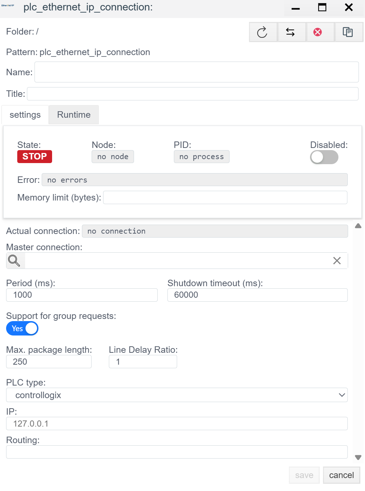
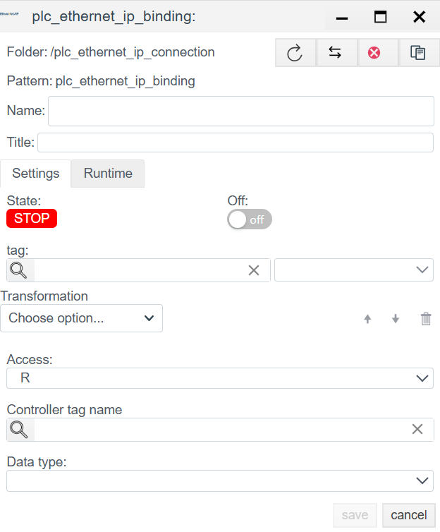

# EtherNet/IP Driver Configuration (Rockwell Automation)

> See also: [PLC Connections overview](./general_en.md)

## Overview
**EtherNet/IP** (Industrial Protocol) is an industrial standard that runs Common Industrial Protocol (CIP) over standard Ethernet. In **Faceplate**, this driver is used for native integration with **Allen-Bradley (Rockwell Automation)** controllers and compatible devices.

### Supported hardware
According to the driver configuration, the following controller families are supported:
* **ControlLogix / CompactLogix** (tag-based addressing, CIP)
* **Micro800** (Micro820/850/870 series)
* **MicroLogix** (PCCC addressing)
* **SLC 500** (legacy, PCCC)
* **PLC-5** (legacy, PCCC)
* **LogixPCCC** (specific mode for Logix via PCCC)

Configuration is done in two stages:
1. **Connection (`plc_ethernet_ip_connection`):** Protocol network connection.
2. **Binding (`plc_ethernet_ip_binding`):** Addressing information objects and binding configuration.

---

## 1. Connection setup (Connection)

This step creates the communication session with the controller.
> Create a PLC connection -> [Create a PLC connection](./general_en.md#create-a-plc-connection)

> The diagnostics panel and common connection settings are described in [Common connection settings](./general_en.md#common-connection-settings).

### 1.1 Controller settings

This is the critical section that defines the addressing method.

| Field | Description |
| :--- | :--- |
| **Controller type** | Select the PLC family: - **ControlLogix:** Uses symbolic tag names. Most modern mode. - **MicroLogix / SLC / PLC5:** Uses data file addressing (N7:0, F8:1). |
| **IP** | IP address of the communication module or CPU. |
| **Routing** | *Optional.* CIP path for access to a CPU in another slot or chassis. *Format:* Usually a sequence of pairs `Port,Address`. *Example:* `1,0` (Backplane, Slot 0). Leave empty for CompactLogix (no chassis). |

---

## 2. Binding setup (Binding)

In EtherNet/IP (especially for ControlLogix), data is addressed by **tag name** rather than a memory address.

> Create a PLC binding -> [Create a PLC binding](./general_en.md#create-a-plc-binding)

> Common binding fields (Name, Title, State, Tag, Transformation, Access) are described in [Common PLC binding fields](./general_en.md#common-plc-binding-fields).

### 2.1 Data addressing (Target Data)

| Field | Instruction |
| :--- | :--- |
| **Controller tag name** | **Symbolic PLC address.** - For **ControlLogix:** Tag name as in Studio 5000, for example: `MyTag`, `Program:MainProg.Step`. - For **SLC/MicroLogix:** Element address, for example: `N7:0`, `F8:10`, `B3:0/5`. |
| **Data type** | Data type expected from the controller (BOOL, SINT, LREAL, USINT, INT, UINT, DINT, UDINT, LINT, ULINT, REAL). Must match the PLC declaration. |

> Binding error -> [Binding errors](./general_en.md#binding-errors)
---