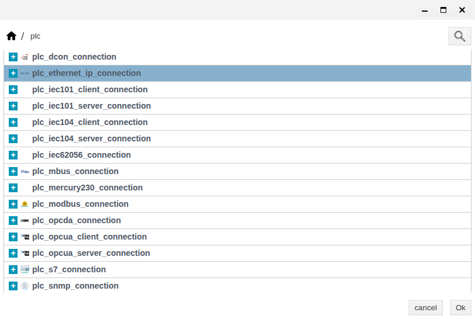
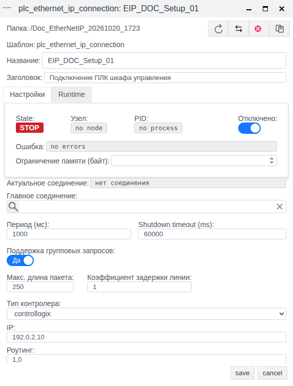
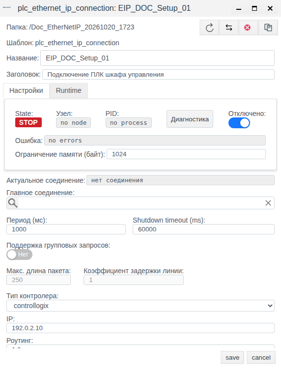
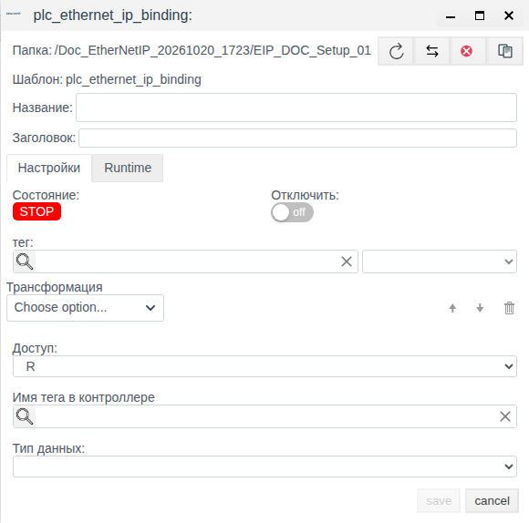
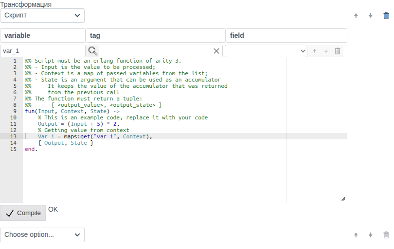
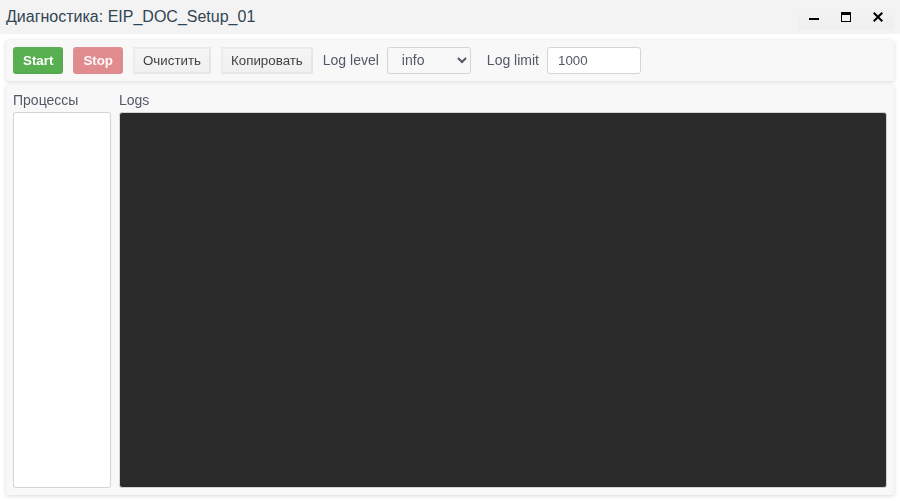

# EtherNet/IP in Faceplate: Configuring Connections and Bindings

A guide for integrators connecting Allen-Bradley PLC variables to fields in Faceplate v4.0.7.

The screenshots show the Russian interface. Actual Russian UI labels are retained with English explanations so that you can match the instructions to the screen. The English localization has not been verified; the explanations are not asserted to be its on-screen labels.

**Contents**

- [Configuration route](#configuration-route)
- [Complete example: PLC variable and project field](#complete-example-plc-variable-and-project-field)
- [Purpose of the module](#purpose-of-the-module)
- [What to prepare](#what-to-prepare)
- [Creating and configuring a connection](#creating-and-configuring-a-connection)
- [Creating and configuring bindings](#creating-and-configuring-bindings)
- [Parameter and state reference](#parameter-and-state-reference)
- [Verification and diagnostics](#verification-and-diagnostics)

[Connection catalogue](./index.md) · [Prepare fields and bindings](./bindings_en.md) · [Transformations](./transformation_en.md) · [Diagnostics and recovery](./diagnostics_en.md)

## Configuration route

Prepare an external source or client and a compatible tag field using the shared guide. Configure the channel, save a complete binding and verify a new value. For supported writing/reception, separately confirm the external result; after correcting a failure repeat verification with a new control value.

[Alternative channels and signal maps](./bindings_en.md#configure-an-alternative-channel) share one procedure; check driver-specific switching conditions.

## Complete example: PLC variable and project field

Prepare scalar PLC variable Training_Temperature, type REAL, with control values 23.5 and 24.5. Prepare float tag EIPTemperature.value in Faceplate. Confirm PLC name and type from its project or Browse; these names are illustrative.

| New binding TemperatureInput field | Value |
|---|---|
| Имя тега в контроллере / Тип данных | Training_Temperature / REAL |
| тег / field | EIPTemperature / value |
| Доступ / Отключить | R / enabled until verified |
| Трансформация | Empty |

Create TemperatureInput inside the disabled connection. Fill the table, save and reopen independently. Explicitly check the type and both destination elements; an enabled save button is insufficient. For an actual PLC, confirm family, IP and route, then enable the connection and binding. Change source 23.5→24.5 and verify new 24.5 in EIPTemperature.value.

With Browse, select the variable beside «Имя тега в контроллере», then verify its exact name and type. For an array or structure member, use a specific scalar-element address from the project/Browse; a Faceplate name is not a substitute.

For writes, prepare a separate permitted Training_Setpoint REAL variable and float command field. Set W/RW, an empty chain and inspect the current command before activation. After changing it to 25.0, independently read Training_Setpoint on the PLC. Grouped reading and writing are supported; the read maximum counts variables, not bytes. This extends setup instructions; no new exchange or Browse execution is claimed.

## Purpose of the module

Use EtherNet/IP to receive measurements from a PLC and send values from Faceplate to the PLC. Configuration consists of a connection and the bindings created inside it.

| Concept | What it defines |
|---|---|
| EtherNet/IP protocol | Rules for communicating with the device; protocol support must be provided in the PLC project |
| EtherNet/IP driver | Faceplate's implementation of protocol support; the selected driver determines the available connection and binding settings |
| Connection | Controller family, IP address, route to the processor, period, and communication mode |
| Binding | PLC variable, its type, target Faceplate object and field, exchange direction, and transformations |
| Faceplate tag | A separate project object whose fields are used to display, process, and transfer values |
| Target Faceplate field | Where a received value is placed or where the value to write is taken from |

During reading, the PLC variable passes through the binding's transformations into a Faceplate field. Writing uses the reverse direction. A connection alone is insufficient to exchange process values: configure bindings.

Controller family, IP address, route, and common polling settings belong to the connection and are used by its bindings. PLC variable name and type, Faceplate object and field, direction, and transformations are configured separately for each binding. Creating a connection or selecting a PLC variable does not automatically create a Faceplate process tag.

The controller tag name identifies the source or destination on the PLC side. The binding's **тег** control identifies a Faceplate object; the adjacent list selects that object's field. These are different sides of the mapping.

Start with the connection, then create bindings inside it. Verify the saved settings and enable communication only after preparing the actual device.

### How polling settings affect communication

**Период (мс)** (period in ms) specifies the requested update cycle. The actual interval depends on communication duration; the specified number does not guarantee exactly when a value will appear.

With **Поддержка групповых запросов = Да** (group requests enabled), variables are combined into groups for communication. **Макс. длина пакета** limits the number of variables per group. With **Нет** (No), individual requests are used, and the group length and line delay coefficient fields cannot be edited.

For an independent connection, leave **Главное соединение** (main connection) empty. Use the [shared redundancy procedure](./bindings_en.md#configure-an-alternative-channel) for alternative transport.

## What to prepare

To configure the forms, you need Studio access, permission to create and edit project objects, and a folder for the connection. For a binding, prepare a target Faceplate object with a field of a suitable type. Creating object types and configuring trends are covered separately.

| Operation | Required information and conditions |
|---|---|
| Configuring a connection | PLC family, entry-point IP address, and route to the processor; explicitly identified training values can be used for a training configuration |
| Configuring a binding manually | Exact variable name and type from the PLC project, plus the target Faceplate object and field |
| Browsing PLC variables | An accessible controller and a correctly configured connection; the network must be accessible from the Faceplate server |
| Checking reading | A known PLC variable and a way to check its value independently |
| Checking writing | An approved PLC test variable, an agreed write value, and a way to check the result on the PLC |

The route depends on the topology: the Ethernet module and processor may occupy different positions or devices. Obtain the IP address and route from the PLC specialist; the example route is not universal.

### Connection example data

The task is to prepare a connection configuration for a control-cabinet PLC and verify that it is saved. This example does not require a PLC. The connection remains disabled.

| Parameter | Example value |
|---|---|
| Existing project folder | Doc_EtherNetIP_20261020_1723; choose a prepared folder in your own project |
| **Название** (name) | EIP_DOC_Setup_01 |
| **Заголовок** (title) | Подключение ПЛК шкафа управления |
| **Тип контролера** (controller type) | controllogix |
| **IP** | 192.0.2.10 — training address |
| **Роутинг** (routing) | 1,0 — explicitly specified training route |
| **Период (мс)** | 1000 |
| **Shutdown timeout (ms)** | 60000 |
| **Поддержка групповых запросов** | Да (Yes) |
| **Макс. длина пакета** | 250 variables |
| **Коэффициент задержки линии** (line delay coefficient) | 1 |
| **Главное соединение** | Empty |
| **Ограничение памяти (байт)** (memory limit, labelled bytes) | Leave empty during creation |
| **Отключено** (disabled) | Turn on before the first save |

For your device, replace the training IP address, route, and family with the PLC project's actual settings. This example does not require prepared bindings or process objects.

## Creating and configuring a connection

### Create a disabled connection

1. Open **Меню → Общий вид** (Menu → General view).
2. Double-click to enter the prepared folder.
3. Click **Создать** (Create).
4. In the **plc** group, select the EtherNet/IP connection type shown in the figure.

5. Click **Ok**.
6. Enter **Название** from the example table.
7. Enter **Заголовок** from the example table.
8. Select **Тип контролера**.
9. Enter **IP**.
10. Enter **Роутинг**.
11. Compare the remaining settings with the example table.
12. Turn on **Отключено**.

13. Click **save**.

### Verify saving and find the connection

1. Select the created row in **Общий вид**.
2. Click **Редактировать** (Edit).
3. Compare the IP address, route, family, and polling settings with the example table.
4. Verify that **Отключено** remains on.

In the checked example, the editor showed **State = STOP**, **Узел = no node**, **PID = no process**, **Ошибка = no errors**, and **Актуальное соединение = нет соединения** (no connection). This is the result of saving a disabled configuration, not a PLC connectivity test.

After saving, **Ограничение памяти (байт)** automatically displays **1024**, although it was left empty during creation. There is no need to clear it again.

5. Close the editor with **cancel**.
6. Open **Меню → Драйверы ПЛК** (Menu → PLC drivers).
7. Enter the connection name in **Поиск по пути** (path search).
8. In the **Тип соединения:** filter (connection type), keep **ethernet_ip** selected.
9. Click **Найти** (Find).

For this example, expect **Режим = Откл.** (disabled mode) and **Состояние = STOP**.

> [!NOTE]
> In the checked version, **Статус** (status) displayed **ОШИБКА** (error), while its tooltip and the editor showed **no errors**. The reason for this display has not been established. Open the details and check binding states and actual values; this column alone is insufficient to conclude that communication has failed.

Double-clicking a row in **Драйверы ПЛК** opens the binding list. To edit the connection itself, use **Общий вид → Редактировать**.

### Verify individual and group modes

Continue with the same disabled connection.

1. Open it through **Общий вид → Редактировать**.
2. Set **Поддержка групповых запросов** to **Нет**.
3. Verify that **Макс. длина пакета** and **Коэффициент задержки линии** are unavailable.

4. Click **save**.
5. Reopen the connection.
6. Verify that **Нет** is saved and that the unavailable fields retain **250** and **1**.
7. Switch the mode back to **Да**.
8. Click **save**.
9. Reopen the connection.
10. Verify **Да**, values **250** and **1**, and that **Отключено** remains on.

The configuration is saved and ready for subsequent binding configuration. This check confirms saving settings and switching modes; no device communication was performed.

### Edit, enable, or disable a connection

Leave the training connection disabled. Apply the following enabling actions to a prepared operational configuration with actual device settings and ready bindings.

| Task | Action in Studio | Result verification |
|---|---|---|
| Edit settings | Select the connection in **Общий вид**, click **Редактировать**, change the required fields, and click **save** | Reopen the form and compare the values; check incoming data separately |
| Disable the connection | Turn on **Отключено** and click **save** | Reopen the form; expect STOP and no process; this connection's bindings must not perform communication |
| Enable a prepared connection | Turn off **Отключено** and click **save** | Check the process, connection and binding errors, then a new value using the communication verification procedure |
| Disable one binding only | Open it inside the connection, turn on **Отключить**, and click **save** | The binding is excluded from communication; this switch does not disable the connection or its other bindings |

Saving changed channel settings reinitializes the connection process. Binding edits are applied separately; manually restarting the entire connection after every binding edit is unnecessary.

Reactivating a connection can transmit the current commands of W bindings. Before enabling or a controlled restart, check all such command values and write authorization. Restoring the network alone does not confirm retransmission of a previously failed W command.

## Creating and configuring bindings

A binding maps an individual PLC variable to a Faceplate field. The instructions below apply to your objects and do not constitute a separate training scenario.

### Create and complete a binding

1. Open **Меню → Общий вид**.
2. Enter the folder containing the required connection.
3. Double-click to enter the connection.
4. Click **Создать**.

The binding form opens directly, without an additional type selection.

5. Enter the binding's **Название**.
6. Turn on **Отключить** (disable) until the configuration is ready to operate.
7. Specify the PLC variable using one of the methods below.
8. Select **Тип данных** (data type) to match the PLC variable.
9. Click the magnifier beside **тег**.
10. Select the target Faceplate object in the selector.
11. Click **ОК**.
12. Select the required object field in the list to the right of **тег**.

> [!WARNING]
> In W mode, the current field value can be written to the PLC on activation, before a new operator action. Before enabling, check the initial command and permission to write to the selected variable. Keep the binding and connection disabled until the device and command are prepared.

13. Select **Доступ** (access): R, W, or RW.
14. If required, configure **Трансформация** (transformation) using the following section.
15. Check the variable, data type, target object, field, direction, and transformations.
16. Click **save**.
17. Select the binding in the list inside the connection.
18. Click **Редактировать**.
19. Compare the saved settings.

An available **save** button does not mean configuration is complete. In the checked form, entering a name alone enabled the button; the data type was initially unselected. To map to a Faceplate field, explicitly specify the source and both destination elements: object and field.

The object's field list may include service parameters. Select a prepared, suitable field; its presence in the list does not establish suitability for process communication. Selecting a PLC variable through browsing does not create the target Faceplate object.

### Specify a variable manually or by browsing

| Method | Actions | When to use |
|---|---|---|
| Manual entry | Enter the exact **Имя тега в контроллере** (controller tag name) and select **Тип данных** | Name and type are known from the PLC project; configuration is prepared without access to the device |
| Browsing | Click the magnifier beside **Имя тега в контроллере**, select an available variable, then verify the populated name and type | The controller is accessible and you need to select a variable from its structure |

For an array element or structure member, specify an individual scalar variable. After changing the PLC project, refresh the browse list. Successful browsing requires an actual controller and was not part of the performed UI check.

### Select the exchange direction

| **Доступ** | Behavior | What to verify |
|---|---|---|
| R | PLC → Faceplate field; reading is performed | Source change and the result of direct transformations |
| W | Faceplate field → PLC; field changes are transmitted, and writing may also occur on activation or reapplication of settings | Command value before enabling and the actual write result on the PLC |
| RW | Reading from the PLC and transmitting field changes to the PLC | Both directions, accounting for direct and reverse transformations |

W does not poll for externally made changes to the PLC variable. If such changes must appear in Faceplate, use a suitable reading direction.

### Configure transformations

In **Трансформация**, select an operation from **Choose option...**. After adding one, another empty row appears for an additional operation. Arrows change the order; the bin icon removes an operation. Leave the list empty if transformations are unnecessary.

Reading executes operations from top to bottom. Writing applies reverse processing in reverse order. Each operation's limits and units refer to the value at that stage of the chain.

| UI selection | Parameters and initial values | Reading R | Writing W/RW |
|---|---|---|---|
| **Scaling** | Factor = 1; Cмена = 0 | y = x × Factor + Cмена | x = (y − Cмена) / Factor; Factor must be nonzero |
| **Default Value** | Значение = 0 | Numeric input passes unchanged; nonnumeric or missing input is replaced with the configured number | Passes the value without substitution |
| **Limit Control** | Lower Limit = 0; Upper Limit = 0; set Upper Limit greater than Lower Limit | A value outside the inclusive limits or nonnumeric input becomes missing | Clamps the value to the specified limits |
| **Integration** | No parameters | Accumulates the value over time | Unsupported; use R |
| **Derivative** | No parameters | Calculates the rate of change | Unsupported; use R |
| **Damper** | Tlag = 1, minimum 1 ms | Smooths changes; the first result equals the input | Passes the value without smoothing |
| **Скрипт** (script) | Context variables and an Erlang function | Custom value processing | Unsupported; use R |

The editor uses a Latin C in **Cмена**; this is the shift parameter. **Значение** means value.

Integration and Derivative use milliseconds. The integration result has input units multiplied by ms; the derivative has input units divided by ms. Adjust the scale for the required time units. The first result of both operations is missing: another valid sample is required.

The form may display all seven operations with W/RW as well. This does not permit incompatible combinations. Before saving, exclude Integration, Derivative, and Скрипт for W/RW, set valid Limit Control limits, and use a nonzero Factor for reverse scaling.

Substitution does not clear a communication error. A substituted number in the target field does not establish that the PLC was read successfully.

### Configure a script and its context

The script is an Erlang function with three arguments.

| Element | Purpose |
|---|---|
| Input | Value entering this operation in the chain |
| Context | Map of variables from the context table |
| State | Accumulator passed from the previous function call |
| Result | Pair containing the output value and new accumulator state |

1. Set **Доступ = R**.
2. Select **Скрипт** in **Трансформация**.
3. In **variable**, enter the context variable name you use.
4. In **tag**, select the Faceplate object supplying the context.
5. In **field**, select its field.
6. Enter your function in the editor.
7. Click **Compile**.
8. Check the compilation result before saving the binding.

The **variable** row name is used as a string key in Context. For example, the supplied template accesses `maps:get("var_1", Context)`. Map every variable used to a field; remove accesses to unnecessary variables from the function.

> [!NOTE]
> The template can produce **Compile → OK** even with tag and field empty. This confirms function compilation, not context availability, calculation correctness, or PLC communication. Do not use the unchanged template as ready-to-run processing.

## Parameter and state reference

The tables contain form values from the checked version. Numeric ranges refer to UI controls; parameter combinations require additional validation. Settings for an operational PLC are determined by its project.

### Connection

| Field | Purpose and entry | Initial value / UI range |
|---|---|---|
| **Папка** (folder) | Location; select before creation | Current folder |
| **Шаблон** (pattern) | Determined by the selected connection type | Type display |
| **Название** | Object name; choose an unused name in the selected folder | Empty |
| **Заголовок** | Optional descriptive title | Empty |
| **Тип контролера** | Select the option for your PLC | controllogix; also plc5, slc500, logixpccc, micro800, micrologix |
| **IP** | PLC entry-point IP address; enter explicitly | Empty; 127.0.0.1 is a placeholder, not a configured address |
| **Роутинг** | Route to the processor according to the PLC topology | Empty; the example explicitly specifies 1,0 |
| **Главное соединение** | Common reference for additional connection configuration; empty for an independent connection | Empty |
| **Период (мс)** | Requested update cycle | 1000; 1–3600000 ms |
| **Shutdown timeout (ms)** | Wait for process termination during shutdown | 60000; 10–3600000 ms |
| **Поддержка групповых запросов** | Group or individual communication | Да / Нет (Yes / No); initially Да |
| **Макс. длина пакета** | Maximum variables per group; available with Да | 250; 1–10000 variables |
| **Коэффициент задержки линии** | Common PLC setting. In this driver, group size determines grouping; this coefficient does not change it. Leave at 1 for initial configuration | 1; 1–10; available with Да |
| **Отключено** | Disables connection execution | Off; on in the training example |
| **Ограничение памяти (байт)** | Common process setting; leave unchanged for initial configuration | Empty during creation; displays 1024 after saving the example |

**Shutdown timeout (ms)** is not the controller response timeout. This form has no separate port, request timeout, or attempt-count fields.

Despite the **Ограничение памяти (байт)** label, the process heap limit is interpreted in MiB: 1024 corresponds to 1 GiB. Leave the system value unchanged in the example.

### Binding

| Field | Purpose and entry | Initial state |
|---|---|---|
| **Название / Заголовок** | Binding name and optional title | Empty |
| **Отключить** | Disables this binding independently of others | Off |
| **тег** | Target Faceplate object; select it for communication with a field | Empty |
| List to the right of тег | Target object field; select after choosing the object | Empty and unavailable until an object is selected |
| **Трансформация** | Optional ordered chain; parameters are described above | No operations selected |
| **Доступ** | Exchange direction | R; options R, W, RW |
| **Имя тега в контроллере** | PLC variable name; enter manually or select by browsing | Empty |
| **Тип данных** | PLC variable type; select explicitly | Empty; options BOOL, SINT, LREAL, USINT, INT, UINT, DINT, UDINT, LINT, ULINT, REAL |
| **Состояние** (state) | Binding state display | STOP in a new draft |

The destination's **тег** and the script context's **tag** identify Faceplate objects. **Имя тега в контроллере** identifies a PLC variable. Do not substitute one for the other.

### States and details

| Where to look | Meaning |
|---|---|
| Connection: State | Process state; STOP was observed in the disabled example |
| Connection: Узел / PID | Execution node and process; no node / no process in the disabled example |
| Connection: Ошибка | Error detail; no errors in the example |
| Connection: Актуальное соединение | Connection in use; нет соединения in the disabled example |
| Binding: Состояние | Individual binding state; check together with its diagnostics |
| Binding: Runtime | Service rows error, state, value; available for diagnostic inspection |

For normal configuration, use **Настройки** (settings). Do not set service states manually instead of correcting the configuration.

Connection RUN alone does not establish PLC availability. Successful communication is confirmed by correct value exchange and binding states.

After reading, the binding's **value** already includes processing; it does not necessarily equal the original controller value. After writing, it is the Faceplate-side value, not independent confirmation of the PLC result. A disabled binding can retain an old number. Check direction, errors, and newly arriving data together.

## Verification and diagnostics

### Open diagnostics

The diagnostics window is available for a saved connection, including STOP. It helps correlate messages with connection and binding states. **Start** and **Stop** control diagnostic message collection; enable or disable the connection through **Отключено** and save.

1. Open the connection form through **Общий вид → Редактировать**.
2. Click **Диагностика**.
3. Select the required **Log level**: info, warning, error, or debug.
4. Change **Log limit** if required.
5. Click **Start**.
6. Inspect the messages in **Logs**.
7. If the required messages are present, click **Копировать** (Copy) to save the output to the clipboard.
8. Click **Stop** when collection is complete.
9. Close the diagnostics window.

Initially, **Log level = info** and **Log limit = 1000**; the limit control range is 1–100000 lines. During collection, Start is unavailable and Stop available; the reverse applies after stopping. **Очистить** (Clear) clears the displayed log. **Процессы** (Processes) provides process information; an empty list does not establish the absence of a worker process.

In the performed check of the disabled connection, **Logs** and **Процессы** remained empty. Check state and PID in the connection form, and the result in the binding and tag field. An empty log does not establish channel health. Copying a meaningful log, clearing, and inspecting details of a selected process were not tested.

### Verify communication with an actual PLC

This procedure requires an accessible PLC and a prepared binding with a known variable and suitable Faceplate field. It was not performed in the described UI check.

1. Independently check the initial value of the PLC test variable.
2. Verify the actual family, IP address, and route in the connection.
3. For W/RW, check the agreed initial Faceplate field value before enabling.
4. Turn off **Отключено** for the prepared connection.
5. Click **save**.
6. Turn off **Отключить** for the ready binding.
7. Click **save**.
8. Check the binding state and error details.
9. For R/RW, verify that the target field changes after an agreed source change.
10. For W/RW, send an authorized test value from the Faceplate field.
11. Independently check the write result on the PLC.

Observe reading over several configured periods. If communication takes longer than the period, allow more time. For R/RW, compare the Faceplate field with the result of direct transformations; for W/RW, compare the PLC variable with the result of reverse transformations. Scaling does not necessarily produce equal values on both sides.

### Verify communication recovery

This procedure is intended for an actual PLC after a fault has been corrected. A network failure and communication recovery were not reproduced in this documentation check.

1. Record the current errors of the connection and affected binding.
2. Start diagnostic message collection if required.
3. Restore network and PLC availability.
4. Compare the family, IP address, route, variable name, and type with the PLC project.
5. Verify that the prepared connection and required binding are enabled.
6. For R/RW, make an agreed source change and observe several polling periods.
7. Check the new expected value in the correct field, accounting for transformations.
8. For W, perform an authorized repeat test write from the target Faceplate field.
9. Independently check the written value on the device.
10. Check the current errors and new successful results of the individual binding.
11. Save the required diagnostic messages and stop collection with **Stop**.

W does not participate in read polling. Restored network access or RUN does not confirm retransmission of a previously failed write. If controlled connection reactivation is required instead of a new write, first check the initial commands of all W bindings; they may be transmitted on activation. Do not use reactivation as an unconditional recovery command for every project.

### Find the cause of a deviation

| Symptom | Where to check | Possible cause | Action | Recovery verification |
|---|---|---|---|---|
| Connection save unavailable | Название, IP | Empty field or unfinished entry | Complete the fields and move focus | Button available; the entered value is retained |
| Target field list unavailable | тег and adjacent list | No object selected | Select a suitable object with the magnifier | Its field list is available |
| Value does not appear | Доступ, variable name/type, object/field | Incorrect mapping, unsuitable direction, or inaccessible PLC | Compare source and destination, then inspect error details | A source change reaches the correct field |
| Disabled configuration has no communication | Отключено / Отключить | Connection or binding disabled | Enable only a prepared configuration using the procedure above | Values pass verification; RUN alone is insufficient |
| Transformation and W/RW combination rejected | Доступ and Трансформация | Integration, Derivative, or Скрипт require R | Select R or remove the incompatible operation | Settings saved; direction matches the task |
| Incorrect scale or missing value | Factor, Cмена, limits, order | Incorrect units, reverse scaling, or range filtering | Check the calculation; set Upper Limit greater than Lower Limit and a nonzero Factor for writing | Result matches the transformed source |
| First integration/derivative result missing | Source and subsequent samples | A previous valid sample is required | Wait for the next valid measurement | A calculated result appears |
| Number displayed during communication error | Substitution, binding error | Default Value applied | Restore the source and check the error separately | Actual value received; error cleared |
| Compile returns OK but script fails | variable / tag / field and function | Missing context in use or incorrect logic | Map the fields, remove unnecessary accesses, and check the function | Correct result with valid inputs |
| Browse does not obtain variables | IP, route, family, PLC project | Access unavailable or list needs refreshing | Restore access and refresh; use manual entry when the name is known | Correct name/type selected; reading verified |
| List shows ОШИБКА, tooltip shows no errors | Connection editor and binding diagnostics | Inconsistent display observed in the checked version | Assess details and actual values | Cause determined from diagnostics and communication, not row color alone |
| Connection RUN, individual signal fails | Affected binding, address, type, direction, transformations, and destination field | An individual signal error does not necessarily stop the connection | Correct signal configuration and inspect its current error | New result matches the source and selected field |
| Network restored but W command unconfirmed | Command value and independent device reading | W does not poll the device; restored network access does not confirm a repeat write | Perform an authorized test write after checking the command | Write result independently confirmed on the device |
