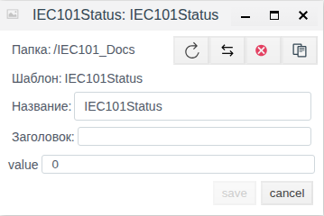
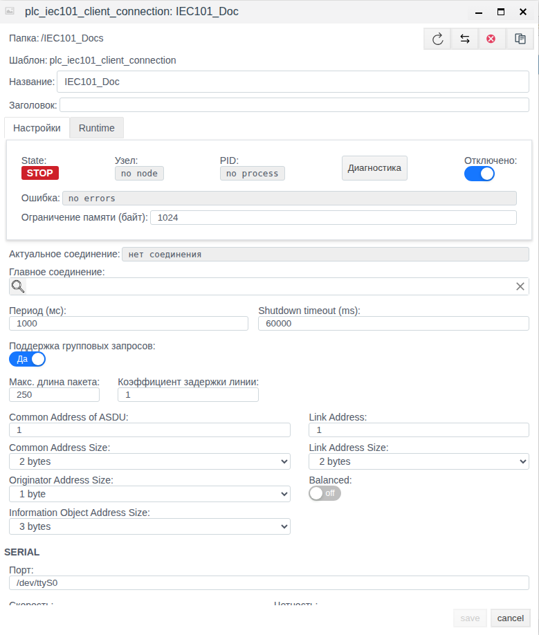
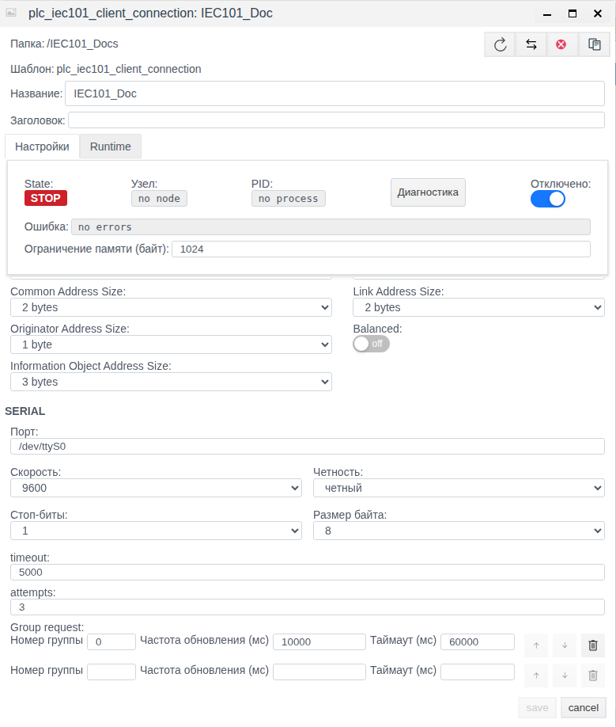
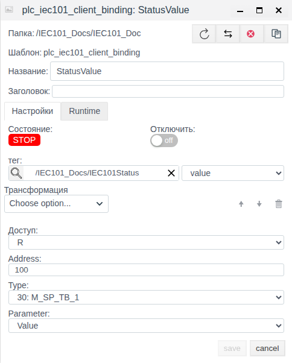

# IEC 60870-5-101 in Faceplate: configuring a client connection and bindings

Faceplate version: v4.0.7.

Configure an IEC 60870-5-101 serial channel, then link signal attributes to project fields. This guide contains one configuration example without a device: the connection remains disabled, and verification covers saving and separately reopening it. Writing, diagnostics of an operating channel, and redundancy are described as reference material. Screenshots show the Russian UI. Actual Russian labels are retained below with English explanations; these translations do not represent a verified English localization.

**Contents**

- [Configuration route](#configuration-route)
- [Align measurement, quality, time and command](#align-measurement-quality-time-and-command)
- [How the client connection works](#how-the-client-connection-works)
- [What to prepare before configuration](#what-to-prepare-before-configuration)
- [Create the connection and configure bindings](#create-the-connection-and-configure-bindings)
- [Manage the connection](#manage-the-connection)
- [Check data and the write result](#check-data-and-the-write-result)
- [Settings reference](#settings-reference)
- [Diagnostics and exchange recovery](#diagnostics-and-exchange-recovery)

[Connection catalogue](./index.md) · [Prepare fields and bindings](./bindings_en.md) · [Transformations](./transformation_en.md) · [Diagnostics and recovery](./diagnostics_en.md)

## Configuration route

Prepare an external source or client and a compatible tag field using the shared guide. Configure the channel, save a complete binding and verify a new value. For supported writing/reception, separately confirm the external result; after correcting a failure repeat verification with a new control value.

[Alternative channels and signal maps](./bindings_en.md#configure-an-alternative-channel) share one procedure; check driver-specific switching conditions.

## Align measurement, quality, time and command

Use the [shared IEC catalogue](./iec_reference_en.md). For IOA 100, Type 36: M_ME_TF_1, prepare float Measurement.value and integer Quality.value and Timestamp.value. Create separate Value, QDS and TS bindings sharing Address 100 and Type 36.

For reception set R; confirm new source measurement 21.5→22.5 in Measurement.value. For separate control, prepare integer Command.value and an RW binding: Address 101, Type 1, Parameter Value, Remote control type 45, Remote control address 200. Command 1 targets IOA 200; feedback is read at IOA 101. Check ACTCON/ACTTERM and independently inspect feedback.

Replace the illustrative map with the device's agreed IOA/TypeID. Quality is a numeric descriptor; CP24/CP56 TS have different meanings. Old cache contents and transmission time do not establish a new measurement. Save disabled configuration and independently reopen every binding before operational startup. These are configuration recipes; no new commands or external updates are claimed as tested here.

## How the client connection works

Faceplate acts as a client: it receives status signals and measurements from a remote device, requests general or group interrogation, and, when configured accordingly, transmits values and commands. This client uses a serial port on the **Faceplate execution node**. The browser does not open the port.

The IEC101 protocol defines the exchange rules. The driver implements them in Faceplate. A **PLC connection** stores the settings of one channel: port, link mode, and device addresses. A **PLC binding** inside the connection selects one information object and one of its attributes. A **tag** is a project object, and a **tag field** is the specific destination for reading or source for writing. Selecting a tag without selecting its field leaves the destination incomplete. Application tags and the signal map are not created automatically.

Distinguish three addresses: **Link Address** is the link-layer address; **COA** is the common address of the ASDU, an application data unit; **IOA** is the information object address within an ASDU. One connection has one Link Address and one COA. **TypeID** defines the ASDU format and its attributes.

The **Balanced** switch selects balanced or unbalanced transmission. Faceplate retains the client role. In unbalanced mode, the client performs class 1 and class 2 link requests; separate connections are created for multiple devices. Shared-port conditions are described in the reference section.

The read path is: serial channel → received ASDU → internal data store (cache) by IOA → attribute selected by the binding → direct transformation → field type conversion → selected tag field. The binding also exposes its own result. Each PLC cycle reads the cache: an individual R binding does not send an individual signal request to the device. Interrogation responses and spontaneous ASDUs populate the cache.

The write path is: change in the linked field → type conversion → reverse transformation → selection of the write TypeID and IOA → outgoing ASDU. R permits reading, W writing, and RW both directions. A value written into the field by the connection itself during reading should not trigger its return transmission. With W, the current value is also transmitted at startup, reconnection, and binding configuration updates: account for retransmission when using commands.

## What to prepare before configuration

Obtain the following from the device owner and node administrator:

- The serial port path on the execution node, OS access permissions, physical interface, and line settings: baud rate, parity, data bits, and stop bits.
- Balanced/unbalanced mode, Link Address, COA, and the sizes of the Link Address, COA, originator address, and IOA fields. Both address values and their representation sizes must match.
- The signal map: IOA, TypeID, attribute, units, scale, permitted values, and availability of time and quality. Confirm supported interrogation groups and spontaneous transmission.
- For control, the command TypeID and IOA, permitted control values, support for direct control, expected confirmations, and a separate feedback status signal.
- A project tag and compatible field, configuration permissions, and an eligible execution node. For numeric masks and packed words, select a field that preserves all bits; for measurements, account for fractional values and transformation.

For the example, prepare a separate **IEC101_Docs** folder and an **IEC101Status** tag with an integer **value** field, initially 0. The field must be accessible in the tag form. If the folder name is occupied, use a separate available name and substitute it consistently in all destinations.

No device is available for this example. Port `/dev/ttyS0`, COA 1, Link Address 1, and IOA 100 are illustrative settings. The port need not exist to save a disabled connection; replace these settings with actual device data before an operational connection.

## Create the connection and configure bindings

### Check the prepared tag

Open Studio and double-click **IEC101_Docs** in the project tree. Select **IEC101Status** and click **Редактировать** (Edit). Check that the **value** field exists and contains the initial 0, then close the window with **cancel** without changes.

Figure 1. The prepared tag field. The value 0 was set before configuring the client and was not received over IEC101.

### Create and reopen the connection

1. In **IEC101_Docs**, click **Создать** (Create). In the type window, open **plc**, select `plc_iec101_client_connection`, and click **Ok**.
2. Immediately turn on **Отключено** (Disabled) in the new form. Keep it on throughout the example, including before the first save.
3. Set **Название** (Name) and the parameters from the table. Finish entering a number or path by moving to another field; reread the values before saving. Leave **Главное соединение** (Master connection) empty.

| Form field | Example value |
|---|---|
| Название (Name) | IEC101_Doc |
| Отключено (Disabled) | On: the connection is disabled |
| Период (мс) (Period) / Shutdown timeout (ms) | 1000 / 60000 ms |
| Common Address of ASDU / Common Address Size | 1 / 2 bytes |
| Originator Address Size / Information Object Address Size | 1 byte / 3 bytes |
| Link Address / Link Address Size | 1 / 2 bytes |
| Balanced | off: unbalanced |
| SERIAL → Порт (Port) | /dev/ttyS0 |
| Скорость (Baud rate) / Четность (Parity) | 9600 bit/s / четный (even, code 1) |
| Стоп-биты (Stop bits) / Размер байта (Data bits) | 1 / 8 |
| timeout / attempts | 5000 ms / 3 |
| Group request → Номер группы (Group number) | 0 |
| Частота обновления (мс) (Update frequency) / Таймаут (мс) (Timeout) in the group row | 10000 / 60000 ms |
| Главное соединение (Master connection) | Empty |

In **Group request**, fill in the existing group 0 row. The empty bottom row is a placeholder; do not configure another group in this example. Number 0 represents general interrogation; do not enter 20 instead.

Leave the common fields **Поддержка групповых запросов** (Bulk request support), **Макс. длина пакета** (Maximum packet length), and **Коэффициент задержки линии** (Line latency coefficient) unchanged: the verified form shows **Да** (Yes), 250, and 1. This common switch does not control IEC101 **Group request** interrogation. Also leave **Ограничение памяти (байт)** (Memory limit, bytes) unchanged: it was empty in the new form and became 1024 after saving. Its actual units are explained in the reference section.

Click **save**. The window closes automatically and **IEC101_Doc** appears in the folder. Now separately select that saved row and click **Редактировать** (Edit). Check the table values, the enabled **Отключено** (Disabled) switch, and the group by scrolling down. In the reopened, unchanged form, **save** is unavailable. Close it with **cancel**.

Figure 2. The saved, separately reopened connection: disabling, period, and addresses. STOP, no node, and no process correspond to the disabled example.

Figure 3. The same saved configuration after scrolling: 9600/even/8/1 and one completed group 0/10000/60000.

### Create and reopen the binding within the same example

1. Double-click **IEC101_Doc** to enter the connection, then click **Создать** (Create). The `plc_iec101_client_binding` form opens directly here; the verified UI has no separate type selection at this point.
2. Set **Название** (Name), **Address**, and **Type** using the table. Explicitly select **Value** in **Parameter**. This is the displayed name of the `value` attribute.
3. Click the magnifying glass to the left of **тег** (Tag). In the selection window, open **PROJECT → IEC101_Docs**, select **IEC101Status**, and click **ОК**. Then select **value** in the separate field list to the right of the tag.
4. Check **Доступ: R** (Access), the binding's own **Отключить: off** (Disable), and the absence of a transformation. The parent connection remains disabled.

| Form field | Example value |
|---|---|
| Название (Name) | StatusValue |
| Папка (Folder) | /IEC101_Docs/IEC101_Doc |
| тег (Tag) / separate field | /IEC101_Docs/IEC101Status / value |
| Доступ (Access) / Отключить (Disable) | R / off |
| Address | 100 |
| Type | 30: M_SP_TB_1 |
| Parameter | Value — the value attribute |
| Трансформация (Transformation) | Not set: Choose option... |
| Remote control type / address | Not set; hidden with R |

Click **save**: the form closes and a single child row, **StatusValue**, appears. Separately select it and click **Редактировать** (Edit). Check the IOA, type, **Parameter**, access, and both destination elements: tag and field. Close with **cancel**.

Figure 4. The binding has been saved and separately reopened. Parameter shows Value, while the value field is selected separately to the right of the tag.

Return to **IEC101_Docs** and reopen **IEC101Status**: the destination field is accessible. In the verified example, it retained its initial 0. The result is a saved connection and one binding with the correct destination. The port was not opened; reception, writing, and actual device status were not tested. Leave **IEC101_Doc** disabled.

## Manage the connection

### Find and edit the configuration

Select the connection in the project tree and use **Редактировать** (Edit). Studio's PLC connection list provides an overview of multiple channels; double-clicking a connection opens its bindings. Change common parameters in the connection, and IOA, attribute, access, transformation, and destination in the corresponding child binding.

After editing, click **save**, wait for the window to close, and reopen the object separately. For addresses, check the value together with its size; for destinations, check the tag together with the field. Changing an operating channel's settings may rebuild its execution and subscriptions; confirm exchange again after applying changes.

### Permit or stop execution

**Отключено** (Disabled) in the connection controls its execution permission. Turning this switch off permits startup when project and node conditions are met. If the project or parent area is disabled, or no eligible execution node exists, the connection's own permission does not ensure startup. Check **State**, **Узел** (Node), **PID**, and **Ошибка** (Error) separately from the switch.

Before enabling an operational channel, check the port, signal map, and write destinations. Pay particular attention to W bindings: their current value may be retransmitted at startup, reconnection, and configuration updates. W does not require an operator to change the field before every startup.

Turning **Отключено** (Disabled) on stops the connection and initiates invalidation of linked readable fields; W fields are not overwritten by this reset. **Отключить** (Disable) in a binding excludes only that binding from reading and write subscriptions. Disabling an individual binding may leave the previous number in the destination field. Assess it together with state and evidence of new reception; account for **Default Value** substitution if configured.

## Check data and the write result

### Establish that data was actually received

Execution permission, a running process, and data reception are different results. RUN and the absence of a common error do not guarantee success for every binding. Check the required binding's error, IOA and attribute, transformation result, and **specific destination field**.

For an operational connection, correlate a new expected source event with a received ASDU containing the required COA and IOA, then with the binding result and tag field. If the process value does not change, another indication of new reception of that IOA after the action being checked is required. Reading the previous number from the cache again is not such an indication.

The configured **Type** defines the form's attribute list, quality handling, and base write type, but does not filter cached `value` by the incoming ASDU TypeID. A plausible number therefore does not prove that the selected type is correct. The cache has no data expiry setting exposed by this binding; reception time is not offered as a separate **Parameter**.

### Assess quality and time

Value, quality, and time are separate attributes. Obtaining several attributes of one IOA requires separate bindings with suitable fields. Quality is delivered as a numeric descriptor: bad flags do not automatically turn `value` into `none` or put the binding into an error state. Application logic must handle quality.

The meaning of `ts` depends on the ASDU type. For CP24, it is milliseconds within the hour; for CP56, milliseconds since the epoch after converting the node's local time to UTC. Check the node's time zone and clock. An invalid CP56 date may produce `none`. A subsequent message without time may leave an earlier `ts` in the cache; that timestamp alone does not prove freshness. Separate time flags are not exposed as binding parameters.

### Distinguish transmission from the control result

For a command, check the outgoing request, positive **ACTCON** (acceptance confirmation), and then positive **ACTTERM** (protocol completion). Next, check the expected device feedback. Even ACTTERM does not confirm physical switching without a feedback status signal.

If no separate command TypeID is set, the binding's base type is used: an information ASDU is transmitted asynchronously. Success on this path means the message was passed for transmission, rather than that a remote command was executed. In the example with R and a disabled parent, only configuration persistence and accessibility of the selected field were checked.

## Settings reference

### Common connection settings

A form's initial value may differ from the object type's default. Such cases are identified separately below. UI ranges also do not replace verification of actual line settings.

| Setting | Initial value | Purpose and permitted conditions | Verification |
|---|---|---|---|
| Название / Заголовок (Name / Title) | Empty | Name identifies the object; title is an optional description | Name and folder after reopening |
| Отключено (Disabled) | Off | Turning it on prevents execution of the entire connection | Project/node permission, State, and PID |
| Период (мс) (Period) | 1000 | 1–3600000 ms, form increment 10. Cache scan and delay before a new connection attempt | Required binding result; this is not the new-ASDU frequency |
| Shutdown timeout (ms) | 60000 | 10–3600000 ms, form increment 10. Wait for execution to finish; a nonpositive value falls back to 60000 | Termination of the worker process |
| Главное соединение (Master connection) | Not set | Link from a reserve configuration to a master connection of the same client type; circular links are prohibited | Links, applied configuration, and new exchange |
| Актуальное соединение (Actual connection) | Before connecting: нет соединения (no connection) | Automatic output: the last successfully selected configuration | Compare with the expected channel and fresh data |
| Ограничение памяти (байт) (Memory limit, bytes) | Object type: 1024; new form empty, 1024 after saving | Worker process resource. The number actually represents MiB: ×1048576 bytes, despite the label | Node resources; do not interpret it as frame size |
| Поддержка групповых запросов (Bulk request support) | Form: Да (Yes) | Common bulk-read setting; does not enable bulk reading or control IEC101 Group request in this client | Configure IEC101 groups in their own list |
| Макс. длина пакета (Maximum packet length) | Form: 250 | 1–10000, increment 1; this common bulk-read parameter does not set IEC frame length here | Do not use it to select ASDU size |
| Коэффициент задержки линии (Line latency coefficient) | Object type: 2; form: 1 | 1–10, increment 1; relates to common bulk reading and is not used here | Do not use it to adjust group periods |

If scanning the bindings takes longer than the configured period, the next scan starts without an additional pause. This field does not guarantee an exact interval for delivering new data.

A reserve configuration contains alternative connection settings and a **Главное соединение** (Master connection) link; its standalone execution is forcibly disabled. The master connection's execution tries linked configurations and uses **its own** bindings. Do not expect bindings from the reserve object to be used automatically. Configure links before operational startup and avoid recursion. After changing a reserve, recheck the applied configuration and new exchange: changing an active reserve path while running has not been verified. Switching was not performed in the example.

### Serial port and IEC101 addressing

| Setting | Initial value | Range and meaning | Selection and verification |
|---|---|---|---|
| SERIAL → Порт (Port) | Form: /dev/tty0; required path | Nonempty OS port name on the execution node | Actual port, permissions, and physical interface; the initial string does not indicate a detected device |
| Скорость (Baud rate) | 9600 bit/s | Selection from the form's list | Match the line and hardware capabilities |
| Четность (Parity) | нет (none), code 0 | нет / четный / нечетный (none / even / odd): codes 0 / 1 / 2 | Match the device |
| Стоп-биты (Stop bits) | 1 | 1–2 | Match the line |
| Размер байта (Data bits) | 8 | 5–8 data bits | Match the line |
| Balanced | off | off — unbalanced; on — balanced | Peer mode; the role remains client |
| Common Address of ASDU | 1 | 1–65535, subject to COA size | Incoming COA must match exactly |
| Common Address Size | 2 bytes | 1–2 bytes | Address capacity and source format |
| Originator Address Size | 1 byte | 0–1 bytes | Originator address field size; its value is fixed at 0 |
| Information Object Address Size | 3 bytes | 1–3 bytes | Must accommodate both read and write IOAs |
| Link Address | 1 | UI: 1–65535, subject to size | Link address of the specific device |
| Link Address Size | 2 bytes | None — 0 bytes; 1 or 2 bytes | Link-layer format; None does not mean automatic detection |
| timeout | 5000 ms | UI: 1–6000 ms; wait for a link response | Based on line timing; not the group or command timeout |
| attempts | 3 | UI: 1–500; link request attempts, including the first | Account for link recovery being repeated after attempts are exhausted |

The verified form offers these baud rates: 300, 600, 1200, 2400, 4800, 9600, 19200, 38400, 57600, 115200, 230400, 460800, 500000, and 576000 bit/s. A list entry does not establish adapter or device support.

The address must fit the selected size: one byte allows up to 255, two up to 65535, and three up to 16777215. Saving does not guarantee joint validation of address and size. Pay particular attention to IOA: the form's upper boundary of 16777216 is one greater than a representable three-byte address.

Opening the port has its own 3000 ms wait. **attempts** does not define an overall limit on all transmissions during a recovery episode: after link attempts are exhausted, the link may be established again. A new overall connection attempt also depends on the PLC period.

For multiple unbalanced devices on one physical port, create separate connections with the appropriate Link Address and COA for each device. Access to the shared port is serialized. The first connection to open it determines the port settings and link address size; the others must use compatible settings. The same port name does not create independent physical lines. This arrangement was not tested in the example.

### Interrogation groups and independent timings

| Setting or mode | Initial value | Range and behavior | Verification |
|---|---|---|---|
| Group request | Object type: empty list; new form offers group 0 | Request list; the source determines which IOAs belong to each group | Saved rows after reopening |
| Номер группы (Group number) | New general-interrogation row: 0 | 0–16. 0 → QOI20, 1–16 → QOI21–36 | Source support for the selected group |
| Частота обновления (мс) (Update frequency) | Not set | When set: 500–604800000 ms; omitted — one interrogation after connection | Repeated request after the previous one finishes and the period elapses |
| Таймаут (мс) (Timeout) | Empty field; 60000 ms is used when omitted | UI: 50–120000 ms; group data reception phase | Complete source response and its termination |
| Interrogation confirmation | Separate 10000 ms wait | Not the serial line timeout field | Interrogation activation confirmation |
| Genuinely empty list | No interrogation requests | Spontaneous reception and unbalanced link polling continue | Do not expect an initial data snapshot from GI |
| Row order | Initial queue order | Does not define guaranteed priority or exact frequency | Compare actual requests and responses |

Interrogation is transmitted as Type100 `C_IC_NA_1`, activation, IOA 0. For general interrogation, the form requires number **0**, corresponding to protocol QOI20. The update period starts after the previous interrogation finishes, so the actual interval includes its duration. Failure of one interrogation does not necessarily stop the entire connection.

Distinguish the PLC cache-read period, internal unbalanced link polling with an initial period of 1000 ms, and the **Group request** period. Changing one does not replace the others. Connection shutdown, link response, group, and command confirmation timeouts are also independent.

When no period is needed, leave the optional row field unset. After changing or deleting groups, always verify the resulting list by reopening: an empty placeholder is not a second configured group, and a new form itself offers group 0. Only one explicitly completed row was checked in the example.

### PLC binding fields

| Field | Initial value | Purpose and conditions | Verification |
|---|---|---|---|
| Название / folder (Name / folder) | Empty name; selected connection's folder | The binding must be directly inside its connection | Path after saving |
| тег / separate field (Tag / separate field) | Not set | Read destination pair or write source; without the pair, the result may remain only in the binding | Actual tag, field, and field type |
| Отключить (Disable) | off | Excludes only this binding from execution and subscriptions | State; the previous field value may remain |
| Доступ (Access) | R | R — read; W — write without reading; RW — read and write changes | For W, account for transmission of the current value at startup and reconnection |
| Address | Object type: 1; new form empty | UI: 0–16777216; actually no higher than 16777215 with 3 bytes | IOA map and connection address size |
| Type | Object type: 1; no type selected in the new form | 1–21 and 30–38 | Source format and attributes; not a filter for incoming value |
| Parameter | No initial value | Required attribute selection; Value corresponds to value | Attribute availability in the received IOA |
| Трансформация (Transformation) | Not set | Operation chain; W/RW requires a reverse operation | Units, range, field type, and reversibility |
| Remote control type | Not set | 45–51 or 58–64; omitted — use base Type | Command type and device support |
| Remote control address | Not set | UI: 0–16777216; omitted — use Address | Actual representability of the write IOA |

**Remote control type/address** fields are available with W or RW **and** `Parameter=value`. Selecting another attribute clears both fields. Write type and address fall back independently: either can be overridden on its own. A command type with another attribute causes `invalid_remote_type_parameter`, an incompatible control type and attribute configuration.

Writing requires a numeric result after conversion and reverse transformation. A linked boolean field is converted to 1/0, and a numeric string is parsed as a number; nonnumeric text does not provide a valid value. A boolean set directly on an unlinked binding should not be treated as the same numeric command. The driver does not transmit a nonnumeric result.

### ASDU types and available attributes

The attribute column contains exact attribute names. Each is selected by a separate binding. In the form, `value` appears as **Value**, and `ts` remains one attribute regardless of its CP24/CP56 format.

| TypeID and ASDU name | value representation | Available attributes | ts time |
|---|---|---|---|
| 1: M_SP_NA_1 | Single-point state 0/1 | value, qds, siq | None |
| 2: M_SP_TA_1 | Single-point state 0/1 | value, qds, siq, ts | CP24 |
| 3: M_DP_NA_1 | Double-point state 0–3 | value, qds, diq | None |
| 4: M_DP_TA_1 | Double-point state 0–3 | value, qds, diq, ts | CP24 |
| 5: M_ST_NA_1 | Step position, −64…63 | value, vti, qds | None |
| 6: M_ST_TA_1 | Step position, −64…63 | value, vti, qds, ts | CP24 |
| 7: M_BO_NA_1 | unsigned32 bitstring | value, qds | None |
| 8: M_BO_TA_1 | unsigned32 bitstring | value, qds, ts | CP24 |
| 9: M_ME_NA_1 | Normalized [−1,1] | value, qds | None |
| 10: M_ME_TA_1 | Normalized [−1,1] | value, qds, ts | CP24 |
| 11: M_ME_NB_1 | Scaled signed16 | value, qds | None |
| 12: M_ME_TB_1 | Scaled signed16 | value, qds, ts | CP24 |
| 13: M_ME_NC_1 | float32 number | value, qds | None |
| 14: M_ME_TC_1 | float32 number | value, qds, ts | CP24 |
| 15: M_IT_NA_1 | signed32 counter | value, bcr | None |
| 16: M_IT_TA_1 | signed32 counter | value, bcr, ts | CP24 |
| 17: M_EP_TA_1 | Protection event, state 0–3 | value, sep, duration, ts | CP24 |
| 18: M_EP_TB_1 | Packed protection events | value, qdp, duration, ts | CP24 |
| 19: M_EP_TC_1 | Packed protection output events | value, qdp, duration, ts | CP24 |
| 20: M_PS_NA_1 | Packed SCD unsigned32 word | value, qds | None |
| 21: M_ME_ND_1 | Normalized [−1,1] | value | None |
| 30: M_SP_TB_1 | Single-point state 0/1 | value, qds, siq, ts | CP56 |
| 31: M_DP_TB_1 | Double-point state 0–3 | value, qds, diq, ts | CP56 |
| 32: M_ST_TB_1 | Step position, −64…63 | value, vti, qds, ts | CP56 |
| 33: M_BO_TB_1 | unsigned32 bitstring | value, qds, ts | CP56 |
| 34: M_ME_TD_1 | Normalized [−1,1] | value, qds, ts | CP56 |
| 35: M_ME_TE_1 | Scaled signed16 | value, qds, ts | CP56 |
| 36: M_ME_TF_1 | float32 number | value, qds, ts | CP56 |
| 37: M_IT_TB_1 | signed32 counter | value, bcr, ts | CP56 |
| 38: M_EP_TD_1 | Protection event, state 0–3 | value, sep, interval, ts | CP56 |

Normalized measurements have already been converted to [−1,1]; do not apply a second conversion from signed16 without checking. Scaled signed16 represents −32768…32767. Bitstrings and the SCD word are delivered as one number, 0…4294967295; individual bits and change indicators are not expanded automatically.

`siq`, `diq`, `vti`, `sep`, and `qdp` are raw bytes, 0…255. SIQ/DIQ include state, VTI is the full step-position element, SEP the full protection-event element, and QDP protection quality. `qds` contains numeric quality bits: a mask of 254 is used for single-point state and 252 for double-point state, without shifting flags to 0/1. Read quality separately from state.

`bcr` contains all five bytes as an unsigned 40-bit number, including the descriptor byte. The counter reading is exposed separately in `value` as signed32; BCR does not replace it. `duration` and `interval` are raw 16-bit CP16Time2A fields, 0…65535, without conversion; for Type38, select `interval`. They are not the `ts` timestamp. Boolean fields lose information for masks, full BCRs, and packed words; use a suitable numeric field.

CP24 `ts` is calculated as milliseconds plus minutes ×60000; it is not unconditionally a Unix timestamp. CP56 `ts` represents milliseconds since the epoch, accounting for the node's local time zone. Type70 and the `coi` attribute are not available in the standard form for this client binding.

### Control commands

Select the type in **Remote control type**, the `value` attribute, and W or RW access. To read feedback and transmit to another address, set the base **Address** and a separate **Remote control address**. W also supports commands; RW is not required for control.

| TypeID without time / with time | ASDU names | Purpose | Value representation |
|---|---|---|---|
| 45 / 58 | C_SC_NA_1 / C_SC_TA_1 | Single command | 1 bit, 0…1 |
| 46 / 59 | C_DC_NA_1 / C_DC_TA_1 | Double command | 2 bits, 0…3 |
| 47 / 60 | C_RC_NA_1 / C_RC_TA_1 | Regulating step | 2 bits, 0…3 |
| 48 / 61 | C_SE_NA_1 / C_SE_TA_1 | Normalized setpoint | [−1,1], encoded as signed16 |
| 49 / 62 | C_SE_NB_1 / C_SE_TB_1 | Scaled setpoint | signed16, −32768…32767 |
| 50 / 63 | C_SE_NC_1 / C_SE_TC_1 | Floating-point setpoint | float32 |
| 51 / 64 | C_BO_NA_1 / C_BO_TA_1 | Bitstring | unsigned32, 0…4294967295 |

The table boundaries describe representation, rather than guaranteed input validation. The device defines permitted control states and setpoint ranges. Integer commands are encoded with rounding; this path has no separate range or float finiteness check. Ensure the correct numeric result before transmission.

**Direct activation** is used. There is no select-before-execute option or arbitrary qualifier fields; qualifiers use the initial value 0. For timed commands, the timestamp is generated from the node's current time during encoding, with no separate input field. If the device requires selection before execution or another qualifier, this form does not establish compatible control support.

Positive ACTCON and ACTTERM are expected. `reject` means acceptance was refused, `not_executed` means negative completion, and `confirm_timeout` and `execute_timeout` mean the corresponding confirmation was not received. The confirmation and completion phases use separate 10000 ms timers; the actual write call may stop waiting sooner. The serial line **timeout** field is not an overall command timeout.

Without a separate command type, an information ASDU of the base type is sent with the spontaneous cause. This asynchronous path must be agreed with the device separately; control confirmations must not be attributed to it.

### Transformations

Direct transformation runs from source to field in list order. For W/RW, operations run in reverse, from field to source, in reverse list order; every operation must support that direction. Destination field type conversion is also taken into account.

| Operation | Initial settings | Source → field | Field → source |
|---|---|---|---|
| Scaling | factor=1, shift=0 | x×factor+shift; nonnumeric input produces none | (x−shift)/factor; factor must differ from 0 |
| Default Value | value=0 | Numbers are retained; missing or nonnumeric input is replaced with the specified value | Unchanged |
| Limit Control | lower=0, upper=0 | Outside the inclusive range — none | Clamp to the nearest boundary |
| Damper | tlag=1 ms; form minimum 1 | Smoothing; the first numeric sample passes through | Unchanged |
| Derivative | No parameters | Δvalue/Δtime; first sample — none | Not supported for W/RW |
| Integration | No parameters | Previous value + Δtime×current input; first sample — none | Not supported for W/RW |
| Script | Editor template | User transformation with state | Not supported for W/RW |

**Limit Control** requires upper>lower: the initial 0/0 pair is not a complete configuration. **Damper** uses a positive tlag in milliseconds. Derivative units are value/ms, and integration units are value×ms; timing is based on sample processing, rather than source `ts`. An unsupported reverse operation prevents preparation of the W/RW transformation.

**Default Value** may turn missing data into an ordinary number. Check reception and quality separately from the substituted result. For measurements, compare units before and after transformation; for writing, check the reverse chain result and the device's permitted range.

### States and evidence of a result

| Observation | Meaning | Additional checks |
|---|---|---|
| Отключено / Отключить (Disabled / Disable), Runtime ВКЛ/ВЫКЛ (ON/OFF) | Own execution permission | Project, parent, and node permission |
| STOP, no node, no process | Execution is not currently running | Expected for the disabled example; investigate startup for an operational channel |
| RUN, Узел (Node), and PID | A process is running | Channel readiness and reception of the required IOA |
| no errors or overall connection success | No common error is registered | Individual binding errors; the collection may be empty |
| Successful binding / OK | Cache selection or the write path succeeded | New reception, quality, and actual write confirmation |
| A number in the binding and tag field | Routing and transformation result | It may be initial, old, cached, or substituted |
| Quality and ts | Separate attributes of the received object | Quality flags, time format, and a possibly old timestamp |
| New ASDU for the required COA/IOA | New reception after the event being checked | Required attribute and destination field after transformation |
| Positive ACTCON | Protocol acceptance of the command | ACTTERM and device feedback status |
| Positive ACTTERM | Protocol completion of the command | Physical result through feedback |
| save and separate reopening | Configuration is persisted | Does not establish port availability, exchange, or data |

## Diagnostics and exchange recovery

### Collect information

A saved connection has a **Диагностика** (Diagnostics) button, including while STOP. Execution startup is not a prerequisite for this button to appear. Meaningful logs depend on events from the operating channel; collection was not performed in the disabled example.

Open diagnostics and select **info**, **warning**, **error**, or **debug**; the initial level is info and the limit is 1000 entries. **Start** starts log collection and **Stop** ends it. These buttons do not enable or disable the connection itself. **Logs** refreshes approximately once per second. Retain relevant messages together with their time, connection path, binding, and binding settings; for large volumes, limit the collection interval to the event of interest.

**Processes** shows senders of captured log events, rather than a complete tree of running processes. An empty list or empty Logs proves neither a healthy channel nor the absence of a process. A complete protocol frame is not guaranteed to appear in this window; conclusions about new reception must rely on available evidence of the required ASDU or source event.

### Find the cause by symptom

This table describes operational checks with a real source. Faults and recovery were not reproduced in the single example.

| Symptom | What to check | Action | Evidence of a result |
|---|---|---|---|
| Connection remains STOP | Отключено (Disabled), project/parent Runtime, eligible node, dependency errors | Resolve the specific execution prohibition or missing-node cause | Node/PID appears; then confirm exchange |
| Port fails to open | Path on the execution node, port existence, OS permissions, serial access component | Correct the path/access and installation settings | Port opens, followed by new protocol exchange |
| Link timeout | Baud rate, parity, bits, balanced, Link Address and size, line and device | Match both sides' settings and physical connection | New successful link exchange and the required ASDU |
| ASDU is rejected or data cannot be decoded | COA, COA/ORG/IOA sizes, message structure | Match the source map's format; COA must match exactly | Newly decoded ASDU with the required COA/IOA |
| address_not_available | IOA availability in received data, groups, and spontaneous transmission | Correct the IOA or ensure its transmission by the source | New reception of that IOA and a result in the required field |
| invalid_parameter | Whether the received IOA has the selected attribute; correct Type and Parameter | Select an available attribute and check the map | Required attribute received without this error |
| Incorrect value or wrong destination | Tag/field pair, field type, scale, transformation order and boundaries | Correct the destination or chain; check direct and reverse directions | Expected result in the correct destination field |
| A number or RUN despite bad quality | Separate quality descriptor, Default Value substitution, ts meaning | Handle quality flags in the project and resolve the source cause | Current value and quality agree; an old number is not accepted as trustworthy |
| Write is not sent or command does not complete | W/RW, numeric result, reverse operation, TypeID/IOA, reject/not_executed and timeouts | Correct the settings and refusal cause; agree on direct control | New request, ACTCON/ACTTERM for a command, and expected feedback |
| An old number remains after stopping or reconnecting | Binding state, cache without expiry, Default Value, and possibly old ts | After recovery, trigger an agreed new source event and trace the required IOA | New reception after the action and the correct field; disappearance of the error is insufficient |

### Confirm recovery

After correcting the cause, record a new expected source value or event. Confirm reception of an ASDU for the required IOA **after** the correction, then the corresponding binding result and correct tag field after transformation. Correlate quality and time meaning. If the process value remains unchanged, confirm new reception with another observable indication of that IOA; another cache selection does not replace it.

For control, also trace command confirmations and equipment feedback status. RUN, a cleared error, a populated Actual connection, or the previous number alone does not confirm exchange recovery.
