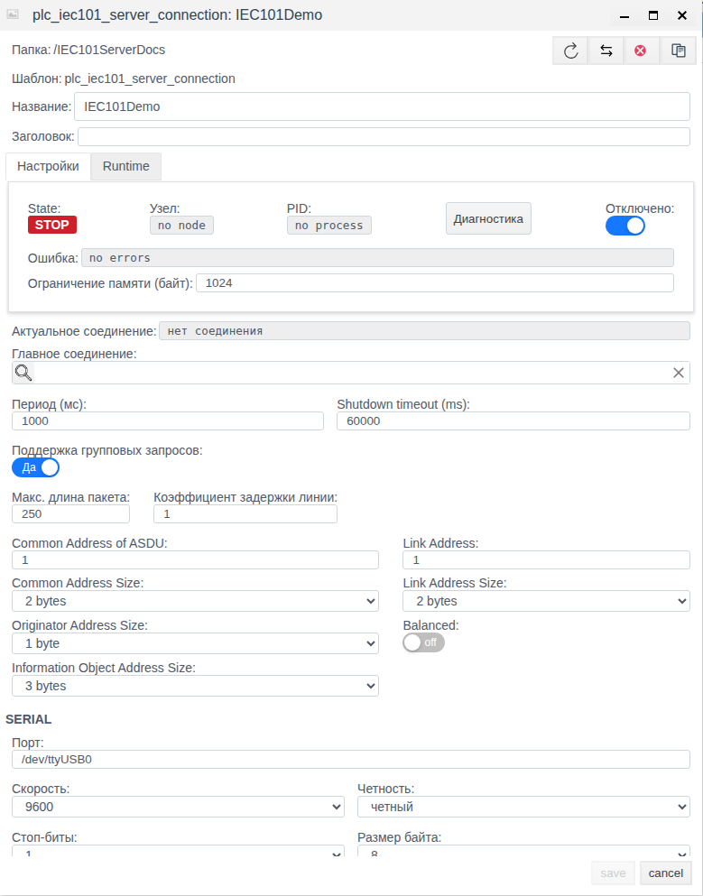
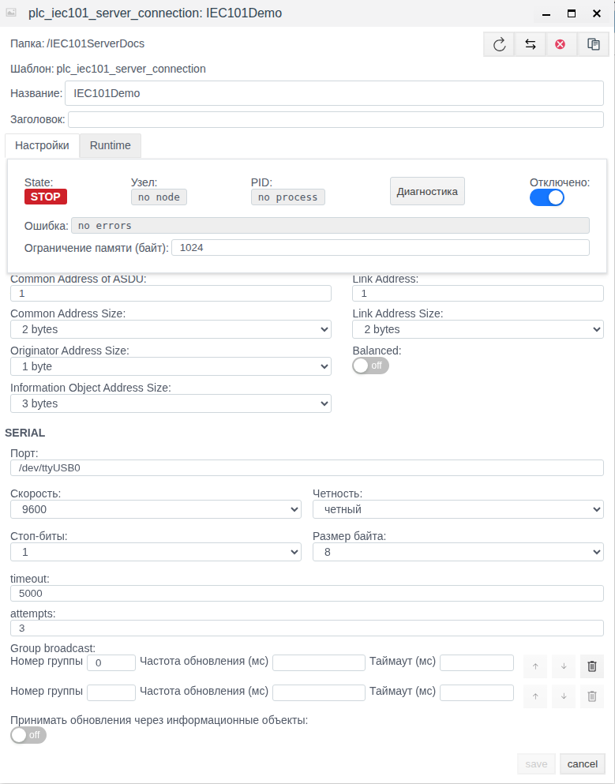
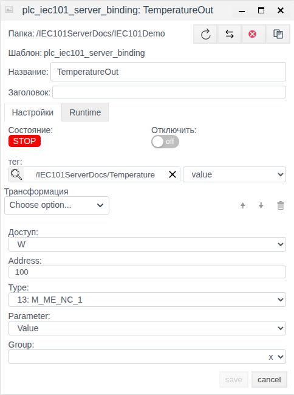

# Configuring an IEC 60870-5-101 server in Faceplate

Faceplate v4.0.7. A guide for integrators configuring a serial server connection and its data map for an external master. The single training example verifies creation, saving and independent reopening of the configuration. The server remains disabled; no client, line or protocol exchange was tested.

The screenshots show the Russian interface. Actual Russian labels are retained with English explanations where needed; the English explanations are not verified labels of an English localization.

**Contents**

- [Configuration route](#configuration-route)
- [Align measurement, quality, time and command](#align-measurement-quality-time-and-command)
- [Purpose and data flow](#purpose-and-data-flow)
- [Preparation](#preparation)
- [Connection setup](#connection-setup)
- [Publishing data and receiving commands](#publishing-data-and-receiving-commands)
- [Additional exchange settings](#additional-exchange-settings)
- [Managing the connection and restoring exchange](#managing-the-connection-and-restoring-exchange)
- [Diagnostics](#diagnostics)
- [Parameter reference](#parameter-reference)

[Connection catalogue](./index.md) · [Prepare fields and bindings](./bindings_en.md) · [Transformations](./transformation_en.md) · [Diagnostics and recovery](./diagnostics_en.md)

## Configuration route

Prepare an external source or client and a compatible tag field using the shared guide. Configure the channel, save a complete binding and verify a new value. For supported writing/reception, separately confirm the external result; after correcting a failure repeat verification with a new control value.

[Alternative channels and signal maps](./bindings_en.md#configure-an-alternative-channel) share one procedure; check driver-specific switching conditions.

## Align measurement, quality, time and command

Use the [shared IEC catalogue](./iec_reference_en.md). For IOA 100, Type 36: M_ME_TF_1, prepare float Measurement.value and integer Quality.value and Timestamp.value. Create separate Value, QDS and TS bindings sharing Address 100 and Type 36.

For publication, set W and the same Group on the object's attributes. Change Measurement.value 21.5→22.5 and confirm new 22.5 at the external master/client. For an incoming command, create an R binding with Address 101, Type 1, Parameter Value, Remote control type 45 and Remote control address 200, linked to separate Command.value. Client numeric write 1 to IOA 200 should update the server model and then the field; ACTCON/ACTTERM do not confirm a physical action.

Replace the illustrative map with the device's agreed IOA/TypeID. Quality is a numeric descriptor; CP24/CP56 TS have different meanings. Old cache contents and transmission time do not establish a new measurement. Save disabled configuration and independently reopen every binding before operational startup. These are configuration recipes; no new commands or external updates are claimed as tested here.

## Purpose and data flow

The IEC 60870-5-101 server provides Faceplate data to an external master and accepts its commands. Faceplate acts as the controlled station. This connection type uses a serial port on the Faceplate node and supports balanced and unbalanced link operation.

The protocol defines communication rules and message formats. The driver implements them in Faceplate. A PLC connection specifies a particular port, addressing and execution settings. A child binding maps a parameter of an information object to a selected tag field. A tag is a project object whose data is used by displays, archives, calculations and other project functions.

ASDU (Application Service Data Unit) is an application-layer data unit in IEC 60870-5-101. These units carry measurements, states, commands and other protocol data.

Distinguish three addresses: **Link Address** belongs to the link layer, **Common Address of ASDU (CA)** identifies the station in the ASDU, and the binding's **Address (IOA)** identifies an individual information object. **Remote control address** is the address of an incoming command; it can differ from the local IOA holding its result.

**Доступ** (Access) is defined from Faceplate's perspective:

- **W**: tag field → inverse transformation → local server data → transmission to the master. Use it to publish measurements and states. W bindings are not selected for incoming commands.
- **R**: local server data → forward transformation → selected tag field. It can receive the result of an accepted command or an enabled information-object update.
- **RW**: both directions; the field can receive server data and publish its own changes to the server.

Saving a binding does not mean that the master has received data. The connection provides the channel, the binding specifies the information object and field, and actual delivery is verified at the receiving side.

## Preparation

For the training example, open Studio at `http://127.0.0.1:9000/fp/studio` and sign in with permission to create and edit objects in the training folder.

For a working connection, obtain the following from the line administrator and external master:

- the port name on the Faceplate node and permission to access it;
- baud rate, parity, stop bits and data bits;
- Balanced mode, link address and link address size;
- CA and the sizes of the CA, originator address and IOA fields;
- the map of IOAs, ASDU types, parameters, groups, signal units and ranges;
- for commands, the command TypeIDs/IOAs, values and corresponding project fields;
- quality and timestamp sources when they must be supplied explicitly.

The port belongs to the node executing the connection. A path on the browser computer does not identify an available server port. All line and ASDU format settings must match the master.

The training example has a prepared **IEC101ServerDocs** folder and a **Temperature** tag with a float **value** field equal to **23.5**. The **IEC101Demo** connection and its **TemperatureOut** binding are created below. In your project, use a separate training folder and a suitable numeric field.

`/dev/ttyUSB0` is a configuration string saved in the example. The example does not assume that this device exists. The number 23.5 is prepared in advance and is not the result of protocol exchange.

## Connection setup

### Create the training server

1. Open the prepared **IEC101ServerDocs** folder in the general project view.
2. Click **Создать** (Create), expand **plc**, select **plc_iec101_server_connection**, and click **Ok**.
3. Enter **IEC101Demo** in **Название** (Name). Immediately enable **Отключено** (Disabled). You can leave **Заголовок** (Title) empty.
4. Set **Common Address of ASDU = 1**, **Common Address Size = 2 bytes**, **Originator Address Size = 1 byte**, and **Information Object Address Size = 3 bytes**.
5. Check **Link Address = 1**, **Link Address Size = 2 bytes**, and **Balanced = off**.
6. In **SERIAL**, select the previous text in **Порт** (Port), type `/dev/ttyUSB0`, and press **Tab**. Confirm that the field retains the entered string.
7. Select **Скорость = 9600** (baud rate), **Четность = четный** (even parity), **Стоп-биты = 1** (stop bits), and **Размер байта = 8** (data bits).
8. Check **timeout = 5000** and **attempts = 3**.
9. Leave **Период (мс) = 1000** (cycle period) and **Shutdown timeout (ms) = 60000**. Do not select **Главное соединение** (Main connection).
10. Under **Group broadcast**, leave the initial group **0** row with empty **Частота обновления (мс)** (Update frequency) and **Таймаут (мс)** (Timeout). The next empty row is an input area. Leave **Принимать обновления через информационные объекты** (Accept information-object updates) **off**.
11. Leave the common group-request and memory settings unchanged. Click **save**.
12. After the form closes, select **IEC101Demo** and click **Редактировать** (Edit). Check the saved fields, especially **Порт** and **Четность**, and that **Отключено** remains enabled.
13. Close the form with **cancel**.

**timeout** is measured in milliseconds and controls confirmation waits in balanced mode; **attempts** is the number of attempts for those procedures. In the selected unbalanced mode, these settings do not control waiting for master requests. **Shutdown timeout (ms)** controls the wait for the connection process to finish.

This form has no separate Originator Address value field; **Originator Address Size** specifies only its size. The training example did not change the originator address value through the UI.

The saved example shows **STOP**, **no node**, **no process**, **нет соединения** (no connection), and **no errors**. These are expected for a disabled configuration. The group 0 row without a period does not demonstrate periodic broadcasting.

## Publishing data and receiving commands

### Configure the published measurement in the same example

1. In **IEC101ServerDocs**, double-click **IEC101Demo**.
2. Click **Создать**. Inside the connection, the **plc_iec101_server_binding** form opens directly.
3. Enter **TemperatureOut** in **Название**.
4. Click the search button next to **тег** (Tag). Expand **IEC101ServerDocs**, select **Temperature**, and click **ОК**.
5. Select **value** in the adjacent field dropdown. The form displays the tag path as **/IEC101ServerDocs/Temperature**.
6. Select **Доступ = W** and enter **Address = 100**. Press **Tab** after entering it.
7. Select **Type = 13: M_ME_NC_1**, then **Parameter = Value**.
8. Leave **Трансформация** (Transformation) and **Group** empty. Leave the binding's **Отключить** (Disable) off; the parent connection remains disabled.
9. Click **save**. After the form closes, select **TemperatureOut**, click **Редактировать**, and check the saved tag, field, W, address, type and parameter.
10. Confirm that no transformation or group is assigned. Close the form with **cancel**.

The binding describes the future flow **Temperature.value → Value of information object IOA 100**. **STOP** here is associated with the disabled connection. Enabling the binding itself does not start the parent server. The example produces a saved configuration, not receipt of 23.5 by an external master.

### Incoming command settings

Use R or RW for an incoming command. Select the command TypeID in **Remote control type** and the command IOA expected from the master in **Remote control address**. Local **Address** and **Type** still describe the server's information object; the linked tag field receives its selected **Parameter**.

When the command address and type match, the server copies the value and available timestamp into local data. The tag field is updated in a subsequent read cycle. The form hides Remote control fields for W. RW is not required for accepting a command: R is supported too.

A command ASDU must contain one information object. There is no separate Select/Execute stage: the Select flag and additional qualifiers do not hold the update until Execute. Positive ACTCON/ACTTERM responses mean that the command has been processed into server data; they do not confirm physical action or wait for the tag to update. Account for this when designing the command map. Incoming commands are not tested in the training example.

### Transformations and field compatibility

An empty **Трансформация** passes the value without conversion. R applies the forward transformation, W the inverse, and RW both. The chain runs in forward order for reading and reverse order for writing. For scaling, the forward direction is `input × factor + shift`, and the inverse is `(input − shift) / factor`; the factor must be nonzero for writing.

Scripts, differentiation and integration have no inverse transformation and are unsuitable for W/RW. A default-value substitution can hide missing data. A range limiter rejects out-of-range input when reading, but clamps values to the boundaries in the inverse direction; the damper's inverse leaves the number unchanged.

Choose a field suitable for the signal type. Bool is transmitted as 0/1; reading a floating-point number into an integer field rounds it, while reading into bool uses a 0.5 threshold. A field's presence in the selector does not prove suitability. Without a selected tag and field, the binding's own value is used, and the result is not automatically linked to the intended project field.

## Additional exchange settings

### Groups and periodic broadcasting

A binding's **Group** assigns the information object to group **1…16**. General interrogation retrieves all objects; group interrogation retrieves the corresponding group. An object without Group remains available to general interrogation. If several bindings provide different parameters of the same IOA, align their Type and Group: they describe one object, and a later update can change its metadata.

**Group broadcast** schedules repeated queuing of the current server data for transmission. **Номер группы = 0** (Group number) selects all objects; **1…16** selects the specified group. **Частота обновления (мс)** sets the period; without it, periodic broadcasting does not start. The first run is scheduled immediately. Arrows change row order and the trash button removes a row; row order is not a polling priority.

The group's **Таймаут (мс)** is not used by the server scheduler. Broadcasting repeats existing data and does not obtain a new measurement from a remote device. In unbalanced mode, the master must service class 1/2 requests; a schedule does not mean the server transmits frames without those requests. Interrogation works independently of the schedule.

The common **Поддержка групповых запросов** (Support for group requests), **Макс. длина пакета** (Maximum packet length), and **Коэффициент задержки линии** (Line delay ratio) do not control IEC101 groups or packet assembly for this connection type. The example leaves them at their initial settings.

### Quality and measurement time

To transmit quality or time explicitly, map the corresponding Parameter to its source with the same Address and Type as the value. Tag state and error are not automatically converted into quality. If a quality attribute is not supplied, 0 is generally transmitted; this is not evidence of verified source validity. Do not link a quality or time attribute to an unsuitable empty field.

**QDS**, **SIQ**, **DIQ**, **VTI**, **BCR**, **SEP**, and **QDP** are numeric attribute representations, not additional configuration field names. Select a suitable integer source for them:

- QDS is a byte, 0…255. For Single Point, the low state bit is separated with mask 0xFE; for Double Point, the two low bits are separated with mask 0xFC.
- SIQ and DIQ are read as full bytes, 0…255; when transmitted, state bits come from the separate Value. Writing quality does not change an existing Value.
- VTI is read as a full byte, 0…255; transmission uses its high bit, while the position comes from Value. The position uses a signed 7-bit representation, −64…63; for type 32, agree transmission of boundary values separately with the master.
- BCR is read as a 40-bit number, 0…1099511627775; transmission uses BCR's low attribute byte, while the counter is supplied separately through Value as signed32: −2147483648…2147483647.
- SEP is read as a byte, 0…255; its two low state bits come from Value 0…3 during transmission. QDP is a byte, 0…255.
- Duration and Interval are transmitted as 16-bit integers, 0…65535, without conversion. Check the physical unit against the agreed data map; automatic scaling is not applied.

These are representation ranges, not a guarantee of automatic validation or clamping. Parameters other than Value are converted to integers by discarding the fractional part. Publishing quality alone before a value is available can create an object with value 0.

**TS** depends on the selected type. Types **2, 4, 6, 8, 10, 12, 14, 16, 17, 18, 19** use CP24: its numeric value corresponds to `milliseconds + minutes × 60000`, without a date or hour. Do not supply POSIX milliseconds here as a calendar date; without a suitable integer timestamp, 0 is used.

Types **30…38** and commands **58…64** use CP56. TS is expressed in POSIX milliseconds; the calendar part of the message is converted using the OS timezone of the Faceplate node. A nonexistent or ambiguous local time can produce an empty result when read. Time status flags are not preserved as separate tag fields. Without an explicit integer TS, transmission uses the current system time, so selecting a timestamped Type alone does not provide the original measurement time.

### Information-object updates and a shared port

**Принимать обновления через информационные объекты** is off by default. When enabled, incoming informational ASDUs update local data by their IOA. An R/RW binding with that **Address** can then pass the selected parameter to a tag. Remote control type/address are not used on this path.

Reception covers the informational types in the reference and type 70; type 70 itself cannot be selected in a binding's Type. An exact match between the incoming Type and binding Type is not checked. Matching types merge parameters; a compatible update without time may preserve the timestamped type. A different type can replace the object, including its previous parameters and group. A received update may also enter the outgoing queue. Agree the incoming data map to prevent unexpected replacement of published objects.

Multiple unbalanced connections can share a serial port with different Link Addresses. The first connection to open it determines the physical port settings; the others must use consistent settings. Reusing an address can replace the previous line mapping. A normal single-server setup does not require additional connections on that port.

The server does not perform clock synchronization. Counter interrogation receives a negative confirmation; this differs from transmitting a counter value using a supported information type.

## Managing the connection and restoring exchange

To change a connection, select it and click **Редактировать**. After **save**, reopen the form and check the saved values. Changing execution settings of a running connection can restart it; compare port and addressing settings with the master before enabling it.

**Отключено** controls execution of the whole connection. For a working deployment, clear this flag and save after preparing a valid line. To stop the connection, enable it and save. Assess execution permission, State/PID, and actual data separately. The flag remains enabled in the training example.

The binding's **Отключить** stops its normal reads and field subscription, but does not remove an already published IOA from local server data. An incoming command can still match such a binding and update local data, although transfer to the tag is disabled. A deleted or disabled signal can remain available to the master until the connection restarts; check the current map after an agreed restart.

On activation, W publishes the current source value into server data. Initial publication is not guaranteed for RW. Before the first command, R/RW may show an empty value followed by 0, or the binding's previous value. Reusing an already transformed number to initialize data can apply the transformation again. On a communication error, R/RW receives the forward transformation of missing data; W does not change its source field for that reason. An old number can also remain visible in the binding.

Changes made while disconnected do not form a guaranteed queue. Do not treat an empty value as a command to clear a published object. After recovery, verify a new, distinguishable result: a new source value must appear at the master, and a new command must appear in the intended tag field. RUN, a new PID, an old number, and a cleared error do not replace that check. This is a criterion for a working deployment; recovery was not performed in the training example.

**Главное соединение** refers to Faceplate configuration redundancy, not the external IEC101 master. A redundant configuration selects a main connection of the same type; chained links are not allowed, and the redundant configuration's own execution is disabled automatically. The main connection uses its settings as an alternative on a connection failure, retaining its own bindings. Lack of unbalanced-master requests does not by itself guarantee a switch to the alternative.

## Diagnostics

Start with three questions: is execution allowed, is a process running, and is new data confirmed? In this example, **Отключено** is enabled, **State = STOP**, **PID = no process**, and **Актуальное соединение = нет соединения**. **no errors** means no error is currently displayed; it does not establish that the line is open.

**Диагностика** (Diagnostics) is available for a saved STOP connection too. The window contains **Процессы** (Processes), **Logs**, **Log level**, **Log limit**, and **Start**, **Stop**, **Очистить** (Clear), and **Копировать** (Copy) buttons. Start begins output capture; Stop stops its updates. These control diagnostics, not server execution. The initial Log limit is 1000. Select info, warning, error or debug according to the detail required. Capture was not started during the training inspection; empty panels do not demonstrate a healthy channel.

If the line does not open, check the port and process permissions on the execution node, serial-adapter availability, and the means of accessing the port. If exchange is incorrect or absent, compare baud/parity/bits, Balanced, Link Address and its size, CA, and ASDU field sizes. In unbalanced mode, master requests must service transmission; prolonged silence can produce a warning while the process remains running.

If one signal fails, check the parent connection, **Отключить**, **тег** and selected field, **Доступ**, **Address**, **Type**, **Parameter**, group, and transformation. For a command, also compare Remote control type/address. Compare **Runtime → value**, **error**, and binding state with the tag field and external source; the last number is not a timestamp of new exchange. The absence of a displayed connection error does not rule out an individual value-format or transformation error.

After correcting a setting, first verify the saved configuration by reopening it, then verify a new result at the receiving side when a working connection is available. For quality and time, check those attributes specifically, not only Value. A positive command confirmation is checked separately from a field change and the result on equipment.

## Parameter reference

### Connection parameters

Numeric boundaries refer to form settings, not tests of every boundary value. An address must fit the selected field size. For an IOA of 1/2/3 bytes, use 0…255, 0…65535, or 0…16777215 respectively; the form's allowed value 16777216 does not fit in 3 bytes. For a one-byte CA, use an address within 1…255.

| Field | Initial value / choices | Purpose and verification |
|---|---|---|
| Название, Заголовок | Name required; title optional | Channel name and additional description; IEC101Demo in the example |
| Отключено | Off in a new form; enabled in the example | Execution permission for the entire connection |
| Common Address of ASDU | 1; form 1…65535 | Station CA; check its size and agreement with the master |
| Common Address Size | 2 bytes; 1/2 bytes | CA field size |
| Originator Address Size | 1 byte; 0/1 byte | Originator address size; no separate address-value field is exposed |
| Information Object Address Size | 3 bytes; 1/2/3 bytes | IOA size for all objects |
| Link Address | 1; form 1…65535 | Link-layer address; align it with its size |
| Link Address Size | 2 bytes; 2/1 byte or None (0) | Link address size; align it with the master |
| Balanced | off; on/off | Balanced or unbalanced link operation |
| SERIAL → Порт | /dev/tty0 in a new form | Actual execution-node port; /dev/ttyUSB0 is saved in the example |
| Скорость | 9600 | Available form baud rates are listed below |
| Четность | нет; нет/четный/нечетный | None/even/odd; четный in the example; the actual line determines the choice |
| Стоп-биты | 1; 1/2 | Number of stop bits |
| Размер байта | 8; 5/6/7/8 | Number of data bits |
| timeout | 5000; 1…6000 ms | Balanced confirmation wait, not an individual byte timeout |
| attempts | 3; 1…500 | Attempts for balanced procedures; unused in unbalanced mode |
| Group broadcast → Номер группы | 0 in the initial row; 0…16 | 0 selects all objects; 1…16 selects a group |
| Частота обновления (мс) | Empty; 500…604800000 ms | Period for queuing the current data again |
| Таймаут (мс) группы | Empty; 50…120000 ms | Not used by the server scheduler |
| Принимать обновления через информационные объекты | off | Accept incoming information-object updates by IOA |
| Период (мс) | 1000; 1…3600000 ms | Cycle for reading local R/RW data, not polling the master |
| Shutdown timeout (ms) | 60000; 10…3600000 ms | Wait for the worker process to finish |
| Поддержка групповых запросов | Да in a new form | Common setting; this driver does not perform these bulk operations |
| Макс. длина пакета | 250; 1…10000 | Common setting, not this connection's IEC101 packet size |
| Коэффициент задержки линии | 1 in the form; 1…10 | Common setting; not a separate serial-line delay |
| Главное соединение | Empty | Main configuration of the same type for redundancy |
| Ограничение памяти (байт) | 1024 after saving; min 10 | The number actually specifies process heap MiB: 1024 equals 1 GiB; the “bytes” label does not match the calculation |
| State, Узел, PID, Ошибка | System-managed | Process and diagnostics; STOP/no node/no process/no errors in the example |
| Актуальное соединение | System-managed | Selected channel; нет соединения in the disabled example |

The form offers baud rates **300, 600, 1200, 2400, 4800, 9600, 19200, 38400, 57600, 115200, 230400, 460800, 500000, 576000**. Check support for a particular rate with the OS and adapter. In unbalanced mode, line-idle handling uses separate internal 60000 ms intervals; changing timeout/attempts does not configure them.

### Binding parameters

| Field | Initial value / choices | Purpose and verification |
|---|---|---|
| Папка, Название, Заголовок | Parent is the intended connection; name required, title optional | Ensure that the signal is created inside the intended server |
| тег and adjacent field selector | Not selected | Existing object and specific field pair; Temperature/value in the example |
| Доступ | R; R/W/RW | Direction from Faceplate's perspective; W for the published example |
| Address | System initial value 1; form 0…16777216 | Local IOA; 100 in the example; account for the IOA size |
| Type | System initial value 1; 1…21, 30…38 | Information TypeID; select explicitly from the data map |
| Parameter | Selected after Type | Parameter from the catalog; Value in the example |
| Group | Empty; Group 1…Group 16 | Object group; clear using x |
| Remote control type | Empty; 45…51, 58…64 | Incoming command type for R/RW; catalog below |
| Remote control address | Empty; form 0…16777216 | Incoming command IOA; account for the IOA field size |
| Трансформация | Empty | Forward/inverse conversion; W/RW requires an inverse |
| Отключить | Off | Normal execution of this binding only; does not automatically remove the IOA |
| Состояние, Runtime → value/error | System-managed | Binding execution result; STOP with a disabled parent does not invalidate persistence |

### Informational ASDUs and parameters

Informational ASDUs carry measurements, states and other object data. The table below lists types for the binding's **Type** field and the parameters available for each type in **Parameter**. In the training example, **Type = 13 (M_ME_NC_1)** specifies the floating-point measurement format, while **Parameter = Value** selects its value.

Value is the signal value. For Single Point it is 0/1; for Double Point, 0…3. A scaled integer uses signed16 −32768…32767, a bit string uses unsigned32 0…4294967295, a normalized measurement uses −1…1, and a floating-point value uses float32. Match the field type and source range to the format; saving an address and type does not validate every possible value.

| TypeID | Name | Parameter in the form |
|---|---|---|
| 1 | M_SP_NA_1 | Value, QDS, SIQ |
| 2 | M_SP_TA_1 | Value, QDS, SIQ, TS |
| 3 | M_DP_NA_1 | Value, QDS, DIQ |
| 4 | M_DP_TA_1 | Value, QDS, DIQ, TS |
| 5 | M_ST_NA_1 | Value, VTI, QDS |
| 6 | M_ST_TA_1 | Value, VTI, QDS, TS |
| 7 | M_BO_NA_1 | Value, QDS |
| 8 | M_BO_TA_1 | Value, QDS, TS |
| 9 | M_ME_NA_1 | Value, QDS |
| 10 | M_ME_TA_1 | Value, QDS, TS |
| 11 | M_ME_NB_1 | Value, QDS |
| 12 | M_ME_TB_1 | Value, QDS, TS |
| 13 | M_ME_NC_1 | Value, QDS |
| 14 | M_ME_TC_1 | Value, QDS, TS |
| 15 | M_IT_NA_1 | Value, BCR |
| 16 | M_IT_TA_1 | Value, BCR, TS |
| 17 | M_EP_TA_1 | Value, SEP, Duration, TS |
| 18 | M_EP_TB_1 | Value, QDP, Duration, TS |
| 19 | M_EP_TC_1 | Value, QDP, Duration, TS |
| 20 | M_PS_NA_1 | Value, QDS |
| 21 | M_ME_ND_1 | Value |
| 30 | M_SP_TB_1 | Value, QDS, SIQ, TS |
| 31 | M_DP_TB_1 | Value, QDS, DIQ, TS |
| 32 | M_ST_TB_1 | Value, VTI, QDS, TS |
| 33 | M_BO_TB_1 | Value, QDS, TS |
| 34 | M_ME_TD_1 | Value, QDS, TS |
| 35 | M_ME_TE_1 | Value, QDS, TS |
| 36 | M_ME_TF_1 | Value, QDS, TS |
| 37 | M_IT_TB_1 | Value, BCR, TS |
| 38 | M_EP_TD_1 | Value, SEP, Interval, TS |

### Command ASDUs

Command ASDUs carry remote-control commands and setpoints from the external master to the Faceplate server. Select these types in Remote control type for R/RW. Set command and information TypeIDs separately. Commands with CP56 use the same TS semantics described beside the time settings.

| Without time | With CP56Time2A | Purpose |
|---|---|---|
| 45 C_SC_NA_1 | 58 C_SC_TA_1 | Single command |
| 46 C_DC_NA_1 | 59 C_DC_TA_1 | Double command |
| 47 C_RC_NA_1 | 60 C_RC_TA_1 | Regulating step command |
| 48 C_SE_NA_1 | 61 C_SE_TA_1 | Normalized setpoint |
| 49 C_SE_NB_1 | 62 C_SE_TB_1 | Scaled integer setpoint |
| 50 C_SE_NC_1 | 63 C_SE_TC_1 | Floating-point setpoint |
| 51 C_BO_NA_1 | 64 C_BO_TA_1 | 32-bit string |
