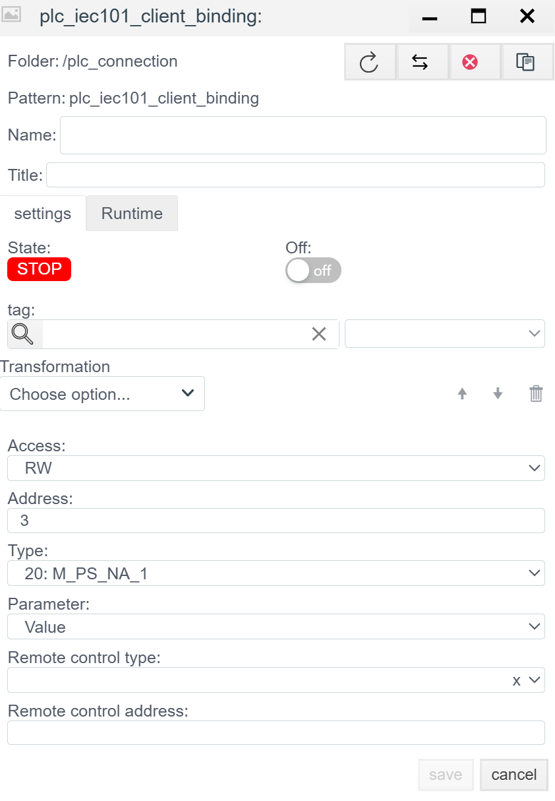

# IEC 60870-5-101 Server Configuration Guide

> See also: [PLC Connections overview](./general_en.md)

## Overview
The **IEC 101 Server** driver lets **Faceplate** operate as a Controlled Station (Slave) over serial interfaces (RS-232/485). In this mode, the system waits for requests from an external Control Station (Master), sends data, and executes remote control commands.

Configuration is done in two stages:
1. **Connection (`plc_iec101_server_connection`):** COM port, physical layer, and addressing.
2. **Binding (`plc_iec101_server_binding`):** Address map (IOA) and control settings.

---

## 1. Connection setup (Connection)
> Create a PLC connection -> [Create a PLC connection](./general_en.md#create-a-plc-connection)

This step defines port parameters and protocol logic. These settings must match the Master.

> Diagnostics and common settings are described in [Common connection settings](./general_en.md#common-connection-settings).
>
> For this connection type, **Support for group requests**, **Max. package length**, and **Line Delay Ratio** are not used. Keep defaults.

### 1.1 Protocol and addressing parameters
| Field | Description |
| :--- | :--- |
| **Common Address of ASDU** | **Station address (CA).** Logical address of this device. |
| **Common Address Size** | ASDU address size (1 or 2 bytes). |
| **Originator Address Size** | Originator address size (1 byte or 0). |
| **Information Object Address Size** | IOA size (2 or 3 bytes). |
| **Link Address** | **Link-layer address.** Used in unbalanced mode for bus addressing. |
| **Link Address Size** | Link address size (1 or 2 bytes). |
| **Balanced** | **Transmission mode:** - **Off (Unbalanced):** Master-Slave. Standard for RS-485. - **On (Balanced):** Point-to-point. Peer mode (typically RS-232). |

### 1.2 Serial port settings (SERIAL)
| Field | Description |
| :--- | :--- |
| **Port** | Port name (for example, `/dev/ttyUSB0` or `COM1`). |
| **Baud rate** | Baud rate (9600, 19200, and so on). |
| **Parity** | Parity. IEC 101 commonly requires **Even**. |
| **Stop bits** | Stop bits. |
| **Data bits** | Data bits (usually 8). |
| **Timeout** | Byte timeout on the line. |
| **Attempts** | Retry count (for balanced mode). |

**Group broadcast:**
Allows periodic sending of selected groups even if the client does not explicitly request them.

**Group list management:**
1. **Add a group:** Use the UI controls to add a new row.
2. **Delete a group:** Click the trash icon (Delete) on the row.
3. **Order:** Use **up** and **down** arrows to change poll priority.

**Group parameters:**
| Field | Description |
| :--- | :--- |
| **Group number** | Group ID used internally and aligned with the standard. |
| **Update frequency (ms)** | Polling period for tags in the group. |
| **Timeout (ms)** | Response timeout for this group. |
---

## 2. Binding setup (Binding)

> Create a PLC binding -> [Create a PLC binding](./general_en.md#create-a-plc-binding)

> Common binding fields are described in [Common PLC binding fields](./general_en.md#common-plc-binding-fields).

### 2.1 Binding-specific parameters
| Field | Description |
| :--- | :--- |
| **Address** | **IOA (Information Object Address).** Numeric address. |
| **Type** | **ASDU type.** Data format. Examples: `1: M_SP_NA_1` (Single Point), `30: M_SP_TB_1` (Single Point + Time). See (https://support.kaspersky.com/kics-for-networks/3.0/206199) |
| **Parameter** | Value attribute: `Value`, `Quality` (DIQ/SIQ/QDS), `Timestamp`. |

> Binding error -> [Binding errors](./general_en.md#binding-errors)

### 2.2 IOA calculation (if specified by octets)
If the address is given in bytes (for example, `10.2.0`), use the formula:
$$Address = Octet_1 + (Octet_2 \times 256) + (Octet_3 \times 256^2)$$

### 2.3 Write parameters (Access = RW / W)

These fields appear only if **RW** or **W** is selected.
*Note:* For remote control commands (TU), `Access: RW` is required.

| Field | Description |
| :--- | :--- |
| **Remote control type** | **Command TypeID.** ASDU type used to send commands. Examples: - `45: C_SC_NA_1` (Single Command) - `46: C_DC_NA_1` (Double Command) - `50: C_SE_NC_1` (Setpoint float) |
| **Remote control address** | **Command IOA.** Address used for writing. Often matches `Address`, but can differ (for example, read status at IOA 100 and control at IOA 2100). |

---