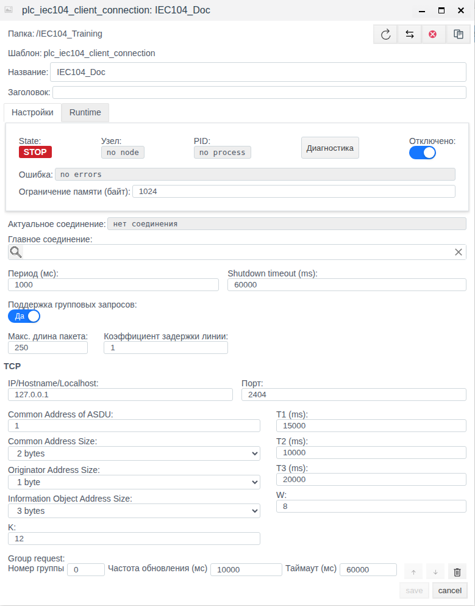
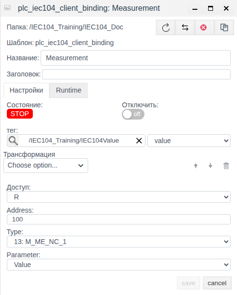

# IEC 60870-5-104 in Faceplate: configuring a client connection and bindings

Documentation version: Faceplate v4.0.7.

This guide explains how to configure an IEC 60870-5-104 client and link server signals to tag fields. The single practical example shows saving a disabled client and one binding without a server. Its settings were verified by opening the objects again separately. Other capabilities are described as reference information; the example does not verify communication with equipment.

The screenshots show the Russian UI. Actual Russian labels are retained where needed, with English explanations. These explanations are not verified labels of an English localization.

**Contents**

- [Configuration route](#configuration-route)
- [Align measurement, quality, time and command](#align-measurement-quality-time-and-command)
- [How the connection works](#how-the-connection-works)
- [What to prepare](#what-to-prepare)
- [Create the connection and configure its binding](#create-the-connection-and-configure-its-binding)
- [Read values, quality, and time](#read-values-quality-and-time)
- [Configure command writes](#configure-command-writes)
- [Manage the connection and redundancy](#manage-the-connection-and-redundancy)
- [Settings and transformations reference](#settings-and-transformations-reference)
- [Diagnostics and recovery](#diagnostics-and-recovery)

[Connection catalogue](./index.md) · [Prepare fields and bindings](./bindings.md) · [Transformations](./transformation.md) · [Diagnostics and recovery](./diagnostics.md)

## Configuration route

Prepare an external source or client and a compatible tag field using the shared guide. Configure the channel, save a complete binding and verify a new value. For supported writing/reception, separately confirm the external result; after correcting a failure repeat verification with a new control value.

[Alternative channels and signal maps](./bindings.md#configure-an-alternative-channel) share one procedure; check driver-specific switching conditions.

## Align measurement, quality, time and command

Use the [shared IEC catalogue](./iec_reference.md). For IOA 100, Type 36: M_ME_TF_1, prepare float Measurement.value and integer Quality.value and Timestamp.value. Create separate Value, QDS and TS bindings sharing Address 100 and Type 36.

For reception set R; confirm new source measurement 21.5→22.5 in Measurement.value. For separate control, prepare integer Command.value and an RW binding: Address 101, Type 1, Parameter Value, Remote control type 45, Remote control address 200. Command 1 targets IOA 200; feedback is read at IOA 101. Check ACTCON/ACTTERM and independently inspect feedback.

Replace the illustrative map with the device's agreed IOA/TypeID. Quality is a numeric descriptor; CP24/CP56 TS have different meanings. Old cache contents and transmission time do not establish a new measurement. Save disabled configuration and independently reopen every binding before operational startup. These are configuration recipes; no new commands or external updates are claimed as tested here.

## How the connection works

Faceplate acts as a client: it establishes an outgoing TCP connection to the telecontrol server, receives data, and sends interrogation requests and supported commands. The server can be an RTU, controller, or another source with a compatible IEC 104 profile. The server role uses a different connection type.

| Concept | Meaning |
|---|---|
| Protocol | IEC 60870-5-104 communication rules |
| Driver | Faceplate support for the protocol |
| Connection | A specific server channel with network and common communication settings |
| Binding | Selection of a signal, attribute, direction, and specific tag field |
| Tag and field | A project object and the destination for a read result or source of a write setpoint |

A connection contains child bindings. It specifies the server address and ASDU common address, **CA**; a binding specifies the information object address, **IOA**, ASDU type, **TypeID**, and required attribute. Creating a connection does not automatically create tags or a signal map.

Reads follow this path: server → TCP/ASDU → internal connection cache → selected IOA attribute → transformation → conversion to the field type → tag field. The field does not have to be named `value`: select it explicitly. The PLC period controls cache reads; periodic server requests are configured separately under **Group request**. Spontaneous server updates are also accepted.

For writes, the selected field supplies the setpoint. A change passes through the reverse transformation chain and is sent to the command address using the command TypeID. Updates made by the connection itself during reading should not trigger a command back to the server. Without a tag link, the result can remain in the binding's own value; configure both the tag and field to pass data into the project.

## What to prepare

For an operational connection, obtain the following from the server administrator or equipment map:

- An IPv4 address or hostname and TCP port reachable from the Faceplate execution node. Hostnames are resolved to IPv4; `127.0.0.1` refers to that node.
- CA and ASDU address sizes: CA, originator address ORG, and IOA.
- The IOA map, actual TypeIDs, available attributes, units, and value types.
- Supported interrogation groups and rules for initial and spontaneous transmission.
- For writes, command TypeIDs/IOAs, permitted setpoints, and confirmation requirements.

Prepare an existing tag with a suitable field and permission to configure the training folder. Use a numeric field for measurements; preserve numeric codes for a full double-point state instead of reducing it to a boolean. Compatibility with particular equipment depends on its data and command profile.

The single example uses the **IEC104_Training** folder and a prepared **IEC104Value** tag with a float **value** field. No server is available; the network and protocol addresses below are illustrative. Studio is available at `http://127.0.0.1:9000/fp/studio`.

## Create the connection and configure its binding

The example demonstrates client settings and selection of a tag field. The client remains disabled from the first save through completion. Verification consists of saving both objects and opening each again separately.

| Setting | Example value |
|---|---|
| Folder / connection | IEC104_Training / IEC104_Doc |
| Отключено (Disabled) | On |
| IP/Hostname/Localhost / Порт (Port) | 127.0.0.1 / 2404 |
| Период (мс) (Period) / Shutdown timeout (ms) | 1000 / 60000 |
| Common Address of ASDU | 1 |
| CA / ORG / IOA sizes | 2 / 1 / 3 bytes |
| T1 / T2 / T3 | 15000 / 10000 / 20000 ms |
| K / W | 12 / 8 |
| Group request | Group number 0; update interval 10000 ms; timeout 60000 ms |
| Главное соединение (Master connection) | Empty |

### Save the channel settings

1. Open **Общий вид** (General view) in Studio.
2. Double-click **IEC104_Training**.
3. Click **Создать** (Create), open the **plc** group, select **plc_iec104_client_connection**, and click **Ok**. This is the type name shown in the selection dialog.
4. Enter **IEC104_Doc** in **Название** (Name); leave **Заголовок** (Title) empty.
5. Turn on **Отключено** (Disabled) before the first save.
6. Explicitly enter **127.0.0.1** in **IP/Hostname/Localhost**; a placeholder in an empty field is not an entered address.
7. Compare the port, ASDU settings, period, timers, and windows with the table.
8. Under **Group request**, keep **Номер группы** (Group number) at **0**. Enter **10000** in **Частота обновления (мс)** (Update frequency) and press **Tab** to move focus. Then enter **60000** in **Таймаут (мс)** (Timeout) and press **Tab** again. Leave the empty add-group row unfilled.
9. Click **save** and wait for the form to close.
10. Select the **IEC104_Doc** row, click **Редактировать** (Edit), and compare the saved values. Check that **Отключено** remains on and that the group row is correct.
11. Close the form with **cancel**.

Figure 1. Connection opened separately after saving; Group request is at the bottom of the form.

In this example, **STOP**, **no node**, **no process**, and **нет соединения** (no connection) are expected because the client is disabled. **no errors** means that no error is displayed; it does not indicate successful connection to an absent server.

### Add the signal within the same example

| Binding setting | Value |
|---|---|
| Название (Name) | Measurement |
| тег (Tag) / field | /IEC104_Training/IEC104Value / value |
| Доступ (Access) | R |
| Address | 100 |
| Type | 13: M_ME_NC_1 |
| Parameter | Value |
| Трансформация (Transformation) | Empty |
| Отключить (Disable binding) | Off; the parent connection remains disabled |

1. Double-click **IEC104_Doc** to open its children.
2. Click **Создать** (Create) to open the binding form.
3. Enter **Measurement** in **Название** (Name).
4. Check **R** under **Доступ** (Access) and leave **Трансформация** (Transformation) empty; do not select an entry from **Choose option...**.
5. Enter **100** in **Address** and press **Tab**.
6. Select **13: M_ME_NC_1** under **Type**.
7. Explicitly select **Value** under **Parameter**. **QDS** is also available for this type.
8. Click the magnifying glass beside **тег** (Tag), open **IEC104_Training**, select **IEC104Value**, and click **ОК**.
9. Explicitly select **value** in the adjacent field list. Check both the tag path and field name.
10. Compare the settings with the table and click **save**.
11. After the form closes, select **Measurement** and click **Редактировать** (Edit). Check the saved address, type, attribute, access, tag/field, and empty transformation.
12. Close with **cancel**, return to **IEC104_Training**, and check again that **IEC104_Doc** is disabled.

Figure 2. R binding opened separately after saving.

The binding list may show **Runtime ВКЛ** (enabled) with **State Stop**: the binding itself is enabled, but its parent channel is disabled. The example produces saved settings. The prepared tag value is not treated as data received from the server; reading, writing, and communication recovery were not tested.

## Read values, quality, and time

**Parameter** selects an attribute of one IOA. **Value** is the useful value; **QDS**, **SIQ**, **DIQ**, and other status fields are packed numbers interpreted according to the signal profile. To put quality or time in a separate field, use additional bindings of the same IOA with the corresponding Parameter; this is a reference capability and is outside the practical example.

Select **Type** from the server map. During reading it does not filter the actual TypeID of the received ASDU: the lookup uses IOA. An incorrect Type can apply an unsuitable quality mask or produce an apparently successful read of a different representation. Check the Type/Parameter pair against the server signal map and the Parameter list for the selected Type.

Single-point Value is an integer 0/1; double-point Value is 0…3. Conversion to boolean loses distinctions between codes. Normalized measurements are already represented in the range −1…1; scaled values are signed16, and floats are IEEE32. A float written into an integer field is rounded. Engineering units and any further conversion come from the equipment map and transformation.

| TS timestamp | Representation and verification |
|---|---|
| CP24 | Milliseconds within the hour: milliseconds + minutes × 60000; no date or hour number. Do not display it as a complete Unix date |
| CP56 | Unix epoch in milliseconds. Received calendar components are interpreted using the execution node OS local timezone; the connection has no timezone setting |

For CP56, an ambiguous or impossible time conversion can produce no value. When a timestamped message is followed by a compatible message without a timestamp, the previous TS can remain. The presence of TS therefore does not prove that it arrived with the latest Value.

Quality does not automatically block Value: even an invalid indication in QDS does not imply a binding read error. For single-point data, QDS is derived from SIQ with mask 254; for double-point data, from DIQ with mask 252. BCR contains a packed 40-bit field, while the counter Value is signed32. Duration and Interval return the numeric contents of a 16-bit field without conversion to seconds.

The internal cache does not check the age of each IOA. A working channel and an unchanged number do not establish freshness. Compare state with actual source transmission, an expected signal change, and the meaning of its quality/time.

## Configure command writes

Writes are configured in the binding, and the selected tag field supplies the setpoint. For a normal command, select **Parameter = Value**, the required access, and command **Remote control type** and **Remote control address**. These fields are visible with **W** or **RW** and **Value**; selecting another Parameter clears them.

| Access | Behavior |
|---|---|
| R | Reading; field changes do not send commands |
| RW | Reads state and writes when the setpoint changes. There is no normal initial transmission of the current setpoint |
| W | Writes only; sends the current setpoint on activation, reconnection, and changes to an active binding, then on setpoint changes |

Before using W, check whether automatic transmission of the current setpoint after recovery is acceptable. W does not read equipment state or continuously maintain the setpoint against changes made at the equipment. Changes while the connection is absent do not form a guaranteed queue; requests postponed within active protocol communication are a separate mechanism.

The command IOA can differ from the read IOA. Empty remote-control fields fall back to the main Address/Type. If this is an information TypeID, transmission is asynchronous and lacks normal command ACTCON/ACTTERM confirmation; compatibility with this mode must be established for the specific server.

For command TypeIDs, activation is sent, followed by waiting for matching IOA/TypeID and positive **ACTCON** confirmation, then **ACTTERM** termination. ACTCON is awaited for 10000 ms, then ACTTERM for another 10000 ms; T1 and the group timeout do not set these intervals. Negative replies and timeouts produce `reject`, `confirm_timeout`, `not_executed`, or `execute_timeout`. A request can wait for the channel while interrogation or another command is running.

There are no separate select-before-operate or qualifier fields; their initial zero value is used. Commands with CP56 use the current system time. Check whether this meets the equipment's requirements.

After conversion and reverse transformation, the setpoint must be numeric. A nonnumeric or absent value may not be sent without a separate write error. A successful binding state alone therefore does not prove transmission. Positive ACTTERM confirms protocol termination; verify the actual position or setpoint through the equipment and feedback signal. No commands were sent in the training example.

## Manage the connection and redundancy

| Operational project task | Action and verification |
|---|---|
| Change settings | Open the connection with Редактировать (Edit), change fields, save, and open again separately; executable changes may restart its execution |
| Disable the channel | Turn on Отключено and save; check STOP and absence of a process; communication for all its bindings stops |
| Enable execution | Turn off Отключено and save; check the process, errors, and separately new source data |
| Disable one signal | Turn on Отключить for that binding; other channel signals retain their own settings |
| Check the tag link | Check that the tag and field exist and verify field type and dependencies; a saved broken link may exclude a binding from execution |
| Configure redundancy | Select Главное соединение (Master connection) on an additional connection of the same type; check configurations and Актуальное соединение (Actual connection) |

The secondary connection references the master and is automatically disabled as an independent execution instance. The master must not itself reference another master. Linked configurations are used on failures; **Актуальное соединение** shows the selected channel. This is the common connection redundancy mechanism; confirm a switchover through new data on the selected path.

In the training example, **IEC104_Doc** remains disabled; enabling and redundant switchover were not performed. Disabling or removing a link does not guarantee clearing a previously displayed tag value. Check channel existence and data freshness separately.

## Settings and transformations reference

### Common connection settings

Initial displays below refer to the inspected form; ranges come from its numeric controls. They do not replace verification against the selected server.

| Field | Initial value / form range | Purpose and verification |
|---|---|---|
| Название / Заголовок (Name / Title) | Empty; enter a name explicitly, title optional | Object name and description |
| Период (мс) (Period) | 1000; 1–3600000 ms | Cache-read cycles; a long cycle is followed by the next without an additional pause |
| Shutdown timeout (ms) | 60000; 10–3600000 ms | Graceful shutdown wait, not a TCP response wait |
| Поддержка групповых запросов (Bulk request support) | Да (Yes) | Common PLC optimization; this client does not perform those bulk operations |
| Макс. длина пакета (Maximum packet length) | 250; 1–10000 | Common optimization setting, not an ASDU limit or IEC interrogation setting |
| Коэффициент задержки линии (Line delay factor) | 1 in the form; 1–10 | Common optimization setting, not a pause or retry count. The schema initial value is 2; saving 1 through the form was verified |
| Отключено (Disabled) | Off in a new form; on in the example | Controls the entire channel |
| Главное соединение (Master connection) | Empty | Independent connection or a secondary link to a master of the same type |
| Ограничение памяти (байт) (Memory limit, bytes) | Empty before saving; 1024 afterwards | Actual units are MiB: 1024 represents a 1 GiB worker heap limit. The bytes label does not match; the example leaves the value unchanged |

The bulk fields above do not control **Group request**. Selecting **Нет** (No) disables their numeric controls; the checkbox does not add this optimization to the IEC client.

### TCP and IEC104 settings

| Field | Initial value / range | Purpose |
|---|---|---|
| IP/Hostname/Localhost | Placeholder 127.0.0.1; enter explicitly | Server IPv4 address or hostname; TCP with IPv4 is used |
| Порт (Port) | 2404; 1–65535 | Server port |
| Common Address of ASDU | 1; 1–65535 | CA; must fit its selected size |
| Common Address Size | 2 bytes; 1 or 2 bytes | CA size |
| Originator Address Size | 1 byte; 0 or 1 byte | ORG size; the originator address value itself is fixed at 0 |
| Information Object Address Size | 3 bytes; 1, 2, or 3 bytes | IOA size |
| T1 (ms) | 15000; 1–3600000 ms | Confirmation of sent I-frames and test frames |
| T2 (ms) | 10000; 1–3600000 ms | Delayed confirmation of received I-frames; editing is bounded by the current T1 |
| T3 (ms) | 20000; 1–3600000 ms | Receive inactivity before TESTFR; the test reply is awaited within T1 |
| K | 12; 1–32767 | Threshold limiting unconfirmed sent packets |
| W | 8; 1–32767 | Received I-frame threshold for acknowledgement |

Timers and windows must suit channel conditions and server requirements; their values do not all have to match numerically on both sides. Changing T1 alone does not guarantee a correct relationship with an earlier T2: check both fields. With partial confirmations, actual waiting can exceed T1.

There is no separate **To/t0** field. TCP establishment and STARTDT waiting each use a fixed 5000 ms interval. The form provides no TLS or certificate selection.

### Group request

| Field | Initial value / form range | Behavior |
|---|---|---|
| Номер группы (Group number) | 0 in the first row; 0–16 | Protocol QOI = number + 20: 0 means general interrogation, 1–16 mean the respective groups |
| Частота обновления (мс) (Update frequency) | Empty; 500–604800000 ms | Without an integer value, only the initial request is sent; with one, the next request is scheduled after the previous one finishes |
| Таймаут (мс) (Timeout) | Empty; 50–120000 ms | Defaults to 60000 ms when absent; waits for termination after positive ACTCON |

ACTCON itself is awaited for up to 10000 ms. The client may become ready before interrogation completes successfully; a request error does not necessarily stop the whole connection. A configured repeat interval is also scheduled after completion with an error.

Add groups using the empty list row and remove them with the trash icon. Arrows change the initial order, not a permanent polling priority. The server determines group membership: bindings have no separate group-assignment field. An empty list disables interrogation requests while allowing spontaneous data.

### Binding

| Field | Value / range | Use |
|---|---|---|
| Папка (Folder) | Parent connection | Place the binding directly inside the required channel |
| Название / Заголовок (Name / Title) | Empty in a new form | Signal name and optional description |
| тег / adjacent field list | Initially unselected | Select an existing object and specific field; the tag link alone is insufficient |
| Доступ (Access) | R; options R, W, RW | Communication direction and initial write behavior |
| Отключить (Disable binding) | Off | Exclude this binding |
| Address | Empty in a new form; use 0–16777215 | Read IOA; the form permits an extra upper boundary of 16777216 that is not valid for the saved main address |
| Type | Unselected in a new form; 1–21, 30–38 | Mapped signal type; does not filter received ASDUs |
| Parameter | Unselected; list depends on Type | Value, quality, time, or a special attribute |
| Remote control type | Empty; 45–51, 58–64 | Command type; shown with W/RW and Value |
| Remote control address | Empty | Command IOA; must fit the IOA size, like the main address |
| Трансформация (Transformation) | Empty | Ordered processing; W/RW requires a reverse chain |

For IOA sizes of 1, 2, and 3 bytes, the maximum representable addresses are 255, 65535, and 16777215 respectively. If the map lists octets from least to most significant, decimal IOA = low + 256 × middle + 65536 × high. Confirm the map's octet order with its author; dotted notation cannot automatically be treated as protocol byte order. CA and IOA remain separate settings.

### Command TypeIDs

| TypeID | Type | Setpoint representation |
|---|---|---|
| 45 | C_SC_NA_1 | Single-bit command, numeric 0/1 |
| 46 | C_DC_NA_1 | Two-bit command; permitted actions come from the equipment map |
| 47 | C_RC_NA_1 | Two-bit step command; direction meaning comes from the map |
| 48 | C_SE_NA_1 | Normalized setpoint −1…1 |
| 49 | C_SE_NB_1 | Signed16 setpoint, −32768…32767 |
| 50 | C_SE_NC_1 | Float32 setpoint |
| 51 | C_BO_NA_1 | Numeric 32-bit mask, 0…4294967295 |
| 58 | C_SC_TA_1 | Single-bit command 0/1 with CP56 |
| 59 | C_DC_TA_1 | Two-bit command with CP56 |
| 60 | C_RC_TA_1 | Step command with CP56 |
| 61 | C_SE_TA_1 | Normalized setpoint −1…1 with CP56 |
| 62 | C_SE_TB_1 | Signed16 setpoint, −32768…32767 with CP56 |
| 63 | C_SE_TC_1 | Float32 setpoint with CP56 |
| 64 | C_BO_TA_1 | 32-bit mask 0…4294967295 with CP56 |

These are data representations, not permission for arbitrary equipment actions. Obtain actual values, bits, directions, limits, and units from its map. Automatic safe clamping to the encoding range is not guaranteed.

### Transformations

An empty **Трансформация** (Transformation) leaves the value unchanged before conversion to the field type. Add methods through **Choose option...**; they run from top to bottom, while the reverse write chain runs in reverse order. Method numeric controls display up to 6 decimal places; this is not protocol precision.

| Method | Parameters and initial values | Read / write |
|---|---|---|
| Scaling | Factor = 1, Shift = 0; numeric, no specified form bounds | Read: X × Factor + Shift. Write: (X − Shift) / Factor; Factor must not be 0 for writes |
| Default Value | Value = 0; numeric | Preserves any numeric input; replaces nonnumeric input, including absent data, with this number. Passes write input unchanged |
| Limit Control | Lower Limit = 0, Upper Limit = 0; set Upper above Lower | Read: outside inclusive limits gives no value. Write: clamps to the nearest limit. The initial 0/0 pair must be corrected |
| Damper | Tlag = 1; form minimum 1, calculated in milliseconds | Smooths using elapsed time and history; passes the first numeric input. Passes write setpoints without filtering |
| Derivative | No special numeric fields | Value difference / elapsed milliseconds; first result absent. For R; no reverse transformation |
| Integration | No special numeric fields | Accumulates current value × elapsed milliseconds; first result absent. For R; no reverse transformation |
| Script | Erlang, variables table, and function text | Receives Input, Context, State; returns Output and new State. For R; no reverse transformation |

A list containing Script, Derivative, or Integration is unsuitable for W/RW because a reverse transformation is required. Script variables are defined by name, tag, and field; Context contains their values, and State persists between calls, starting without a value. Restarting or reconfiguring resets the history. Successful compilation does not prove the calculation works with real data.

Method order changes the result: Default Value after a method that produced no value can substitute a number. This substitution does not fix the communication error. Derivative units are input units per millisecond; Integration units are input units × milliseconds. There is no automatic conversion to seconds.

## Diagnostics and recovery

Distinguish execution permission, a working channel, and receipt of the required data. A successful common cycle does not mean every IOA succeeded.

| Indicator | What to check |
|---|---|
| Runtime ВКЛ / ВЫКЛ, Отключено | Whether execution is enabled; binding and connection permissions are separate |
| State RUN / STOP, PID, Узел (Node) | Worker process state, not confirmation of a fresh signal |
| Актуальное соединение (Actual connection) | Which master/secondary channel is selected |
| Connection error | Channel issue; no errors alone does not establish data receipt |
| Binding state, error, and value | Result for the specific signal and transformation; compare with the selected tag field |
| Number in the tag field | May be old or substituted; new receipt must be confirmed |

The common **Диагностика** (Diagnostics) window displays processes and logs. **Start/Stop** control log collection; Stop here does not stop the connection. Levels are **info**, **warning**, **error**, and **debug**; **Log limit** defaults to 1000 with a range of 1–100000 lines. An empty log is not a health indicator. The diagnostics window was not reproduced in the single example.

| Symptom | Check | Action | Confirmation |
|---|---|---|---|
| STOP / no process | Disable setting, folder/node, dependencies | Remove the execution block for an operational channel; keep the training channel disabled | A process appears; data is checked separately |
| TCP/STARTDT/ASDU error | Host/port, execution-node access, CA and sizes | Verify the channel and server profile | Channel and required data are confirmed |
| address_not_available / invalid_parameter | IOA in cache, actual type and attribute, interrogation | Correct address/Parameter and ensure server transmission | The required attribute appears in the correct field |
| Interrogation does not repeat or fails | Group number, update, confirmation, termination | Verify the group and intervals with the server | A new reply and expected data are received |
| RUN/OK with an old number, quality, or TS | Actual incoming stream, source state, TS/QDS meaning | Check transmission of the specific signal, beyond heartbeat | A known new change or fresh reply is matched to the tag field |
| Incorrect value | Field type, normalization, units, transformation chain | Correct representation and conversion | Value matches the map and source |
| Command not sent/rejected or repeated after recovery | W/RW, numeric setpoint, reverse, Type/IOA, confirmations | Check the initial setpoint and command profile | Protocol termination and actual equipment state are checked separately |
| Empty log | Collection, level, limit, process | Configure collection and check channel/signal state | Relevant messages and an independent data check are available |

After recovery, check a known new source value or fresh reply/ASDU matched to the selected tag field. An error disappearing, RUN/OK, a new PID, or retention of the old number is insufficient. A read error can pass absent data through the transformation, and Default Value can replace it with a number. Communication recovery and the physical outcome were not tested in this example.
