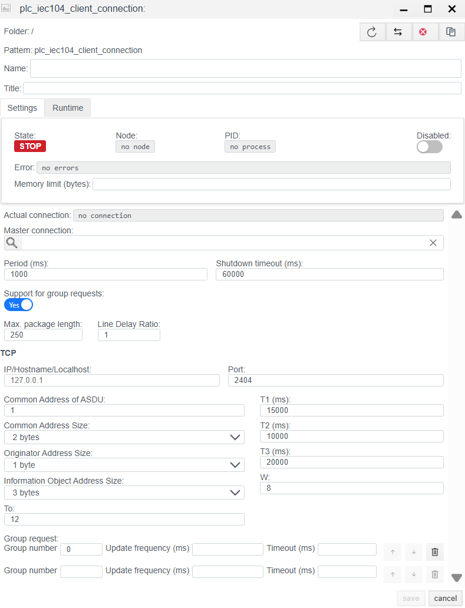
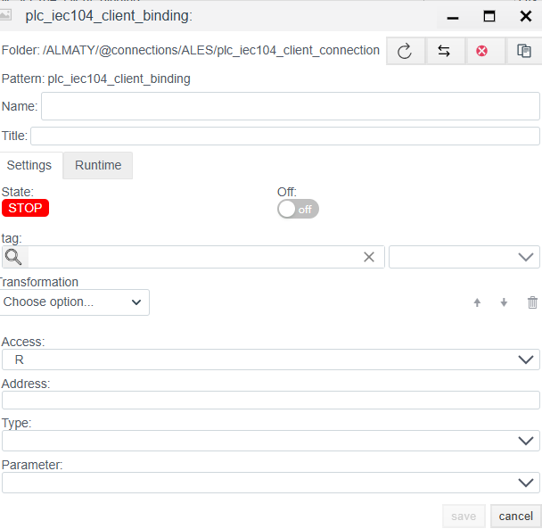
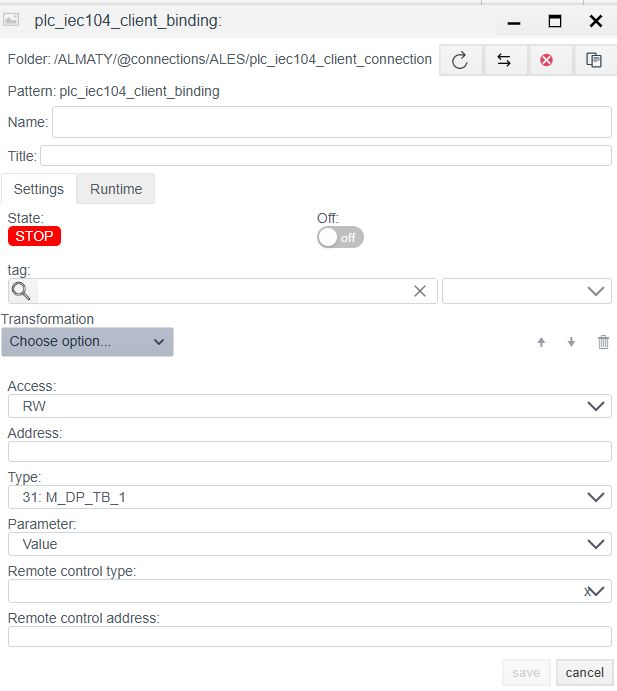

# IEC 60870-5-104 Client Configuration Guide

> See also: [PLC Connections overview](./general_en.md)

## Overview
The **IEC 104 Client** driver exchanges data with telecontrol equipment (RTU, substation controllers, protection terminals) using **IEC 60870-5-104** over TCP/IP.

Configuration is done in two stages:
1. **Connection (`plc_iec104_client_connection`):** Network connection, ASDU parameters, and protocol timing.
2. **Binding (`plc_iec104_client_binding`):** IOA addressing and remote control commands.

---

## 1. Connection setup (Connection)
> Create a PLC connection -> [Create a PLC connection](./general_en.md#create-a-plc-connection)

This step sets physical connection parameters and IEC 104 protocol settings.

> Diagnostics and common settings are described in [Common connection settings](./general_en.md#common-connection-settings).

### 1.1 Protocol parameters (IEC 60870-5-104 client)

These parameters must match the RTU (slave) configuration.

| Field | Description |
| :--- | :--- |
| **IP/Hostname** | IP address of the slave/server. |
| **Port** | TCP port. |
| **Common Address of ASDU** | Station common address (CA). Unique device ID on the bus. |
| **Common Address Size** | ASDU address size (usually **2** bytes). |
| **Originator Address Size** | Originator address size (usually **1** byte, sometimes 0). |
| **Information Object Address Size** | IOA size. Standard: **3** bytes. |
| **To** | TCP connection setup timeout (t0). |
| **T1 (ms)** | Timeout for sent APDU confirmation (t1). |
| **T2 (ms)** | Timeout for APDU receive confirmation when there is no data traffic (t2). |
| **T3 (ms)** | Channel test timeout (t3). If the channel is idle this long, a `TESTFR` frame is sent. |
| **W** | Receive window size (w). Max number of unacknowledged APDUs that can be received before sending an ack. |

### 1.2 Group request setup
Group Requests split polled signals into logical groups (for example, by update rate). Group 20 (General Interrogation) is typically used.

**Group list management:**
1. **Add a group:** Use the UI controls to add a new row.
2. **Delete a group:** Click the trash icon (Delete) on the row.
3. **Order:** Use **up** and **down** arrows to change poll priority.

**Group parameters:**
| Field | Description |
| :--- | :--- |
| **Group number** | Group ID, used internally and aligned with the standard. |
| **Update frequency (ms)** | Polling period for tags in the group. |
| **Timeout (ms)** | Response timeout for this group. |

---

## 2. Binding setup (Binding)

Configure a specific tele-signal (TS) or tele-measurement (TM).

> Create a PLC binding -> [Create a PLC binding](./general_en.md#create-a-plc-binding)

> Common binding fields are described in [Common PLC binding fields](./general_en.md#common-plc-binding-fields).

### 2.1 Binding-specific parameters
| Field | Description |
| :--- | :--- |
| **Address** | **IOA (Information Object Address).** Full address. Numeric (for example, `100`). |
| **Type** | **ASDU type (TypeID).** Expected data type from the device. Examples: - `1: M_SP_NA_1` (Single point TS) - `30: M_SP_TB_1` (TS with CP56 time) - `13: M_ME_NC_1` (Float measurement) - `36: M_ME_TF_1` (Float measurement with time). See (https://support.kaspersky.com/kics-for-networks/3.0/206199) |
| **Parameter** | Value attribute: `Value`, `Quality` (DIQ/SIQ/QDS), `Timestamp`. |

> Binding error -> [Binding errors](./general_en.md#binding-errors)

### 2.2 IOA calculation (if specified by octets)
If the address is given in bytes (for example, `10.2.0`), use the formula:
$$Address = Octet_1 + (Octet_2 \times 256) + (Octet_3 \times 256^2)$$

### 2.3 Remote control and write parameters (Access = RW / W)

These fields appear only if **RW** or **W** is selected.
*Note:* For remote control commands (TU), `Access: RW` is required.

| Field | Description |
| :--- | :--- |
| **Remote control type** | **Command TypeID.** ASDU type used to send commands. Examples: - `45: C_SC_NA_1` (Single Command) - `46: C_DC_NA_1` (Double Command) - `50: C_SE_NC_1` (Setpoint float) |
| **Remote control address** | **Command IOA.** Address used for writing. Often matches `Address`, but can differ (for example, read status at IOA 100 and control at IOA 2100). |

---
