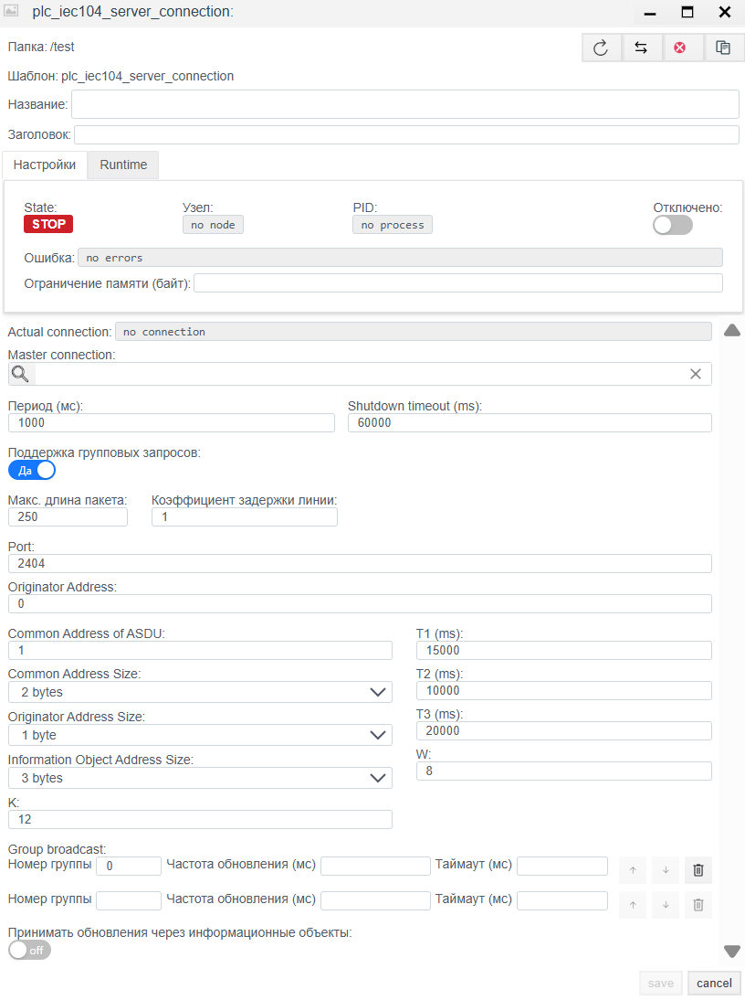
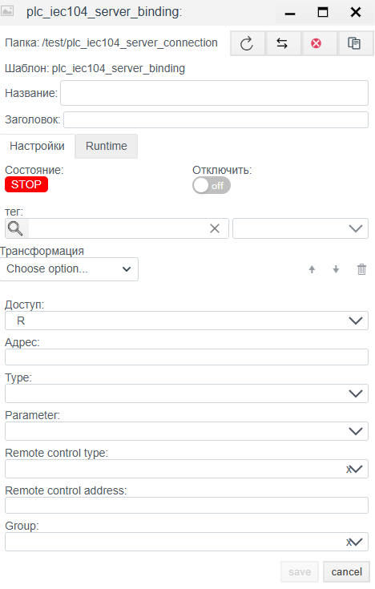

# IEC 60870-5-104 Server Configuration Guide

> See also: [PLC Connections overview](./general_en.md)

## Overview
The **IEC 104 Server** driver lets **Faceplate** act as a controlled station (slave). In this mode, the system opens a TCP port and waits for connections from external information systems (Control Stations, upper-level SCADA), provides its tag data, and accepts control commands.

Configuration is done in two stages:
1. **Connection (`plc_iec104_server_connection`):** TCP port, ASDU addressing, and protocol timing.
2. **Binding (`plc_iec104_server_binding`):** Publish tags in the protocol address space (IOA) and configure command reception.

---

## 1. Connection setup (Connection)
> Create a PLC connection -> [Create a PLC connection](./general_en.md#create-a-plc-connection)
>
This step configures the listening socket and link-layer parameters. These settings must match the Client (Master) that connects to Faceplate.

> Diagnostics and common settings are described in [Common connection settings](./general_en.md#common-connection-settings).

### 1.1 Protocol parameters (IEC 60870-5-104 server)

| Field | Description |
| :--- | :--- |
| **Port** | TCP port for incoming connections. IANA standard: **2404**. |
| **Originator Address** | Originator address that the server uses in responses by default (usually 0). |
| **Common Address of ASDU** | **Station address (CA).** Unique device ID in the IEC 104 network. Must match the Client settings. |
| **Common Address Size** | ASDU address size. Standard: **2 bytes**. |
| **Originator Address Size** | Originator address size. Standard: **1 byte** (sometimes 0). |
| **Information Object Address Size** | IOA size. Standard: **3 bytes**. |
| **K** | **k** parameter (APDU transmit window). Max number of sent APDUs without confirmation. |
| **W** | **w** parameter (APDU receive window). Max number of received APDUs before confirmation. |
| **T1 (ms)** | Timeout for send confirmation. |
| **T2 (ms)** | Timeout for receive confirmation when there is no data message. |
| **T3 (ms)** | Channel test timeout. Interval for `TESTFR` when the channel is idle. |

**Group broadcast:**
Allows periodic sending of selected groups even if the client does not explicitly request them.

**Group list management:**
1. **Add a group:** Use the UI controls to add a new row.
2. **Delete a group:** Click the trash icon (Delete) on the row.
3. **Order:** Use **up** and **down** arrows to change poll priority.

**Group parameters:**
| Field | Description |
| :--- | :--- |
| **Group number** | Group ID used internally and aligned with the standard. |
| **Update frequency (ms)** | Polling period for tags in the group. |
| **Timeout (ms)** | Response timeout for this group. |
---

## 2. Binding setup (Binding)

This step defines the set of signals that the server publishes.

> Create a PLC binding -> [Create a PLC binding](./general_en.md#create-a-plc-binding)
>
> Common binding fields are described in [Common PLC binding fields](./general_en.md#common-plc-binding-fields).

### 2.1 Binding-specific parameters
| Field | Description |
| :--- | :--- |
| **Address** | **IOA (Information Object Address).** Numeric address. |
| **Type** | **ASDU type.** Data format. Examples: `1: M_SP_NA_1` (Single Point), `30: M_SP_TB_1` (Single Point + Time). See (https://support.kaspersky.com/kics-for-networks/3.0/206199) |
| **Parameter** | Value attribute: `Value`, `Quality` (DIQ/SIQ/QDS), `Timestamp`. |

> Binding error -> [Binding errors](./general_en.md#binding-errors)

### 2.2 IOA calculation (if specified by octets)
If the address is given in bytes (for example, `10.2.0`), use the formula:
$$Address = Octet_1 + (Octet_2 \times 256) + (Octet_3 \times 256^2)$$

### 2.3 Remote control parameters
These fields become active and required when `Access` is set to **RW**. They define how the server should handle incoming commands.

| Field | Description |
| :--- | :--- |
| **Remote control type** | **Command type.** ASDU type expected from the client to control this object. Examples: `C_SC_NA_1` (Single Command), `C_SE_NC_1` (Setpoint Float). |
| **Remote control address** | **Command IOA.** Address where the client must send the control command. Often matches `Address`, but can differ. |
| **Group** | Interrogation group number that includes this signal (usually 20 - General Interrogation). |

---