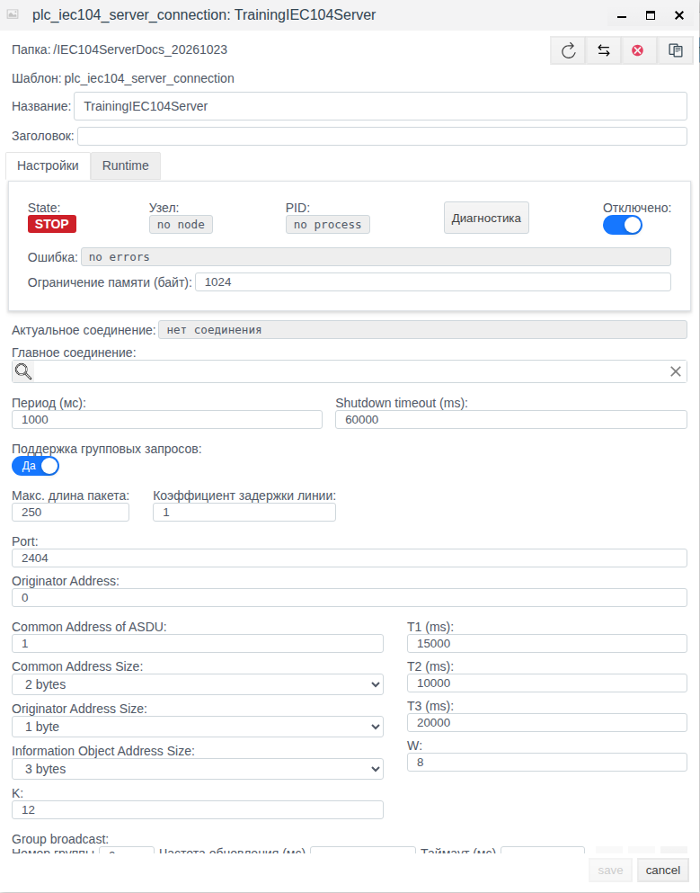
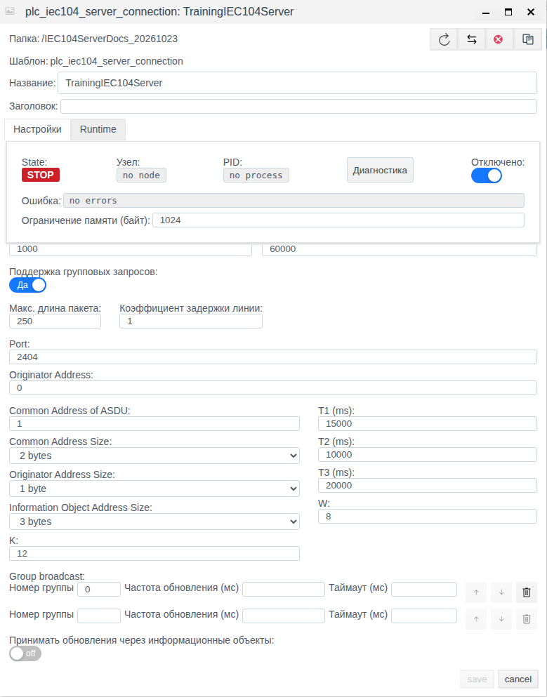
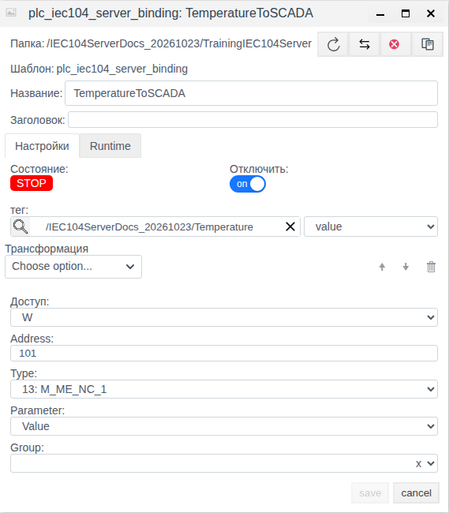

# IEC 60870-5-104 Server: Configuring Connections and Data Exchange in Faceplate

Documentation version: Faceplate v4.0.7.

The screenshots show the Russian interface. Russian control labels are retained with English explanations; these explanations do not represent a verified English localization.

This guide helps you provide Faceplate data to an external SCADA and configure command reception. The single practical example configures the server and publication of a temperature field. Saving and separate reopening were verified; the connection and binding remain disabled. No client exchange was performed.

**Contents**

- [Configuration route](#configuration-route)
- [Align measurement, quality, time and command](#align-measurement-quality-time-and-command)
- [Purpose and data flow](#purpose-and-data-flow)
- [Before configuration](#before-configuration)
- [Configure the connection and publish tags](#configure-the-connection-and-publish-tags)
- [Receive commands and information updates](#receive-commands-and-information-updates)
- [Groups, quality, time, and transformations](#groups-quality-time-and-transformations)
- [Manage the connection](#manage-the-connection)
- [Verify data and recovery](#verify-data-and-recovery)
- [Diagnostics](#diagnostics)
- [Settings reference](#settings-reference)

[Connection catalogue](./index.md) · [Prepare fields and bindings](./bindings_en.md) · [Transformations](./transformation_en.md) · [Diagnostics and recovery](./diagnostics_en.md)

## Configuration route

Prepare an external source or client and a compatible tag field using the shared guide. Configure the channel, save a complete binding and verify a new value. For supported writing/reception, separately confirm the external result; after correcting a failure repeat verification with a new control value.

[Alternative channels and signal maps](./bindings_en.md#configure-an-alternative-channel) share one procedure; check driver-specific switching conditions.

## Align measurement, quality, time and command

Use the [shared IEC catalogue](./iec_reference_en.md). For IOA 100, Type 36: M_ME_TF_1, prepare float Measurement.value and integer Quality.value and Timestamp.value. Create separate Value, QDS and TS bindings sharing Address 100 and Type 36.

For publication, set W and the same Group on the object's attributes. Change Measurement.value 21.5→22.5 and confirm new 22.5 at the external master/client. For an incoming command, create an R binding with Address 101, Type 1, Parameter Value, Remote control type 45 and Remote control address 200, linked to separate Command.value. Client numeric write 1 to IOA 200 should update the server model and then the field; ACTCON/ACTTERM do not confirm a physical action.

Replace the illustrative map with the device's agreed IOA/TypeID. Quality is a numeric descriptor; CP24/CP56 TS have different meanings. Old cache contents and transmission time do not establish a new measurement. Save disabled configuration and independently reopen every binding before operational startup. These are configuration recipes; no new commands or external updates are claimed as tested here.

## Purpose and data flow

The IEC 60870-5-104 server presents Faceplate as a controlled station. It opens a TCP port, accepts client connections, and provides information objects. The selected Faceplate tag field supplies the published value. A client can also send commands to the server data model, from which a binding transfers the result to a project field.

| Concept | Meaning |
|---|---|
| Protocol | Rules for exchanging IEC 60870-5-104 frames and ASDUs over TCP |
| Driver | Faceplate's implementation of the protocol's server role |
| Connection | A specific server channel: port, common addressing, timers, and broadcasts |
| Binding | A mapping between an information-object attribute, a specific tag field, and a transfer direction |
| Tag and field | A project object and its selected field, which supplies or receives data |
| Server cache | Stored server information objects; their presence does not prove new client exchange |

The selected connection type determines the role. This guide configures a TCP server. The administrator provides the Faceplate node's network address to the client; this connection has no remote-host field. The driver form does not provide selection of a specific local interface, TLS, or certificates.

**Publication:** tag field → binding's reverse transformation → server-cache attribute → client. **Reception:** client command or permitted information update → server cache → direct transformation and type conversion → selected tag field.

Creating a connection does not create tags automatically. A binding must be a direct child of its connection. To link project data, select both the tag and its specific field; matching object names do not establish this link.

In protocol terminology, **ASDU** is an application service data unit, **IOA** is an information object address, and **TypeID** identifies its type. **ACK** means acknowledgment, **ACTCON** means activation confirmation, and **ACTTERM** means activation termination. **GI** is general interrogation, **QOI** is its qualifier, and **COT** is the cause of transmission. **STARTDT** enables data transfer in a client session; **TESTFR** checks session activity. **TTL** is a value's retention or validity period.

## Before configuration

Before enabling a production connection, agree on the exchange map and network settings.

| Information to obtain | Why it is needed |
|---|---|
| Faceplate execution node, its network address, and an available TCP port | The client connects to this node; the port opens on the execution node |
| Common Address of ASDU (COA), Originator Address, and address sizes | Both sides must interpret the ASDU header identically |
| IOA and TypeID map | IOA addresses an object; TypeID determines its protocol representation |
| Each signal's direction and the command map | Publication and reception use different settings; command and information-object addresses may differ |
| Tag fields, their types, units, and valid values | A binding operates on the selected field, not the whole tag |
| Groups, transmission conditions, quality, and time source | These properties are not inferred automatically from a tag containing a value |
| Agreed K, W, T1, T2, and T3 | Windows and timers must suit the channel and client settings |
| Studio permissions and an object location | Configuration requires creation and editing permissions in the selected folder |

A client is not required to save configuration. Verifying actual transfer requires a client with a known data map and a way to observe received values or transmitted commands.

The training folder **IEC104ServerDocs_20261023** already contains **Temperature**: field **value**, type float, initial number **21.5**, representing temperature in °C. The example does not create the type or tag. In your project, use a prepared numeric field with a clear purpose.

| Object | Before the example | Configuration result |
|---|---|---|
| Temperature | Already exists, value = 21.5 | Source of the selected field |
| TrainingIEC104Server | Absent | Saved, disabled connection |
| TemperatureToSCADA | Absent | Saved, disabled W binding inside the connection |

## Configure the connection and publish tags

### Server configuration example for temperature publication

The task is to describe publication of **Temperature.value** at IOA **101**. It uses **W**: the tag field supplies the server object. No transformation is needed, so the number retains its meaning in °C. Type **13: M_ME_NC_1** represents a float value without a timestamp.

#### Save the connection

| Field | Example value |
|---|---|
| Название (Name) | TrainingIEC104Server |
| Отключено (Disabled) | On |
| Период (мс) (Period, ms) | 1000 |
| Shutdown timeout (ms) | 60000 |
| Port | 2404 |
| Originator Address | 0 |
| Common Address of ASDU | 1 |
| Common Address Size | 2 bytes |
| Originator Address Size | 1 byte |
| Information Object Address Size | 3 bytes |
| K / W | 12 / 8 |
| T1 (ms) / T2 (ms) / T3 (ms) | 15000 / 10000 / 20000 |
| Group broadcast | Update frequency and timeout left empty |
| Принимать обновления через информационные объекты (Receive information-object updates) | Off |

1. In the general project tree, double-click **IEC104ServerDocs_20261023** to open the folder.
2. Select **Temperature**, click **Редактировать** (Edit), verify **value = 21.5**, and close the form with **cancel**.
3. Click **Создать** (Create). In the type chooser, open **plc**, select the IEC 60870-5-104 server connection, and click **Ok**.
4. Immediately turn **Отключено** (Disabled) on so that the prepared configuration is saved without starting the server.
5. Enter **TrainingIEC104Server** in **Название** (Name).
6. Check the fields against the table. Keep values that already match. Leave **Заголовок** (Title) and **Главное соединение** (Master connection) empty.
7. Do not enter a frequency under **Group broadcast**. The zero-group row and an empty input row may remain visible: no schedule is created without a frequency. Leave information-object reception off.
8. Click **save** and wait for the form to close.
9. Select the saved **TrainingIEC104Server** row and click **Редактировать**. Check the settings and enabled **Отключено** switch in the newly opened form.

The verification showed **STOP**, **no node**, **no process**, **no errors**, and **Актуальное соединение: нет соединения** (Actual connection: no connection). This is the expected state of the disabled example. It does not confirm TCP-server operation.

Figure 1. The connection opened separately after saving: disabling is on and the settings are saved.

Figure 2. Group broadcast without a frequency and information-object reception switched off.

Close the form with **cancel**, then continue configuration inside the same connection.

#### Link the temperature field to the information object

| Field | Example value |
|---|---|
| Название (Name) | TemperatureToSCADA |
| Отключить (Disable) | On |
| тег (Tag) | Temperature in the training folder |
| Field selector to the right of тег | value |
| Доступ (Access) | W |
| Address | 101 |
| Type | 13: M_ME_NC_1 |
| Parameter | Value |
| Group | Empty |
| Трансформация (Transformation) | Empty chain, Choose option... |

1. Double-click **TrainingIEC104Server** to open its contents.
2. Click **Создать** — the binding form opens.
3. Immediately turn **Отключить** (Disable) on. This is the binding label; the connection uses **Отключено**.
4. Enter **TemperatureToSCADA** in **Название** and leave **Заголовок** empty.
5. Change the initial **R** to **W** in **Доступ**.
6. Click the magnifying glass next to **тег**, open the training folder, select **Temperature**, and click **ОК**.
7. Explicitly select **value** in the separate field selector to the right of **тег**.
8. Set **Address = 101**, select **Type = 13: M_ME_NC_1**, then **Parameter = Value**. Changing the type does not select a parameter automatically.
9. Leave **Group** and the **Трансформация** chain empty. Remote-control fields are hidden for W and are not filled in this example.
10. Click **save** and wait for the form to close.
11. Select the saved **TemperatureToSCADA**, click **Редактировать**, and check the table values, including the tag, field, and enabled **Отключить** switch.
12. Close the form with **cancel**. The connection and binding remain disabled.

Figure 3. Saved W binding to Temperature.value: IOA 101, type 13, parameter Value, state STOP.

The result is a saved mapping **Temperature.value → information object 101**. The number **21.5** was prepared beforehand. Its presence in the field is not the result of client exchange; starting the listener and transferring the value were not verified here.

## Receive commands and information updates

**Доступ** (Access) determines the binding's direction relative to the server cache, not client permissions.

| Access | Tag field → cache | Cache → tag field | Incoming-command mapping |
|---|---|---|---|
| W | Initial write when the connection starts, then field changes | No | Not used as a command target |
| R | No | Cyclic reading of the selected attribute | Supported through remote fields |
| RW | Field changes | Cyclic reading of the selected attribute | Supported through remote fields |

In the standard configuration, initial publication of the current field at startup is guaranteed for W. There is no equivalent general rule for RW: an empty server point can supply a missing value and then 0 to the tag field. Before enabling production RW, establish the value source and initialization order. Updating the field through reading should not be treated as a new external command.

### Remote-control commands

For **R** and **RW**, the form provides **Remote control type** and **Remote control address**. They identify the expected C_* command type and its IOA. **Address** remains the information-object address; the command address may differ. An incoming command updates the server object; the binding then transfers its attribute through transformation to the selected tag field.

Remote fields may be left empty when saving. This does not configure C-command reception: without a matching type and address, the command finds no binding. One command may map to several information objects. Mapping is not restricted to **Parameter = Value**, so fill remote fields only on bindings intended to accept that command.

Positive **ACTCON** and **ACTTERM** acknowledge processing of the server model, not a completed change to a tag field or equipment. Transfer to the field occurs in a subsequent cycle with transformation and type conversion. A physical result requires separate feedback.

Separate **select-before-execute (SBO)** sequence control is not implemented; verified two-stage selection and execution semantics must not be assumed. Additional SCO/DCO/RCO/QOS command indicators are not transferred to the field as independent attributes. Counter interrogation C_CI_NA_1 receives a negative acknowledgment; C_CS_NA_1 does not set the node's clock.

### M_* information updates

**Принимать обновления через информационные объекты** is a separate permission for incoming M-objects. It is off by default and is not required for ordinary C-commands. When enabled, a received object updates the cache directly by its IOA, without remote-field mapping or a binding-access check at the cache-write stage. R/RW then transfers the selected attribute to the field; W does not read the cache back.

Accepted information types are 1–21, 30–38, and 70. Type 70 is not available as a binding Type. Objects without bindings can also enter the cache. Immediate spontaneous forwarding of such an incoming update to other clients is not guaranteed; they can access the shared cache through interrogation or periodic broadcast.

## Groups, quality, time, and transformations

### Groups and transmission to clients

Changing the server cache can trigger spontaneous transmission. The connection's **Период (мс)** determines the bindings' cache-reading cycle, not the external client's interrogation interval or the broadcast schedule.

| Setting | Purpose |
|---|---|
| Binding Group: empty | The object participates in general interrogation but belongs to no individual group |
| Group 1 … Group 16 | Membership of an information object in an individual group |
| Group broadcast / Номер группы (Group number) 0 | Periodic snapshot of the entire cache if a frequency is specified |
| Group broadcast / Номер группы 1–16 | Periodic snapshot of the corresponding group |
| Частота обновления (мс) (Update frequency, ms) | 500–604800000; an integer enables the first immediate and subsequent periodic broadcasts for the client session |
| Таймаут (мс) (Timeout, ms) | The form range is 50–120000; server broadcast does not use this field and it does not specify a client-response timeout |

Logical numbers 0–16 correspond to **QOI 20–36** on the wire: 0 → general interrogation 20, 1 → 21, 16 → 36. A client's **C_IC_NA_1** request does not require a Group broadcast row. Its response includes ACTCON, selected data, and ACTTERM; the data use COT 20 + group number. A periodic snapshot uses COT 3. Reordering rows should not be interpreted as a guaranteed interrogation priority.

Multiple clients use a shared cache and their own sessions. The last write to an IOA affects the shared object. The form sets no numeric client limit; this is not a promise of unlimited performance. Repeated cache-write calls may also trigger transmission of the same value; the queue may combine unsent updates for one IOA. Ordinary cache reading alone does not create a new publication.

### Quality and timestamp

Use separate compatible bindings with the same IOA for an object's value, quality, and time. Keep their **Type** and **Group** consistent: one cache object has one type and one group. An atomic simultaneous snapshot of several tag fields is not guaranteed.

Quality is a numeric protocol attribute; it is not generated automatically from RUN/STOP, errors, or value age. An absent quality attribute is usually encoded as 0; this is not independent proof of a healthy source.

**TS** depends on the type: CP24 contains milliseconds within an hour; CP56 contains Unix time in milliseconds, converted through the execution node's local time. Changing Value does not automatically update an explicitly supplied TS. If a CP56 TS is absent, ASDU encoding time is used, so a new transmission time may accompany an old value.

### Transformations

Reception applies the direct chain from top to bottom, followed by conversion to the tag field's type. Publication applies output type conversion followed by the reverse chain in reverse order. An empty chain performs no transformations; type conversion still applies.

| Menu item | Reception R/RW | Publication W/RW |
|---|---|---|
| Scaling | Value × Factor + Shift | (Value − Shift) / Factor; Factor must not be 0 |
| Default Value | Replaces a nonnumeric input with the specified number | Passes the value through |
| Limit Control | A value outside Lower/Upper Limit becomes missing | Clamps the value to the boundaries; Upper must exceed Lower |
| Damper | Smoothing; Tlag > 0, in ms | Passes the value through |
| Скрипт (Script) | User-defined Erlang function with input, field context, and state | Reverse transformation is unsupported |
| Derivative | Derivative; the first result is missing | Unsupported |
| Integration | Integral; the first result is missing | Unsupported |

W/RW requires reverse transformation support: Скрипт, Derivative, and Integration are unsuitable for these directions. Derivative/Integration use time in milliseconds; account for this in the result's physical units. Arrows change operation order, and the bin removes an operation.

Float-to-integer conversion uses rounding; integer-to-float produces a floating-point value. Bool publication produces 1 or 0; the reception threshold is 0.5. String publication attempts numeric conversion. A direct-chain error produces a missing value; a reverse-chain error may allow a write of the original converted number without the intended transformation. Check the result rather than relying only on successful chain saving.

## Manage the connection

| Action | How to perform it | What to verify |
|---|---|---|
| Change settings | Select the object → Редактировать → edit → save | Reopen separately and check the settings |
| Disable the connection | Turn Отключено on and save | STOP and no working process; tag values may remain |
| Enable a production server | After preparing the client and channel, turn Отключено off and save | Separately check Runtime/folder/node permission, listener, client session, and new data |
| Disable a binding | Turn its Отключить on and save | Exclusion from cyclic transfer and local subscription; this does not delete the cached IOA |
| Change an address or delete a point | Check its field link and edit the intended object | The old IOA may remain in the running cache and be returned by general interrogation |

Enabling, deletion, and exchange verification were not performed in the single training example. The actions above explain management of a production configuration.

Changing executable connection settings restarts the server and creates a new cache; W republishes source fields at startup. Reconnecting only the client is not equivalent to restarting the server. Editing or deleting a binding does not automatically remove the old cache object; making the model match removed IOAs requires separate consideration and a server restart at an appropriate time.

Disabling a binding is also not a universal prohibition on incoming C-command mapping. To prohibit reception, check the command map and populated remote fields; stopping the connection itself stops its server execution.

On a connection-wide error, W does not overwrite its source tag field. In the standard configuration, R/RW may pass a missing value or a Default Value replacement into the field. The binding's runtime value may remain unchanged on a connection-wide error; on an individual error, it may become the result of processing a missing input. Such a number does not prove freshness.

## Verify data and recovery

| Level | What it confirms | What is insufficient |
|---|---|---|
| Отключено / Отключить | Permission to execute the object | A saved flag does not prove a client connection |
| Saving and reopening | Settings were accepted and saved | Does not confirm TCP or ASDU |
| Connection RUN | Local process and cycle operation | RUN is possible without a client |
| Binding RUN | Successful local cache operation | Does not confirm transmission or fresh external data |
| TCP and STARTDT | Client session and enabled data transfer | Does not prove the correct IOA or the selected signal's result |
| New expected value | Transfer of the specific signal in the required direction | An old number and a positive ACK do not replace this check |
| Equipment feedback | Actual action | A tag write alone does not prove the physical result |

For production publication, confirm that the client receives a new known value on the intended IOA. For reception, confirm a new command or permitted M-object and a new value in the selected tag field, accounting for transformation.

After an interruption, restore the session and then make a new change appropriate to the direction. Check data received after recovery. A cleared error, an old GI snapshot, or a retained number is insufficient: the cache has no TTL and is not cleared when a client disconnects. Automatic CP56 time may also be the encoding time of an old value.

## Diagnostics

A saved connection's **Диагностика** (Diagnostics) button is available even in STOP. The window provides **Start**, **Stop**, **Log level**, **Log limit**, log clearing, and copying. Start/Stop control diagnostic collection; **Отключено** controls the connection itself. Levels are error, warning, info, and debug; the initial level is info and the limit is 1000 lines.

| Symptom | Check and correct | Result evidence |
|---|---|---|
| STOP, no process | Отключено, folder/Runtime execution permission, node, and error | The process starts; client and data are checked separately |
| Port does not open / eaddrinuse | Listener conflict, selected port, and termination of the previous process | The intended server opens the port; then verify the client session |
| RUN but no client signal | Client's node address/port, COA/sizes, STARTDT, W, IOA/Type/Parameter | A new signal is received by the client |
| Rejected command / no_bindings_found | Remote type/address, R/RW, parent connection, and COA | A new command is processed, then the field updates |
| ACK received but field unchanged | Selected tag/field, binding disabling, period, and transformation | A new expected field value is obtained |
| M-object does not reach the tag | Reception flag, received IOA, and R/RW | A new M-object is transferred into the field |
| Wrong value, quality, or time | Type/Parameter compatibility, range, units, CP24/CP56, and node time zone | New, agreed attributes are received |
| Deleted IOA remains in GI | Retained cache after editing/deleting a binding | The model matches the new settings after it is refreshed |
| Old number displayed after recovery | No TTL, fallback transformation, state, and new exchange | A known new value is received after recovery |

ASDU or individual-command errors may be logged without putting the whole connection into STOP. An empty log does not prove channel health. Correlate messages with the specific binding's state and actual data.

## Settings reference

### Common connection fields

| Field | Initial value / range | Purpose |
|---|---|---|
| Название / Заголовок (Name / Title) | Name required, description optional | Object identification; the example leaves the description empty |
| Период (мс) (Period, ms) | 1000; 1–3600000 | Server-cache reading cycle; also contributes to reconnection waiting |
| Shutdown timeout (ms) | 60000; form range 10–3600000 | Waiting for process termination, not a client response |
| Поддержка групповых запросов (Group-request support) | Да (Yes) in the form | Common PLC mechanism; this driver does not enable bulk reads through it or replace Group broadcast |
| Макс. длина пакета (Maximum packet length) | 250 in the form; 1–10000 | Does not set this server's ASDU length or affect broadcasts |
| Коэффициент задержки линии (Line-latency factor) | 1 in the form; 1–10 | Does not set this server's pause or broadcast period |
| Отключено (Disabled) | Off in a new form; on in the example | Overall connection execution permission |
| Главное соединение (Master connection) | Optional, empty | Common redundancy mechanism: compatible type, no cyclic links; specifying a master automatically disables independent execution of the current connection |
| Актуальное соединение (Actual connection) | System-managed | Path of the selected channel, not the client's address; no connection in the disabled example |
| Ограничение памяти (байт) (Memory limit, bytes) | Empty in a new form; 1024 after saving | Despite the label, the number is processed in MiB: 1024 means 1 GiB; the example does not change it |
| State, Узел (Node), PID, Ошибка (Error) | System-managed | Working process and its diagnostics; not signal-freshness criteria |

### Connection protocol fields

| Field | Default / valid value | Selection and verification |
|---|---|---|
| Port | 2404; 1–65535 | Incoming port on the Faceplate node, agreed with the client |
| Originator Address | 0; 0–255 | One-byte ORG; the form permits wider input, but a valid value does not exceed 255 |
| Common Address of ASDU | 1; 1–65535 | COA must match on both sides and fit Common Address Size |
| Common Address Size | 2 bytes; 1 or 2 bytes | With 1 byte, COA is 1–255; with 2 bytes, 1–65535 |
| Originator Address Size | 1 byte; 0 or 1 byte | With 0, ORG is absent from ASDU; the form has no separate COT size |
| Information Object Address Size | 3 bytes; 1–3 bytes | IOA: 0–255 / 0–65535 / 0–16777215; value and size are not cross-validated automatically |
| K | 12; 1–32767 | Window of unacknowledged outgoing I-frames; the implementation may permit 1 more frame than K |
| W | 8; 1–32767 | Incoming I-frame count threshold for S acknowledgment; K/W consistency is not checked automatically |
| T1 (ms) | 15000; form range 1–3600000 | Acknowledgment waiting; confirmation_timeout ends the session. Partial acknowledgment may extend actual waiting |
| T2 (ms) | 10000; form range 1–3600000 | S-acknowledgment delay; the editor limits an edited value to the current T1 |
| T3 (ms) | 20000; form range 1–3600000 | Incoming-channel inactivity before TESTFR; then a response is awaited for T1, otherwise heartbeat_timeout |
| Group broadcast | No schedule without a specified frequency | Group number, frequency, and the timeout unused by the server are described in the groups section |
| Принимать обновления через информационные объекты | false / off | Incoming M-object permission; separate from C-commands |

Protocol timers do not set value freshness duration. A mismatching incoming COA causes invalid_common_address_received. ORG is not a command-admission mechanism.

### Binding fields

| Field | Initial value / valid value | Purpose |
|---|---|---|
| Название / Заголовок (Name / Title) | Name required, description optional | Binding name inside its immediate parent connection |
| тег and field selector | Not selected | Object and specific field; without the complete pair, the binding's own runtime value is used rather than a project field |
| Доступ (Access) | R; R/W/RW | Direction relative to the cache, not client permissions |
| Отключить (Disable) | Off; on in the example | Stops ordinary transfer for this binding without clearing the cache |
| Трансформация (Transformation) | Empty | Processing chain; W/RW requires the reverse direction |
| Address | 1; 0–16777215 | Object IOA, additionally restricted by address size. The form's permitted input 16777216 is not a valid three-byte IOA |
| Type | 1; 1–21, 30–38 | Information TypeID |
| Parameter | Required, not selected automatically | Attribute of the selected Type; recheck the selection after changing Type |
| Group | Empty; Group 1–16 | Object group; clear with x. An empty group does not exclude general interrogation |
| Remote control type | Empty; 45–51, 58–64 | Expected C-command type, visible for R/RW |
| Remote control address | Empty or a valid IOA within the selected size | Incoming-command address; need not equal Address. Broad input validation does not replace checking the protocol range |
| Состояние (State), Runtime value/error | System-managed | Local binding result; the last number may remain after an error |

Several attributes of the same IOA must have consistent Type/Group. Empty remote columns in the list do not replace checking the form: their visibility conditions differ between the table and dialog.

### Attribute meanings

| Parameter | What it transfers | If the attribute is absent |
|---|---|---|
| Value | Main numeric value | A missing server-model value is normalized to 0 |
| QDS | Numeric quality descriptor; linked to SIQ/DIQ for SP/DP | Usually 0 when encoded |
| SIQ / DIQ | Quality/state byte; the low 1/2 bits are taken from Value on transmission | 0 |
| VTI | Step-representation byte; transient bit from VTI, value from Value | 0 |
| BCR | 40-bit representation; the last 8 bits supply qualifiers, the counter comes from Value | 0 |
| SEP | High 6 bits from SEP, low 2 from Value | 0 |
| QDP | Protection-data quality byte | 0 |
| Duration | CP16, integer milliseconds | 0 |
| Interval | Uint16 milliseconds for Type 38 | 0 |
| TS with CP24 | Minutes × 60000 + milliseconds within the minute; not Unix time | 0 |
| TS with CP56 | Unix time in ms, accounting for the node's local time | ASDU encoding time |

CP24 is used by types 2, 4, 6, 8, 10, 12, 14, 16–19; CP56 by 30–38 and commands 58–64. For SP, QDS clears the low SIQ bit using mask 254; for DP, the low 2 DIQ bits using mask 252. Protocol flags are not automatically split into separate bool fields. COI has no available combination with a Type offered by the binding form.

### Incoming command types: Remote control type

Use this table to choose **Remote control type** when configuring command reception from a client. Select the expected command code and identifier, either without a timestamp or with **CP56Time2A**. For matching, also set **Remote control address** and **Доступ = R** (Access = R) or **RW**. The incoming command type is configured separately from the information object's **Type**.

| Without a timestamp | With a CP56Time2A timestamp | Transmitted value |
|---|---|---|
| 45: C_SC_NA_1 | 58: C_SC_TA_1 | Single command, 1 bit |
| 46: C_DC_NA_1 | 59: C_DC_TA_1 | Double command, 2 bits |
| 47: C_RC_NA_1 | 60: C_RC_TA_1 | Regulating step command, 2 bits |
| 48: C_SE_NA_1 | 61: C_SE_TA_1 | Normalized setpoint |
| 49: C_SE_NB_1 | 62: C_SE_TB_1 | Scaled setpoint, signed16 |
| 50: C_SE_NC_1 | 63: C_SE_TC_1 | Setpoint, float32 |
| 51: C_BO_NA_1 | 64: C_BO_TA_1 | Bitstring, unsigned32 |
