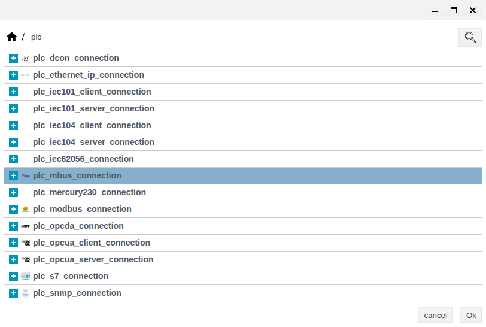
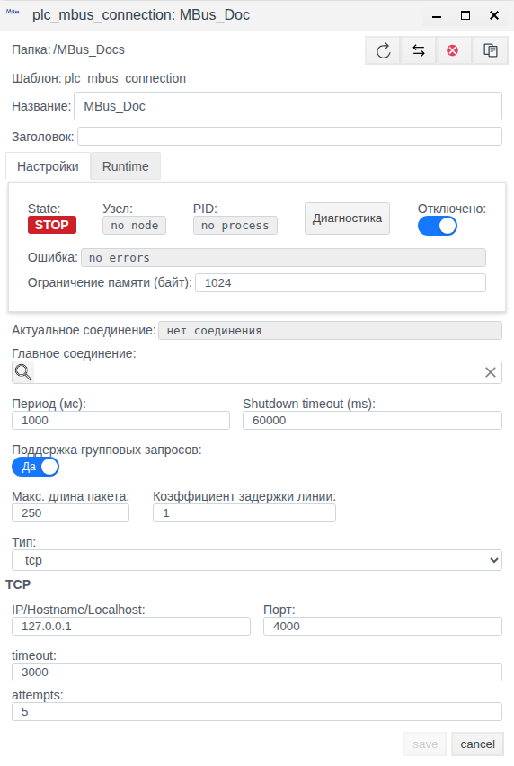
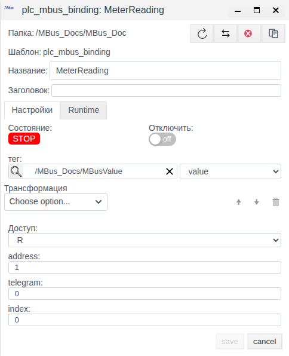
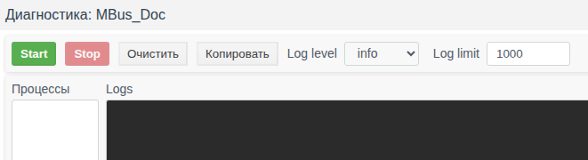

# M-Bus in Faceplate: configuring connections and bindings

Faceplate v4.0.7. An integrator's guide.

The screenshots show the Russian interface. Actual Russian UI labels are retained below with English explanations; these explanations are not verified labels of an English localization.

**Contents**

- [Configuration route](#configuration-route)
- [Map example: index, number and units](#map-example-index-number-and-units)
- [1. How the connection works](#1-how-the-connection-works)
- [2. What to prepare](#2-what-to-prepare)
- [3. Create the connection and configure its bindings](#3-create-the-connection-and-configure-its-bindings)
- [4. Manage the connection](#4-manage-the-connection)
- [5. Check the data](#5-check-the-data)
- [6. Settings reference](#6-settings-reference)
- [7. Diagnostics and recovery](#7-diagnostics-and-recovery)

[Connection catalogue](./index.md) · [Prepare fields and bindings](./bindings.md) · [Transformations](./transformation.md) · [Diagnostics and recovery](./diagnostics.md)

## Configuration route

Prepare an external source or client and a compatible tag field using the shared guide. Configure the channel, save a complete binding and verify a new value. For supported writing/reception, separately confirm the external result; after correcting a failure repeat verification with a new control value.

[Alternative channels and signal maps](./bindings.md#configure-an-alternative-channel) share one procedure; check driver-specific switching conditions.

## Map example: index, number and units

Obtain the complete telegram layout and confirm that the required block and every preceding block can be decoded. Illustrative map: address 1, telegram 0, index 0, unsigned number 1000, documented multiplier 0.001, unit m³.

Set MeterReading to R, tag MBusValue, float field value and Scaling: Factor 0.001, Cмена 0. Save and independently reopen addressing, field and scale. Only with that map should 1000 yield 1.0 m³ and new 1001 yield 1.001 m³. VIF/VIFE do not apply this conversion automatically.

For serial, retain binding settings and configure the actual port and line framing on the connection; independently verify opening and a new response. For constant readings confirm a fresh response for the correct address/telegram/index externally. W/RW do not write readings. This is an illustrative map recipe, not a specific meter test.

## 1. How the connection works

M-Bus is used to read metering devices. Faceplate initiates polling: it opens a TCP channel to a gateway or a serial port on the execution node, requests device data and delivers the selected result to the project. This driver has no switch to a server role. A TCP gateway must carry compatible M-Bus frames; an Ethernet or serial interface alone does not establish compatibility.

| Concept | What it determines |
|---|---|
| Protocol | M-Bus request and response rules |
| Driver | Supported commands, transport and data decoding |
| Connection | A shared channel, waiting and execution settings |
| Binding | A device, telegram, data block, transformation and destination field |
| Tag / tag field | A project object and the specific field receiving the result |
| Telegram code | A value selecting data according to the device documentation |
| Index | A response block number, starting at 0 |

Read path: **device → connection channel → binding telegram and index → decoding → transformation → selected tag field**. A connection can contain multiple bindings for different parameters and addresses. Prepare the tag first; creating a connection does not automatically create application signals.

Each readable binding performs its own sequence of service reset, telegram selection and response request. M-Bus has neither a shared telegram cache for several bindings nor grouped requests. The number of parameters, waiting times and retries increase the duration of a complete scan.

**Writing values to the device is not implemented.** The common form offers R/W/RW, but W excludes the binding from reading, and RW does not add working writes. Select **R** to receive readings. A successful outgoing-operation status does not confirm a device change. Service commands are still sent as part of polling.

## 2. What to prepare

Before connecting to a working source, obtain the following from the device supplier or administrator:

- The transport, Faceplate execution node and actual gateway IPv4/port, or the system port and serial-line settings.
- The device address, telegram code and block map with indexes, formats, units and multipliers.
- A suitable field of an existing tag and permission to configure project objects.
- The permitted polling load, response time and a way to verify a new reading independently.

The IP address and system port belong to the execution node, not the computer running the browser. Serial requires a suitable converter and access to that node's port. The driver has no secondary-address search or automatic device discovery.

Check the entire response structure up to the required block. Unsigned little-endian integers and BCD are supported; there is no separate decoding of signed numbers, dates, strings or BCD signs. The 32-bit real and variable-length formats are unsupported; an unsupported preceding block can also prevent reaching the required index. Some block service flags are rejected. Continuation from a subsequent frame is not assembled.

VIF/VIFE units and multipliers are not applied automatically. The decoded number may need conversion according to the device map. Matching the index without checking the format and units is insufficient.

### Training objects

The example verifies **configuration persistence**, without a device. The `/MBus_Docs` folder and `/MBus_Docs/MBusValue` tag are prepared with a visible float field named `value`, initially 0. This is an initial number, not a source reading. Prepare an equivalent folder, tag and field in your own project.

| Parameter | Example value |
|---|---|
| Connection | MBus_Doc, disabled throughout |
| Transport and address | tcp, 127.0.0.1:4000 — a training endpoint |
| Period / timeout / attempts | 1000 ms / 3000 ms / 5 |
| Binding | MeterReading inside the connection |
| address / telegram / index | 1 / 0 / 0 — illustrative addressing |
| Access / transformation | R / no transformation |
| Destination | /MBus_Docs/MBusValue, field value |

The values 1/0/0 are not a map of any tested device. The connection and binding are created in the next section as parts of one example.

## 3. Create the connection and configure its bindings

### Create and save the channel

1. Open **Меню → Общий вид** (Menu → General view), then the prepared `/MBus_Docs` folder.
2. Click **Создать** (Create), double-click the **plc** category and select the M-Bus connection row highlighted in the figure. Confirm with **Ok**. The list uses technical labels; use the illustrated row.
3. Set **Название** (Name) to `MBus_Doc`. Enable **Отключено** (Disabled) before the first save.
4. Select **Тип** (Type) = **tcp**. Enter **IP/Hostname/Localhost** = `127.0.0.1` and **Порт** (Port) = **4000**.
5. Set **Период (мс)** (Period) = **1000**, **timeout** = **3000** and **attempts** = **5**. Leave the other common settings unchanged and **Главное соединение** (Main connection) empty.
6. After entering a number, press **Tab** and check the value. To replace the port, select its contents with **Ctrl+A**, type **4000** and move focus away.
7. Make sure **Отключено** is enabled, then click **save**.
8. After the form closes, select `MBus_Doc` and click **Редактировать** (Edit). Check every specified setting, then close the unchanged form with **cancel**.

Figure 1. The required row in the actual type list. The repeated capture of this list was cancelled without creating a second object.

Figure 2. TCP, address, port, waiting settings and disabling were checked after a separate reopening.

In the new form, the IP appears as a placeholder without an entered value, and the port is 1024. Enter the actual IP and port explicitly. A visual number change before moving focus does not establish persistence: during automated-input verification, the port reverted to its initial value. Keyboard input, Tab and a separate reopening confirmed 4000.

### Select data and the tag field

1. Double-click `MBus_Doc` and click **Создать**. Inside the connection, the child-binding form opens directly.
2. Set **Название** = `MeterReading`, **address** = **1**, **telegram** = **0** and **index** = **0**.
3. Enter `/MBus_Docs/MBusValue` in **тег** (tag), press **Tab**, then select **value** in the adjacent list. This path is relative to the project; selecting only the object without its field does not complete the assignment.
4. Leave **Доступ** (Access) = **R**, **Трансформация** (Transformation) empty and **Отключить** (Disable) off. The parent connection remains disabled.
5. Click **save**, wait for the form to close, then separately open `MeterReading` with **Редактировать**.
6. Check addressing, R, the absence of transformations, the tag path and the selected field. Close the form with **cancel**.

Figure 3. The separately reopened binding with persisted addressing and destination.

Without a correct tag/field pair, the result may remain only in the binding's own value. Open `MBusValue` and check that `value` is available; do not use the initial 0 as proof of reading. The example's float field accepts numeric results, but unit conversion is not configured.

## 4. Manage the connection

### Change settings

In **Общем виде**, select the object and open **Редактировать**. Change shared settings in the connection, and individual-signal addressing and destination in its binding. After **save**, close and separately reopen the object. Changing execution settings of a working channel can recreate its execution; check new data afterwards.

For a serial connection, select **serial** and supply the port and line settings from the equipment documentation. Only the selected transport is active. The reference covers serial settings; the practical example remains TCP and contains no additional serial saves.

### Enable or disable

Before a working start, replace the training values with verified source settings and check all bindings. Turn off **Отключено** on the connection and save. Also check project execution permission, dependencies and node availability, followed by the process, errors and new data.

To stop the whole channel, enable **Отключено** and save the connection. To exclude one signal, enable **Отключить** in its binding. An enabled binding does not start a disabled parent channel. The value on stopping depends on the field type and transformation; there is no universal reset to zero.

**Главное соединение** links a backup configuration to a main connection of the same type. The backup configuration is automatically disabled for independent execution and is used by the main channel. Recursive chains are prohibited. Switching is associated with a connection-establishment error; an individual binding error does not guarantee switching. This field is empty in the example.

### Find the connection and check its mode

Open **Меню → Драйверы ПЛК** (Menu → PLC drivers), enter the path or a sufficiently specific fragment in **Поиск по пути** (Path search), then click **Найти** (Find). Select the **mbus** type if necessary. Check the returned connection's path, mode and state. Double-clicking its row opens its bindings.

Figure 4. Part of the found MBus_Doc row: Откл. (Disabled), ОШИБКА (Error), STOP.

For the tested disabled object, the red **ОШИБКА** had a `no errors` tooltip; the form also displayed **Ошибка: no errors**. The list indicator reacts to nonempty message text. Read the tooltip together with the mode and process: this observation does not establish a transport error, because the example never opened the transport.

## 5. Check the data

Check execution permission, the process/channel, the individual binding and the result in the selected field in that order. **RUN** can appear before a device response; a connection-wide **OK** does not rule out an individual read error. With the training channel disabled, its binding displayed **Вкл. / OK / STOP** (Enabled / OK / STOP), which did not confirm reading.

After enabling a working connection, match the address, telegram, index, format, units, transformation and field type. The decoder does not apply a VIF multiplier. A float is rounded when delivered to an integer field, and an integer is converted to float for a float field.

If the required block is absent, the binding's own value may contain `not_defined` while its status remains OK and the numeric tag field retains its old number. Check the map and the actual response structure; a successful status is insufficient.

Confirm a new read with a distinguishable expected source reading. If the reading does not change, independently observe a fresh, valid response and match it to the received result. There is no universal timestamp of a successful read; an identical number is not rewritten to the field on every poll. An old number, a disappearing error or a manual tag edit does not confirm recovery.

The training example confirms saving and reopening settings. The connection remains disabled, and the tag's initial value is not an exchange result.

## 6. Settings reference

### Common connection settings

The tables distinguish initial form values from object-model defaults. Form ranges describe numeric input, not completed boundary-save tests. The optional **Заголовок** (Title) can remain empty; the user chooses **Название** and the project location.

| Field | Initial value and range | Purpose and applicability | How to check |
|---|---|---|---|
| Период (мс) | 1000; form 1–3600000 ms | Planned period of a full scan. A long scan can exceed it | Check the saved number and the duration of real communication |
| Shutdown timeout (ms) | 60000; form 10–3600000 ms | Wait for graceful process termination, not a device response | Reopen; verify termination separately |
| Отключено | Off in a new form | Prevents independent execution of the entire connection | Save; compare mode, process and state |
| Главное соединение | Empty | Optional backup configuration of the same type | Check the link and actual switching conditions |
| Поддержка групповых запросов | Да (Yes) in the form | Grouped reading is not implemented for M-Bus | Do not treat the enabled switch as proof of grouping |
| Макс. длина пакета | 250 in the form; 1–10000 | A common grouping field, not an M-Bus telegram size | Not used for individual M-Bus reads |
| Коэффициент задержки линии | Form 1; model 2; form 1–10 | Dimensionless grouping parameter, not a pause between M-Bus requests | Not used for individual M-Bus reads |
| Ограничение памяти (байт) | New form empty; 1024 after saving | Actually interpreted in MiB: 1024 corresponds to 1 GiB, despite the bytes label | Left unchanged in the example; do not interpret it as bytes |

### TCP and serial

| Field | Initial value and range | Purpose and applicability | How to check |
|---|---|---|---|
| Тип | tcp; tcp / serial | The sole active transport | Reopen and check the selected group |
| IP/Hostname/Localhost | Empty input, 127.0.0.1 placeholder; model 127.0.0.1 | TCP only, numeric IPv4; the driver does not resolve DNS or localhost | Enter the actual IPv4 explicitly |
| Порт TCP | Form 1024; model 4000; form 1–65535 | Gateway port, not the device address | Tab, save, separate reopening and comparison |
| Порт SERIAL | /dev/tty0 in the form | Port path on the execution node; it must exist and be accessible | Check against the system and verify on a working start |
| Скорость | 9600 | Options: 300, 600, 1200, 2400, 4800, 9600, 19200, 38400, 57600, 115200, 230400, 460800, 500000, 576000 | Match the device and port capabilities |
| Четность | нет; нет / четный / нечетный (none / even / odd) | Serial-line setting | Match the equipment |
| Стоп-биты | 1; 1 / 2 | Serial-line setting | Match the equipment |
| Размер байта | 8; 5 / 6 / 7 / 8 | Number of serial data bits | Match the equipment |
| timeout | 3000; form 1–6000 ms | Wait for individual response parts; TCP connect separately uses 3000 ms | Account for the whole request, retries and actual response time |
| attempts | 5; form 1–500 | Maximum number of sends per transaction, including the first | Do not assume every error uses every retry |

For TCP, a first-byte timeout returns an individual read error without exhausting retries; for serial, this wait is retried up to the attempt limit. Exhausting attempts gives `no_response` and leads to reconnection. A full poll includes multiple transactions and receives separate parts, so timeout is not the scan duration. The baud-rate list does not guarantee support by a particular port.

### Binding

| Field | Initial value and range | Purpose and applicability | How to check |
|---|---|---|---|
| address | 1; form 1–250, driver 1–254 | Device address in the frame and checked response | Match the device map/settings, separately from IP and port |
| telegram | 0; form 0–6000 | Telegram-selection code sent as a single byte | Confirm the byte code from the device documentation |
| index | 0; form 0–6000 | Sequential block starting at zero, not a byte offset | Match the complete response structure |
| тег and adjacent field | Empty | Existing object and specific destination field | Check the path and selected field after save/reopen |
| Доступ | R; R / W / RW | R reads, W excludes reading; RW does not provide physical writing | Use R for readings |
| Трансформация | Empty chain | Forward processing before field-type adaptation | Check order, parameters and result units |
| Отключить | Off | Excludes the individual binding | Check together with the parent's permission |

A telegram value above 255 is truncated to its least significant byte: 256 is sent as 0, and 6000 as 112. The form's large range does not establish device support for such a code. An incorrect index can leave an old numeric field with OK; checking the response is essential. The driver does not automatically select a tag, field or addressing from the device.

### Transformations

The operation names below are those used in the editor. All listed operations are available for reading; initial parameters do not always form a working configuration.

| Operation | Parameters | Result and units | Verification and missing data |
|---|---|---|---|
| Scaling | Factor = 1, Shift = 0 | Input × Factor + Shift | Obtain the multiplier from the device map; a nonnumeric input produces no value |
| Default Value | Value = 0 | Passes a number through; replaces nonnumeric input with the specified number | Substitution can conceal missing communication or an index error |
| Limit Control | Lower Limit = 0, Upper Limit = 0 | Passes a number in the inclusive interval; outside it, produces no value | Requires Upper Limit > Lower Limit; change the initial 0/0; this does not clamp to a boundary |
| Damper | Tlag = 1; form minimum 1; positive number | Smoothing, Tlag in ms; the first number passes through | Nonnumeric input does not update accumulated state |
| Derivative | No parameters | Input change / actual interval, input units/ms | The first number does not yet produce a derivative; a zero interval can cause an error |
| Integration | No parameters | Sum of current input × actual interval, input units×ms | The first number establishes time; the initial sum is not configurable |
| Script | Erlang editor and context variables | Three arguments: input, context, state; result: output and new state | The script defines missing-input handling; an execution error produces no value |

The chain runs from top to bottom. Each operation keeps its own state. Time-dependent operations use actual call intervals in milliseconds, not device time or the configured period; there is no automatic conversion to seconds. Nonnumeric input does not reset the time reference of the damper, derivative or integral. Recreating a binding or process starts state again; an ordinary reconnection does not guarantee a reset.

For W/RW, the common validation additionally requires reversibility; Script, Derivative and Integration do not satisfy it. This does not add the missing M-Bus writes. The training MeterReading keeps an empty chain.

### States and result

| Indicator | Set by | What it confirms and how to check |
|---|---|---|
| Отключено / mode | User and execution conditions | Permission, not the existence of communication |
| Узел and PID | System | Worker process; no node/no process indicates the absence of the respective assignment/process |
| RUN / STOP | System | Execution state, not reading correctness |
| Актуальное соединение | System | Selected transport configuration; нет соединения means it is not established |
| Ошибка / Статус | System and list rendering | Channel or binding message; read together with its tooltip and data |
| Binding's own value | Processing result | Can be missing, erroneous or old; compare with the map and field |
| Tag field | Delivery result and field type | The number alone does not establish a new read |

## 7. Diagnostics and recovery

### Diagnostics window

Open the saved connection with **Редактировать** and click **Диагностика**. The window is also available for a disabled connection.

Figure 5. Top portion of the actual MBus_Doc diagnostics window. Log collection was not started in the example.

**Start** begins collection and **Stop** stops it. **Log level** offers info, warning, error and debug; initially info. **Log limit** is initially 1000, with a form range of 1–100000 lines. **Очистить** (Clear) clears the output; **Копировать** (Copy) copies existing output. **Процессы** (Processes) and **Logs** were empty in the disabled example; collecting and copying substantive messages were not tested. An empty log does not establish correct operation, and every successful TCP transaction is not automatically logged.

### Find the cause and confirm the result

| Symptom | What to check | Action | Result confirmation |
|---|---|---|---|
| STOP, no process | Disabling, project, dependencies, node | Restore execution permission only for the intended working channel | A process appears; a new read is confirmed separately |
| TCP/serial error, timeout, no_response | IPv4/port or system port, line, device address, response time | Compare settings with the source and correct the cause | A new valid response and the expected field |
| Addressing or format error | address, telegram byte code, index and all preceding blocks | Clarify the map and supported format | The intended block is selected and its value received |
| RUN/OK but an old field | Binding value, not_defined, destination field and transformation | Correct index/destination; check the original response | A distinguishable new reading or fresh response matched to the field |
| Wrong scale or substitution | VIF units, multiplier, field type, Default Value | Set a verified transformation and independent freshness monitoring | Value and units match the source |
| W/RW does not change the device | Actual write support | Use R for polling; do not use this driver's writes | Reading verified separately; outgoing success not treated as a physical effect |
| Empty Logs | Active collection, level, channel state | Check collection settings and data independently of the log | Output assessed by its content; communication by a fresh response |

After correcting a working channel, reopen settings and check persisted values, then check the process, binding errors and data. A disappearing error is insufficient. Recovery evidence must refer to communication after the correction, rather than a previously retained reading.
