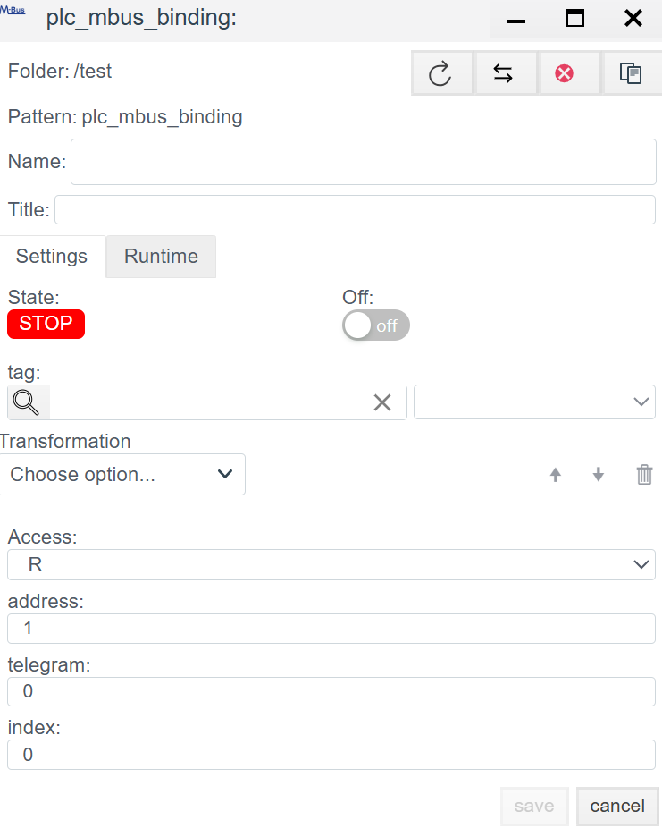

# M-Bus (Meter-Bus) Driver Configuration

> See also: [PLC Connections overview](./general_en.md)

## Overview
**M-Bus (Meter-Bus)** is a European standard (EN 13757) for remote reading of commercial metering devices: heat meters, water meters, gas meters, and power meters.

In **Faceplate**, the M-Bus driver is hybrid and supports two physical layers:
1. **Serial (COM):** Direct connection to a master level converter (M-Bus <-> RS-232/485).
2. **TCP (Ethernet):** Connection through remote gateways (Ethernet-to-MBus) or transparent converters.

Configuration is done in two stages:
1. **Connection (`plc_mbus_connection`):** Transport setup to the bus.
2. **Binding (`plc_mbus_binding`):** Poll a specific variable inside a device.

---

## 1. Connection setup (Connection)
> Create a PLC connection -> [Create a PLC connection](./general_en.md#create-a-plc-connection)

This step configures the master device that polls the bus.

> Diagnostics and common settings are described in [Common connection settings](./general_en.md#common-connection-settings).

### 1.1 Protocol parameters (MBUS)

#### 1.1.1 `serial` mode (direct connection)
Devices are connected via RS-485. Faceplate connects through RS-232<=>RS-485 or USB<=>RS-485 converters. If one serial port is used for multiple devices, configure a single shared connection. M-Bus device addresses are set in bindings (see Binding creation).

| Field | Description |
| :--- | :--- |
| **Port** | System port name (Linux: `/dev/ttyUSB0`, Windows: `COM1`). |
| **Baud rate** | Baud rate. *Standard:* usually **2400** (less often 9600). Must match the device settings. |
| **Parity** | Parity. *Standard:* usually **Even**. The screenshot shows `no`, but most heat meters require `Even`. |
| **Data / Stop bits** | Usually 8 data bits and 1 stop bit. |
| **Timeout** | Maximum response time. For M-Bus, use a safe margin (3000-5000 ms). **Warning:** Increasing this on poor links can introduce delays. |
| **attempts** | Number of retries. Defines the maximum number of repeated requests when there is no response. |

#### 1.1.2 `tcp` mode (network gateway)
Use this type for TCP<=>RS-485 gateways. This allows TCP<=>RS-485 converters to act as master devices and communicate with many meters.

| Field | Description |
| :--- | :--- |
| **IP/Hostname** | Gateway IP address or hostname. |
| **Port** | Port used to connect to the gateway. |
| **Timeout** | Account for network delays and bus latency. |
| **attempts** | Number of retries. Defines the maximum number of repeated requests when there is no response. |

---

## 2. Binding setup (Binding)

An M-Bus device returns **all** data in one packet. The binding extracts the required value from that packet.

> Create a PLC binding -> [Create a PLC binding](./general_en.md#create-a-plc-binding)

> Common binding fields are described in [Common PLC binding fields](./general_en.md#common-plc-binding-fields).

### 2.1 Binding-specific parameters

| Field | Description |
| :--- | :--- |
| **Address** | **Primary Address.** Number from 1 to 250. Unique meter address on the bus. |
| **Telegram** | Requested telegram code. Supported telegrams are described in the device documentation. |
| **Index** | **Telegram parameter index (starting from 0).** The M-Bus telegram has a fixed structure where each block corresponds to one measured parameter. The index selects the block to bind. See device documentation for details. |

> Binding error -> [Binding errors](./general_en.md#binding-errors)
---