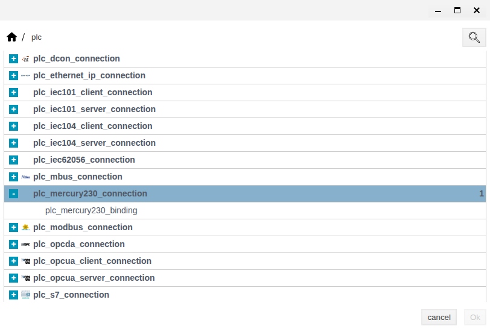
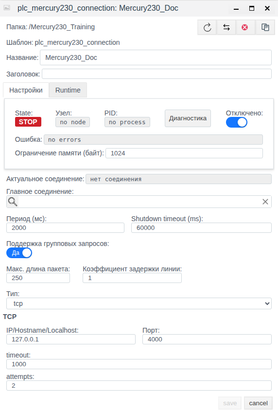
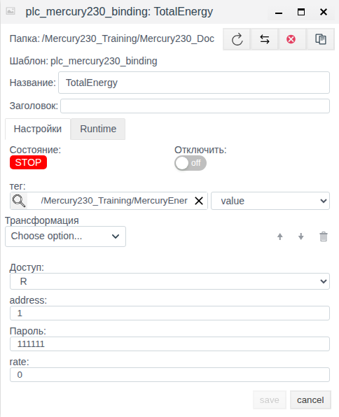
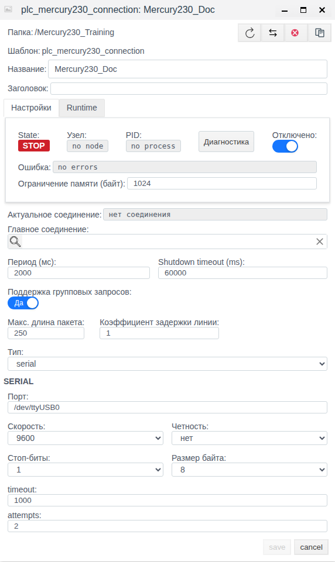
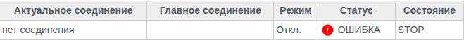
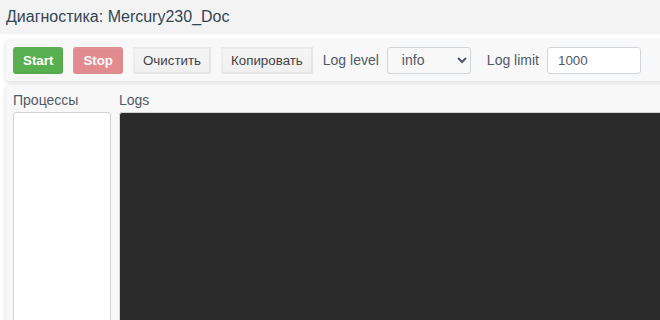

# Mercury 230 in Faceplate: Configuring Connections and Bindings

Faceplate version: v4.0.7.

This guide explains how to read cumulative meter energy into a tag field over TCP or a serial port. The training example saves a disabled connection and binding, then verifies them by reopening each object. Its addresses and password are training values; they do not establish that a transport was opened or a reading received. Screenshots show the Russian UI. Actual Russian control labels are retained below with English explanations; they are not verified English localization labels.

**Contents**

- [Configuration route](#configuration-route)
- [Conversion example and multiple-tariff verification](#conversion-example-and-multiple-tariff-verification)
- [1. How the Connection Works](#1-how-the-connection-works)
- [2. What to Prepare](#2-what-to-prepare)
- [3. Creating a Connection](#3-creating-a-connection)
- [4. Configuring Bindings](#4-configuring-bindings)
- [5. Editing, Enabling and Disabling](#5-editing-enabling-and-disabling)
- [6. Verifying Data](#6-verifying-data)
- [7. Parameter Reference](#7-parameter-reference)
- [8. Diagnostics and Recovery](#8-diagnostics-and-recovery)

[Connection catalogue](./index.md) · [Prepare fields and bindings](./bindings_en.md) · [Transformations](./transformation_en.md) · [Diagnostics and recovery](./diagnostics_en.md)

## Configuration route

Prepare an external source or client and a compatible tag field using the shared guide. Configure the channel, save a complete binding and verify a new value. For supported writing/reception, separately confirm the external result; after correcting a failure repeat verification with a new control value.

[Alternative channels and signal maps](./bindings_en.md#configure-an-alternative-channel) share one procedure; check driver-specific switching conditions.

## Conversion example and multiple-tariff verification

An ordinary binding reads the first cumulative-energy value for the selected tariff. Before scaling, obtain the specific meter's raw unit, value per count and required transformer factors.

Illustrative map: each count is 0.1 kWh and already includes the agreed factors. Set TotalEnergy linked to float MercuryEnergy.value to Scaling: Factor 0.1, Cмена 0; raw 1000 corresponds to 100.0 kWh and new 1001 to 100.1 kWh. This factor is inapplicable to another map. Save and reopen destination and scale.

For a second tariff, create a separate R binding with a confirmed rate and separate field; do not send different tariffs to one field. Separate sessions increase cycle duration. For unchanged energy, verify freshness through a new successful request/response or source request counter.

The hidden command mode is not a ready control procedure and does not add energy writes. This example does not confirm actual exchange or a specific meter's units.

## 1. How the Connection Works

### Connection and the Role of Faceplate

Faceplate initiates communication: it opens access to the meter, requests a reading and closes the session. The connection carries Mercury binary commands over outbound TCP or a serial port on the Faceplate execution node. TCP requires a compatible source or a transparent interface converter carrying this protocol. This driver has no server mode, UDP or Modbus support.

### Concepts and Object Responsibilities

| Concept | Responsibility |
|---|---|
| Protocol | Meter command and response format, device address and integrity checking. |
| Driver | Command generation and retrieval of the supported reading in Faceplate. |
| Connection | Transport, traversal period, response wait and attempts. |
| Binding | A child of the connection: meter address, password, tariff, access, transformation and result destination. |
| Tag / tag field | An existing project object and the particular field receiving the value. The field is selected separately from the tag. |

The IP address and TCP port identify the channel to the source. **address** in the binding identifies the meter within the protocol. Bindings in one connection can address different meters and tariffs.

### Data Path and Directions

The read path is: connection → meter using the binding address and password → selected tariff request → first cumulative energy value from the response → transformation → conversion to the field type → tag field. Creating a connection or binding does not automatically create an application tag.

The returned number is a raw unsigned value in the range 0–4294967295. The driver assigns no units and applies no automatic scaling or transformer ratios. Establish the units and tariff meaning for the particular meter. This driver does not read voltage, current, power, profiles or arbitrary registers.

Use **R** for energy. The common form also offers **W** and **RW**, but writing cumulative energy is not implemented: a successful write result does not mean that the meter changed. A preconfigured command mode is discussed beside the access settings in section 4.

## 2. What to Prepare

### Equipment and Channel Details

Before enabling the connection, obtain the following from the person responsible for the meter:

- For TCP: a numeric IPv4 address and source port reachable from the Faceplate execution node. **IP/Hostname/Localhost** is a common label; this driver does not resolve DNS names.
- For serial: the port path on the execution node, baud rate, parity, stop bits and data bits. Check that serial support is available and that the Faceplate process can access the port.
- Meter address, a password consisting of decimal digits and a tariff code in the range 0–5. Establish the tariff mapping and valid password length from the meter documentation.
- Reading units, scale and an independent way to confirm new communication after startup or recovery.

### Project Objects and Access

You need permission to create and edit objects. The diagnostics window requires administrative access.

The example starts with a prepared `/Mercury230_Training` folder and `/Mercury230_Training/MercuryEnergy` tag with an integer runtime field named `value`, initially 0. In your project, prepare a suitable numeric tag and a field capable of holding the required range. The example's initial 0 was set during preparation; it is not a meter reading.

The folder will contain the `Mercury230_Doc` connection and its `TotalEnergy` binding. The connection remains disabled throughout the example.

## 3. Creating a Connection

### Create the Object

1. In **Общий вид** (General view), open `/Mercury230_Training`.
2. Click **Создать** (Create), enter the **plc** group and select the parent Mercury connection row shown in the figure. The child row is the binding type. Confirm with **Ok**. The type list uses technical captions; use the highlighted parent row as a guide.
3. Enter `Mercury230_Doc` in **Название** (Name). Turn on **Отключено** (Disabled) before the first save.

Figure 1. Actual type list: the parent Mercury connection is expanded, with the binding type beneath it.

### TCP Parameters

1. Set **Тип** (Type) to **tcp**. In **TCP**, enter **IP/Hostname/Localhost** = `127.0.0.1` and **Порт** (Port) = 4000.
2. Set **Период (мс)** (Period, ms) = 2000, **timeout** = 1000 and **attempts** = 2.
3. Leave the other common settings at their initial values. Verify that **Отключено** is on and click **save**.
4. After the form closes, select the connection row again and open **Редактировать** (Edit). Check the name, disabled setting, transport, IP, port and the three numeric settings. Close with **cancel** if you made no changes.

Figure 2. Saved TCP settings of the disabled connection. The inactive save button indicates that the reopened form has no new edits.

In the verified new form, the initial port is 1024 and the IP is a placeholder without an entered value. Enter both explicitly. `127.0.0.1` means the Faceplate execution node; it does not by itself identify a remote meter.

### Serial Port

After creating the binding in the next section, you can switch the same object to serial as described in section 5. Training settings: `/dev/ttyUSB0`, baud rate 9600, 8 data bits, **нет** (no parity), 1 stop bit — 8N1. The path belongs to the execution node, not the computer running the browser. The example did not verify that this port exists or opens.

### Save and Verify

After the form closes following **save**, reopen it separately and compare the values. This verifies configuration persistence. It does not prove that execution is permitted, the transport opened or the meter responded.

## 4. Configuring Bindings

### Meter Address, Password and Tariff

1. In **Общий вид**, double-click `Mercury230_Doc` and click **Создать** inside the connection. The child binding form opens.
2. Set **Название** = `TotalEnergy`, **address** = 1, **Пароль** (Password) = `111111` and **rate** = 0.
3. Leave the binding's **Отключить** (Disable) off. The disabled parent connection still prevents execution.

The password is empty in the verified new form; enter it explicitly. The field displays plain text, so the figures use only a training password. The driver uses a fixed consumer access level of 01; the form provides neither another level nor a separate write password. Nondecimal characters are invalid; the form does not separately validate length.

**rate** is sent to the meter literally. The example's 0 is not a verified tariff name. The form has no upper bound, but the driver accepts only 0–5.

### Tag and Field

In **тег** (tag), select `/Mercury230_Training/MercuryEnergy`, then explicitly select `value` in the adjacent dropdown. Selecting only the tag does not complete the destination. Without a target field, the binding can hold its own value, but this does not deliver a reading to the required project field.

### Access and Transformation

Set **Доступ** (Access) to **R** and leave **Трансформация** (Transformation) empty. The value is converted to the field type without additional scaling; converting a fractional result to an integer uses rounding.

The common transformation chain supports scaling, default value substitution, limiting, damping, scripts, differentiation and integration. Choose it according to the field's units and purpose. Substituting a constant on error can conceal missing data. A transformation error can also produce an empty result while the binding has no communication error.

**R** and **RW** participate in reads; **W** is excluded from cyclic polling. Writing through **W/RW** requires a supported command and a reversible transformation. Scripts, differentiation and integration have no reverse transformation. Verify the reverse path separately before using it for control.

A preconfigured setup may contain a hidden command mode absent from the normal parameter choices in the form. In this mode, reading returns a synthetic 0 after access is opened. Writing integer 1 sends a command sequence with a 2000 ms pause; writing 0 does not send that command. Its physical purpose has not been established here; the synthetic 0 is not equipment feedback. A **W** binding can resend the current field command on activation or reconnection. This mode requires a separately confirmed configuration and equipment test; it is not used in this example.

### Save and Verify

1. Click **save**, wait for the form to close, then separately open `TotalEnergy` through **Редактировать**.
2. Check the address, password, tariff, R, empty transformation, tag path and selected field. A long path can be visually truncated, so verify the entire destination in the selection control.
3. Close the unchanged form with **cancel**.

Figure 3. Reopened TotalEnergy: R, address 1, training password, tariff 0, value field and empty transformation.

### Multiple Meters and Tariffs

Create a separate active child binding for each meter and tariff combination. Give each its own address, password, tariff and target field. They share the connection transport. Each readable binding has a separate access, read and close session; additional bindings and attempts increase the full traversal time.

## 5. Editing, Enabling and Disabling

### Change Transport and Parameters

1. Open `Mercury230_Doc` through **Редактировать** and verify that **Отключено** is on.
2. Change **Тип** to **serial**. In **SERIAL**, set **Порт** = `/dev/ttyUSB0`, **Скорость** (Baud rate) = 9600, **Четность** (Parity) = **нет**, **Стоп-биты** (Stop bits) = 1 and **Размер байта** (Data bits) = 8. Keep period 2000, timeout 1000 and attempts 2.
3. Click **save**, then separately reopen the connection and check the serial settings and disabled setting.
4. Separately open `TotalEnergy` and verify that its address, password, tariff, R, tag, field and empty transformation were preserved. Close the forms without changes.

Figure 4. The same disabled channel after switching to serial, with saved 9600/8N1 and traversal settings.

Only the selected transport is active; the other transport's fields do not apply to it. To return to TCP, select tcp, check its IP and port, save and reopen the object.

### Permit or Prevent Execution

Before a production start, replace the training settings with confirmed equipment settings and check every binding destination. In the connection form, turn off **Отключено**, save and check the state. Execution permission also depends on the node, dependencies and overall project configuration.

To stop the connection's own execution, turn on **Отключено** and save. To exclude a single signal, turn on **Отключить** in its binding and save it. Enabling an individual binding does not start a disabled parent channel. After changing a working connection, check its state and new data: saving parameters alone does not confirm restored communication.

**Главное соединение** (Main connection) is used for a backup configuration of the same concrete type. A subordinate configuration is forcibly disabled for independent startup; the main connection's process uses it. Chains of main connections are not allowed. Configuration switching is associated with a connection failure; an individual binding error does not guarantee switching. This field is empty in the training example, and failover was not tested.

### Check the State After a Change

Open **Меню → Драйверы ПЛК** (Menu → PLC drivers), find `Mercury230_Doc` and compare the mode, state, active connection and error message. After all example actions: **Режим** (Mode) = **Откл.** (Disabled), **Состояние** (State) = **STOP**, **Актуальное соединение** (Active connection) = **нет соединения** (no connection).

Figure 5. Detail of the Mercury230_Doc row in the PLC list. The red status requires the explanation below.

For the verified disabled object, **Статус** (Status) shows **ОШИБКА** (Error), while its tooltip and the editor error field contain `no errors`. The list assigns this status to any nonempty error string. This is a display behavior; it does not confirm a meter communication fault. The example never started communication.

## 6. Verifying Data

### Permission, State and Data

Distinguish three checks: the object is permitted to execute; the process runs and opens the channel; the required binding delivers new data to the selected field. **RUN** can appear before a successful connection. A connection can show **RUN/OK** while an individual binding has an error, or even when there are no readable bindings.

After a production enable, check the node, PID, active connection and channel error. Then check the required binding's state, error and value, its access, disabled setting and tag link. Compare the field result with the address, tariff, units and applied transformation. These state fields are populated during execution; they are not user settings.

### Confirm a New Read

Allow a full traversal, including waits and attempts. The period does not guarantee that every field updates at exactly that interval. On a read error, the transformation chain can receive an empty value; default substitution may display a plausible constant.

Confirm a new read using a new expected reading independently known from the source. If energy does not change during the check, use an external capture of a successful new request and response, or an independent source request counter. An unchanged value is not written to the field again, and this binding has no separate last-read time or request counter. An unchanged number, RUN/OK and a cleared error are insufficient evidence of freshness.

The training example verified configuration saving and reopening. The initial tag value was not used as proof of reading.

## 7. Parameter Reference

### Connection

Initial values below refer to the verified new form unless stated otherwise. Example values are entered explicitly. The user selects the name and folder; execution determines the state, node, PID, error and active connection.

| Field | Initial value | Range / condition | Purpose and verification |
|---|---|---|---|
| Тип (Type) | tcp | tcp / serial | Transport selection. Reopen after save and check the active field group. |
| IP/Hostname/Localhost | Empty input, placeholder 127.0.0.1 | Numeric IPv4, TCP only | Source address from the execution node. Enter explicitly; DNS is unsupported. |
| Порт (TCP port) | 1024 | 1–65535 | Source port. The object schema defaults to 4000; check the saved port instead of assuming that defaults match. |
| Порт (SERIAL port) | /dev/tty0 | Nonempty path, serial only | Execution node port; check path and access, then opening during production startup. |
| Скорость (Baud rate) | 9600 | 300, 600, 1200, 2400, 4800, 9600, 19200, 38400, 57600, 115200, 230400, 460800, 500000, 576000 | Serial only; compare with the meter and reopen the form. |
| Четность (Parity) | нет | нет / четный / нечетный | Serial only; corresponds to codes 0 / 1 / 2. |
| Стоп-биты (Stop bits) | 1 | 1 / 2 | Serial only; check against the line. |
| Размер байта (Data bits) | 8 | 5 / 6 / 7 / 8 bits | Serial only; check against the line. |
| Период (мс) (Period, ms) | 1000 | 1–3600000, step 10 | Full traversal period. If traversal takes longer, the next one begins immediately; measure actual duration. |
| timeout | 100 ms | 1–6000, step 1 | Response wait for an individual operation. Not the whole traversal time; TCP connection wait is fixed at 3000 ms. |
| attempts | 1 | 1–500, step 1 | Attempts for an individual operation. Additional attempts increase traversal time. |
| Отключено (Disabled) | On before first save in the example | On / off | When on, prevents independent execution; verify by reopening and checking process state. |
| Shutdown timeout (ms) | 60000 ms | 10–3600000, step 10 | Process shutdown wait, separate from a meter response. Unchanged in the example. |
| Главное соединение (Main connection) | Empty | Same concrete type; no chains | Optional backup configuration link. Check the active configuration while the main connection runs. |
| Поддержка групповых запросов (Bulk request support) | Да (Yes) | Common field | Mercury uses individual operations; this switch does not add bulk polling. |
| Макс. длина пакета (Maximum packet length) | 250 | 1–10000, step 1 | Common grouping field; does not affect this driver's frames. |
| Коэффициент задержки линии (Line latency coefficient) | 1 in the form | 1–10 | Unused in individual Mercury communication; the schema default of 2 is not an effective line delay. |
| Ограничение памяти (байт) (Memory limit, bytes) | 1024 after saving | Form validation: minimum 10, step 100 | Unit label is inaccurate: execution interprets the number in MiB. Do not treat 1024 as a byte limit; unchanged in the example. |

### Binding

The integrator sets the address, password, tariff, access and destination. Transformation can remain empty. The default readable parameter is cumulative energy; the normal form has no selector for other parameters. An omitted tariff receives the initial 0; enter it explicitly for a verifiable configuration.

| Field | Initial value | Range / condition | Purpose and verification |
|---|---|---|---|
| address | 1 | Form 1–253; schema 0–254 | Meter address, separate from IP. Use a meter-valid value within the form range; verify a response from the required address. |
| Пароль (Password) | Empty in form; 111111 in schema | Decimal digits; length unchecked | Enter explicitly and check against the meter. Displayed without masking. |
| rate | 0 | Driver 0–5; form sets only minimum 0 | Tariff code, meaning defined by the meter. Verify persistence and the expected reading. |
| Доступ (Access) | R | R / W / RW | Use R for energy. W/RW do not add energy writing; verify the reverse path separately for a supported command. |
| тег and adjacent field (Tag and field) | Unselected | Existing tag and numeric field | Select both. The field can have another name; value is the training field name. |
| Трансформация (Transformation) | Empty | Optional chain | Forward chain for reading, reverse chain for supported writing. Check the result and field type. |
| Отключить (Disable) | Off | On / off | Excludes this binding from service. Check after saving. |
| State, error, value | Populated during execution | Separate from the connection | Check the required binding and destination field; its own value without a field link does not deliver data to the tag. |

### States and Verification

| Indicator | Meaning | What to check next |
|---|---|---|
| Откл. / Отключено (Disabled) | Independent execution is prevented | Intended disable, main connection and dependencies. |
| STOP, no node, no process | No running process in the displayed state | Permission, node assignment and stop causes; expected in the example. |
| RUN, node and PID | Process has started | Channel opening and binding service; RUN does not prove a meter response. |
| Актуальное соединение (Active connection) | Configuration selected for operation | A path alone does not prove a successful read. |
| Channel error / list status | Common-level result or its rendering | Read the message and tooltip. ОШИБКА with no errors is discussed in section 5. |
| Binding state / error | Individual signal result | Address, password, tariff, access, transformation and field. |
| Field value | Last written result | Agreement with the source and independent evidence of a new read. |

## 8. Diagnostics and Recovery

### Diagnostics Window

1. Open the saved connection through **Редактировать** and click **Диагностика** (Diagnostics). The window is also available at STOP.
2. Check **Log level**: initially **info**, with **warning**, **error** and **debug** also available. **Log limit** initially equals 1000, range 1–100000.
3. Click **Start** to begin log collection. This button does not enable connection execution. Watch **Процессы** (Processes) and **Logs**.
4. Click **Stop** to stop collection. Use **Копировать** (Copy) to share the log or **Очистить** (Clear) to clear the display if needed. Close the window after checking.

Figure 6. Window detail: collection is stopped and the process and log panes are empty. In the example, collection was started and stopped without enabling the connection.

**Start/Stop** control message collection here. An empty log does not prove channel health, and debug does not guarantee a record of every successful Mercury frame. Use the methods in section 6 to confirm new data.

### Symptoms and Actions

The following table is for an operational connection. These faults were not reproduced in the disabled training example.

| Symptom | Check | Action | Confirmation |
|---|---|---|---|
| STOP instead of operation | Disable, node, dependencies, main connection, error | Permit the required execution and correct the indicated stop cause | Process started, then a new response and the required binding result confirmed. |
| TCP error / connection_error / no_response | Numeric IPv4, saved port, node access, compatible binary protocol | Correct the channel; then address, wait and attempts for actual conditions | Transport opened and a new valid response received from the required meter. |
| Serial opening error | Node port path, process permissions, serial support, line settings | Correct access and match settings to the meter | Port opened, then a new Mercury response received. |
| access_denied | Individual binding password and consumer access level | Enter the agreed numeric password | Access opened successfully and a new read completed. |
| invalid_slave_address / invalid_memory_address | Address and tariff; the latter message can indicate an invalid tariff | Correct the address within form bounds and tariff to 0–5 | Settings saved; separately, a response with the expected reading confirmed. |
| invalid_command / device_internal_error / no_open_connection | Meter response, command compatibility and session opening | Resolve the cause at the meter and repeat the check | New successful response after correction. |
| invalid_response | Complete frame, address, integrity and reply delivery through the TCP converter | Check channel compatibility and delivery of the full response | Complete valid new response received and reading parsed. |
| Channel RUN/OK, signal error | Required binding error, disable, address, password, tariff, access | Correct the binding and check its state separately | Signal processed successfully and a new read confirmed. |
| Empty field or wrong number | Selected tag and field, type, tariff, units, transformation | Correct destination and processing; do not add scaling without meter data | Field value matches an independently known result. |
| Previous number after failure | Permission, signal error, default substitution and freshness | Resolve the failure and choose independent evidence of new communication | New expected reading, or an external new request/response or source counter. |
| Traversal exceeds period | Binding count, individual sessions, waits and attempts | Measure duration and match the period to the load | Actual traversal time and data arrival meet the task. |
| Empty Процессы / Logs | Collection enabled, execution present, events at the chosen level | Check the process separately, select a level; do not treat silence as success | Execution confirmed and new communication established independently. |
| Write succeeds without an effect | Whether parameter writing is supported and what the result means | Use R for energy; check command mode separately | Equipment effect requires separate evidence from the meter. |

### Confirm Restored Communication

After correction, reopen the configuration and verify that the required settings persisted. Check the process and transport, then the individual binding and tag field. Finish with a new expected reading or independent evidence of a new successful request and response. A cleared error and an unchanged previous number alone do not confirm recovery.
