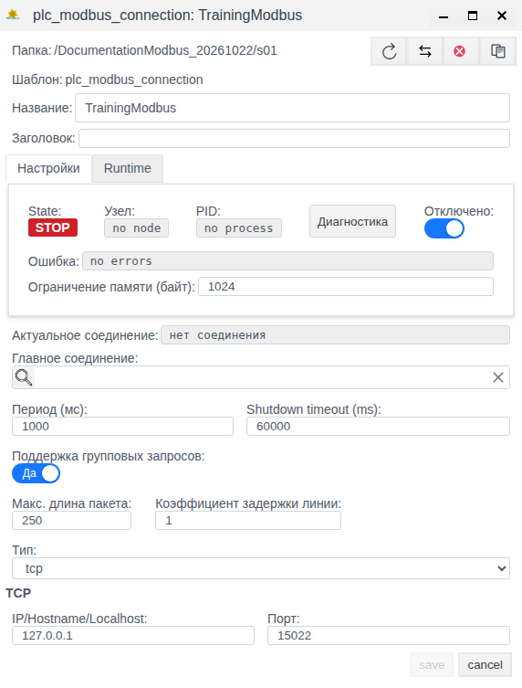
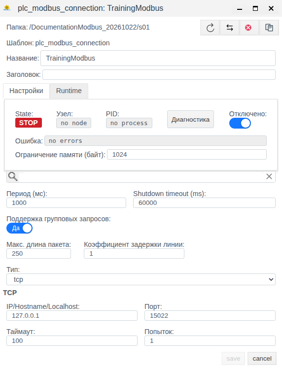
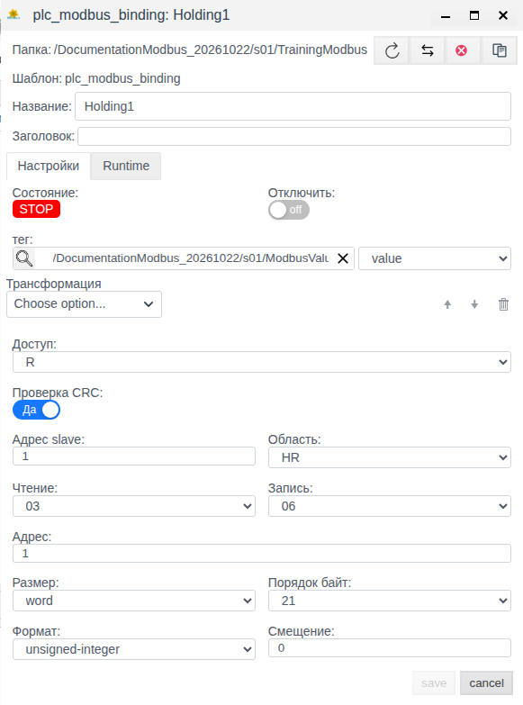
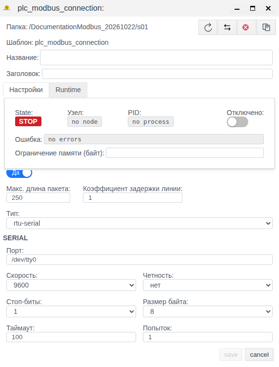
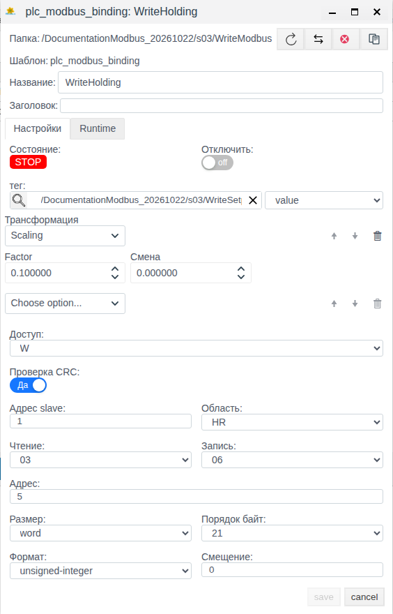
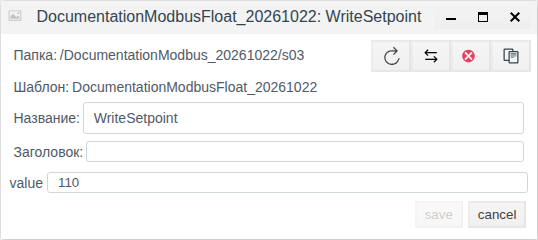
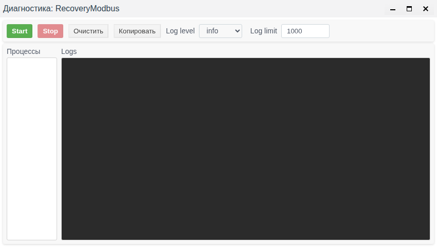

# Modbus in Faceplate: configuring a connection and verifying data exchange

Faceplate v4.0.7 · For integrators · Document for review

Four training configurations were checked through Studio: creation, saving, separate reopening and parameter verification. The shared PROJECT remained disabled. Reading into tag fields, W/RW writing and exchange recovery were not executed; the corresponding steps below describe expected checks on an authorized setup.

Screenshots show the actual Russian interface, captured with Playwright without retouching. Russian UI labels are retained with English explanations; these are not verified labels of an English localization. Screenshots show configuration and diagnostic forms rather than successful device exchange.

**Contents**

- [How Modbus exchange works](#how-modbus-exchange-works)
- [Preparing to connect](#preparing-to-connect)
- [First Modbus TCP exchange](#first-modbus-tcp-exchange)
- [Connection settings](#connection-settings)
- [Bindings and value processing](#bindings-and-value-processing)
- [Writing and verifying the result](#writing-and-verifying-the-result)
- [Editing and controlling exchange](#editing-and-controlling-exchange)
- [Diagnostics and recovery](#diagnostics-and-recovery)

[Connection catalogue](./index.md) · [Prepare fields and bindings](./bindings_en.md) · [Transformations](./transformation_en.md) · [Diagnostics and recovery](./diagnostics_en.md)

## Configuration route

Prepare an external source or client and a compatible tag field using the shared guide. Configure the channel, save a complete binding and verify a new value. For supported writing/reception, separately confirm the external result; after correcting a failure repeat verification with a new control value.

[Alternative channels and signal maps](./bindings_en.md#configure-an-alternative-channel) share one procedure; check driver-specific switching conditions.

## Prepare a reproducible training source

The documentation includes a [Modbus TCP training source](./examples/modbus_training_server.py). Run it with Python 3 on the node from which Faceplate reaches 127.0.0.1: python3 modbus_training_server.py. It listens at 127.0.0.1:15022, Unit 1, provides five HR values 1000, 65535, 1000, 1000, 1000 and functions 03/06/10.

In another terminal, python3 modbus_training_server.py --get 1 reads the first register; --set 1 1001 establishes a new control value. CLI address 1 corresponds to PDU 0. For the general guide's port 15020 use --port 15020 and select the same port in the command-line client.

Prepare the example fields using the shared binding guide. Verify the source with the command-line client first, then follow this article. The training server verifies protocol values; it does not model physical actions. Its independent check is not a new Faceplate PLC-driver test.

## How Modbus exchange works

A Modbus connection receives device values into Faceplate tag fields and sends project setpoints to the device. Faceplate acts as a client (master): it initiates requests to a server or slave device. This connection does not provide a server role for receiving requests from other Modbus clients.

The protocol defines the exchange rules. The driver implements protocol support in Faceplate. A connection contains the shared channel settings: transport, host address or serial port, polling period and request settings. A binding describes one value: device, area and address, size and format, direction, transformation and tag field. A tag is a project object; its field receives a value or holds a setpoint for writing.

One connection can serve several bindings, including different slaves on a shared line. Place bindings directly inside the connection. The connection does not automatically create tags or discover a register map.

Reading follows this path: **source → connection channel → binding address and format → transformation → tag field**. Writing follows: **tag field change → inverse transformation → binding-format encoding → write request → source**. R receives data; W writes; RW works in both directions. These are exchange directions, rather than user permissions.

### Choosing a transport

| Type | What is transmitted | Information needed before setup | How to verify the choice |
|---|---|---|---|
| tcp | Modbus TCP with an MBAP header | IP/hostname, TCP port, Unit ID and data map | The device or gateway accepts Modbus TCP |
| rtu-tcp | RTU frames with CRC over TCP | Transparent gateway address and port, slave and map | The gateway carries RTU frames rather than expecting Modbus TCP |
| rtu-serial | RTU through the Faceplate node's serial port | OS port, baud rate, parity, stop bits, byte size, slave and map | The port exists on the execution node and the Faceplate process can access it |

A gateway that accepts Modbus TCP and queries RTU devices itself requires **tcp**. Choose **rtu-tcp** for transparent RTU transport over TCP. A TCP port number alone does not identify the protocol.

The connection supports reads using functions 01/02/03/04 and writes using 06/0F/10 (hex). Available options include bit, byte, word, dword, signed and unsigned integers, the float numeric format, extraction of part of a register and transformations. Use dword for float32. Function 05, mask write 16 and combined operation 17 are unsupported; there are no native 64-bit or string Modbus types. Converting a number into a string tag field does not read a string from several registers.

## Preparing to connect

Obtain the data map and source settings before creating a connection. For each signal, record the area, map notation, PDU address, Unit ID, size, signedness or float format, byte and word order, permitted functions, engineering units and transformation separately.

**The manual's notation, form address, PDU address and Unit ID are different values.** If the manual calls the first holding register “40001” and defines its PDU address as 0, select HR and enter **Адрес (Address) 1**. The 4xxxx prefix is not stripped automatically: entering 40001 produces PDU address 40000. The slave address/Unit ID selects a device and does not replace a register address.

Prepare an existing tag and a specific compatible field for receiving data. Integer is suitable for −1 and 65535; use float for scaling 1000 × 0.1 and a setpoint of 120.0. The field must be available in Runtime. Select both the tag and the field in the binding: a tag path alone is insufficient.

Check permissions to edit the folder and execute the project. Enabling the connection itself does not replace permission on its parent folders. When PROJECT is disabled, a child example cannot run even with its own «Отключено» (Disabled) flag off. Enabling the shared PROJECT may start other enabled objects; agree this change with the person responsible for the project.

Check device addresses and serial ports **from the Faceplate execution node**. Address 127.0.0.1 means that node, rather than the computer running the browser. Serial requires an accessible OS port and matching line settings.

### Training data

The examples use a prepared, dedicated Modbus TCP source at **127.0.0.1:15022**, Unit ID **1**, with five holding registers. This is a training setup; reading a register or receiving a write response does not confirm a physical equipment action.

| Signal | Form address / PDU | Initial data | Tag field |
|---|---|---|---|
| First read | 1 / 0 | 1000; controlled change to 1001 | ModbusValue/value, integer |
| Signedness | 2 / 1 | FFFF, or unsigned 65535 | SignedValue/value and UnsignedValue/value, integer |
| Scaling | 3 / 2 | 1000; factor 0.1, shift 0 | ScaledValue/value, float |
| RW setpoint | 4 / 3 | 1000; setpoint 120.0 corresponds to 1200 | Setpoint/value, float |
| W setpoint | 5 / 4 | 1000; current setpoint before activation 110.0 | WriteSetpoint/value, float |

Before the recovery example, prepare the source with HR1=2000; after an interruption, use HR1=2001. The check signal uses HR3. Form address 99 is outside this particular training source's map; it may be valid on another device.

Training tags are placed in separate s01–s04 folders inside DocumentationModbus_20261022. Before configuring bindings, integer fields contain 0; ScaledValue and Setpoint contain 0.0, and WriteSetpoint contains 110.0. Disable each example's connection after checking it so subsequent checks do not affect each other. Prepare equivalent fields and a source if using a different training project.

## First Modbus TCP exchange

The task is to link the training source's first holding register to ModbusValue/value. Creation, saving and separate reopening were checked through the UI in this run. The connection remains disabled: receiving 1000 and a new 1001 below is an expected check on an authorized setup, rather than an observed result.

### Create the connection and binding

1. Open Studio at http://127.0.0.1:9000/fp/studio and sign in with configuration permissions. In **Меню → Общий вид** (Menu → General view), open DocumentationModbus_20261022 → s01. Open ModbusValue, confirm its initial value is 0, and close without changes.
2. In s01, click **Создать** (Create), choose category **plc** and the Modbus connection template **plc_modbus_connection**, then **Ok**. Enter **TrainingModbus**, type **tcp**, address **127.0.0.1**, port **15022**. Commit text input with Tab. Leave Period at 1000 ms, Timeout at 100 ms and Attempts at 1; leave Main connection empty. Scroll down to Timeout and Attempts if needed.
3. Turn **Отключено** (Disabled) on before the first save to prevent exchange from starting. Click **save**, leave the editor, then select TrainingModbus and **Редактировать** (Edit). Check the saved address, port and flag in this separate editor opening. Close with **cancel** if no changes are needed.
4. Double-click TrainingModbus and click **Создать**. Name the child binding **Holding1** and use the parameters below. Create the binding inside the connection rather than alongside it.
5. Click the magnifier at **тег** (tag), open DocumentationModbus_20261022 → s01, select **ModbusValue** and confirm **ОК**. Choose **value** in the adjacent field list. Check the full path if the abbreviated path does not fit.
6. Click **save**, close the editor and open Holding1 separately. Check address, format and target field. Additionally verify functions in the binding table under **Меню → Драйверы ПЛК → TrainingModbus**: opening an HR form may temporarily substitute write function 10. Do not save an unintended substitution.

| Holding1 parameter | Value |
|---|---|
| Доступ / Проверка CRC (Access / CRC check) | R / Да (Yes) |
| Адрес slave / Область (Slave address / Area) | 1 / HR |
| Чтение / Запись (Read / Write) | 03 / 06; write function unused for R |
| Form address / PDU address | 1 / 0 |
| Размер / Формат (Size / Format) | word / unsigned-integer |
| Порядок байт / Смещение (Byte order / Offset) | 21 / 0 |
| тег / field | ModbusValue / value in s01 |
| Трансформация (Transformation) | None |
| Отключить (Disable) on the binding | Off; parent connection remains disabled |

*Saved TCP channel: port 15022 and «Отключено» on. STOP and no process are expected for this configuration check.*

*Scrolling exposes Timeout 100 and Attempts 1. A separate reopening confirmed these values.*

*Holding1 form after restoring 06 instead of the substituted 10; save is disabled. Saved 06 was confirmed separately in the binding table. No write request was executed.*

### Check new data on an authorized setup

On a setup with project execution allowed and the source running, turn **Отключено** off for TrainingModbus, save and check the binding. The initial 0 in ModbusValue/value is expected to become 1000. Then change **the source itself** from HR1=1000 to HR1=1001 and read it independently with a Modbus client. Reopen ModbusValue: expect **1001 in the same field**, without manually assigning that Faceplate field.

Check connection and Holding1 states separately from the value. RUN, OK or a cleared error is insufficient proof of a new read. After checking, turn **Отключено** on for your TrainingModbus and save. In this run the field remained 0, the connection was not activated, and the 1000→1001 transition was not executed.

## Connection settings

Connection settings apply to the shared channel. The slave address, register and format of an individual value belong to its binding. After an edit, press Tab, save the object and open it separately again; a value entered into an unsaved form does not confirm the configuration.

### Channel and polling parameters

| Parameter | Initial value / options | Purpose and conditions | Verification |
|---|---|---|---|
| Название (Name), Папка (Folder), Заголовок (Title) | Integrator supplies the name; Title may be empty | Object location and a meaningful name | Check the full path to edit the intended connection |
| Тип (Type) | tcp; tcp / rtu-tcp / rtu-serial | Selects transport and framing | Match the device or gateway mode |
| IP/Hostname/Localhost | 127.0.0.1 is also shown as a placeholder | Host address for both TCP variants | Enter the actual address and check reachability from the Faceplate node |
| Порт (TCP port) | 502; 1…65535 | Source TCP port; 15022 in the training example | A separate reopen must show the intended port |
| Порт (SERIAL port) | /dev/tty0 in a new form | OS port on the execution node; unused for TCP | Check that it exists and the process has access |
| Скорость (Baud rate) | 9600; 300, 600, 1200, 2400, 4800, 9600, 19200, 38400, 57600, 115200, 230400, 460800, 500000, 576000 | Serial baud rate; support depends on the port and adapter | Match the devices on the line |
| Четность (Parity) | нет / четный / нечетный (none / even / odd); initially нет | Serial frame format | Match the line |
| Стоп-биты (Stop bits) | 1 or 2; initially 1 | Serial frame format | Match the line |
| Размер байта (Byte size) | 5 / 6 / 7 / 8; initially 8 | Number of serial data bits | Match the line |
| Таймаут (Timeout) | 100 ms in a new form | Receive wait; not the duration of the entire cycle | Set according to source response time; verify a new response |
| Попыток (Attempts) | 1; form range 1…50 | Total RTU attempts, including the first | Do not rely on this parameter for Modbus TCP retries |
| Период (мс) (Period, ms) | 1000 ms | Polling cycle period | Check actual updates; lengthy exchange increases the interval |
| Shutdown timeout (ms) | 60000 ms | Wait for process shutdown | Separate setting; do not use it instead of request timeout |
| Поддержка групповых запросов (Grouped requests) | Да (Yes) in a new form | Combines compatible reads | Compare grouped and individual reads against the device map |
| Макс. длина пакета (Maximum packet length) | 250 bytes | Limits a combined request | Respect valid device ranges and request size |
| Коэффициент задержки линии (Line delay ratio) | 1 in a new form | Affects request grouping decisions | Change for justified grouping adjustments; it is not an RS-485 pause |
| Главное соединение (Main connection) | Empty for an independent channel | Associates an additional transport with the main connection | Leave empty for an ordinary single connection |
| Отключено (Disabled) | Off in a new form | Prohibits this connection's execution when on | After saving, check state and new data separately |
| Ограничение памяти (байт) (Memory limit, bytes) | 1024 after saving | Process memory threshold; despite the UI label, interpreted in MiB | Do not recalculate it as “1024 bytes”; agree threshold changes with the administrator |

Timeout and Attempts are lower down in the scrollable form. They also appear for tcp, but Attempts is used by RTU exchange. RTU does not retry every failure type: some failures while receiving the response tail terminate the transaction immediately. Therefore attempts and timeout do not provide an exact upper bound for cycle duration.

An omitted value and a new form's initial value differ. In configurations created by another method, omitted Timeout uses 50 ms, omitted grouping means grouping off, and an omitted ratio uses 2. Check explicitly saved values in the training examples rather than assuming they match a new form.

### TCP

Select **Тип tcp**, and enter the device's IP/Hostname/Localhost and TCP port. The source must accept Modbus TCP. Slave/Unit ID remains a binding parameter. The training example explicitly saves 127.0.0.1 and 15022; an address placeholder in an empty field does not confirm a saved value.

Timeout controls the receive wait. Attempts appears in the TCP form, but TCP exchange does not use it as a retry count. Check host reachability, source response and a new tag field value separately.

### RTU over TCP

Select **Тип rtu-tcp**, and enter the transparent RTU gateway's address and port. Set device slaves in bindings and retain CRC checking unless there is a justified reason to disable it. Set Timeout and total RTU attempts for the actual line. Opening a TCP connection alone does not confirm a valid RTU response.

If the gateway accepts Modbus TCP and performs RTU conversion itself, select tcp. Only the unsaved rtu-tcp form was inspected for this reference; RTU-over-TCP transport and exchange were not executed.

### Serial RTU line

Select **Тип rtu-serial**. Set the actual OS port on the Faceplate node, baud rate, parity, stop bits and byte size to match the line. Check process permissions on the port. The /dev/tty0 value in a new form is an initial field value, rather than a discovered adapter.

*rtu-serial form inspection: line settings, Timeout and Attempts. The form was cancelled; saving a serial configuration and exchange through a physical port were not checked.*

### Grouping reads

Grouping reduces request count by combining compatible ranges with the same slave, read function and CRC setting. It does not add grouped writes. An inaccessible address inside a combined range may cause the device to reject the entire group, affecting several signals.

For a group error, temporarily disable grouping on your test connection and check the same address with an individual request. Then compare map boundaries, response size and maximum packet length. The line delay ratio affects grouping decisions; it is not a physical delay between serial frames.

### Additional transport channels

An additional connection describes another transport path and points to a main connection of the same type through «Главное соединение». Chains of these references are unsupported. The main connection uses its own bindings; copying them into the additional transport is unnecessary. The additional object does not run as an independent connection and is placed in the disabled state.

Check the standalone channel first, then configure the additional channel and separately reproduce failure and path switching. Do not assume seamless switching or automatic return to a preferred path without testing your setup. «Актуальное соединение» (Actual connection) may retain the last selected path after disconnection; it does not replace proof of new data. Channel switching is not tested in this article's training TCP examples.

### System values

State, Узел (Node), PID, Ошибка (Error) and Актуальное соединение are generated during execution. Do not fill them as device addresses or binding parameters. PID and node indicate a process; RUN and no error do not yet confirm reading the intended register. Compare them with the individual binding and a new value in the correct tag field.

## Bindings and value processing

A binding links one source address to one tag field. Place it directly inside the connection. The channel is shared, while slave, address, format, direction and transformations are defined for each value.

### Binding parameters

| Parameter | Initial / valid values | Purpose and conditions | Verification |
|---|---|---|---|
| Название (Name) | Supplied for each value | Signal name within the connection | Check the parent connection path |
| тег / field | Explicitly selected | Object and field receiving data or providing a write setpoint | After choosing the tag, select the adjacent field |
| Доступ (Access) | R; R / W / RW | Read, write or both | Choose R for AI/DI |
| Проверка CRC (CRC check) | Да (Yes) | Checks RTU response CRC; has no effect on Modbus TCP | Disabling checking does not remove CRC from the transmitted RTU frame |
| Адрес slave (Slave address) | 1; supported range 1…254 | Device identifier, Unit ID | The HTML field allows 255, but this is not a supported savable value |
| Область (Area) | HR; HR / AI / DO / DI | Data map area | Match the read and write functions |
| Чтение (Read) | 03 for HR; options 01 / 02 / 03 / 04 | Read request function | Check after selecting the area |
| Запись (Write) | Initially 10 for HR; options 06 / 0F / 10 | Write request function | Set the required function last and verify it in the binding table |
| Адрес (Address) | 0 in a new form; enter 1 for the first register | For HR/AI, PDU address equals form address minus 1 | Do not use 0 for the first register; the 4xxxx prefix is not stripped |
| Размер (Size) | word; bit / byte / word / dword | Width of the extracted value | dword requires two registers; choose dword for float32 |
| Формат (Format) | signed-integer; unsigned-integer / float | Signedness or float interpretation | Check known bytes; use unsigned-integer for a single bit |
| Порядок байт (Byte order) | 21; current form offers 12 / 21 | Byte permutation before numeric decoding | The list stays the same for dword; check a known 32-bit value |
| Смещение (Offset) | 0 | Selects a bit or byte after byte ordering | Valid values depend on size and area; see below |
| Трансформация (Transformation) | None; operation list available | Read result processing and inverse setpoint processing | The entire W/RW chain must support the reverse direction |
| Отключить (Disable) | Off | Excludes only this binding from exchange | After enabling, confirm a new value in its own field |

Empty tag and field references can be used for special operation through the binding's own value. Select both to transfer data into a project field; an empty reference does not complete tag setup.

### Areas and functions

Function codes in this article are hexadecimal.

| Area | Meaning | Read | Write | Direction to configure |
|---|---|---|---|---|
| DI | Discrete inputs | 02 | Do not configure | R |
| AI | Input registers | 04 | Do not configure | R |
| DO | Discrete outputs, coils | 01 | 0F | R / W / RW |
| HR | Holding registers | 03 | 06 for one word; 10 for one or several registers | R / W / RW |

Area and function must agree: the function determines the actual request. Selecting AI/DI disables the write-function control, but does not replace choosing R. Remaining W/RW access with function 10 can address holding registers. Function 05 is unsupported; DO writes use 0F.

**Check functions after opening a form.** In the current interface, opening the HR editor inserts 03/10 as a temporary change. If 06 is saved, the form may display 10 with save active. Do not automatically save that substitution. Select the area and other settings first, then set the required function last; verify the saved value through **Меню → Драйверы ПЛК**, opening the connection and its binding table. That table confirmed 06 in the training example. Changing size also does not automatically select the correct functions, format, byte order or offset.

### Size, format and offset

| Size | Width and integer range | Offset | Conditions |
|---|---|---|---|
| bit | 1 bit; unsigned gives 0/1 | HR/AI: 0…15; DI/DO: 0…7 | Choose unsigned-integer for the expected logical value |
| byte | 8 bits; unsigned 0…255, signed −128…127 | 0 or 1 | For HR/AI, selects the low or high byte after reordering |
| word | 16 bits; unsigned 0…65535, signed −32768…32767 | Only 0 | One register; FFFF gives 65535 or −1 depending on format |
| dword | 32 bits; unsigned 0…4294967295, signed −2147483648…2147483647 | Only 0 | Two registers; use float for IEEE float32 |

The HTML offset field allows 0…16 regardless of size; this does not make every value valid for each combination. Use the table's ranges. DI/DO read requests are byte-aligned; additional offset does not extend the response. Check that the extracted part fits the returned data. Set DO write offset to 0: it is not applied when writing.

With order 21, word 1234 hex gives byte offset 0 = 34 hex and byte offset 1 = 12 hex. Bit offset 3 in word 0008 hex gives 1. A signed single bit gives −1 rather than 1; converting it to bool produces false because the logical threshold is 0.5. Configure bit as unsigned-integer.

The float format does not select width automatically. Float32 requires dword and two registers; float writes support dword only. Reading a 16-bit float depends on runtime support for that format; float16 exchange is not tested in the examples. Selecting word/float does not automatically mean float32.

A float received into an integer field is rounded; an integer received into a float field becomes floating point. This additional conversion follows transformation, so field type affects the scaling result.

### Byte order using known data

| Response bytes | Order value | Bytes used for decoding | Availability in the current form |
|---|---|---|---|
| 12 34 | 21 | 12 34 → 1234 hex | Available |
| 12 34 | 12 | 34 12 → 3412 hex | Available |
| 12 34 56 78 | 21 or 12 | 12 34 56 78 → 12345678 hex | Available, but these options do not reorder four bytes |
| 12 34 56 78 | 4321 | 12 34 56 78 → 12345678 hex | Not offered in the current list; explains an already prepared configuration |
| 12 34 56 78 | 1234 | 78 56 34 12 → 78563412 hex | Not offered in the current list |
| 12 34 56 78 | 2143 | 56 78 12 34 → 56781234 hex | Not offered in the current list |
| 12 34 56 78 | 3412 | 34 12 78 56 → 34127856 hex | Not offered in the current list |

The current form retains the 12/21 list after selecting dword. Other values supported when processing an already prepared project are not thereby selectable in this list. Check a known device value before using the result for control.

An omitted order uses separate rules: word HR/AI uses 21, dword HR/AI uses 2143, and multibyte DI/DO uses reversed bytes. Explicitly check the order rather than clearing it in expectation of a universal option.

### Read and write transformations

Reading applies operations from top to bottom in the list. Writing applies inverse operations in reverse order. After reading, the result is converted to the selected tag field's type.

| UI operation | Read | Write | Conditions |
|---|---|---|---|
| No transformation | Decoded value | Setpoint encoded in the binding format | Size, byte order and field type still apply |
| Scaling | y = x × Factor + shift | x = (y − shift) / Factor | «Cмена» sets shift; Factor must be nonzero for writing |
| Default Value | Replaces a nonnumeric input with the configured number | Passes the setpoint unchanged | Can substitute a plausible number when data is lost; does not prove communication |
| Limit Control | Gives an empty/invalid result outside the permitted range | Clamps the setpoint to lower and upper limits | Upper limit must exceed lower; read behavior is not the same clamping used for writes |
| Damper | Smooths changes with a positive time constant | Passes the setpoint unchanged | Allow settling time; time base is milliseconds |
| Integration | Integrates numeric input | Unsupported | Use R only; time base is milliseconds |
| Derivative | Calculates change over time | Unsupported | Use R only; time base is milliseconds |
| Скрипт (Script) | Runs a user-defined read transformation | Unsupported | A chain containing it is unsuitable for W/RW; training examples require no script |

Without transformation, lost reading makes an R/RW field empty/invalid. Default Value can replace this input with a number, so a retained plausible value does not confirm channel health. Reading does not overwrite the W field.

For Factor=0.1 and shift=0, source value 1000 should produce 100.0 in a float field; setpoint 120.0 should produce source value 1200 when writing. Check both sides independently rather than only the formula or a form value.

### Check signedness and scaling with known data

s02 contains prepared integer SignedValue/value and UnsignedValue/value fields and a float ScaledValue/value field. The source contains HR2=FFFF and HR3=1000. This run checks the saved configuration; −1, 65535 and 100.0 are not assigned to the tags or claimed as received values.

1. Create **FormatModbus** in s02 using the first example: tcp, 127.0.0.1:15022, Period 1000 ms, Timeout 100 ms, Attempts 1, no main connection. Turn **Отключено** on before the first save.
2. Create three child bindings using the table. Shared parameters: slave 1, HR, Read 03, word, order 21, offset 0, R, CRC Yes. If setting Write 06 for configuration consistency, select it last; R does not execute writes.
3. In ScaledHolding select **Scaling**. Click **Factor**, select its value with Ctrl+A, type 0.1 and commit with Tab; leave **Cмена** at 0. Check the displayed **0.100000 / 0.000000**, save, close and open the form separately again. Reopening must confirm the numeric settings without re-entering them.
4. Check the binding table and separately saved formats, addresses, target fields and Scaling. Cancel unintended function changes in the HR form. Leave FormatModbus disabled.

Check Factor particularly carefully after adding a new Scaling row. If a separate opening still shows **1.000000**, edit the already saved binding: select Factor, type **0.1**, commit with Tab, restore the intended write function and save. Another separate opening must show **0.100000**. Do not allow execution before this, particularly for W/RW: the inverse transformation depends on the factor.

| Binding | Form address / format | Tag field | Transformation and expected result during exchange |
|---|---|---|---|
| SignedHolding | 2 / signed-integer | SignedValue/value | No transformation: FFFF → −1 |
| UnsignedHolding | 2 / unsigned-integer | UnsignedValue/value | No transformation: FFFF → 65535 |
| ScaledHolding | 3 / unsigned-integer | ScaledValue/value | Scaling 0.1 / 0: 1000 → 100.0 |

*Saved Scaling: Factor 0.100000 and shift 0.000000. This confirms settings rather than receipt of 100.0 from the source.*

For a later check on an authorized setup, run only this example and compare the three actual fields with the last column. The same FFFF should produce different numbers due to signedness; 1000 should produce 100.0 in the float field. If 100 appears instead of a fractional value for a different input, check field type and rounding, then Factor and shift. Disable your FormatModbus after checking.

## Writing and verifying the result

Writing is supported for HR and DO. Choose the area and function from the device map: 06 for one HR word, 10 for multiple registers, 0F for DO. Use dword for float writing. The whole transformation chain must be reversible; Scaling requires nonzero Factor.

The example uses separate HR4 and HR5 registers so W and RW do not compete for one address. Only configuration saving was checked: setpoint 120.0 is not entered, W is not activated, and protocol writing and independent reading of its result are not performed.

### Prepare W and RW

1. In s03, prepare float Setpoint/value with **0.0** and float WriteSetpoint/value with **110.0**. HR4 and HR5 initially contain **1000** in the training source. Before allowing execution, check the current W setpoint separately: sending the current value is provided for when W activates or its configuration changes.
2. Create **WriteModbus**, tcp 127.0.0.1:15022, Period 1000 ms, Timeout 100 ms, Attempts 1, no main connection. Turn **Отключено** on before the first save.
3. Create two bindings inside WriteModbus using the table. Shared parameters: slave 1, HR, Read 03, word, unsigned-integer, order 21, offset 0, CRC Yes, Scaling **Factor 0.1 / Cмена 0**. Set **Запись 06** after the other parameters.
4. Save, close and reopen both bindings separately. Check access, address, target field and Factor **0.100000**. Confirm saved 06 in the separate binding table; do not save the substituted 10 when opening the HR form. Leave WriteModbus disabled.

If a new Scaling row was saved with Factor **1.000000**, set **0.1** by separately editing the saved binding, commit with Tab, check the write function and save again. A separate reopen must show **0.100000**. Use the same numeric-entry verification as in the scaling example.

| Binding | Form address / PDU | Access and tag field | Transformation |
|---|---|---|---|
| ReadWriteHolding | 4 / 3 | RW, Setpoint/value | Scaling 0.1 / 0 |
| WriteHolding | 5 / 4 | W, WriteSetpoint/value | Scaling 0.1 / 0 |

*WriteHolding: W, address 5, Factor 0.100000 and function 06. The saved 06 selection was restored before capture; save is disabled. The binding was not activated.*

*Initial WriteSetpoint/value=110.0. This is the pre-activation setpoint, rather than confirmation of raw 1100 transmitted to the source.*

### Confirm the write independently

Perform the following check on an authorized training setup with execution enabled and a known initial state. It was not executed in this run.

1. For RW, first wait for HR4=1000 to be read as **Setpoint/value=100.0**. Then change the setpoint through the tag form to **120.0** and save. With Factor=0.1, the inverse transformation gives **120.0 / 0.1 = 1200**. Read HR4/PDU3 using an independent Modbus client and confirm **1200**.
2. For W, confirm **WriteSetpoint/value=110.0** and initial HR5=1000 before activation. Record what happens immediately upon activation, before manually changing the setpoint: the expected current-setpoint transmission produces **1100**. Check by reading HR5/PDU4 rather than assuming a saved form proves it.
3. Change the W setpoint to **120.0**, save and independently read HR5/PDU4. Expect **1200**. Separate initial transmission of 110.0 from the subsequent change to 120.0.
4. Record address, function, old and new source value, and verification time. Disable your WriteModbus after checking. For a physical device, separately confirm its actual action using an authorized method for that device.

A number in the setpoint field shows the entered command. OK or no error does not replace independent source reading. W does not update its current field by reading; it responds to changes and the provided initial transmission, rather than periodically maintaining a number in the device. RW's own read should not immediately write that same update back.

### Partial register writes

Writing a bit or byte in HR reads the entire register, replaces the selected part and writes the whole word. This sequence is not atomic: another participant's change to neighboring bits between the read and write may be lost. Account for competing writers and check adjacent data. Use offset 0 for DO; mask function 16 is unsupported.

## Editing and controlling exchange

Saving parameters and allowing execution are separate actions. The connection's **Отключено** flag applies to the entire channel, while **Отключить** in a binding applies to one value. Permission on your objects works together with permission on parent folders and the project.

### Edit saved settings

1. In **Меню → Общий вид**, open your folder and connection. For an individual signal's settings, open its child binding. Check the full object path before editing.
2. Edit the required field, commit with Tab and click **save**. For Modbus functions, select area and size first, then check functions, format, byte order and offset.
3. Leave the editor and open the object separately again. Compare saved values with the task. Additionally check HR functions in the binding table through **Драйверы ПЛК**; cancel unintended changes in the open form.
4. On a running authorized setup, confirm new data after the change. Reopening alone confirms configuration rather than exchange.

Changing connection parameters may recreate its process. Changing a binding updates its settings and read plan; it need not disconnect the entire channel. Account for possible current-setpoint transmission when changing a W binding.

### Disable and allow execution again

To stop your channel, turn **Отключено** on in the connection and save. To exclude one signal, turn **Отключить** on in its binding and save. Open the object separately and check the saved flag; then check actual process and field state. Disabling a binding is not intended to stop the connection's other values.

On an authorized setup, turn the corresponding flag off and save to resume. Change the source to a known new value and confirm it in the intended field. A retained number after enabling is insufficient. On stop or error, R/RW fields receive an empty/invalid result through the transformation chain; Default Value may produce a number instead. Reading does not overwrite the W setpoint.

All four training connections were saved disabled; the shared PROJECT and Runtime are not switched. Activation and confirmation of a subsequent new read are not performed.

## Diagnostics and recovery

Check in sequence: execution permission → process → channel → individual binding → new field value → independent write confirmation. These are different result levels.

### What states confirm

| Indicator | What it establishes | Additional check |
|---|---|---|
| Отключено / Отключить, folder permissions | Whether configuration execution is permitted | Process state and a new value |
| Узел and PID | Whether a process exists on a node | Channel error and individual binding result |
| RUN | The process is running | A binding may have an error; check it separately |
| OK / no errors | No error is currently displayed | This is not a successful read or write counter |
| Актуальное соединение | Last selected transport path | The path may remain after disconnection; confirm a new read |
| Previous number in a field | Displayed or substituted value | Compare a new known source value and the transformation |
| New number in the correct field after a source change | A new read result for that signal | For writing, separately read the source register |
| Independent source reading after a setpoint | Register/output state according to the protocol | Verify physical equipment action separately |

The binding form has no dedicated standard timestamp of the last successful read or write counter. Use a controlled source change and check the intended field. If a transformation returns an empty result or substitutes Default Value, a healthy overall cycle may not produce the expected number.

### Open the connection, bindings and log

In **Меню → Драйверы ПЛК**, find your connection's full path. Open its binding table to compare addresses, functions, target fields, states and errors of individual values. For channel settings and state, open the connection from General view; its card contains **Диагностика** (Diagnostics).

Diagnostics shows **Процессы** (Processes) and **Logs**, **Log level** and **Log limit**, and **Start**, **Stop**, **Очистить** (Clear), **Копировать** (Copy). Levels are info, warning, error and debug; the initial level is info and limit is 1000. While collecting messages, the window polls the log every 1000 ms. Start/Stop control diagnostic message collection rather than PLC exchange. An empty log or process list alone proves neither healthy exchange nor absence of a running process.

*Start and Stop switched log collection only during verification. Processes and Logs remained empty; the connection stayed STOP. The screenshot shows actual controls; no substantive exchange log was obtained.*

### Common situations

| Symptom | Where to check | Possible cause | Action | Confirmation |
|---|---|---|---|---|
| Configuration does not save | Form and save message | Invalid slave, area, address, size, offset, tag field or non-reversible W/RW chain | Check valid combinations; slave 1…254; offset for size; remove non-reversible operations from W/RW | Successful save, separate reopen and binding table |
| Disabled, STOP, no node/PID | Connection, binding, folders and PROJECT | Execution prohibited on the object or an ancestor | Check flags and permissions; agree shared project changes with its owner | Permission and process state, then a new read |
| No connection or response | Execution node, address/port, transport type, Error | Wrong address, unavailable source, different framing, inaccessible serial port or mismatched line settings | Check the source from the Faceplate node; compare tcp/rtu-tcp/serial, slave, timeout and RTU line | Successful source response and a new tag field value |
| One signal or group is not read | Binding table, address map, grouping | Wrong function/address/size or inaccessible address inside a group | Check PDU address and map; temporarily disable grouping on the test connection; compare a healthy signal | Error cleared and that signal received a new known value |
| Wrong number | Size, format, order, offset, transformation, field type | Signedness, permutation, different float width, signed bit, rounding or scale | Supply known bytes; compare FFFF as signed/unsigned; use unsigned for bit; check Factor/shift | Known source data matches the expected numeric value |
| Write unconfirmed | Access, write function, setpoint field, inverse transformation and source | R instead of W/RW, wrong address/FC, non-reversible chain, zero Factor, unchanged setpoint or rejected write | Check saved FC in the table; change an authorized test setpoint; check the response | Independently read the intended register, such as raw 1200; confirm equipment outcome separately |
| Log or process list empty | Diagnostics, state and observation period | Collection stopped, selected level has no messages, no events or process stopped | Check collection control and level, wait for an event; compare PID, error and tag field | Actual message or independent state evidence; empty output is not proof |
| Old number after recovery | Source, tag field, transformations and binding state | Retained previous value, substituted Default Value, exchange not resumed or wrong field checked | Change the source to a known new value; check tag path and processing | New value, such as 2001 instead of 2000, received in the intended field |

Save errors may include invalid_slave_address, invalid_memory_area, invalid_memory_type, invalid_memory_address and invalid_offset. During exchange, inspect the original message: timeout, closed, no_response, unexpected_response, unexpected_pdu, invalid_format. For Modbus TCP, exception 2 corresponds to invalid_address; other common exceptions include unsupported_operation, invalid_length, reading_error, slave_busy, gateway_path_unavailable and target_device_not_respond. RTU may finish the same situation as no_response, so transport error text need not match TCP.

### Isolate an incorrect address

For the s04 training configuration, use RecoveryModbus with grouped reading off. Holding1 reads HR1/Address 1 into ModbusValue/value; CheckHolding reads HR3/Address 3 into CheckValue/value. Use slave 1, R, word, unsigned-integer, order 21, offset 0 and no transformation. Prepare the source with HR1=2000 and HR3=1000.

Changing Holding1 from address 1 to **99**, saving, separately reopening and returning it to **1** checks configuration editing. Address 99 is outside this source's map. Only running authorized exchange can establish this signal's error while CheckHolding continues reading; change HR3 from 1000 to 1002 and confirm a new CheckValue to prove the check signal is healthy. In this configuration run, Faceplate sends no request for address 99, and a healthy check signal or runtime error is not confirmed.

*Address 99 was confirmed by a separate reopening; function 06 was restored to its saved selection in the form. The connection is disabled and no protocol error was reproduced. After capture, the address was restored to 1 and checked again.*

### Confirm recovery using a new value

On an authorized training setup, receive **ModbusValue/value=2000**, interrupt only your own source, and record channel and field state. Set HR1=**2001** before bringing the source back; independently confirm the new register with a Modbus client. After resumption, wait for **2001 in the same ModbusValue/value**. A cleared error, RUN and retained 2000 are insufficient confirmation.

The source was not interrupted for a recovery test in the illustrated verification. Stopping it after the work completes closes the training setup and does not confirm Faceplate recovery. Receipt of a new 2001 was not tested.
