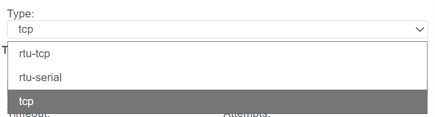

# Modbus (TCP/RTU) Configuration Guide

> See also: [General information about PLC connections](./general_en.md)

## Overview
**Modbus** is a de facto standard in industrial automation. The **Faceplate** system includes a universal driver supporting three operating modes, allowing polling of both modern controllers and legacy equipment or sensors via gateways.

Supported modes (`Type`):
1.  **tcp:** Classic Modbus TCP (Ethernet).
2.  **rtu-serial:** Modbus RTU over a physical COM port (RS-485/232).
3.  **rtu-tcp:** Modbus RTU encapsulated in a TCP packet (Modbus-over-TCP). Used for working with transparent gateways (Moxa, HF, etc.).

The configuration process consists of two stages:
1.  **Connection (`plc_modbus_connection`):** Transport setup.
2.  **Binding (`plc_modbus_binding`):** Register addressing.

---

## 1. Connection Setup
> Create a PLC connection → [Steps to create a PLC connection](./general_en.md#creating-a-plc-connection)
At this stage, we select the communication transport.

> The diagnostics panel and general connection parameters (Settings) are described in the [General connection parameters](./general_en.md#general-connection-parameters-settings) section.

### 1.1 Selecting the Transport Type
First, specify the connection type in the **Type** field.

#### 1.1.1 `tcp` Mode (Ethernet)
Used for communication with PLCs or I/O modules that have an Ethernet port and support the Modbus TCP stack.

**Use cases:**
- Direct connection to a device supporting MODBUS-TCP
- Connection through a gateway that communicates with the FACEPLATE station via MODBUS-TCP, proxying requests to another communication line (e.g., MODBUS-RTU or even non-MODBUS protocols)

| Field | Description |
| :--- | :--- |
| **IP/Hostname** | IP address or hostname of the device (e.g., `192.168.1.10`). |
| **Port** | Port number for the connection. By default, MODBUS-TCP uses port **502**, but when connecting through a gateway (e.g., TCP⇔RS-485), the port number may differ. |
| **Timeout** | Maximum time to wait for a response from the polled device (in ms). ⚠️ **WARNING:** Increasing this parameter on low-quality communication channels may lead to increased delays in connection operation. |
| **Attempts** | Number of retry attempts when an incorrect response is received or the timeout is exceeded. Increasing this helps achieve more stable operation on low-quality channels but may introduce delays. |

#### 1.1.2 `rtu-serial` Mode (RS-485/232)
Used for direct daisy-chain connection of devices to the server's COM port.

**Connection details:**
- The device is connected via an RS-485 communication line
- The FACEPLATE station is connected to the communication line using **RS-232⇔RS-485** or **USB⇔RS-485** converters
- **Important:** When using a single serial port to communicate with multiple slave devices, you need to configure **one shared connection**. In this case, the Modbus addresses of devices are defined during binding configuration.

| Field | Description |
| :--- | :--- |
| **Port** | The port used for data exchange. Examples: `COM3` for Windows OS, `/dev/ttyUSB0` for Linux-based systems. |
| **Baud rate** | Data transfer speed. Must **strictly match** across all devices on the line (9600, 19200, etc.). |
| **Parity** | Parity check setting (`no`, `even`, `odd`). |
| **Stop bits** | Number of stop bits transmitted per packet (usually `1`). |
| **Data bits** | Byte size — number of bits transmitted per packet (usually `8`). |
| **Line Delay Ratio** | Line delay coefficient. Increase if the line is long and "noisy". |

#### 1.1.3 `rtu-tcp` Mode (Modbus-over-TCP)
Used for working with transparent gateways (Moxa, HF, etc.).

**Details:**
- Suitable for data exchange with devices supporting MODBUS-RTU
- Unlike `rtu-serial`, a **TCP⇔RS-485** converter is used to connect to the device
- FACEPLATE connects to the converter via TCP but uses the MODBUS-RTU protocol for data exchange
- This approach allows using TCP⇔RS-485 converters as Modbus master devices to organize communication with a large number of slave devices
- The internal packet structure is the same as RTU (with CRC checksum)

**Configuration:**

| Field | Description |
| :--- | :--- |
| **IP/Hostname** | IP address or hostname of the gateway. |
| **Port** | Port number for the connection. By default, MODBUS-TCP uses port **502**, but when connecting through a TCP⇔RS-485 gateway, the port number may differ. |
| **Timeout** | Maximum time to wait for a response from the polled device (in ms). |
| **Attempts** | Number of retry attempts when an incorrect response is received. |

---

## 2. Variable Configuration (Binding)

Here we bind a specific Modbus register to a system tag.

> Create a PLC binding → [Steps to create a PLC binding](./general_en.md#creating-a-plc-binding)

> Common binding fields (Name, Title, State, Tag, Transformation, Access) are described in the [Common PLC binding fields](./general_en.md#common-plc-binding-fields) section.

### 2.1 Addressing

| Field | Description |
| :--- | :--- |
| **Slave address** | **Modbus device address on the bus.** Can range from **1 to 255**. This field value is used when connecting to a device through a gateway or in RTU-SERIAL mode. *Examples:* In TCP, usually `1` (or `255`); in Serial — from `1` to `247`. |
| **Memory area** | **Memory area type in the device:**  • **DI (Discrete Inputs)** — discrete input (1xxxx). This memory type is **read-only**. One DI register corresponds to one bit. If the mapped tag field has an integer type, more than one register can be read into it. The number of registers read is determined by the "Size" setting (see below).  • **AI (Analog Input) / IR (Input Registers)** — input registers (3xxxx). This memory type is **read-only**. Each register consists of **16 bits**. To transmit floating-point numbers or integer values greater than 65535, two consecutive registers may be used. This is determined by the "Size" and "Format" settings (see below).  • **DO (Discrete Outputs) / CS (Coils)** — coils/outputs (0xxxx). This type supports **read and write**. One register corresponds to one bit. If the mapped tag field has an integer type, more than one register can be read into it. The number of registers read is determined by the "Size" setting (see below).  • **HR (Holding Registers)** — holding registers (4xxxx). This type supports **read and write**. Each register consists of **16 bits**. To transmit floating-point numbers or integer values greater than 65535, two consecutive registers may be used. This is determined by the "Size" and "Format" settings (see below). |
| **Address** | **Starting register address.** Register address offset. If the binding "Size" (see below) requires transmitting more than one register, the address of the **first register in the group** must be specified. ⚠️ *Note:* In some address maps, numbering starts at 1, while the driver typically starts at 0. If data appears "shifted", try +/- 1. |
| **Read / Write** | **Modbus function codes.** These fields allow overriding the read and write functions for the memory area (see [Modbus Application Protocol](http://www.modbus.org/docs/Modbus_Application_Protocol_V1_1b.pdf)). By default, values corresponding to the selected memory area are assigned (e.g., Read `03`, Write `10` or `06`). |

### 2.2 Data Format (Data Handling)

| Field | Description |
| :--- | :--- |
| **The size** | **Data size.** Determines the volume of transmitted data:  • **bit** — one bit.  • **byte** — 8 bits. This type can be used to transmit 8 consecutive single-bit registers (DI, DO).  • **word** — 16 bits. This type is used for transmitting one AI or HR register, as well as for working with 16 consecutive DI or DO registers.  • **dword** — 32 bits. This type can be used to transmit 2 consecutive AI or HR registers. The transmitted value format is determined by the "Format" setting (see below). This type can also be used to transmit 32 consecutive single-bit registers (DI, DO). |
| **Format** | **Transmitted data format.** This setting is relevant when the transmitted data volume exceeds one byte (word, dword types): • `signed-integer` — Signed integer • `unsigned-integer` — Unsigned integer • `float` — Floating-point number |
| **Byte order** | **Byte order (byte sequence).** A critically important setting. • `21` — direct (Big Endian, standard) • `12` — reverse (Little Endian) • `2143` / `3412` — Various Swap options for 32-bit numbers. Selected experimentally if the number displays incorrectly. |
| **Offset** | **Bit (byte) offset within the register**, starting from `0`. |
| **Check CRC** | **Checksum verification.** Allows disabling CRC verification. Relevant only for MODBUS RTU.  ⚠️ **WARNING:** It is not recommended to disable this check, as it may lead to **corruption of data received from the device**. Disabling the check should only be used when integrating with equipment that does not support the CRC mechanism.  *Typically:* `Yes` (enabled). |

---