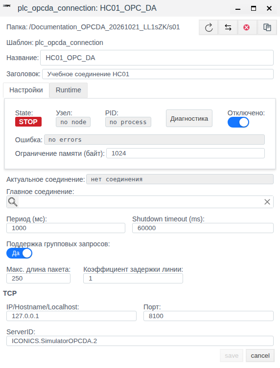
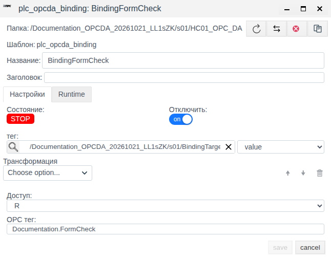

# OPC DA in Faceplate: Configuring Connections and Bindings

A guide for integrators using Faceplate **v4.0.7**. It covers connection parameters, binding configuration, object management, and diagnostics.

The screenshots show the Russian UI. The instructions retain actual Russian on-screen labels, with English explanations where needed. These explanations are translations for the reader, not verified labels from the English localization.

**Contents**

- [Configuration route](#configuration-route)
- [Prepare the proxy and complete a binding](#prepare-the-proxy-and-complete-a-binding)
- [Module purpose](#module-purpose)
- [Prerequisites](#prerequisites)
- [Configuring a connection](#configuring-a-connection)
- [Managing a connection](#managing-a-connection)
- [OPC DA bindings](#opc-da-bindings)
- [Quick reference](#quick-reference)
- [Diagnostics](#diagnostics)

[Connection catalogue](./index.md) · [Prepare fields and bindings](./bindings_en.md) · [Transformations](./transformation_en.md) · [Diagnostics and recovery](./diagnostics_en.md)

## Configuration route

Prepare an external source or client and a compatible tag field using the shared guide. Configure the channel, save a complete binding and verify a new value. For supported writing/reception, separately confirm the external result; after correcting a failure repeat verification with a new control value.

[Alternative channels and signal maps](./bindings_en.md#configure-an-alternative-channel) share one procedure; check driver-specific switching conditions.

## Prepare the proxy and complete a binding

Before operational startup, the source administrator must supply a compatible OPC DA Proxy, its version and installation guide, address/port, actual ServerID and test ItemID with read/write permissions. The proxy distribution has not been identified in these materials. Configuration remains preliminary until a compatible proxy is obtained; an ordinary OPC DA server is not a substitute for Faceplate's TCP proxy.

For the training map, define source ItemID Training.Pressure with numeric value 25, representing tenths of the engineering quantity. This illustrative ItemID must actually exist on your server. Prepare float tag OPCPressure.value.

| New binding PressureInput field | Value |
|---|---|
| OPC тег | Training.Pressure |
| тег / field | OPCPressure / value |
| Доступ / Отключить | R / enabled until verified |
| Трансформация | Scaling: Factor 0.1, Cмена 0 |

Create PressureInput inside the disabled connection, fill the table, save and reopen independently. Check ItemID, tag, field and Factor 0.100000. Once the proxy and execution are confirmed, raw 25 should give 2.5 and new 26 should give 2.6 in the same field.

For writing, use a separate permitted ItemID and command field, W/RW and a reversible chain. With this scale command 3.0 corresponds to external 30; confirm it through an independent OPC client. Check the current W command before startup. This recipe does not claim executed proxy compatibility, read or write tests.

## Module purpose

The OPC DA module reads OPC tag values into Faceplate fields and sends field changes to an OPC DA server. This connects existing process data sources to a Faceplate project.

Faceplate connects over TCP to a compatible **OPC DA Proxy**. The proxy provides access to the OPC DA server. In Faceplate, specify the proxy address, its port, and the server identifier, **ServerID**.

A protocol defines the rules for exchanging data; this guide covers OPC DA. A driver implements support for that exchange in Faceplate and operates as a client through the proxy. A Faceplate tag is a project object with fields that hold data for use in the project. Its name and selected field are distinct from an OPC tag, which is identified by ItemID on the external server.

| Concept | Purpose |
|---|---|
| Connection | Common access settings for the proxy and selected OPC DA server, the exchange period, and connection state |
| Binding | Configuration for exchanging one OPC tag with a selected Faceplate field. Created inside a connection |
| ServerID | Identifier of the OPC DA server available through the proxy |
| ItemID | Identifier of a particular OPC tag on the server; entered in the binding's **OPC тег** (OPC tag) field |
| Faceplate object and field | Destination for a read value or source of a value to write |

During reading, data follows this path: OPC DA server → proxy → Faceplate driver → binding with the required ItemID → transformation and conversion to the field type → field of the selected Faceplate tag. During writing, a field change is processed in the reverse direction and sent through the driver and proxy to the server. Each binding selects its own direction; a connection can contain several bindings.

The overall workflow is: prepare the proxy and connection details → create a connection → add bindings → enable operation → check state and values.

## Prerequisites

| Requirement | Purpose |
|---|---|
| Access to Studio and permission to create and modify objects in the selected folder | Configure the connection and bindings |
| A prepared project folder | Store the connection |
| A compatible, running OPC DA Proxy | Exchange data between Faceplate and the OPC DA server |
| Proxy address and TCP port, and the actual ServerID | Populate the connection settings; the source administrator provides these details |
| A ready Faceplate execution node | Run the connection; saving an object alone does not confirm that its process is running |
| Exact ItemID and permitted access direction | Configure each binding |
| An existing Faceplate object with a suitable field | Receive a value or send it to the server; the type and units must match the source data |

Prepare a compatible OPC DA Proxy beforehand. Installing it and configuring its access to the OPC DA server are outside this guide. The address and port in the Faceplate form refer to the proxy.

The source may be unavailable while you prepare the configuration. In that case, leave the connection and bindings disabled. Checking saved parameters confirms configuration; connection establishment, reading, and writing require a running source.

### Core settings

| Setting | Effect |
|---|---|
| Address, port, and ServerID | Select the proxy and OPC DA server |
| Connection period | Period of the complete exchange cycle; shared by the connection's bindings |
| Connection disabling | Controls whether the entire connection and its bindings can operate |
| Binding ItemID, object, and field | Determine which OPC tag is linked to which Faceplate field |
| R/W/RW access | Exchange direction |
| Binding disabling | Controls whether one binding participates in exchange |
| Transformation | Optional value processing |

## Configuring a connection

### Prepare the НС01 pump station connection

This example creates a disabled connection and verifies that its parameters are saved. It does not create a proxy or OPC DA server. For an operational connection, follow the same procedure with your own connection details.

| Parameter | Example value |
|---|---|
| Folder | A separate writable training folder |
| Название — name | НС01_OPC_DA |
| Заголовок — title | Учебное соединение НС01 |
| Отключено — disabled | On |
| IP/Hostname/Localhost | 127.0.0.1 |
| Порт — port | 8100 |
| ServerID | ICONICS.SimulatorOPCDA.2 |
| Главное соединение — main connection | Empty |
| Период (мс) — period in ms | 1000 |
| Shutdown timeout (ms) | 60000 |

The address 127.0.0.1 refers to the node executing Faceplate communication, rather than the computer running the browser. The form's initial ServerID is used here as a training parameter; it does not confirm that this server is installed.

1. Open the training folder in **Меню → Общий вид** (Menu → General view).
2. Click **Создать** (Create).
3. Expand the **plc** group.
4. Select **plc_opcda_connection**.
5. Click **Ok**.
6. Enter **НС01_OPC_DA** in **Название** (Name).
7. Enter **Учебное соединение НС01** in **Заголовок** (Title).
8. Turn on **Отключено** (Disabled) on the **Настройки** (Settings) tab.
9. Explicitly enter 127.0.0.1 in **IP/Hostname/Localhost**.
10. Check **Порт** (Port): 8100.
11. Check **ServerID**: ICONICS.SimulatorOPCDA.2.
12. Leave **Главное соединение** (Main connection) empty.
13. Compare the period and shutdown timeout with the initial settings table.
14. Press Tab to finish editing the last field.
15. Click **save**.
16. Select the created row with a single click.
17. Click **Редактировать** (Edit).
18. Compare the saved parameters with the table.

> [!NOTE]
> In a new form, 127.0.0.1 is a placeholder in an empty field. Enter the address explicitly. If the form has not yet accepted a field change, move focus to another field or press Tab.

Result: the connection exists in the selected folder, **Отключено** is on, and the address, port, ServerID, and period are saved. **State = STOP** is expected for a disabled object. This result does not confirm proxy or server availability.

## Managing a connection

Continue the example with НС01_OPC_DA. Copy and delete the training copy before adding bindings; delete only the temporary copy.

A single click selects a row for **Редактировать**, **Копировать** (Copy), or **Удалить** (Delete). Double-clicking a connection opens its contents: bindings. Clicking an already selected row once more may deselect it.

### Find a connection

1. Open **Меню → Драйверы ПЛК** (Menu → PLC drivers).
2. Enter the training folder name in **Поиск по пути** (Search by path).
3. Open **Тип соединения:** (Connection type).
4. Select **opcda**.
5. Close the type list.
6. Click **Найти** (Find).

After filtering, the table shows **Путь** (Path), **ServerID**, **IP**, **Порт**, **Режим** (Mode), **Статус** (Status), and **Состояние** (State). Find НС01_OPC_DA and check its connection details.

### Change the period

1. Select НС01_OPC_DA in **Общий вид**.
2. Click **Редактировать**.
3. Set **Период (мс)** to 2000.
4. Press Tab.
5. Click **save**.
6. Reopen the form using **Редактировать**.
7. Check that the period is 2000 and **Отключено** is on.

The period defines the exchange cycle. Sequential access to several tags and lengthy operations may cause each value's actual update interval to differ from the configured period.

### Copy and delete the training copy

Before copying, make sure the original training connection is disabled. Check the same setting on the copy after pasting.

1. Select НС01_OPC_DA in **Общий вид**.
2. Click **Копировать**.
3. Click **Вставить** (Paste).
4. In **Вставить элементы? (1)** (Paste items?), check **Operation = copy** and **Количество копий = 1** (Number of copies).
5. Click **ОК**.
6. Select the new НС01_OPC_DA_1 copy.
7. Click **Редактировать**.
8. Change **Название** to НС01_OPC_DA_COPY.
9. Click **save**.
10. Reopen the copy using **Редактировать**.
11. Check that **Отключено** is on and the period is 2000 ms.
12. Close the form with **cancel**.
13. Select only НС01_OPC_DA_COPY.
14. Click **Удалить**.
15. Confirm with **yes** in **delete items: 1**.
16. Check that the copy is absent and the original НС01_OPC_DA remains.

### Check the switch and state

Perform this check on the training connection without bindings. It demonstrates saving the permission to run and inspecting the object's actual state.

1. Open the НС01_OPC_DA settings.
2. Turn off **Отключено**.
3. Click **save**.
4. Reopen the settings.
5. Check the switch position.
6. Inspect **State**, **Узел** (Node), **PID**, **Ошибка** (Error), and **Актуальное соединение** (Actual connection).
7. Turn **Отключено** back on.
8. Click **save**.
9. Reopen the form to check that disabling was saved.

During configuration checks, the object may remain in **STOP** with **no node**, **no process**, and **no errors**. This state does not confirm a running process or communication with the proxy. Operational exchange requires a ready Faceplate execution environment; connection checks are described under “Diagnostics.”

To finish the example, follow “Collect diagnostic messages” for НС01_OPC_DA with **Log level = debug** and **Log limit = 100**. Check **Start/Stop**, then **Копировать** and **Очистить** (Clear). An empty log does not confirm that the connection works.

## OPC DA bindings

A binding defines which OPC tag is linked to a Faceplate field and in which direction changes are transferred. It is created directly inside a saved connection. Proxy settings and ServerID come from that connection.

The binding name identifies an object in the project. **OPC тег** is the ItemID on the OPC DA server. The **тег** control selects a Faceplate object and its field; these specify a separate destination or source of the value.

### Choose the access mode

| Access | Read from OPC DA | Write to OPC DA | Behavior |
|---|---|---|---|
| **R** | Yes | No | A read value updates the Faceplate field. Manually changing that field does not send it to the OPC DA server and the next read may overwrite it |
| **W** | No | Yes | The current field value is sent when the binding is activated, followed by subsequent changes. External changes to the OPC tag are not read |
| **RW** | Yes | Yes | Reading updates the field; changing the field while connected sends it to the server. There is no forced initial write of the current value |

> [!WARNING]
> For W, the current value may be sent when starting, reconnecting, creating, modifying, or re-enabling a binding on a running connection. Before enabling operation, check the ItemID, source field, and value. In RW, changing the field is also a write command.

Changes made while disconnected are not queued. After recovery, W uses the current field value; for RW, do not rely on a local change made while disconnected being replayed later.

### Create and configure a binding

Before configuration, obtain the exact ItemID and prepare an existing Faceplate object with a suitable field. Leave the connection disabled during initial preparation. On a running connection, save a new binding with **Отключить** (Disable) on until its parameters have been checked.

1. In **Общий вид**, double-click the required connection to open its contents.
2. Click **Создать**. The binding form opens.
3. Enter the binding's **Название**.
4. Fill in **Заголовок** if needed.
5. Turn on **Отключить** on the **Настройки** tab.
6. Click the magnifying-glass button beside **тег** (Tag).
7. Select the required Faceplate object in the tree.
8. Click **ОК**.
9. Select its field in the separate list to the right of the selected object.
10. Select **Доступ** (Access): R, W, or RW according to the access mode table.
11. Enter the exact ItemID in **OPC тег**.
12. Leave **Трансформация** (Transformation) empty if no additional processing is needed.
13. Press Tab.
14. Click **save**.
15. Select the saved binding.
16. Click **Редактировать**.
17. Check the object, selected field, ItemID, access mode, transformation, and disabling setting.

The preparation result is a saved, disabled binding with the required settings. The values in the illustration show the form layout; select the ItemID and destination for your source.

The object-and-field pair is technically optional. Without it, exchange uses the binding's own value, displayed as **value** on the **Runtime** tab. The form has no manual editor for that value. To link exchange to project data, select both the object and its field.

### Value transformation

An empty **Трансформация** means no additional processing; conversion to the selected field's type still applies. If processing is needed, select it in the same form. See the [shared transformation guide](./transformation_en.md) for setup and numeric examples.

For W/RW, the transformation must support the reverse direction. Script, integration, and derivative are not supported in these modes. Changing R to W/RW checks whether the existing transformation is compatible.

### Enable operation and verify the result

Perform verification after preparing the Faceplate execution environment, proxy, and OPC DA server. For W/RW, agree in advance that writing to the selected tag is permitted.

1. Turn off **Отключено** on the prepared connection.
2. Save the connection with **save**.
3. Open the required binding using **Редактировать**.
4. Turn off **Отключить**.
5. Click **save**.
6. Check the connection and binding states.
7. Check the result for the selected direction using the table.

| Mode | Verification with a running source |
|---|---|
| R | Compare the Faceplate field with the value of the same ItemID on the OPC DA server, allowing for the transformation and cycle |
| W | Confirm receipt of the permitted value on the OPC DA server. The local field value alone does not confirm delivery |
| RW | Check reading into the Faceplate field and separately confirm receipt of a permitted change on the server |

If a binding does not work, first check its own state and message, then its connection. The connection's overall **RUN** state does not confirm that every ItemID is available.

### Modify or disable a binding

To prepare changes on a running connection, first save the binding with **Отключить** on. Then change parameters using **Редактировать**, save, and reopen to check them. Re-enabling W may immediately write the current value.

Disabling one binding excludes it from exchange and does not by itself clear the last value. That value does not confirm current data. Disabling the entire connection stops exchange for all its bindings.

## Quick reference

### Connection fields

Initial values apply to a new form. User-entered parameters are distinguished from state information populated by Faceplate.

| Field | Initial value and accepted input | Purpose |
|---|---|---|
| **Название** — name | Required | Object name in the selected folder |
| **Заголовок** — title | Empty; optional | Descriptive label |
| **IP/Hostname/Localhost** | Empty; placeholder 127.0.0.1; required | IPv4 address, DNS name, or localhost of the proxy node |
| **Порт** — port | 8100; 1–65535; required | Proxy TCP port |
| **ServerID** | ICONICS.SimulatorOPCDA.2; required | Actual OPC DA server identifier |
| **Период (мс)** — period in ms | 1000; 1–3600000 | Period of the complete exchange cycle |
| **Shutdown timeout (ms)** | 60000; 10–3600000 | Time allowed for the connection handler to shut down |
| **Отключено** — disabled | Off | Turning the switch on disables the connection |
| **Главное соединение** — main connection | Empty; optional | Redundancy link. This guide covers a standalone connection |
| **Ограничение памяти (байт)** — memory limit (bytes) | Empty in a new form; the platform supplies a value after saving | Common service parameter. Leave it unchanged for the configuration described here |

The common form includes **Поддержка групповых запросов** (Support grouped requests; initially Да/Yes), **Макс. длина пакета** (Maximum packet length; 250; 1–10000), and **Коэффициент задержки линии** (Line delay coefficient; 1; 1–10). OPC DA performs individual operations; these settings do not enable grouped exchange or provide a way to accelerate it.

### Binding fields

| Field | Initial value and requirement | Purpose |
|---|---|---|
| **Название** — name | Empty; required | Binding name inside the connection |
| **Заголовок** — title | Empty; optional | Descriptive label |
| **Отключить** — disable | Off | Excludes the binding from exchange |
| **тег** — tag | Object and field not selected; the pair is optional | Selects the read destination or write source. Select the field separately after the object |
| **Доступ** — access | R; options R, W, RW | Exchange direction |
| **OPC тег** — OPC tag | Empty; required | Exact ItemID. Leading and trailing whitespace is removed |
| **Трансформация** — transformation | Empty; optional | Additional processing; W/RW require support for the reverse direction |

### States and values

| Item | How to use it |
|---|---|
| Connection **State** / binding **Состояние** | RUN or STOP. STOP can also occur during reconnection attempts with a running process: check PID to determine whether a process exists. Connection RUN/OK does not establish success for every binding; check each binding separately |
| Connection **Ошибка** — error | Message text; no errors means no message is displayed, rather than proven communication |
| **Узел**, **PID** — node and PID | Assigned node and process. no node / no process do not confirm connection execution |
| **Актуальное соединение** — actual connection | Displayed connection information; when absent, нет соединения (no connection). Assess it together with state |
| Binding **Runtime**: **error**, **state**, **value** | Service message, state, and binding value. value is displayed without a manual editor |

When the connection stops or communication is lost, R/RW values are processed as empty; without a transformation, the result becomes empty. The W value is retained. The behavior of an individually disabled binding is described under binding management.

## Diagnostics

Check three results separately: parameters are saved; the connection process is running; the required ItemID can be read or accepts a write. Success at one stage does not confirm the others.

After correcting the cause of a failure, check the connection's node, PID, state, and error again, then check the required binding. For R, compare the Faceplate field with the current value of the same ItemID at the source; if it is constant, confirm a new read using available diagnostics or an agreed change to the training source. For W/RW, separately confirm receipt of the permitted value on the server. A retained previous number and a cleared error do not by themselves prove that exchange has recovered.

### Collect diagnostic messages

1. Open the saved connection using **Редактировать**.
2. Click **Диагностика** (Diagnostics) on the **Настройки** tab.
3. Select **Log level**; use debug for the training check.
4. Set **Log limit**; use 100 for the training check.
5. Click **Start**.
6. Inspect **Процессы** (Processes) and **Logs**.
7. Click **Stop**.
8. If needed, click **Копировать** to save the displayed messages.
9. If needed, click **Очистить** to clear the message window.
10. Close the diagnostics window.

**Start/Stop** control message collection. They do not start or stop the OPC connection. The defaults are **Log level = info** and **Log limit = 1000**. Available levels are info, warning, error, and debug; the limit is 1–100000. Closing the window stops collection.

### Symptoms and actions

| Symptom or message | What to check and do | Result check |
|---|---|---|
| **save** is unavailable | Fill in the required fields; finish editing the last field by pressing Tab | The button is available; saved parameters match after reopening |
| **ERROR!**: `{<<"ServerID">>,required_field}` | Reopen the connection form and fill in **ServerID** | Saving succeeds and the nonempty ServerID is read back |
| **ERROR!**: `{<<"itemID">>,required_field}` | Reopen the binding form and fill in **OPC тег** | Saving succeeds and ItemID is read back |
| STOP with **Отключено** or **Отключить** on | After checking the settings, enable the required connection and binding for operation | With the environment ready, check state and the operation result |
| STOP, no node, no process, no errors | A running process is not confirmed. Ask the administrator to check whether the Faceplate execution node is ready | An assigned node and process appear; then check communication and ItemID |
| The table shows **ОШИБКА** (Error), while the tooltip or form shows no errors | Open the form, read **Ошибка**, and check the node, process, and log. A single label does not establish the cause | A specific message or confirmed process state is obtained |
| A message contains invalid_ip | Check the address and name resolution from the Faceplate node | The address is resolved; then check connection establishment |
| A message contains econnrefused, timeout, or closed | Check the address, port, running proxy, and network availability | The process establishes communication; the required binding completes its operation |
| invalid response or connect invalid response | Check proxy compatibility and ServerID; give support the full message | Connection establishment succeeds without this message and the ItemID operation succeeds |
| A binding shows no connection | First check its connection's state and error | The connection has recovered; then check the binding value |
| Read/write error for one binding | Check the exact ItemID, direction permissions, and field type compatibility | This binding has a successful state and the correct value on the required side |
| W/RW cannot be saved after configuring a transformation | Check support for reverse processing; script, integration, and derivative are not supported | Parameters save with a supported transformation |
| A field does not update or contains an old value | Check whether the binding is disabled, its mode, and its own error | In R/RW, the value matches the source allowing for the cycle; W does not read external changes |
| The log is empty | Check that collection has started, the level, and whether a process exists; an empty log does not confirm a healthy transport | Relevant information is available while the process runs, or the reason for its absence has been established |
