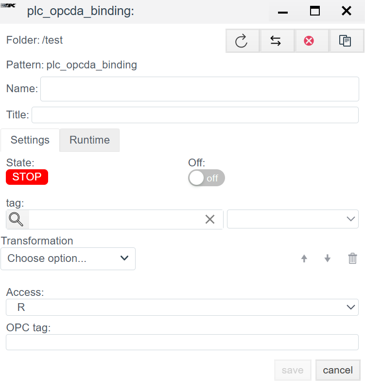

# OPC DA (Classic) Configuration Guide

> See also: [PLC Connections overview](./general_en.md)

## Overview
**OPC DA (Data Access)** is the classic industrial data exchange standard based on Microsoft DCOM. In **Faceplate**, this driver allows you to connect to external OPC servers (for example, Kepware, Matrikon, Lectus) and read data from them.

> **Important:** Because OPC DA uses DCOM, you often must configure Windows and DCOM permissions on both sides (client and server).

Configuration is done in two stages:
1. **Connection (`plc_opcda_connection`):** Connect to the OPC server.
2. **Binding (`plc_opcda_binding`):** Subscribe to specific tags.

---

## 1. Connection setup (Connection)

> Create a PLC connection -> [Create a PLC connection](./general_en.md#create-a-plc-connection)  
> Diagnostics and common settings -> [Diagnostics](./general_en.md#diagnostics)

This step specifies where the OPC server is located and how it is identified.

### 1.1 Protocol parameters (OPC DA)

Unlike other drivers, network settings here point to the host where the OPC Server runs.

| Field | Description |
| :--- | :--- |
| **IP/Hostname/Localhost** | Network address of the computer with the OPC server. *Example:* `192.168.1.5` or `localhost` (server on the same machine). |
| **Port** | **8100** (or another port if tunneling is used). *Note:* Classic OPC DA does not require a fixed TCP port (it uses DCOM/RPC, port 135), but this field may be used for specific OPC tunnels or internal proxies. |
| **ServerID** | **OPC server ProgID.** This uniquely identifies the server component in the Windows registry. *Examples:* `Kepware.KEPServerEX.V6`, `Matrikon.OPC.Simulation.1`, `ICONICS.SimulatorOPCDA.2`. |

---

## 2. Binding setup (Binding)

In OPC DA, addressing uses the tag name (Item ID).

> Create a PLC binding -> [Create a PLC binding](./general_en.md#create-a-plc-binding)

> Common binding fields are described in [Tag binding](./general_en.md#tag-binding).

### 2.1 Addressing (OPC tag)

| Field | Instruction |
| :--- | :--- |
| **OPC tag** | **Item ID.** Full path to the tag in the OPC server address space. *Examples:* - `Channel1.Device1.Tag1` - `Simulation.Ramp` - `Bucket Brigade.Int4` |

> Binding error -> [Binding errors](./general_en.md#binding-errors)

---