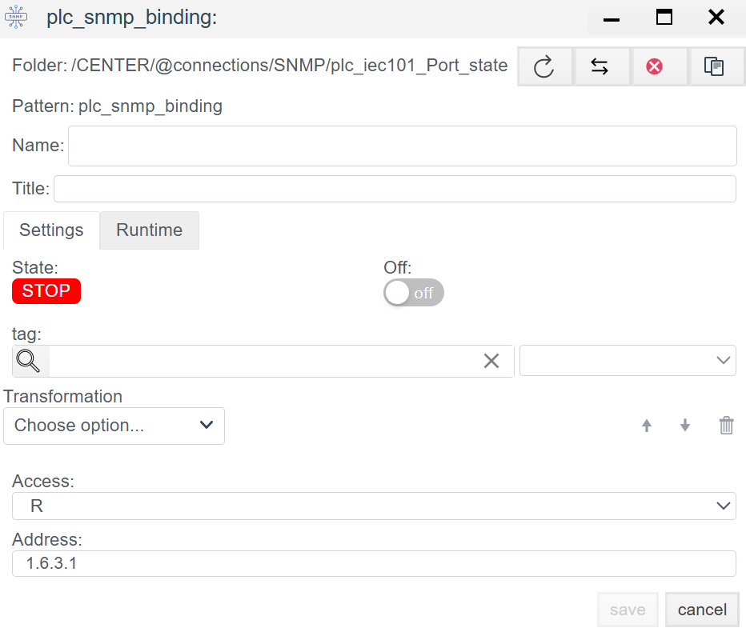

# SNMP Configuration in Faceplate

> See also: [PLC Connections overview](./general_en.md)

## Overview
**SNMP** (Simple Network Management Protocol) is an open communication protocol defined by the IETF. It is widely used to exchange data with network equipment (controllers, gateways, UPS, and so on).

Faceplate supports **SNMPv2** and **SNMPv3**.

Integration is done in two stages:
1. **Connection (`plc_snmp_connection`):** Network transport and redundancy settings.
2. **Binding (`plc_snmp_binding`):** Address specific device variables (OID).

---

## 1. Connection setup (Connection)
> Create a PLC connection -> [Create a PLC connection](./general_en.md#create-a-plc-connection)

This step creates the transport channel to the device.

> Diagnostics and common settings are described in [Common connection settings](./general_en.md#common-connection-settings).

### 1.1 Protocol parameters (SNMP)
| Field | Description |
| :--- | :--- |
| **Community** | **Community string.** Used as a password for SNMP v1/v2c. - **public** - standard read-only community. - **private** - standard read-write community. *Important: case-sensitive, must match device settings.* |
| **IP** | IP address or DNS name of the device. Examples: `192.168.1.10` (network device) or `127.0.0.1` (local agent). |
| **Port** | SNMP agent port. Standard request port: **161**. |
| **Agent** | Agent identifier or driver parameter. Used for SNMPv3 authentication; for SNMPv2 keep the default (often `0` or `1`). |

---

## 2. Binding setup (Binding)

Within the connection, create `plc_snmp_binding` objects. Each object maps to one OID on the device.

> Create a PLC binding -> [Create a PLC binding](./general_en.md#create-a-plc-binding)

> Common binding fields are described in [Common PLC binding fields](./general_en.md#common-plc-binding-fields).

### 2.1 Binding-specific parameters

| Field | Description |
| :--- | :--- |
| **Address** | **OID (Object Identifier).** Variable address in the SNMP hierarchy. *Examples:* `1.3.6.1.2.1.1.1.0` (absolute) or `1.6.3.1` (relative, if supported). |

> Binding error -> [Binding errors](./general_en.md#binding-errors)

---
