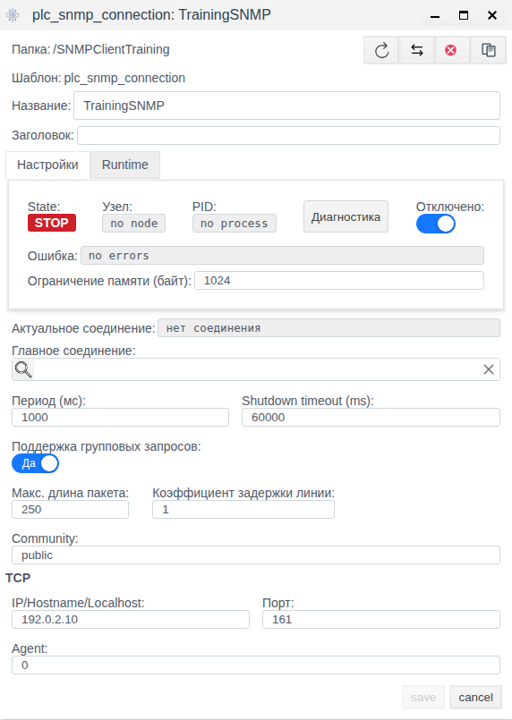
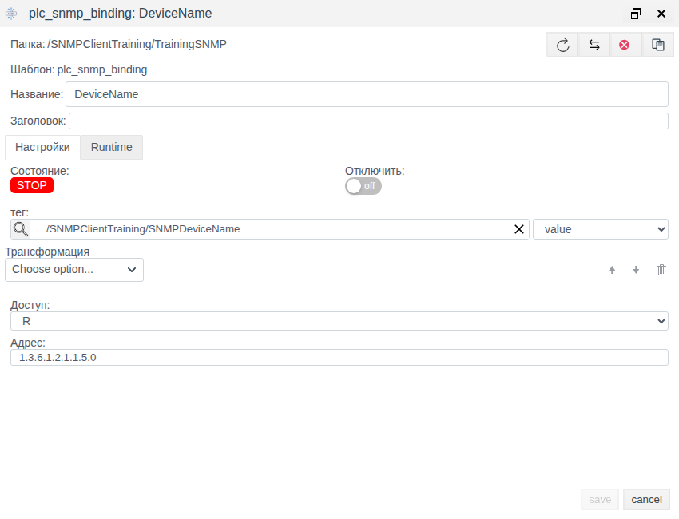

# SNMP in Faceplate: connecting devices and using MIBs

Faceplate version v4.0.7.

This article describes SNMP client configuration and the purpose of MIBs. The reference material is based on v4.0.7 source; saving and reopening forms were verified in Faceplate Studio 4.0.6.subs. Its single practical example saves a connection and binding without an available server. The connection remains disabled; receiving data, writing and exchange recovery are not tested in the example. Screenshots show the Russian interface, including mixed Russian/English labels. Russian labels below identify the actual controls; English explanations are not verified English-localization labels.

**Contents**

- [Configuration route](#configuration-route)
- [Add a numeric signal to the string example](#add-a-numeric-signal-to-the-string-example)
- [Purpose and data flow](#purpose-and-data-flow)
- [Preparing the device and MIB](#preparing-the-device-and-mib)
- [Configure the SNMP client](#configure-the-snmp-client)
- [Change settings and control exchange](#change-settings-and-control-exchange)
- [Diagnostics and recovery](#diagnostics-and-recovery)
- [Writing data: W and RW](#writing-data-w-and-rw)
- [Connection redundancy](#connection-redundancy)
- [Built-in agent and supplied MIB](#built-in-agent-and-supplied-mib)
- [Parameter and type reference](#parameter-and-type-reference)

[Connection catalogue](./index.md) · [Prepare fields and bindings](./bindings_en.md) · [Transformations](./transformation_en.md) · [Diagnostics and recovery](./diagnostics_en.md)

## Configuration route

Prepare an external source or client and a compatible tag field using the shared guide. Configure the channel, save a complete binding and verify a new value. For supported writing/reception, separately confirm the external result; after correcting a failure repeat verification with a new control value.

[Alternative channels and signal maps](./bindings_en.md#configure-an-alternative-channel) share one procedure; check driver-specific switching conditions.

## Add a numeric signal to the string example

Alongside DeviceName use a numeric OID whose type is confirmed by the agent MIB/map. For example sysServices 1.3.6.1.2.1.1.7.0 is INTEGER where the agent provides it. Prepare integer tag DeviceServices.value and R binding Services: full OID, that tag and field, empty chain, disabled until verified.

Save and independently reopen the binding. On a reachable agent, independently read the same OID and compare results. For a changeable numeric mapped parameter, cause a permitted new change and confirm it in the field; do not change system sysServices merely for testing.

Agent 0 in the illustrated form was verified by saving, not by agent exchange. Confirm registration and GET on your build before operation. W/RW and writable community do not resolve the identified SET problems: control needs separate library-compatibility and retry verification. Until then use a verified R route. The built-in agent and MIB are described below separately from the client channel.

## Purpose and data flow

SNMP can retrieve parameters from network equipment, controllers, gateways and UPS units that provide an SNMP agent. In a client connection, Faceplate acts as the **SNMP manager**, sending requests to the device agent. This driver uses **SNMPv2c, IPv4 and UDP**. This client has no SNMPv3 selector; the Agent field does not select the protocol version.

The protocol defines communication rules; the driver implements them in Faceplate. A connection stores the settings of a particular device and exchange execution. A binding selects one OID, direction, transformation and tag field. A tag is a project object; its field is the specific destination for a value or source of a command. Creating a connection does not itself create tags.

For reading, data follows this path: **device agent → OID response → connection → binding → transformation → type adaptation → selected tag field**. Each OID uses a separate request. Multiple bindings share one connection's parameters, with their own addresses and destination fields.

For writing, the direction is reversed: **tag field → type adaptation → reverse transformation → binding → command to the agent**. Writing depends on the access mode, value type, agent permissions and implementation behavior described in the W/RW section.

UDP has no TCP session. The driver can register an agent locally before receiving a device response, so connection RUN does not confirm reading a particular OID. The built-in Faceplate agent is a separate service; it is not a server mode of this PLC connection.

## Preparing the device and MIB

For a working connection, obtain the following from the manufacturer or administrator:

- An IPv4 address or name resolvable from the exchange node, the UDP port and confirmation of SNMPv2c availability.
- A community with the required permissions. It is case-sensitive; the words `public` and `private` do not themselves grant read or write access.
- A MIB or object map: the full numeric instance OID, SNMP type, meaning, units, range and access.
- An existing tag and compatible field; for writing, an authorized object and a way to verify the result independently.

The address must be reachable from the node running Faceplate exchange. `localhost` refers to that node. For DNS, use a name accepted by the form and resolving to IPv4; an arbitrary short name may fail form validation.

A **MIB** describes object names, types, access and structure. Enter a numeric address in the binding, rather than a symbolic name such as `SNMPv2-MIB::sysName.0`. A scalar needs its instance index, usually `.0`; a table requires the full row index. The driver does not add a prefix, index or missing components.

The example uses `sysName.0`, full OID `1.3.6.1.2.1.1.5.0`, the textual system name. This address demonstrates configuration; its availability and value on a real device must be checked separately. Reading a numeric OID does not require loading a MIB into the client. This driver does not provide MIB import, a tree browser or automatic binding creation from a MIB.

Check the source type before selecting a field. INTEGER and Unsigned32 remain numeric, but TimeTicks and counters can arrive as text in this implementation. Selecting a numeric field alone does not convert them; see the reference.

## Configure the SNMP client

### Starting state and training parameters

The **SNMPClientTraining** folder is prepared with execution disabled. It contains the string tag **SNMPDeviceName**, with an empty **value** field. The **TrainingSNMP** connection and **DeviceName** binding do not yet exist. In your project, use a suitable tag with an actual string field; selecting only the tag does not replace selecting a field.

Training parameters: IP `192.0.2.10`, UDP port `161`, Community `public`, period `1000` ms, Agent `0`. The address is provided for filling in the form; replace the parameters with device information in a working configuration. This example requires no server, and both folder and connection remain disabled.

### Create the connection together with its binding

1. Double-click **SNMPClientTraining** in the project tree to open it.
2. Click **Создать** (Create), expand **plc** with **+**, select **plc_snmp_connection** and click **Ok**.
3. Check **Папка** (Folder) and set **Название** (Name) to **TrainingSNMP**.
4. Turn **Отключено** (Disabled) on. Leave **Главное соединение** (Master connection) empty and **Период (мс)** (Period, ms) at `1000`.
5. Set **IP/Hostname/Localhost: 192.0.2.10**, **Порт** (Port): **161**, **Community: public**. Keep the initial `0` in **Agent** and leave the other settings unchanged.
6. Click **save** and wait for the form to close and the connection to appear in the list.
7. Select the saved **TrainingSNMP**, click **Редактировать** (Edit), and check the entered parameters and enabled **Отключено** switch. This is a separate reopening. Close the form with **cancel**.
8. Double-click **TrainingSNMP** to enter it as a folder and click **Создать**. In this context, the **plc_snmp_binding** form opens directly.
9. Set **Название** to **DeviceName** and replace **Адрес** (Address) with the full OID `1.3.6.1.2.1.1.5.0`.
10. Click the search button beside **тег** (tag), select the existing **SNMPDeviceName** in the training folder and confirm with **ОК**. Explicitly select **value** in the adjacent field list.
11. Keep **Доступ** (Access): **R**, empty **Трансформация** (Transformation), and the binding's own **Отключить** (Disable) switch off. The disabled folder and connection continue to prevent exchange.
12. Click **save**. After the form closes, select **DeviceName**, click **Редактировать**, and separately verify the OID, tag, **value** field, R and empty transformation.
13. Close the form with **cancel** and return to the training folder. **TrainingSNMP** should retain **Runtime: ВЫКЛ** (Off) and **State: Stop**.

The connection form labels its network block **TCP**. This is the actual interface label; this SNMP driver uses UDP. **Shutdown timeout (ms)** is not the device response timeout. SNMP request timeout and retry-count editors are not displayed on the inspected **Настройки** (Settings) tab; no entry for them is required in this step.

In the inspected form, Agent is a text input containing `0`. The v4.0.7 driver model's initial identifier is the string `agent engine`. Saving and reopening the UI value were confirmed; its suitability during exchange was not tested. The **Agent** label does not mean SNMPv3 authentication configuration.

Figure 1. Reopened connection: training address, Agent and disabled execution.

Figure 2. One R binding inside the connection: full OID and selected value field.

The example's result is saved and independently reopened configuration. STOP, **no process**, **нет соединения** (no connection) and the initially empty field match this example. **no errors** does not prove device availability here. The initial tag value is not an SNMP result.

## Change settings and control exchange

To change a saved object, select it in the tree and click **Редактировать**. After **save**, close and reopen the form to check persistence. Changing executable settings can recreate the connection process; when a device is available, check the result using the individual binding and new data.

**Отключено** in the connection controls all its exchange. **Отключить** in a binding excludes one channel. Parent folders and dependencies must also permit execution. A binding's own **Runtime: ВКЛ** (On) does not mean the connection is working: in the training setup, the parent is disabled and the binding remains STOP.

The period applies to a complete pass over the bindings. If the pass finishes before the period expires, it waits; if it takes longer, the next cycle starts without an additional pause. The period therefore does not guarantee a new value after precisely that number of milliseconds. Failed requests and retries increase the pass duration.

Use distinct connection names, including across different folders: the name participates in the manager's shared agent registration. Re-registration updates address, port and community, but changing Agent in the form does not guarantee updating an existing registration. Stopping the connection does not itself remove that registration.

### Value transformation

In **Трансформация**, read operations run from top to bottom and write operations in reverse order. An empty chain passes the value unchanged. W/RW requires reverse-direction support for every operation. Available methods:

- **Scaling**: `Y = X × Factor + Shift`. Initially Factor is `1`, Shift `0`. Reverse transformation requires a nonzero Factor. Factor is a multiplier; Shift is an offset in the units of this step's output.
- **Default Value**: initially Value is `0`. Reading preserves numeric input and replaces nonnumeric input, including missing values or strings, with the configured number. Writing is an identity operation. Substitution can mask missing communication with a visible number; check state and error separately.
- **Limit Control**: Lower Limit and Upper Limit initially are `0`; the upper limit must be greater than the lower before use. Reading turns values outside the inclusive interval into missing values. Writing clamps numeric values to the nearest boundary.
- **Integration**: no user parameters, R only. The first result is missing; later calls accumulate the current input multiplied by elapsed milliseconds. Result units are signal units × ms. This is current calculation state, reset when the binding is reinitialized, rather than a persistent historical total.
- **Derivative**: no user parameters, R only. The first result is missing; subsequent results are the signal change divided by milliseconds. Units are signal units / ms.
- **Damper**: smoothing, initially Tlag `1`, a positive value in milliseconds. The first numeric input passes directly; writing passes without smoothing or reverse reconstruction of the original signal.
- **Скрипт** (Script): Erlang processing for R only. Receives Input, Context and State and returns `{Output, State}`. Configure context using Variable/Tag/Field; initial state is `undefined`. Compile validation does not prove the result is correct for real data.

For Scaling, Limit Control, Integration, Derivative and Damper, nonnumeric input produces a missing result; Default Value substitutes for it, while Script follows the configured logic. Numeric operations do not convert counter text to a number. Such processing first requires explicit type conversion; a script chain is read-only R. A transformation error or failure to write the result into the field does not always change the binding's overall RUN, so check the actual field. Default Value replaces a returned nonnumeric value but does not catch an exception from a preceding operation.

## Diagnostics and recovery

Start with execution permission, connection state and the individual binding. For each signal, check the full OID, index, SNMP type, destination field and transformation. Overall RUN is insufficient.

| Observation | Meaning | What to check |
|---|---|---|
| Disabled, STOP, no process | Execution stopped or not started | Own switches, parent folders and dependencies; this is intentional in the example |
| Connection RUN | A process is running; the agent may have been registered locally | The specific OID response, binding error and new field value |
| no errors on a disabled connection | No current error message | Do not treat this as a device test |
| Address or name-resolution error | Invalid input or a name not resolving to IPv4 | Address, form-accepted format and resolution from the exchange node |
| Waiting for a response / read error | A request did not produce a valid result | UDP port and route, community, permissions, OID, agent availability and pass duration |
| noSuchObject / noSuchInstance | The agent reports a missing object or instance | Full OID and index; these responses can become text values even with RUN |
| Binding RUN, but the field is empty or wrong | Transformation error, field incompatibility or result-write failure is possible | Response type, selected field, chain and diagnostic messages |
| Old or substituted value | Freshness is not confirmed | Source of a new change, access mode, state and substitutions |

The **Диагностика** (Diagnostics) button opens connection message collection. **Start/Stop** control collection, not exchange. **Log level** selects detail, **Log limit** limits the buffer, clear removes displayed messages, and copy puts accumulated messages on the clipboard. An empty log does not prove communication is healthy. The single example did not reproduce the diagnostic window or network errors.

A read error can send the transformation's missing-value result into the field. Disabling an individual binding can leave its destination field's previous value. When an active connection fails or stops, the common mechanism sends the missing-value transformation result to destination fields. Do not expect the same zero or empty text whenever exchange stops.

When a device is available, verify recovery by recording the last value, restoring access and obtaining a new known source change. Compare it with the tag field and binding error. An unchanged old number or disappearing error is insufficient; account for the imported type of a changing counter. This is a working-connection verification procedure, not a completed test of the training example.

## Writing data: W and RW

**R** polls a value. **W** is excluded from reading and initiates writing when the selected field changes, when an active W binding is initialized, and upon reactivation; the client mechanism skips an originally missing value. **RW** reads and reacts to external field changes. Updating the field through its own reading does not generate a reverse command. Changes without a connection should not be treated as a guaranteed command queue.

Writing requires a writable OID, the necessary community permissions, a suitable type and a reversible chain. The driver chooses the command type from the value, rather than a loaded MIB: integers are sent as INTEGER, fractional values are rounded to integers and bool becomes `1`/`0`. Do not assume arbitrary text, Counter, OID or IPAddress writing merely because W/RW is available. Before reverse transformation, a string field is parsed as a number; nonnumeric text can become a missing value.

In the researched implementation, the SET call does not match the API in the researched OTP27.2.3 source; the actually loaded library was not checked in the example. After the first SET fails, retrying can also end in an internal error instead of another write attempt. A reverse-transformation error does not guarantee suppressing the command: a value can be sent without the intended reverse conversion. Check these circumstances on a bench intended for writing. The training example remains R and does not test SET.

Command acknowledgement, independent result reading and an equipment effect are distinct checks. A successful status alone does not confirm a physical action.

## Connection redundancy

The **Главное соединение** (Master connection) field links a backup object to a master of the same type. The backup stores alternative connection parameters and is disabled as an independent executor; the master services the bindings. Chains of master connections are not allowed.

Trying alternative connections is associated with a connection error, rather than any failed OID. With SNMP, local agent registration can succeed while the device is unavailable, after which GET reports an individual binding error. Automatic switching for every GET timeout is therefore not guaranteed. Verify redundancy using actual responses and a new value; the training example leaves the master field empty and does not test switching.

## Built-in agent and supplied MIB

The application environment attempts to start the built-in Faceplate agent and local manager. They have their own configuration and state, separate from an individual client's settings. The values below belong to the supplied configuration; a running instance can use persisted state.

| Service parameter | Supplied value | Interpretation |
|---|---|---|
| Agent address and port | `127.0.0.1`, UDP `4000` | Separate Faceplate service; not the device address in the client |
| Manager address and port | `127.0.0.1`, UDP `5000` | Local request side; not the remote agent port |
| Service identifiers | `faceplate agent`, `manager's engine` | Separate from an individual connection's Agent field |
| Maximum message size | `484` bytes | Supplied SNMP setting; the common PLC maximum-packet-length field does not replace it |
| Built-in agent community and access | `public`; reading of the permitted branch, no writing for this access | Access configuration, rather than the word public, determines permissions |
| Standard information | sysName `FACEPLATE`, sysDescr `Erlang/OTP Agent`, sysLocation `FACEPLATE` | Describes the agent rather than arbitrary project tags |
| Notification destination | `127.0.0.1`, UDP `162` | Destination configuration alone does not confirm notifications are sent |
| SNMPv3 users | No users in the supplied user list | Agent library capabilities do not add SNMPv3 to the client driver |

The `127.0.0.1` entry in these files does not prove the socket is restricted to loopback: with standard settings of the researched library, UDP can listen on all IPv4 interfaces. An administrator checks the actual address, access and loaded MIBs separately; the example did not use this service as a source.

**FACEPLATE-MIB** contains OID namespaces and notification definitions. These definitions do not create an automatic link to project tag fields. No ready-made configuration for publishing arbitrary tags, sending their alarms or writing incoming traps into tags was found in this module. Branch and notification names should not be mistaken for already working signals.

Initialization compiles and loads the MIB separately from the client form. Look for failures in SNMP initialization messages; a MIB file or running process does not confirm successful loading. The article does not assume a general UI MIB-import function for this service.

## Parameter and type reference

### Connection

The table distinguishes form values from settings known from the driver model. UI ranges do not guarantee that every value is suitable for a particular device.

| Field | Initial value / example | Purpose and check |
|---|---|---|
| Название (Name) | Empty / TrainingSNMP | Connection name; use distinct names |
| Заголовок (Title) | Empty | Optional description |
| Отключено (Disabled) | Off / on | Own execution permission; account for parent restrictions |
| Community | `public` | Agent access string; obtain permissions from the administrator |
| IP/Hostname/Localhost | Empty, placeholder `127.0.0.1` / `192.0.2.10` | External agent address resolving to IPv4 from the exchange node |
| Порт (Port) | `161`; UI `1–65535` | External agent UDP port |
| Agent | `0` in the form and after reopening | Registration identifier; saving does not confirm exchange execution |
| Период (мс) (Period, ms) | `1000`; UI `1–3600000` | Period of a complete pass over the bindings |
| Shutdown timeout (ms) | `60000`; UI `10–3600000` | Process shutdown wait, not an SNMP response timeout |
| Поддержка групповых запросов (Group request support) | Да (Yes) | SNMP lacks this PLC scheduler's grouped operations; it does not enable GETBULK |
| Макс. длина пакета (Maximum packet length) | `250`; UI `1–10000` | Common grouping field; does not set this driver's SNMP message size |
| Коэффициент задержки линии (Line latency factor) | `1`; UI `1–10` | Common grouping field; not a separate delay between SNMP requests |
| Главное соединение (Master connection) | Empty | Links a backup object to a master of the same type |
| Ограничение памяти (байт) (Memory limit, bytes) | Empty in the new form; `1024` after saving | Despite the label, the implementation interprets the number in MiB: `1024` MiB. Do not recalculate it as bytes |
| SNMP request timeout | Model value `100` ms | Wait for one request; no separate editor on the inspected Настройки tab |
| SNMP request retries | Model value `1` | Additional GET attempts: up to `2` requests on error; no separate editor on the inspected tab |
| State, Узел (Node), PID | System-managed | Process state, node and identifier; STOP/no node/no process in the example |
| Ошибка (Error) | System-managed | Current message; no errors does not prove data reception |
| Актуальное соединение (Actual connection) | System-managed | Selected channel; нет соединения in the example |

### Binding

| Field | Initial value / example | Purpose and check |
|---|---|---|
| Папка (Folder) | Parent connection | Verify it belongs to TrainingSNMP |
| Название (Name) | Empty / DeviceName | Individual channel name |
| Заголовок (Title) | Empty | Optional signal description |
| Адрес (Address) | `1.6.3.1` in the new form / `1.3.6.1.2.1.1.5.0` | Enter the full numeric OID; the initial short form value fails its own length validation |
| тег (tag) | Unselected / SNMPDeviceName | Existing project object; no automatic signal creation |
| Field beside тег | Unselected / `value` | Explicitly select it after the tag; appearing in the list does not prove type compatibility |
| Доступ (Access) | R; options R/W/RW | Exchange direction subject to driver and agent capabilities |
| Отключить (Disable) | Off | Excludes one binding; parent disabling applies separately |
| Трансформация (Transformation) | Empty | Processing chain; W/RW requires reverse-direction support |
| Состояние, error, value | System-managed | Individual signal result; also check the actual tag field |

Delivery into the project requires both tag and field. Without this link, the binding's own value can update without data reaching the intended tag.

### SNMP types and tag field

| SNMP type / direction | Conversion result | Considerations |
|---|---|---|
| INTEGER, Unsigned32 on reading | Number | For a numeric field; conversion to integer rounds fractions, and conversion to bool uses threshold `0.5` |
| OCTET STRING on reading | Text through Unicode conversion | Suitable for a string field; arbitrary binary data requires encoding checks |
| BITS on reading | Binary after conversion of bits into octets and Unicode | Does not automatically create separate digital channels |
| TimeTicks, Counter32, Counter64, Gauge32 and other types | Textual value representation | A numeric field does not parse this text automatically; numeric operations require explicit conversion |
| noSuchObject / noSuchInstance | Can become value text | Check response meaning even if the binding is RUN |
| Integer / float / bool on writing | INTEGER; float rounded, bool as `1`/`0` | Command type follows the value rather than a local MIB; SET was not tested in the example |

Units come from the device map and your transformation. The client does not obtain the engineering meaning of a number automatically from the presence of an OID or MIB.
